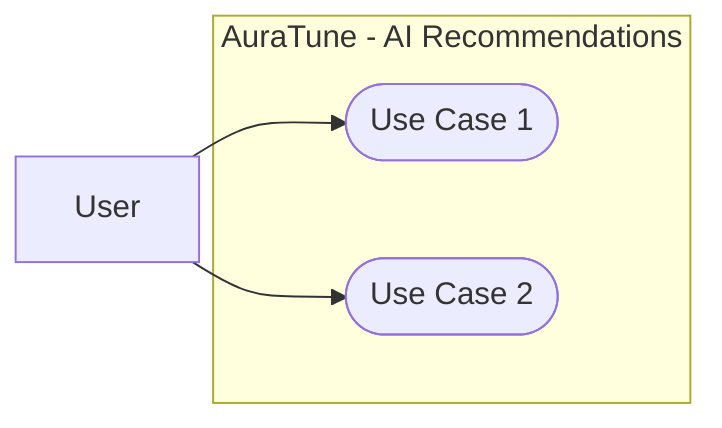

# Nhật ký sử dụng AI – Listening History Analysis

_Mỗi lần dùng AI được ghi thành một mục riêng theo trình tự thực hiện._

| #   | Ngày       | Nội dung                                                                                                         | Nhóm                                              |
| --- | ---------- | ---------------------------------------------------------------------------------------------------------------- | ------------------------------------------------- |
| 1   | 2026-10-20 | Viết spec 101 – Listening History Analysis bằng `$speckit-specify`                                               | 10                                                |
| 2   | 2026-10-20 | Làm rõ spec 101 bằng `$speckit-clarify` – insight, nguồn dữ liệu và lịch sử hợp lệ                               | 10                                                |
| 3   | 2026-10-20 | Tiếp tục làm rõ spec 101 bằng `$speckit-clarify` – cách hiển thị, thời gian và xếp hạng thể loại                 | 10                                                |
| 4   | 2026-10-24 | Hoàn thiện metadata Performed by / Reviewed by / Edited by cho Project Plan theo phân công DL4 và bằng chứng Git | Project Plan / DL4 (không thuộc functional group) |
| 5   | 2026-10-30 | Viết spec 102 – Personalized Recommendations bằng `/speckit-specify` và tích hợp làm rõ                          | 10                                                |
| 6   | 2026-10-30 | Viết spec 103 – Mood and Context Recommendations bằng `/speckit-specify`                                         | 10                                                |
| 7   | 2026-10-30 | Làm rõ spec 103 bằng `/speckit-clarify` – phương thức nhập, nội dung đề xuất và fallback                         | 10                                                |
| 8   | 2026-10-30 | Viết spec 121 – Conversational Interface bằng `/speckit-specify`                                                 | 12                                                |
| 9   | 2026-10-30 | Làm rõ spec 121 bằng `/speckit-clarify` – vòng đời hội thoại, định dạng tin nhắn và xử lý lỗi                    | 12                                                |
| 10  | 2026-10-30 | Viết spec 122 – Music Intent Understanding bằng `/speckit-specify`                                               | 12                                                |
| 11  | 2026-10-30 | Làm rõ spec 122 bằng `/speckit-clarify` – danh mục ý định, smart defaults và kiến trúc orchestrator              | 12                                                |
| 12  | 2026-10-30 | Viết spec 123 – Real-Time Music Assistance bằng `/speckit-specify`                                               | 12                                                |
| 13  | 2026-10-30 | Làm rõ spec 123 bằng `/speckit-clarify` – danh mục hành động, điều phối client và widget phản hồi                | 12                                                |
| 14  | 2026-11-01 | Rà soát và làm rõ toàn diện 12 nhóm chức năng (010 – 120) và đồng bộ liên nhóm trước PA3                         | Toàn bộ 12 nhóm chức năng (010 – 120)             |
| 15  | 2026-11-03 | Xây dựng Use-Case Model hệ thống, hướng dẫn đặc tả Use Case (README) và tạo khung thư mục 12 nhóm cho PA3        | Toàn bộ 12 nhóm chức năng (010 – 120)             |
| 16  | 2026-11-03 | Xây dựng Use-Case Documentation cho Group 100 – AI Recommendations theo chuẩn PA3 và Spec Kit                    | 10 – AI Recommendations                           |

---

## Mục 1: Viết spec 101 – Listening History Analysis

| Trường                   | Nội dung                                                                                                                         |
| ------------------------ | -------------------------------------------------------------------------------------------------------------------------------- |
| Ngày                     | 2026-10-20                                                                                                                       |
| Người thực hiện          | Nhựt                                                                                                                             |
| Nhóm tính năng liên quan | 10 – AI Recommendations, Feature 101: Listening History Analysis (`specs/100-ai-recommendations/101-listening-history-analysis`) |
| Công cụ AI               | Codex (GPT-6), `$speckit-specify`                                                                                                |
| Mục đích                 | Đối chiếu tài liệu dự án và tạo đặc tả nghiệp vụ; ghi nhận các điểm chưa đủ căn cứ thay vì tự đặt thuật toán hoặc chỉ số.        |

### Prompt đã dùng

```text
$speckit.specify SPECIFY_FEATURE_DIRECTORY=specs/100-ai-recommendations/101-listening-history-analysis

Người dùng AuraTune sử dụng tính năng phân tích lịch sử nghe nhạc để hiểu thói quen và sở thích âm nhạc của mình. Hệ thống phân tích dữ liệu lịch sử nghe hiện có để xác định các thông tin hữu ích về hoạt động nghe nhạc của người dùng, trong phạm vi được tài liệu dự án cho phép. Làm rõ người dùng có thể xem những thông tin phân tích nào, dữ liệu lịch sử nghe được sử dụng ra sao, và hành vi khi người dùng chưa có đủ lịch sử nghe hoặc dữ liệu không khả dụng. Kết quả phân tích phải gắn với đúng tài khoản và không được để người dùng truy cập dữ liệu nghe của tài khoản khác.

Không bao gồm: tạo danh sách gợi ý bài hát cá nhân hóa (spec `102-personalized-recommendations`), gợi ý dựa trên tâm trạng hoặc ngữ cảnh (spec `103-mood-and-context-recommendations`), phát nhạc, tìm kiếm nhạc hoặc quản lý lịch sử nghe gốc. Không tự đặt thuật toán phân tích, chỉ số thống kê hoặc mô hình AI nếu tài liệu nguồn chưa xác định.

Dữ liệu và quy tắc: đối chiếu `docs/proposal/proposal.md`, `docs/management/team-contract.md`, `docs/design/database/README.md`, API contract và các spec liên quan. Làm rõ dependency với Listening History và các dữ liệu người dùng hiện có. Nếu chưa xác định được dữ liệu đầu vào, chỉ số phân tích hoặc cách hiển thị kết quả, ghi nhận là điểm cần clarification.
```

### Tóm tắt phản hồi của AI

- Đối chiếu proposal, team contract, thiết kế database, API contract, cấu trúc specs và tài liệu liên quan.
- Tạo spec gồm user stories, functional requirements, edge cases, entities, success criteria, assumptions và checklist chất lượng.
- Ghi nhận các điểm cần làm rõ: đầu ra và ranh giới với Group 070, nguồn dữ liệu/độ đủ lịch sử, cách hiển thị và độ mới của kết quả.
- Đưa yêu cầu cách ly dữ liệu theo tài khoản và giới hạn rõ việc không tạo gợi ý bài hát, gợi ý theo tâm trạng/ngữ cảnh, phát nhạc, tìm kiếm hoặc quản lý lịch sử gốc.

### Phần đã sử dụng / chỉnh sửa / bỏ

| Phần                     | Quyết định                       | Lý do                                                                                                                                       |
| ------------------------ | -------------------------------- | ------------------------------------------------------------------------------------------------------------------------------------------- |
| Phạm vi và dependency    | Dùng, sau đó làm rõ bằng clarify | Bám proposal; Listening History là dependency, các chức năng phát nhạc, tìm kiếm, quản lý history và recommendation khác nằm ngoài phạm vi. |
| Dữ liệu và chỉ số        | Ghi nhận là cần clarification    | Nguồn có `listening_history` và `user_listening_stats` nhưng chưa xác định rõ quy tắc sử dụng hoặc tính toán.                               |
| Bảo vệ dữ liệu tài khoản | Dùng                             | Đáp ứng yêu cầu riêng tư và quy tắc bảo mật về quyền sở hữu lịch sử nghe.                                                                   |

### Cách kiểm chứng

- Đối chiếu với `docs/proposal/proposal.md`, `docs/management/team-contract.md`, `docs/design/database/README.md`, `docs/design/database/security-rules.md` và `docs/analysis-and-design/api-contract.md`.
- Rà soát phạm vi, acceptance scenarios, edge cases, dependencies và checklist chất lượng.
- Không chạy tests vì đây là công việc đặc tả.

**Kết quả kiểm chứng:** Đạt sau khi làm rõ bằng `$speckit-clarify`.

**Ghi chú:** Spec nằm tại `specs/100-ai-recommendations/101-listening-history-analysis/spec.md`; checklist nằm trong thư mục `checklists/`.

---

## Mục 2: Làm rõ spec 101 – lượt `$speckit-clarify` thứ nhất

| Trường                   | Nội dung                                                                       |
| ------------------------ | ------------------------------------------------------------------------------ |
| Ngày                     | 2026-10-20                                                                     |
| Người thực hiện          | Nhựt                                                                           |
| Nhóm tính năng liên quan | 10 – AI Recommendations, Feature 101: Listening History Analysis               |
| Công cụ AI               | Codex (GPT-6), `$speckit-clarify`                                              |
| Mục đích                 | Làm rõ các đầu ra phân tích, dữ liệu đầu vào và điều kiện lịch sử nghe hợp lệ. |

### Prompt đã dùng

```text
$speckit-clarify
```

_Skill `speckit-clarify` được cung cấp kèm invocation; feature context là spec 101 đang hoạt động._

### Tóm tắt phản hồi của AI

- Hỏi tuần tự và ghi câu trả lời vào spec sau mỗi quyết định.
- Chốt đầu ra là tổng thời lượng nghe và top thể loại; top bài hát và nghệ sĩ thuộc Group 070.
- Chốt chỉ dùng `listening_history`, không dùng `user_listening_stats`, likes, follows hoặc dữ liệu tài khoản khác làm đầu vào.
- Chỉ tính lượt nghe gắn với đúng user và bài hát hợp lệ; tối thiểu một lượt. Báo insight không khả dụng khi thiếu metadata cần thiết.

### Phần đã sử dụng / chỉnh sửa / bỏ

| Phần                                  | Quyết định | Lý do                                                                                           |
| ------------------------------------- | ---------- | ----------------------------------------------------------------------------------------------- |
| Tổng thời lượng và top thể loại       | Dùng       | Proposal nêu các insight này; tránh lặp top bài hát/nghệ sĩ của Group 070.                      |
| `listening_history` là nguồn duy nhất | Dùng       | Không tự dựa vào dữ liệu tổng hợp hoặc dữ liệu tài khoản khác khi quy tắc chưa được duyệt.      |
| Điều kiện hợp lệ và thiếu metadata    | Dùng       | Chỉ phân tích sự kiện quy thuộc được cho user/song; không suy đoán khi thiếu dữ liệu cần thiết. |

### Cách kiểm chứng

- Đối chiếu quyết định với database README, API contract, security rules và proposal.
- Kiểm tra các cập nhật trong clarification log, requirements, acceptance scenarios và edge cases.
- Không chạy tests vì thay đổi chỉ cập nhật yêu cầu.

**Kết quả kiểm chứng:** Đạt.

**Ghi chú:** Cách trình bày, time range, thời điểm làm mới và tiêu chí xếp hạng thể loại còn được làm rõ ở lượt tiếp theo.

---

## Mục 3: Làm rõ spec 101 – lượt `$speckit-clarify` thứ hai

| Trường                   | Nội dung                                                                               |
| ------------------------ | -------------------------------------------------------------------------------------- |
| Ngày                     | 2026-10-20                                                                             |
| Người thực hiện          | Nhựt                                                                                   |
| Nhóm tính năng liên quan | 10 – AI Recommendations, Feature 101: Listening History Analysis                       |
| Công cụ AI               | Codex (GPT-6), `$speckit-clarify`                                                      |
| Mục đích                 | Chốt cách trình bày, phạm vi thời gian, làm mới kết quả và tiêu chí xếp hạng thể loại. |

### Prompt đã dùng

```text
$speckit-clarify
```

_Skill `speckit-clarify` được cung cấp kèm invocation; feature context là spec 101 đang hoạt động._

### Tóm tắt phản hồi của AI

- Chốt kết quả ở dạng tóm tắt và danh sách, bao phủ toàn bộ lịch sử hợp lệ; làm mới khi người dùng mở lại phân tích.
- Chốt xếp hạng thể loại theo tổng thời lượng đã nghe.
- Cập nhật user scenarios, functional requirements, entities và clarification log.
- Sau khi cập nhật, spec không còn clarification markers; checklist có 16/16 mục được đánh dấu đạt.

### Phần đã sử dụng / chỉnh sửa / bỏ

| Phần                          | Quyết định | Lý do                                                                                  |
| ----------------------------- | ---------- | -------------------------------------------------------------------------------------- |
| Tóm tắt và danh sách          | Dùng       | Trình bày insight rõ ràng mà không tự thêm dạng hiển thị chưa được yêu cầu.            |
| Toàn bộ lịch sử hợp lệ        | Dùng       | Không tự đặt time range tuần/tháng khi nguồn không quy định.                           |
| Làm mới khi mở phân tích      | Dùng       | Xác định hành vi cập nhật sau khi history thay đổi mà không yêu cầu cập nhật tức thời. |
| Xếp hạng theo tổng thời lượng | Dùng       | Định nghĩa “top thể loại” để acceptance test nhất quán.                                |

### Cách kiểm chứng

- Kiểm tra các câu trả lời nhất quán trong clarification log, stories, requirements và entities; xác nhận không còn clarification markers.
- Checklist: 14/16 mục trước khi tích hợp các câu trả lời còn lại, 16/16 sau khi cập nhật; không có mục bị thoái lui.
- Không chạy tests vì đây là cập nhật spec/checklist, chưa có implementation.

## Mục 4: Hoàn thiện metadata quyền sở hữu các section của Project Plan

| Trường                   | Nội dung                                                                                                                                                                        |
| ------------------------ | ------------------------------------------------------------------------------------------------------------------------------------------------------------------------------- |
| Ngày                     | 2026-10-24                                                                                                                                                                      |
| Người thực hiện          | Nhựt                                                                                                                                                                            |
| Nhóm tính năng liên quan | Project-wide: Project Plan, các section được ánh xạ theo DL4; không gắn với functional group riêng                                                                              |
| Công cụ AI               | Codex (GPT-6)                                                                                                                                                                   |
| Mục đích                 | Cập nhật metadata Performed by và Reviewed by theo bảng phân công DL4; xác định Editor từ nội dung section và Git diff/history có sẵn, không suy đoán với heading thiếu căn cứ. |

### Prompt đã dùng (tóm lược)

    Chỉnh sửa docs/proposal/project_plan.md để hoàn thiện metadata cho các heading thuộc PA2 theo bảng phân công DL4. Ánh xạ Performer và Reviewer theo nội dung công việc. Với section đã được chỉnh sửa trước đây, đặt Editor là Lê Công Minh Nhựt; với section chưa chỉnh sửa, giữ Editor ban đầu theo phân công. Đối chiếu Git diff/history nếu có thể; nếu không đủ căn cứ thì giữ Editor hiện tại và ghi rõ cần xác minh thủ công. Chỉ sửa metadata, bảo toàn các thay đổi chưa commit, không truy cập Jira/Google Sheets, không sửa file khác và không commit/push.

### Tóm tắt phản hồi của AI

- Kiểm tra trạng thái repository và Git history/diff hiện có trước khi sửa; giữ nguyên thay đổi chưa commit ngoài phạm vi.
- Cập nhật metadata cho 70 heading thuộc mapping DL4, ánh xạ Performer/Reviewer theo task và đặt metadata ngay sau heading.
- Đối chiếu Editor với baseline Git: đổi Editor từ một giá trị khác sang Lê Công Minh Nhựt ở 8 heading; giữ Editor đã là Lê Công Minh Nhựt tại 4.1; giữ Editor baseline ở section không đổi; với section không có metadata baseline, dùng Performer cho section không đổi và Lê Công Minh Nhựt cho section có nội dung khác baseline.
- Không gán ownership theo số của heading tổng quan 2–4. Giữ trạng thái hiện tại ở các heading không có task mapping rõ ràng.

### Phần đã sử dụng / chỉnh sửa / bỏ

| Phần                  | Quyết định                                             | Lý do                                                                                                                   |
| --------------------- | ------------------------------------------------------ | ----------------------------------------------------------------------------------------------------------------------- |
| Performer và Reviewer | Dùng mapping DL4 cho 70 heading                        | Mapping được cung cấp rõ; kiểm tra lại để bảo đảm reviewer khác performer.                                              |
| Editor                | Dùng Git diff/history sẵn có và quy tắc của người dùng | Không suy ra người chỉnh sửa từ số heading; khi thiếu dữ liệu baseline, giữ hoặc dùng trạng thái được quy tắc cho phép. |
| Heading tổng quan 2–4 | Không tự ánh xạ vào task nội dung                      | Đây là heading tích hợp, không thuộc mapping section; mục 3 và 4 còn cần xác minh lịch sử Editor thủ công.              |
| Nội dung chuyên môn   | Không sửa trong lượt metadata này                      | Phạm vi yêu cầu chỉ là metadata; các thay đổi nội dung chưa commit từ lượt trước được giữ nguyên.                       |

### Cách kiểm chứng

- Đếm và kiểm tra 73 heading đánh số, gồm 70 heading thuộc mapping DL4; xác nhận đủ metadata ngay sau heading.
- So sánh Performer/Reviewer với mapping: không có mismatch; tất cả reviewer khác performer.
- Chạy git diff --check: không có lỗi whitespace; Git chỉ in cảnh báo chuyển đổi line ending.
- Kiểm tra git status và git diff --name-only: project_plan.md là file tracked duy nhất được chỉnh sửa; docs/PA/ vẫn là thay đổi untracked có sẵn.
- In diff tích lũy của project_plan.md ra terminal theo các đoạn vì output vượt giới hạn hiển thị. Diff còn bao gồm nội dung đã chỉnh sửa ở các lượt trước; không dùng nó để khẳng định lịch Jira đã được xác minh.
- Không truy cập Jira hoặc Google Sheets; không render/kiểm tra trực quan PDF; không commit hoặc push.

**Kết quả kiểm chứng:** Đạt cho mapping Performer/Reviewer và định dạng metadata của 70 heading DL4.

**Ghi chú:** Git history khả dụng chỉ có baseline commit b2a4e88. Metadata Editor của heading tổng quan 3 và 4 cần xác minh thủ công vì baseline không có metadata cho hai heading này; trạng thái hiện tại được giữ nguyên.

---

## Mục 5: Viết spec 102 – Personalized Recommendations

| Trường                   | Nội dung                                                                                                                                  |
| ------------------------ | ----------------------------------------------------------------------------------------------------------------------------------------- |
| Ngày                     | 2026-10-30                                                                                                                                |
| Người thực hiện          | Nhựt                                                                                                                                      |
| Nhóm tính năng liên quan | 10 – AI Recommendations, Feature 102: Personalized Recommendations (`specs/100-ai-recommendations/102-personalized-recommendations`)      |
| Công cụ AI               | Antigravity (Gemini 2.5 Flash / Flash High), `/speckit-specify`                                                                           |
| Mục đích                 | Đối chiếu tài liệu dự án để tạo đặc tả nghiệp vụ, làm rõ hành vi cold-start, xử lý lỗi service AI và phân định phạm vi với các spec khác. |

### Prompt đã dùng

```text
/speckit-specify SPECIFY_FEATURE_DIRECTORY=specs/100-ai-recommendations/102-personalized-recommendations

Người dùng AuraTune nhận danh sách gợi ý âm nhạc được cá nhân hóa theo lịch sử nghe và sở thích của mình. Hệ thống cung cấp các đề xuất phù hợp với từng người dùng dựa trên dữ liệu và quy tắc đã được xác định trong tài liệu dự án. Người dùng có thể xem danh sách đề xuất và chọn nội dung để mở bài hát, album, nghệ sĩ hoặc playlist tương ứng nếu loại nội dung đó được hỗ trợ. Làm rõ hành vi khi người dùng mới chưa có đủ dữ liệu nghe, danh sách đề xuất trống, dữ liệu cá nhân hóa chưa cập nhật hoặc dịch vụ AI không khả dụng. Đề xuất của mỗi người dùng phải được phân tách đúng theo tài khoản và không để lộ dữ liệu cá nhân của người khác.

Không bao gồm: phân tích và hiển thị thống kê lịch sử nghe (spec `101-listening-history-analysis`), gợi ý theo tâm trạng hoặc ngữ cảnh (spec `103-mood-and-context-recommendations`), tìm kiếm âm nhạc, phát nhạc, quản lý lịch sử nghe hoặc chức năng trò chuyện với AI (AI Conversational Agent). Không tự quyết định thuật toán gợi ý, mô hình AI, tiêu chí xếp hạng hoặc cơ chế cập nhật nếu tài liệu nguồn chưa xác định.

Dữ liệu và quy tắc: đối chiếu `docs/proposal/proposal.md`, `docs/management/team-contract.md`, `docs/design/database/README.md`, API contract và các spec liên quan trong repository. Làm rõ dependency với Listening History, Songs, Albums, Artists, Playlists và Music Player. Nếu tài liệu chưa xác định loại nội dung được đề xuất, dữ liệu đầu vào, tiêu chí cá nhân hóa hoặc hành vi khi lỗi, ghi nhận là điểm cần clarification thay vì tự giả định.
```

Lượt phản hồi làm rõ tiếp theo:

```text
1B, 2A, 3A
```

### Tóm tắt phản hồi của AI

- Đối chiếu Proposal, Vision Document, Team Contract, Thiết kế Database, API Contract (`/recommendations/songs`, `/ai/recommend`) và Feature Modules.
- Khởi tạo cấu trúc spec chuẩn Spec Kit gồm User Scenarios (P1, P2), Functional Requirements (FR-001 đến FR-015), Key Entities, Success Criteria (SC-001 đến SC-005), Assumptions và Checklist kiểm tra chất lượng.
- Nhận diện 3 điểm cần làm rõ và đặt câu hỏi tương tác theo chuẩn Spec Kit:
  1. Loại thực thể đề xuất: Chọn Option 1B (Đa thực thể: Bài hát, Album, Nghệ sĩ, Playlist).
  2. Xử lý cold-start / người dùng mới: Chọn Option 2A (Fallback về danh sách bài hát phổ biến/trending).
  3. Xử lý sự cố dịch vụ AI / timeout: Chọn Option 3A (Graceful degradation về nội dung phổ biến kèm thông báo tinh tế).
- Cập nhật toàn bộ các câu trả lời clarification vào spec, loại bỏ hoàn toàn marker `[NEEDS CLARIFICATION]` và cập nhật `checklists/requirements.md` đạt 100%.

### Phần đã sử dụng / chỉnh sửa / bỏ

| Phần                                                | Quyết định       | Lý do                                                                                                                            |
| --------------------------------------------------- | ---------------- | -------------------------------------------------------------------------------------------------------------------------------- |
| Đa thực thể đề xuất (Song, Album, Artist, Playlist) | Dùng (Option 1B) | Bám sát luồng khám phá trong Vision Document Workflow 1 và hỗ trợ đa dạng nội dung cho người dùng.                               |
| Fallback nội dung phổ biến cho Cold-Start           | Dùng (Option 2A) | Đảm bảo người dùng mới luôn có nhạc nghe ngay lập tức, tránh màn hình trống hoặc lỗi hệ thống.                                   |
| Graceful degradation khi AI service lỗi/timeout     | Dùng (Option 3A) | Giữ trải nghiệm Dashboard thông suốt, không làm crash trang khi dịch vụ AI backend gặp sự cố.                                    |
| Bảo mật và cách ly tài khoản                        | Dùng             | Tuân thủ Nghị định 13/2023/ND-CP theo Proposal; mỗi tài khoản chỉ thấy gợi ý cá nhân của chính mình.                             |
| Giới hạn phạm vi (Exclusions)                       | Dùng             | Tách biệt ranh giới rõ ràng với Feature 101 (History Analysis), 103 (Mood/Context), 040 (Player), 070 (History), 120 (AI Agent). |

### Cách kiểm chứng

- Đối chiếu các yêu cầu với `docs/proposal/proposal.md`, `docs/proposal/Auratune_Vision_Document.md`, `docs/design/database/README.md`, `docs/analysis-and-design/api-contract.md` và `docs/design/architecture/feature-modules.md`.
- Kiểm tra tính đầy đủ của spec: 4 User Stories độc lập với kịch bản Given-When-Then, 15 Functional Requirements, 5 Success Criteria đo lường được, không rò rỉ chi tiết code/công nghệ.
- Kiểm tra checklist `specs/100-ai-recommendations/102-personalized-recommendations/checklists/requirements.md`: 12/12 mục đã đạt, không còn marker `[NEEDS CLARIFICATION]`.
- Không chạy automated tests vì đây là công việc xây dựng đặc tả nghiệp vụ (Specification phase).

**Kết quả kiểm chứng:** Đạt yêu cầu chất lượng spec, sẵn sàng cho pha lập kế hoạch (`$speckit-plan`).

**Ghi chú:** Spec được lưu tại `specs/100-ai-recommendations/102-personalized-recommendations/spec.md`; checklist nằm tại `checklists/requirements.md`.

---

## Mục 6: Viết spec 103 – Mood and Context Recommendations

| Trường                   | Nội dung                                                                                                                                     |
| ------------------------ | -------------------------------------------------------------------------------------------------------------------------------------------- |
| Ngày                     | 2026-10-30                                                                                                                                   |
| Người thực hiện          | Nhựt                                                                                                                                         |
| Nhóm tính năng liên quan | 10 – AI Recommendations, Feature 103: Mood and Context Recommendations (`specs/100-ai-recommendations/103-mood-and-context-recommendations`) |
| Công cụ AI               | Antigravity (Gemini 2.5 Flash / Flash High), `/speckit-specify`                                                                              |
| Mục đích                 | Đối chiếu tài liệu dự án để tạo đặc tả nghiệp vụ cho gợi ý theo tâm trạng/ngữ cảnh, phân định ranh giới với Search (030) và các spec khác.   |

### Prompt đã dùng

```text
/speckit-specify SPECIFY_FEATURE_DIRECTORY=specs/100-ai-recommendations/103-mood-and-context-recommendations

Người dùng AuraTune nhận được các gợi ý âm nhạc dựa trên tâm trạng và ngữ cảnh hiện tại. Hệ thống sử dụng thông tin về tâm trạng hoặc ngữ cảnh do người dùng cung cấp và các dữ liệu liên quan được tài liệu dự án xác định để tạo ra những đề xuất phù hợp. Làm rõ cách người dùng cung cấp tâm trạng hoặc ngữ cảnh, các loại thông tin được hỗ trợ, cách hệ thống hiển thị kết quả và hành vi khi thông tin đầu vào không hợp lệ, không đầy đủ hoặc không có kết quả phù hợp. Đảm bảo các đề xuất được xử lý đúng theo tài khoản người dùng.

Không bao gồm: phân tích lịch sử nghe nhạc (spec `101-listening-history-analysis`), gợi ý cá nhân hóa dựa trên sở thích và lịch sử nghe (spec `102-personalized-recommendations`), tìm kiếm âm nhạc, phát nhạc, quản lý playlist hoặc chức năng trò chuyện với AI (AI Conversational Agent). Không tự giả định danh sách tâm trạng, loại ngữ cảnh, thuật toán AI hoặc mô hình xử lý nếu tài liệu nguồn chưa xác định.

Dữ liệu và quy tắc: đối chiếu `docs/proposal/proposal.md`, `docs/management/team-contract.md`, `docs/design/database/README.md`, API contract và các spec liên quan trong repository. Làm rõ dependency với Songs, Albums, Artists, Playlists và Music Player nếu được hỗ trợ. Nếu tài liệu chưa xác định cách nhập tâm trạng/ngữ cảnh, dữ liệu đầu vào, tiêu chí đề xuất hoặc hành vi khi dịch vụ AI không khả dụng, ghi nhận là điểm cần clarification thay vì tự giả định.
```

### Tóm tắt phản hồi của AI

- Đối chiếu Proposal, Vision Document, Team Contract, Thiết kế Database, API Contract và Feature Modules.
- Khởi tạo cấu trúc spec chuẩn Spec Kit gồm User Scenarios (P1, P2), Functional Requirements (FR-001 đến FR-015), Key Entities, Success Criteria (SC-001 đến SC-005), Assumptions và Checklist kiểm tra chất lượng.
- Xác định rõ phạm vi loại trừ (Exclusions): Không bao gồm thống kê nghe nhạc (101), gợi ý cá nhân hóa theo gu (102), tìm kiếm tự do theo ngữ nghĩa (030/033), phát nhạc (040), quản lý playlist (060), và AI chat agent (120).
- Nhận diện 3 điểm chưa đủ căn cứ trong tài liệu nguồn và đánh dấu `[NEEDS CLARIFICATION]`:
  1. Cách người dùng cung cấp tâm trạng/ngữ cảnh (FR-002).
  2. Các loại nội dung âm nhạc được đề xuất (FR-003).
  3. Chính sách xử lý khi kết quả trống hoặc dịch vụ AI không khả dụng (FR-004).
- Khởi tạo `checklists/requirements.md` với 11/12 tiêu chí đạt, ghi nhận 3 điểm cần làm rõ trước khi chuyển sang pha kế hoạch.

### Phần đã sử dụng / chỉnh sửa / bỏ

| Phần                                | Quyết định             | Lý do                                                                                                                                  |
| ----------------------------------- | ---------------------- | -------------------------------------------------------------------------------------------------------------------------------------- |
| Cấu trúc đặc tả nghiệp vụ           | Dùng                   | Đầy đủ 4 User Stories (P1/P2), tiêu chí nghiệm thu Given-When-Then, edge cases, bảo vệ dữ liệu tài khoản theo Nghị định 13/2023/ND-CP. |
| Giới hạn phạm vi (Exclusions)       | Dùng                   | Phân định ranh giới chặt chẽ với Group 030 (Semantic Vector Search) và các feature khác thuộc Group 100.                               |
| Chi tiết kỹ thuật / mô hình AI      | Không tự suy đoán      | Tuân thủ nguyên tắc không rò rỉ chi tiết triển khai công nghệ vào spec nghiệp vụ.                                                      |
| 3 điểm chưa xác định trong tài liệu | Ghi nhận clarification | Chờ người dùng làm rõ qua lệnh `$speckit-clarify` thay vì tự đưa ra giả định.                                                          |

### Cách kiểm chứng

- Đối chiếu với `docs/proposal/proposal.md`, `docs/proposal/Auratune_Vision_Document.md`, `docs/design/database/README.md`, `docs/analysis-and-design/api-contract.md` và `specs/030-search/033-semantic-vector-search/spec.md`.
- Kiểm tra tính đầy đủ của file spec và checklist chất lượng: 11/12 mục đạt, còn lại mục `No [NEEDS CLARIFICATION] markers remain` chờ xử lý ở pha clarify.
- Không chạy automated tests vì đây là công việc phân tích yêu cầu (Specification phase).

**Kết quả kiểm chứng:** Đạt yêu cầu khởi tạo spec sơ bộ, chuyển sang pha clarify.

**Ghi chú:** Spec nằm tại `specs/100-ai-recommendations/103-mood-and-context-recommendations/spec.md`; checklist nằm tại `checklists/requirements.md`.

---

## Mục 7: Làm rõ spec 103 bằng `/speckit-clarify`

| Trường                   | Nội dung                                                                                                                                     |
| ------------------------ | -------------------------------------------------------------------------------------------------------------------------------------------- |
| Ngày                     | 2026-10-30                                                                                                                                   |
| Người thực hiện          | Nhựt                                                                                                                                         |
| Nhóm tính năng liên quan | 10 – AI Recommendations, Feature 103: Mood and Context Recommendations (`specs/100-ai-recommendations/103-mood-and-context-recommendations`) |
| Công cụ AI               | Antigravity (Gemini 2.5 Flash / Flash High), `/speckit-clarify`                                                                              |
| Mục đích                 | Làm rõ tương tác tuần tự 3 điểm nghi vấn trong spec 103: phương thức nhập tâm trạng, loại nội dung đề xuất và chính sách fallback.           |

### Prompt đã dùng

```text
/speckit-clarify
```

Chuỗi phản hồi làm rõ tuần tự:

- Câu 1 (Input method): `A`
- Câu 2 (Content types): `B`
- Câu 3 (Fallback policy): `B`

### Tóm tắt phản hồi của AI

- Chạy kiểm tra tiên quyết qua `check-prerequisites.sh` xác định đúng branch và spec active của feature 103.
- Thực hiện vòng lặp làm rõ tuần tự từng câu hỏi một (sequential interactive loop) kèm đề xuất giải pháp có căn cứ (Recommended option):
  - **Câu 1 (FR-002)**: Chốt phương thức nhập qua các thẻ chọn có sẵn (Curated Preset Tags/Chips) đại diện cho các tâm trạng cốt lõi (Chill, Energetic, Focus, Melancholy) và ngữ cảnh hoạt động (Workout, Study, Commute, Sleep) để tạo tương tác 1 chạm và phân biệt rõ với ô Search văn bản tự do.
  - **Câu 2 (FR-003)**: Chốt loại thực thể đề xuất gồm Bài hát (Songs) và Playlist theo chủ đề tâm trạng (Mood Playlists), bám sát mục tiêu G06/G10 trong Vision Document.
  - **Câu 3 (FR-004)**: Chốt chính sách fallback hiển thị giao diện Empty State thân thiện ("No tracks currently found for this mood") kèm các chip gợi ý chuyển sang tâm trạng khác, tránh phát nhạc lạc quẻ/trái ngược cảm xúc người dùng (như phát pop sôi động khi đang chọn Sleep).
- Cập nhật tức thời từng quyết định vào `spec.md` (Clarifications session 2026-10-30, User Stories, Functional Requirements, Key Entities).
- Tái đánh giá Checklist: cập nhật tiêu chí cuối cùng đạt 100% (12/12 mục đạt), chuyển trạng thái spec sang `Draft — Ready for Planning`.

### Phần đã sử dụng / chỉnh sửa / bỏ

| Phần                                                   | Quyết định      | Lý do                                                                                                                          |
| ------------------------------------------------------ | --------------- | ------------------------------------------------------------------------------------------------------------------------------ |
| Thẻ chọn tâm trạng/ngữ cảnh có sẵn (Preset Tags/Chips) | Dùng (Option A) | Trải nghiệm người dùng 1 chạm thuận tiện, giảm thiểu lỗi nhập liệu, tránh giẫm chân lên tính năng Search Semantic tự do (033). |
| Đề xuất Bài hát và Mood Playlists                      | Dùng (Option B) | Cung cấp cả trải nghiệm nghe bài hát tức thời lẫn phiên nghe dài qua playlist theo chủ đề, đúng tài liệu Vision.               |
| Empty State thân thiện kèm gợi ý tâm trạng             | Dùng (Option B) | Đảm bảo tính nhất quán cảm xúc (emotional alignment), minh bạch trạng thái hệ thống thay vì tự ý phát nhạc sai bối cảnh.       |

### Cách kiểm chứng

- Kiểm tra tính nhất quán giữa câu trả lời trong mục Clarifications với các kịch bản nghiệm thu và yêu cầu chức năng (FR-002, FR-003, FR-004).
- Xác nhận không còn marker `[NEEDS CLARIFICATION]` nào sót lại trong `spec.md`.
- Kiểm tra lại checklist chất lượng: 12/12 mục đạt (`checklists/requirements.md`).
- Không chạy automated tests vì spec chưa bước vào pha implementation.

**Kết quả kiểm chứng:** Đạt yêu cầu làm rõ, đặc tả hoàn chỉnh và sẵn sàng cho pha lập kế hoạch (`$speckit-plan`).

**Ghi chú:** Spec hoàn thiện nằm tại `specs/100-ai-recommendations/103-mood-and-context-recommendations/spec.md`.

---

## Mục 8: Viết spec 121 – Conversational Interface

| Trường                   | Nội dung                                                                                                                                             |
| ------------------------ | ---------------------------------------------------------------------------------------------------------------------------------------------------- |
| Ngày                     | 2026-10-30                                                                                                                                           |
| Người thực hiện          | Nhựt                                                                                                                                                 |
| Nhóm tính năng liên quan | 12 – AI Conversational Agent, Feature 121: Conversational Interface (`specs/120-ai-conversational-agent/121-conversational-interface`)               |
| Công cụ AI               | Antigravity (Gemini 3.8 Flash), `/speckit-specify`                                                                                                   |
| Mục đích                 | Đối chiếu tài liệu dự án để tạo đặc tả nghiệp vụ cho giao diện hội thoại tương tác với AI host; phân định ranh giới với các spec liên quan 122, 123. |

### Prompt đã dùng

```text
/speckit-specify SPECIFY_FEATURE_DIRECTORY=specs/120-ai-conversational-agent/121-conversational-interface

Người dùng AuraTune tương tác với AI Conversational Agent thông qua giao diện hội thoại. Giao diện cho phép người dùng gửi nội dung tin nhắn và xem phản hồi từ AI trong cùng một cuộc hội thoại. Làm rõ cách bắt đầu cuộc hội thoại, gửi tin nhắn, hiển thị tin nhắn của người dùng và phản hồi của AI, trạng thái đang xử lý, cũng như cách xử lý khi gửi tin nhắn thất bại hoặc dịch vụ AI không khả dụng. Đảm bảo nội dung hội thoại được phân tách theo đúng tài khoản người dùng.

Không bao gồm: phân tích ý định âm nhạc từ tin nhắn (spec `122-music-intent-understanding`), hỗ trợ phát nhạc theo thời gian thực hoặc thực hiện hành động âm nhạc (spec `123-real-time-music-assistance`), xây dựng mô hình AI, huấn luyện AI hoặc tự quyết định kiến trúc xử lý hội thoại nếu tài liệu nguồn chưa xác định.

Dữ liệu và quy tắc: đối chiếu `docs/proposal/proposal.md`, `docs/management/team-contract.md`, `docs/design/database/README.md`, API contract và các spec liên quan trong repository. Làm rõ dependency với Authentication, AI Conversational Agent và các thành phần lưu trữ hội thoại nếu được xác định. Nếu tài liệu chưa xác định cấu trúc tin nhắn, vòng đời hội thoại, cách lưu lịch sử hoặc hành vi khi lỗi, ghi nhận là điểm cần clarification thay vì tự giả định.
```

### Tóm tắt phản hồi của AI

- Rà soát các tài liệu liên quan: `docs/proposal/proposal.md`, `docs/proposal/Auratune_Vision_Document.md` (mục G12 & Section 3.5), `docs/design/database/README.md` (chưa có bảng lưu trữ chat/tin nhắn), `docs/design/architecture/feature-modules.md`, và API contract.
- Thiết lập thư mục và spec tại `specs/120-ai-conversational-agent/121-conversational-interface/spec.md`, cập nhật `.specify/feature.json`.
- Xây dựng spec chuẩn Spec Kit gồm: 4 User Stories (P1: Start & View, P1: Send & Receive with processing indicator, P2: Failure & Unavailability handling, P1: Account isolation & privacy), Acceptance Scenarios dạng Given-When-Then, Edge Cases, Functional Requirements (FR-001 đến FR-012), Key Entities (Conversation, Message, User Session), Success Criteria đo lường được (SC-001 đến SC-005) và Assumptions.
- Phân định rõ phạm vi loại trừ (Exclusions): không bao gồm phân tích ý định âm nhạc (122), hỗ trợ phát nhạc/thao tác queue theo thời gian thực (123), xây dựng/huấn luyện mô hình AI hoặc tự quyết định kiến trúc backend chưa xác định.
- Nhận diện 3 điểm chưa đủ căn cứ trong schema database hiện hữu và đánh dấu `[NEEDS CLARIFICATION]`:
  1. Vòng đời hội thoại và lưu trữ lịch sử (FR-008).
  2. Định dạng nội dung tin nhắn giữa người dùng và AI (FR-007).
  3. Hành vi phục hồi khi gửi tin nhắn thất bại hoặc dịch vụ AI không khả dụng (FR-009).
- Khởi tạo `checklists/requirements.md` với 15/16 tiêu chí đạt, ghi nhận 3 điểm cần làm rõ trước khi chuyển sang pha kế hoạch.

### Phần đã sử dụng / chỉnh sửa / bỏ

| Phần                                            | Quyết định             | Lý do                                                                                                                                       |
| ----------------------------------------------- | ---------------------- | ------------------------------------------------------------------------------------------------------------------------------------------- |
| Cấu trúc kịch bản và yêu cầu cốt lõi            | Dùng                   | Đầy đủ luồng gửi/nhận, trạng thái đang xử lý (typing indicator), hiển thị tin nhắn hai chiều và tự động cuộn.                               |
| Phân tách dữ liệu tài khoản (Privacy Isolation) | Dùng                   | Đảm bảo tính riêng tư tuyệt đối theo Nghị định 13/2023/NĐ-CP; cuộc trò chuyện của mỗi user là độc lập, cấm rò rỉ dữ liệu chéo.              |
| Không làm gián đoạn phát nhạc                   | Dùng                   | Giao diện hội thoại và AI host hoạt động độc lập với trình phát nhạc nền (Group 040); khi AI lỗi nhạc vẫn phát bình thường theo Vision Doc. |
| 3 điểm chưa có trong database/tài liệu nguồn    | Ghi nhận clarification | Database hiện hữu chưa có bảng chat/messages; không tự suy diễn cấu trúc dữ liệu hoặc vòng đời hội thoại.                                   |

### Cách kiểm chứng

- Đối chiếu với `docs/proposal/proposal.md`, `docs/proposal/Auratune_Vision_Document.md` (G12, bảng fallback), `docs/design/database/README.md`, `docs/design/architecture/feature-modules.md`.
- Kiểm tra tính đầy đủ của file spec và checklist chất lượng: 15/16 tiêu chí đạt, còn 1 tiêu chí chờ hoàn tất clarify.
- Không chạy automated tests vì đây là công việc phân tích yêu cầu (Specification phase).

**Kết quả kiểm chứng:** Đạt yêu cầu khởi tạo spec sơ bộ, chuyển sang pha clarify.

**Ghi chú:** Spec lưu tại `specs/120-ai-conversational-agent/121-conversational-interface/spec.md`; checklist tại `checklists/requirements.md`.

---

## Mục 9: Làm rõ spec 121 bằng `/speckit-clarify`

| Trường                   | Nội dung                                                                                                                                             |
| ------------------------ | ---------------------------------------------------------------------------------------------------------------------------------------------------- |
| Ngày                     | 2026-10-30                                                                                                                                           |
| Người thực hiện          | Nhựt                                                                                                                                                 |
| Nhóm tính năng liên quan | 12 – AI Conversational Agent, Feature 121: Conversational Interface (`specs/120-ai-conversational-agent/121-conversational-interface`)               |
| Công cụ AI               | Antigravity (Gemini 3.8 Flash), `/speckit-clarify`                                                                                                   |
| Mục đích                 | Giải quyết 3 điểm cần làm rõ trong spec 121 thông qua vòng lặp câu hỏi tuần tự: vòng đời hội thoại, định dạng tin nhắn, và hành vi phục hồi khi lỗi. |

### Prompt đã dùng

```text
/speckit-clarify
```

Chuỗi phản hồi làm rõ tuần tự:

- Câu 1 (Conversation Lifecycle & History): `A`
- Câu 2 (Message Formatting & Content Structure): `A`
- Câu 3 (Failure Recovery & Outage Behavior): `A`

### Tóm tắt phản hồi của AI

- Chạy `check-prerequisites.sh` xác định nhánh `feat/121-conversational-interface` và đường dẫn file spec của feature 121.
- Thực hiện tuần tự từng câu hỏi theo chuẩn format của Spec Kit, đưa ra lý do và khuyến nghị rõ ràng:
  - **Câu 1 (FR-008)**: Chốt lựa chọn Option A – duy trì một luồng hội thoại liên tục (single persistent thread) cho mỗi tài khoản người dùng, tự động tải lại lịch sử tin nhắn theo thứ tự thời gian khi mở giao diện chat; phù hợp vai trò AI Host đồng hành lâu dài mà không làm phức tạp hóa UI quản lý nhiều luồng ở v1.
  - **Câu 2 (FR-007)**: Chốt lựa chọn Option A – AI phản hồi bằng văn bản định dạng Markdown chuẩn (in đậm, in nghiêng, danh sách gạch đầu dòng, liên kết) giúp hiển thị gợi ý bài hát/nghệ sĩ rõ ràng; tin nhắn người dùng được làm sạch và hiển thị dưới dạng plain text.
  - **Câu 3 (FR-009)**: Chốt lựa chọn Option A – tin nhắn gửi thất bại giữ nguyên trong luồng chat kèm huy hiệu lỗi (inline error badge) và nút "Thử lại" (Retry) một chạm; khi dịch vụ AI không khả dụng hiển thị thông báo hệ thống nội tuyến, tuyệt đối không làm gián đoạn việc phát nhạc nền hay điều hướng ứng dụng.
- Cập nhật tức thời vào file `spec.md`: thêm mục `## Clarifications` với session ngày 2026-10-30, cập nhật FR-007, FR-008, FR-009 và các thực thể Conversation, Message; chuyển trạng thái spec sang `Draft — Ready for Planning`.
- Tái đánh giá checklist chất lượng: 16/16 tiêu chí đạt (100%), hoàn tất việc loại bỏ toàn bộ các marker `[NEEDS CLARIFICATION]`.

### Phần đã sử dụng / chỉnh sửa / bỏ

| Phần                                          | Quyết định      | Lý do                                                                                                                           |
| --------------------------------------------- | --------------- | ------------------------------------------------------------------------------------------------------------------------------- |
| Luồng hội thoại duy nhất lưu trên backend     | Dùng (Option A) | Tạo sự liền mạch cho người dùng khi trò chuyện với AI Host; tránh giao diện cồng kềnh quản lý multi-thread trong phiên bản đầu. |
| Markdown cho phản hồi AI, plain text cho user | Dùng (Option A) | Giúp định dạng câu trả lời AI sinh động, dễ đọc các danh sách bài hát/album; đầu vào user đơn giản, an toàn.                    |
| Báo lỗi inline kèm nút Retry                  | Dùng (Option A) | Giữ nguyên ngữ cảnh câu hỏi của người dùng để có thể thử lại ngay khi có kết nối, không làm gián đoạn phát nhạc.                |

### Cách kiểm chứng

- Kiểm tra tính nhất quán giữa câu trả lời trong mục Clarifications và nội dung các yêu cầu chức năng FR-007, FR-008, FR-009.
- Xác nhận không còn marker `[NEEDS CLARIFICATION]` nào trong `spec.md`.
- Kiểm tra lại checklist chất lượng: 16/16 mục đạt (`checklists/requirements.md`).
- Không chạy automated tests vì spec chưa bước vào pha implementation.

**Kết quả kiểm chứng:** Đạt yêu cầu làm rõ, đặc tả hoàn chỉnh và sẵn sàng cho pha lập kế hoạch (`/speckit-plan`).

**Ghi chú:** Spec hoàn thiện nằm tại `specs/120-ai-conversational-agent/121-conversational-interface/spec.md`.

---

## Mục 10: Viết spec 122 – Music Intent Understanding

| Trường                   | Nội dung                                                                                                                                                                                                                             |
| ------------------------ | ------------------------------------------------------------------------------------------------------------------------------------------------------------------------------------------------------------------------------------ |
| Ngày                     | 2026-10-30                                                                                                                                                                                                                           |
| Người thực hiện          | Nhựt                                                                                                                                                                                                                                 |
| Nhóm tính năng liên quan | 12 – AI Conversational Agent, Feature 122: Music Intent Understanding (`specs/120-ai-conversational-agent/122-music-intent-understanding`)                                                                                           |
| Công cụ AI               | Antigravity (Gemini 3.8 Flash), `/speckit-specify`                                                                                                                                                                                   |
| Mục đích                 | Đối chiếu tài liệu dự án để tạo đặc tả nghiệp vụ cho khả năng hiểu ý định âm nhạc từ tin nhắn hội thoại; phân định ranh giới rõ ràng với giao diện chat (121), hành động âm nhạc thời gian thực (123) và tìm kiếm/đề xuất (030/100). |

### Prompt đã dùng

```text
/speckit-specify SPECIFY_FEATURE_DIRECTORY=specs/120-ai-conversational-agent/122-music-intent-understanding

AI Conversational Agent của AuraTune có khả năng hiểu ý định âm nhạc của người dùng từ nội dung tin nhắn trong cuộc hội thoại. Hệ thống phân tích yêu cầu bằng ngôn ngữ tự nhiên để xác định người dùng đang muốn thực hiện hành động hoặc tìm kiếm thông tin âm nhạc nào. Làm rõ các loại ý định được hỗ trợ, cách trích xuất thông tin liên quan từ tin nhắn, cách xử lý khi một yêu cầu có nhiều ý định, thiếu thông tin hoặc không thể xác định ý định. Kết quả nhận diện phải được chuyển tiếp đến thành phần phù hợp để xử lý theo phạm vi chức năng được tài liệu dự án xác định.

Không bao gồm: giao diện hội thoại và quản lý tin nhắn (spec `121-conversational-interface`), thực hiện hành động âm nhạc theo thời gian thực như phát nhạc hoặc điều khiển Music Player (spec `123-real-time-music-assistance`), xây dựng hoặc huấn luyện mô hình AI, tự quyết định thuật toán NLP hoặc mô hình LLM nếu tài liệu nguồn chưa xác định.

Dữ liệu và quy tắc: đối chiếu `docs/proposal/proposal.md`, `docs/management/team-contract.md`, `docs/design/database/README.md`, API contract và các spec liên quan trong repository. Làm rõ dependency với Conversational Interface, Songs, Albums, Artists, Playlists, Music Player và các chức năng âm nhạc khác nếu được xác định. Nếu tài liệu chưa xác định danh sách ý định, cấu trúc kết quả nhận diện, cách xử lý yêu cầu mơ hồ hoặc cơ chế chuyển tiếp kết quả, ghi nhận là điểm cần clarification thay vì tự giả định.
```

### Tóm tắt phản hồi của AI

- Rà soát các tài liệu liên quan: `docs/proposal/proposal.md`, `docs/proposal/Auratune_Vision_Document.md` (mục G12 AI DJ / Real-time Host, mục fallback dịch vụ AI), `docs/design/database/README.md`, `specs/120-ai-conversational-agent/121-conversational-interface/spec.md`.
- Thiết lập thư mục và file đặc tả tại `specs/120-ai-conversational-agent/122-music-intent-understanding/spec.md`, đồng bộ cấu hình nhánh tại `.specify/feature.json`.
- Xây dựng tài liệu đặc tả chuẩn Spec Kit: 5 User Stories (P1: Hiểu yêu cầu phát nhạc và điều khiển, P1: Hiểu yêu cầu tìm kiếm và khám phá âm nhạc, P2: Hiểu truy vấn thông tin âm nhạc/nghệ sĩ, P2: Xử lý yêu cầu mơ hồ/thiếu thông tin/ngoài phạm vi, P1: Bảo vệ quyền riêng tư dữ liệu cá nhân theo Nghị định 13/2023/NĐ-CP), Acceptance Scenarios dạng Given-When-Then, Edge Cases (song ngữ Anh-Việt, lỗi chính tả/slang, đa ý định, dịch vụ AI timeout), Functional Requirements (FR-001 đến FR-012), Key Entities (Intent Analysis Request, Intent Understanding Result, Music Entity Slot), Success Criteria đo lường được (SC-001 đến SC-005) và Assumptions.
- Phân định rõ phạm vi loại trừ (Exclusions): Không render giao diện hội thoại hay quản lý tin nhắn (thuộc 121), không trực tiếp thực thi phát nhạc hay can thiệp Audio Player / Queue (thuộc 123, Group 040/050), không tự giả định thuật toán NLP hay quy trình huấn luyện mô hình AI cục bộ.
- Nhận diện 3 điểm chưa được tài liệu nguồn quy định cụ thể và đánh dấu `[NEEDS CLARIFICATION]`:
  1. Danh mục các nhóm ý định âm nhạc chính thức được hỗ trợ (FR-002).
  2. Chiến lược xử lý khi yêu cầu mơ hồ, thiếu thông tin (missing slot) hoặc chứa nhiều ý định cùng lúc (FR-005).
  3. Cấu trúc kết quả nhận diện và kiến trúc chuyển tiếp/điều hướng đến các thành phần hạ tầng (FR-007).
- Khởi tạo bảng kiểm tra chất lượng tại `checklists/requirements.md` với 15/16 tiêu chí đạt, sẵn sàng chuyển sang bước làm rõ yêu cầu.

### Phần đã sử dụng / chỉnh sửa / bỏ

| Phần                                                        | Quyết định | Lý do                                                                                                                                   |
| ----------------------------------------------------------- | ---------- | --------------------------------------------------------------------------------------------------------------------------------------- |
| Cấu trúc kịch bản người dùng và trích xuất thực thể âm nhạc | Dùng       | Phân tách rõ ràng giữa phân loại ý định (intent) và bóc tách thực thể (slots: bài hát, nghệ sĩ, album, thể loại, tâm trạng, hoạt động). |
| Bảo vệ dữ liệu cá nhân (PII Stripping)                      | Dùng       | Loại bỏ email, số điện thoại, thông tin định danh cá nhân trước khi gửi đến dịch vụ NLP bên ngoài theo Nghị định 13/2023/NĐ-CP.         |
| Ranh giới không thực thi audio và không render chat UI      | Dùng       | Giữ vững tính đóng gói và độc lập giữa 121 (Giao diện), 122 (Hiểu ý định) và 123 (Thực thi hành động).                                  |

### Cách kiểm chứng

- Đối chiếu tài liệu đề xuất (`docs/proposal/proposal.md`), `Auratune_Vision_Document.md` (mục G12, Section 3.5), và spec `121-conversational-interface`.
- Kiểm tra tính đầy đủ của file spec và checklist chất lượng: 15/16 tiêu chí đạt, còn 1 tiêu chí chờ hoàn tất clarify.
- Không chạy automated tests vì đây là công việc phân tích yêu cầu (Specification phase).

**Kết quả kiểm chứng:** Đạt yêu cầu khởi tạo spec sơ bộ, chuyển sang pha clarify.

**Ghi chú:** Spec lưu tại `specs/120-ai-conversational-agent/122-music-intent-understanding/spec.md`; checklist tại `checklists/requirements.md`.

---

## Mục 11: Làm rõ spec 122 bằng `/speckit-clarify`

| Trường                   | Nội dung                                                                                                                                                                                                               |
| ------------------------ | ---------------------------------------------------------------------------------------------------------------------------------------------------------------------------------------------------------------------- |
| Ngày                     | 2026-10-30                                                                                                                                                                                                             |
| Người thực hiện          | Nhựt                                                                                                                                                                                                                   |
| Nhóm tính năng liên quan | 12 – AI Conversational Agent, Feature 122: Music Intent Understanding (`specs/120-ai-conversational-agent/122-music-intent-understanding`)                                                                             |
| Công cụ AI               | Antigravity (Gemini 3.8 Flash), `/speckit-clarify`                                                                                                                                                                     |
| Mục đích                 | Giải quyết 3 điểm cần làm rõ trong spec 122 thông qua vòng lặp câu hỏi tương tác tuần tự: danh mục ý định hỗ trợ, phương án xử lý yêu cầu mơ hồ/thiếu thông tin/đa ý định, và kiến trúc chuyển tiếp kết quả nhận diện. |

### Prompt đã dùng

```text
/speckit-clarify
```

Chuỗi phản hồi làm rõ tuần tự:

- Câu 1 (Supported Music Intent Categories): `B`
- Câu 2 (Resolution Strategy for Ambiguous, Incomplete, or Multi-Intent Messages): `C`
- Câu 3 (Intent Result Delivery and Routing Architecture): `A`

### Tóm tắt phản hồi của AI

- Chạy `check-prerequisites.sh` xác định nhánh `122-music-intent-understanding` và đường dẫn file spec của feature 122.
- Thực hiện tuần tự từng câu hỏi theo chuẩn format Spec Kit, đưa ra lý do và bảng đối chiếu các phương án:
  - **Câu 1 (FR-002)**: Chốt lựa chọn Option B – mở rộng phạm vi hỗ trợ 5 nhóm ý định chính thức: phát nhạc (`play_music`), tìm kiếm khám phá (`search_music`), tra cứu thông tin âm nhạc/nghệ sĩ (`query_music_info`), quản lý thư viện cá nhân (`manage_library`: tạo playlist, thêm vào playlist, thích bài hát, theo dõi nghệ sĩ qua chat), và trò chuyện chung (`general_chitchat`).
  - **Câu 2 (FR-005)**: Chốt lựa chọn Option C – áp dụng cơ chế giá trị mặc định thông minh (Smart heuristic defaults): khi câu lệnh thiếu thực thể bắt buộc (như "bật nhạc đi"), hệ thống tự động suy luận phát danh sách thịnh hành hoặc bài hát đề xuất mà không cần dừng lại hỏi người dùng; với câu lệnh chứa nhiều ý định, ưu tiên thực hiện ngay ý định hành động phát nhạc cốt lõi và lưu lại ý định phụ trong metadata ngữ cảnh.
  - **Câu 3 (FR-007)**: Chốt lựa chọn Option A – áp dụng kiến trúc Centralized AI Agent Orchestrator: module nhận diện ý định trả về payload JSON có cấu trúc chuẩn (`intent_type`, `confidence_score`, `completeness_status`, `extracted_entities`, `suggested_action`) cho backend Orchestrator Controller để điều phối tập trung đến Real-time Music Assistance (`123`), Search/Recommendation (`030`/`100`), hoặc Conversational Interface (`121`).
- Cập nhật tức thời vào file `spec.md`: bổ sung mục `## Clarifications` với session ngày 2026-10-30, cập nhật chi tiết các yêu cầu chức năng FR-002, FR-003, FR-005, FR-007, User Story 4, Edge Cases, Key Entities và chuyển trạng thái spec sang `Draft — Ready for Planning`.
- Tái đánh giá checklist chất lượng tại `checklists/requirements.md`: 16/16 tiêu chí đạt (100%), hoàn tất việc loại bỏ toàn bộ các marker `[NEEDS CLARIFICATION]`.

### Phần đã sử dụng / chỉnh sửa / bỏ

| Phần                                                | Quyết định      | Lý do                                                                                                                                                    |
| --------------------------------------------------- | --------------- | -------------------------------------------------------------------------------------------------------------------------------------------------------- |
| 5 nhóm ý định gồm cả quản lý thư viện cá nhân       | Dùng (Option B) | Cho phép người dùng ra lệnh tạo playlist, like bài hát hoặc theo dõi nghệ sĩ ngay trong luồng chat tự nhiên.                                             |
| Giá trị mặc định thông minh (Smart defaults)        | Dùng (Option C) | Mang lại trải nghiệm phản hồi tức thì, mượt mà khi người dùng nói ngắn gọn (ví dụ "bật nhạc đi"), không bắt người dùng giải thích dài dòng.              |
| Điều phối tập trung qua Centralized AI Orchestrator | Dùng (Option A) | Giữ kiến trúc lỏng (loose coupling), phân tách rõ ràng giữa module phân tích ngữ nghĩa (122) và module thực thi âm nhạc (123) hoặc sinh câu thoại (121). |

### Cách kiểm chứng

- Kiểm tra tính nhất quán giữa câu trả lời trong mục Clarifications và nội dung các yêu cầu chức năng FR-002, FR-003, FR-005, FR-007.
- Xác nhận không còn marker `[NEEDS CLARIFICATION]` nào sót lại trong `spec.md`.
- Kiểm tra lại checklist chất lượng: 16/16 mục đạt (`checklists/requirements.md`).
- Không chạy automated tests vì spec chưa bước vào pha implementation.

**Kết quả kiểm chứng:** Đạt yêu cầu làm rõ, đặc tả hoàn chỉnh và sẵn sàng cho pha lập kế hoạch (`/speckit-plan`).

**Ghi chú:** Spec hoàn thiện nằm tại `specs/120-ai-conversational-agent/122-music-intent-understanding/spec.md`.

---

## Mục 12: Viết spec 123 – Real-Time Music Assistance

| Trường                   | Nội dung                                                                                                                                                                                                                                                                                    |
| ------------------------ | ------------------------------------------------------------------------------------------------------------------------------------------------------------------------------------------------------------------------------------------------------------------------------------------- |
| Ngày                     | 2026-10-30                                                                                                                                                                                                                                                                                  |
| Người thực hiện          | Nhựt                                                                                                                                                                                                                                                                                        |
| Nhóm tính năng liên quan | 12 – AI Conversational Agent, Feature 123: Real-Time Music Assistance (`specs/120-ai-conversational-agent/123-real-time-music-assistance`)                                                                                                                                                  |
| Công cụ AI               | Antigravity (Gemini 3.8 Flash), `/speckit-specify`                                                                                                                                                                                                                                          |
| Mục đích                 | Đối chiếu tài liệu dự án để tạo đặc tả nghiệp vụ cho khả năng hỗ trợ âm nhạc theo thời gian thực trong hội thoại; phân định rõ ranh giới với giao diện hội thoại (121) và phân tích ý định (122), đồng thời kết nối điều phối với Music Player, Queue, Songs, Playlists, Albums và Artists. |

### Prompt đã dùng

```text
/speckit-specify SPECIFY_FEATURE_DIRECTORY=specs/120-ai-conversational-agent/123-real-time-music-assistance

AI Conversational Agent của AuraTune hỗ trợ người dùng thực hiện các yêu cầu liên quan đến âm nhạc ngay trong quá trình hội thoại. Sau khi tiếp nhận tin nhắn và kết quả nhận diện ý định từ spec `122-music-intent-understanding`, hệ thống xử lý yêu cầu và phối hợp với các chức năng âm nhạc tương ứng để cung cấp hỗ trợ cho người dùng. Làm rõ các hành động âm nhạc được hỗ trợ, cách chuyển tiếp yêu cầu đến thành phần xử lý phù hợp, cách phản hồi kết quả cho người dùng và cách xử lý khi yêu cầu không hợp lệ, thiếu thông tin hoặc dịch vụ liên quan không khả dụng.

Không bao gồm: giao diện hội thoại và quản lý tin nhắn (spec `121-conversational-interface`), nhận diện ý định âm nhạc từ ngôn ngữ tự nhiên (spec `122-music-intent-understanding`), xây dựng hoặc huấn luyện mô hình AI, tự quyết định các hành động âm nhạc, thuật toán hoặc kiến trúc xử lý nếu tài liệu nguồn chưa xác định.

Dữ liệu và quy tắc: đối chiếu `docs/proposal/proposal.md`, `docs/management/team-contract.md`, `docs/design/database/README.md`, API contract và các spec liên quan trong repository. Làm rõ dependency với Conversational Interface, Music Intent Understanding, Music Player, Songs, Albums, Artists và Playlists nếu được hỗ trợ. Đảm bảo các hành động được thực hiện trong phạm vi quyền của người dùng hiện tại. Nếu tài liệu chưa xác định danh sách hành động, cách thực thi, cơ chế phản hồi hoặc hành vi khi lỗi, ghi nhận là điểm cần clarification thay vì tự giả định.
```

### Tóm tắt phản hồi của AI

- Rà soát các tài liệu liên quan: `docs/proposal/proposal.md`, `docs/management/team-contract.md`, `docs/analysis-and-design/api-contract.md`, `docs/design/database/README.md`, `docs/design/architecture/feature-modules.md`, `docs/design/architecture/system-architecture.md`, và các spec tiền đề `121-conversational-interface`, `122-music-intent-understanding`.
- Cấu hình thư mục và cập nhật file `.specify/feature.json` trỏ tới `specs/120-ai-conversational-agent/123-real-time-music-assistance`.
- Xây dựng tài liệu đặc tả chuẩn Spec Kit tại `specs/120-ai-conversational-agent/123-real-time-music-assistance/spec.md`:
  - 5 User Stories ưu tiên (P1: Real-time Playback and Audio Control Assistance, P1: Queue Management and Discovery Stream Assistance, P2: Real-time Library Interaction via Conversation, P2: Graceful Error Handling, Missing Information, and Service Outage Recovery, P1: User Session Authorization and Playback Isolation).
  - Kịch bản chấp nhận định dạng Given-When-Then, Edge Cases xử lý bài hát không có trong catalog, lỗi stream giữa chừng, xung đột thao tác thủ công, gọi lệnh dồn dập và timeout mạng.
  - 12 Functional Requirements (FR-001 đến FR-012), Key Entities (Assistance Request, Music Action Command, Assistance Execution Result, Playback Context Snapshot), 5 Success Criteria đo lường được (SC-001 đến SC-005) và Assumptions chi tiết.
- Thiết lập ranh giới rõ ràng: không render UI chat (121), không phân tích NLP (122), không tự ý quyết định vượt quyền người dùng hiện tại.
- Nhận diện đúng 3 điểm mấu chốt cần clarification theo quy định Spec Kit và đánh dấu `[NEEDS CLARIFICATION]`:
  1. Phạm vi các hành động âm nhạc cụ thể được hỗ trợ thời gian thực trong v1 (FR-002).
  2. Cơ chế chuyển tiếp và phối hợp hành động âm nhạc giữa orchestrator và client music player (FR-003).
  3. Cơ chế phản hồi kết quả trực quan và phục hồi lỗi trong luồng hội thoại (FR-004).
- Khởi tạo checklist chất lượng tại `specs/120-ai-conversational-agent/123-real-time-music-assistance/checklists/requirements.md` với 15/16 tiêu chí đạt, sẵn sàng chuyển sang bước clarify.

### Phần đã sử dụng / chỉnh sửa / bỏ

| Phần                                                  | Quyết định | Lý do                                                                                          |
| ----------------------------------------------------- | ---------- | ---------------------------------------------------------------------------------------------- |
| Tiếp nhận payload chuẩn từ spec 122                   | Dùng       | Giữ tính liên kết chặt chẽ với Centralized AI Agent Orchestrator đã thống nhất trong spec 122. |
| Bảo vệ quyền riêng tư và kiểm soát quyền người dùng   | Dùng       | Đảm bảo tính cô lập phiên nghe nhạc, tuân thủ Nghị định 13/2023/NĐ-CP và API Contract.         |
| Không làm gián đoạn phát nhạc hiện tại khi xảy ra lỗi | Dùng       | Đảm bảo trải nghiệm nghe nhạc liên tục (uninterrupted streaming) theo cam kết Proposal.        |

### Cách kiểm chứng

- Đối chiếu tài liệu đề xuất (`docs/proposal/proposal.md`), `api-contract.md` (các nhóm `/songs`, `/playlists`, `/artists`, `/users/me/history`), và specs `121`, `122`.
- Kiểm tra tính đầy đủ của file spec và checklist chất lượng: 15/16 tiêu chí đạt, sẵn sàng cho bước clarify.
- Không chạy automated tests vì spec đang ở pha đặc tả yêu cầu.

**Kết quả kiểm chứng:** Đạt yêu cầu khởi tạo spec sơ bộ cho Feature 123, chuyển sang pha clarify.

**Ghi chú:** Spec lưu tại `specs/120-ai-conversational-agent/123-real-time-music-assistance/spec.md`; checklist tại `checklists/requirements.md`.

---

## Mục 13: Làm rõ spec 123 bằng `/speckit-clarify`

| Trường                   | Nội dung                                                                                                                                                                                                                                                 |
| ------------------------ | -------------------------------------------------------------------------------------------------------------------------------------------------------------------------------------------------------------------------------------------------------- |
| Ngày                     | 2026-10-30                                                                                                                                                                                                                                               |
| Người thực hiện          | Nhựt                                                                                                                                                                                                                                                     |
| Nhóm tính năng liên quan | 12 – AI Conversational Agent, Feature 123: Real-Time Music Assistance (`specs/120-ai-conversational-agent/123-real-time-music-assistance`)                                                                                                               |
| Công cụ AI               | Antigravity (Gemini 3.8 Flash), `/speckit-clarify`                                                                                                                                                                                                       |
| Mục đích                 | Giải quyết triệt để 3 điểm cần làm rõ trong spec 123 thông qua quy trình câu hỏi tương tác: danh mục hành động âm nhạc hỗ trợ (FR-002), cơ chế chuyển tiếp điều phối phía Client (FR-003), và cơ chế phản hồi bằng thẻ tương tác kèm xử lý lỗi (FR-004). |

### Prompt đã dùng

```text
/speckit-clarify hỏi bằng tiếng việt
```

Chuỗi phản hồi làm rõ tuần tự:

- Câu 1: `c` (Option C – Hỗ trợ âm nhạc toàn diện)
- Câu 2: `A` (Option A – Điều phối hành động phía Client qua Payload phản hồi)
- Câu 3: `A` (Option A – Câu thoại của AI host kèm Thẻ bài hát/hành động tương tác và nút Retry)

### Tóm tắt phản hồi của AI

- Kiểm tra điều kiện tiên quyết bằng `check-prerequisites.sh` xác định nhánh `feat/123-real-time-music-assistance` và file `spec.md` mục tiêu.
- Thực hiện tuần tự 3 câu hỏi làm rõ bằng tiếng Việt theo định dạng chuẩn của Spec Kit:
  - **Câu 1 (FR-002)**: Chốt lựa chọn Option C – Hỗ trợ âm nhạc toàn diện: (1) Điều khiển phát nhạc cốt lõi (`PLAY_TRACK`, `PAUSE`, `RESUME`, `SKIP_NEXT`, `SKIP_PREVIOUS`), (2) Quản lý hàng đợi và luồng khám phá (`ADD_TO_QUEUE`, `PLAY_NEXT`, nạp playlist gợi ý/tìm kiếm vào queue), và (3) Tương tác thư viện cá nhân (`LIKE_SONG`, `SAVE_TO_PLAYLIST`, `FOLLOW_ARTIST`) trong phạm vi quyền hạn tài khoản đã đăng nhập.
  - **Câu 2 (FR-003)**: Chốt lựa chọn Option A – Cơ chế điều phối hành động phía Client qua Payload phản hồi (Client-side Action Dispatch via Response Payload): Backend Orchestrator trả về gói tin JSON chứa mảng chỉ thị `client_actions` chuẩn hóa; Web Client tiếp nhận và trực tiếp kích hoạt phát audio/cập nhật queue trên Persistent Bottom Player (`040`/`050`), đồng thời gọi API backend đối với các thao tác thư viện cá nhân.
  - **Câu 3 (FR-004)**: Chốt lựa chọn Option A – Phản hồi tự nhiên bằng câu thoại của AI host kết hợp thẻ bài hát tương tác (Interactive Song/Action Card widget) và nút Retry khi lỗi; cam kết không bao giờ ngắt ngang bài hát đang phát nếu gặp lỗi tra cứu hoặc dịch vụ phụ trợ.
- Cập nhật tức thời vào file `spec.md`: bổ sung mục `## Clarifications` với session ngày 2026-10-30, cập nhật chi tiết các yêu cầu chức năng FR-002, FR-003, FR-004, và chuyển trạng thái spec sang `Draft — Ready for Planning`.
- Tái đánh giá checklist chất lượng tại `checklists/requirements.md`: 16/16 tiêu chí đạt (100%), hoàn tất việc loại bỏ toàn bộ các marker `[NEEDS CLARIFICATION]`.

### Phần đã sử dụng / chỉnh sửa / bỏ

| Phần                                             | Quyết định      | Lý do                                                                                                                                          |
| ------------------------------------------------ | --------------- | ---------------------------------------------------------------------------------------------------------------------------------------------- |
| Danh mục hành động toàn diện                     | Dùng (Option C) | Giúp AI Agent thực hiện trọn vẹn vai trò AI DJ/Host, khai thác tối đa 5 nhóm ý định đã thống nhất ở spec 122.                                  |
| Điều phối hành động phía Client                  | Dùng (Option A) | Tận dụng trực tiếp Persistent Bottom Player hiện có trên Web Client, giữ backend stateless, tránh phụ thuộc phức tạp vào WebSocket/SSE cho v1. |
| Thẻ bài hát tương tác & không ngắt audio khi lỗi | Dùng (Option A) | Mang lại trải nghiệm trực quan sống động trong hội thoại và bảo đảm luồng nghe nhạc liên tục không bị gián đoạn.                               |

### Cách kiểm chứng

- Kiểm tra tính nhất quán giữa nội dung mục `## Clarifications` và các yêu cầu chức năng FR-002, FR-003, FR-004 trong `spec.md`.
- Xác nhận không còn marker `[NEEDS CLARIFICATION]` nào trong `spec.md`.
- Kiểm tra lại checklist chất lượng: 16/16 mục đạt chuẩn (`checklists/requirements.md`).
- Không chạy automated tests vì spec đang ở pha hoàn thiện yêu cầu.

**Kết quả kiểm chứng:** Đạt yêu cầu làm rõ, đặc tả hoàn chỉnh và sẵn sàng cho pha lập kế hoạch (`/speckit-plan`).

**Ghi chú:** Spec hoàn thiện nằm tại `specs/120-ai-conversational-agent/123-real-time-music-assistance/spec.md`.

---

## Mục 14: Rà soát và làm rõ toàn diện 12 nhóm chức năng (010 – 120) và đồng bộ liên nhóm trước PA3

| Trường                   | Nội dung                                                                                                                                                                                                                                                                                                         |
| ------------------------ | ---------------------------------------------------------------------------------------------------------------------------------------------------------------------------------------------------------------------------------------------------------------------------------------------------------------- |
| Ngày                     | 2026-11-01                                                                                                                                                                                                                                                                                                       |
| Người thực hiện          | Lê Công Minh Nhựt (Leader); cùng các thành viên xem và đóng góp ý kiến khi clarify: (Nguyễn Khánh Đăng, Nguyễn Thanh Huy, Thái Hoàng, Mai Đăng Khoa)                                                                                                                                                             |
| Nhóm tính năng liên quan | Toàn bộ 12 nhóm chức năng (010: Authentication, 020: Home Dashboard, 030: Search, 040: Music Player, 050: Queue Management, 060: Playlist Management, 070: Listening History, 080: Album Interaction, 090: Artist Profile & Studio, 100: AI Recommendations, 110: Admin Functions, 120: AI Conversational Agent) |
| Công cụ AI               | Antigravity (Gemini 3.8 Flash), `/speckit-clarify`                                                                                                                                                                                                                                                               |
| Mục đích                 | Rà soát, phân tích, đối chiếu mã nguồn và làm rõ toàn diện yêu cầu, tác nhân (Actors), ranh giới trách nhiệm, quy tắc nghiệp vụ và các luồng dữ liệu liên nhóm của toàn bộ 12 nhóm chức năng AuraTune trước khi thực hiện Use-Case Modeling và Use-Case Specifications cho PA3.                                  |

### Prompt đã dùng

```text
/speckit-clarify # TASK: Clarify All 12 AuraTune Functional Groups Using Existing Repository Sources Only

## 1. Role

Act as a Senior Business Analyst and Software Requirements Engineer for AuraTune.

Your responsibility is to help the project owner clarify the requirements and scope of all 12 functional groups before starting PA3 Use-Case Modeling and Use-Case Specifications.

You must work interactively with the project owner.

**The project owner is the final decision-maker for all requirement ambiguities and proposed changes.**

---

## 2. Strict Working Constraints

These constraints are mandatory.

### 2.1 Do NOT Create New Files or Directories

Do not create:
- New Markdown files.
- New clarification documents.
- New directories.
- New reports.
- New Use-Case Model files.
- New Use-Case Specification files.
- New templates.
- New summary documents.

Do not create a separate clarification package.

Use only the existing repository files as sources for analysis.

### 2.2 Existing Spec Files

You may inspect existing Spec Kit files, especially:

- `specs/[group]/[feature]/spec.md`

You may propose updates to existing `spec.md` files only when necessary to correct or clarify requirements.

However:

1. Do not edit any `spec.md` automatically.
2. First explain the issue to the project owner.
3. Show the current requirement and the proposed change.
4. Explain why the change is necessary.
5. Ask the project owner for confirmation.
6. Only update the existing `spec.md` after explicit approval.

### 2.3 Do NOT Modify Other Files

Do not modify:
- `plan.md`
- `tasks.md`
- `research.md`
- `data-model.md`
- `quickstart.md`
- API contracts.
- Checklists.
- Source code.
- Database files.
- Frontend files.
- Backend files.
- AI service files.
- Existing project documentation outside an explicitly approved `spec.md` change.

Do not modify project configuration or Git settings.

### 2.4 Do NOT Guess

Never invent or assume:
- Features.
- Functional requirements.
- Actors.
- User roles.
- Business rules.
- Authentication methods.
- External providers.
- System behavior.
- Data relationships.
- Functional group ownership.
- Cross-group dependencies.

If information is unclear, ask the project owner.

Do not silently interpret an ambiguous requirement as a confirmed requirement.

### 2.5 Preserve Existing Work

- Do not delete files.
- Do not rename files.
- Do not overwrite existing content.
- Do not discard uncommitted changes.
- Do not run destructive commands.
- Do not reset or clean the Git working tree.

---

## 3. Sources to Inspect

Inspect the existing repository and read the actual contents of the following documents.

### Project Documents

- `docs/proposal/Auratune_Vision_Document.md`
- `docs/proposal/project_plan.md`
- `docs/proposal/proposal.md`

### Management Documents

- `docs/management/team-contract.md`
- `docs/management/git-workflow.md`
- `docs/management/speckit-workflow-guide.md`

### Existing Spec Kit Documentation

Inspect all relevant feature specifications under:

- `specs/010-authentication/`
- `specs/020-home-dashboard/`
- `specs/030-search/`
- `specs/040-music-player/`
- `specs/050-queue-management/`
- `specs/060-playlist-management/`
- `specs/070-listening-history/`
- `specs/080-album-interaction/`
- `specs/090-artist-profile-studio/`
- `specs/100-ai-recommendations/`
- `specs/110-admin-functions/`
- `specs/120-ai-conversational-agent/`

Read the actual `spec.md` files and relevant feature-level specifications.

You may inspect implementation and database files as supporting evidence, but do not treat implementation as proof of approved requirements.

---

## 4. Functional Groups to Clarify

Analyze these 12 groups in their existing ID order.

| Group ID | Functional Group |
|---|---|
| 010 | Authentication |
| 020 | Home Dashboard |
| 030 | Search |
| 040 | Music Player |
| 050 | Queue Management |
| 060 | Playlist Management |
| 070 | Listening History |
| 080 | Album Interaction |
| 090 | Artist Profile & Studio |
| 100 | AI Recommendations |
| 110 | Admin Functions |
| 120 | AI Conversational Agent |

Do not change their IDs or names.

---

## 5. Clarification Process

Work on only one functional group at a time.

Do not analyze all 12 groups and make assumptions in one response.

For each group, follow the process below.

### Step 1: Inspect Existing Requirements

Read the group's existing:
- `spec.md`
- Related feature specifications.
- Relevant Vision Document sections.
- Related existing project documents.

Extract the requirements without changing their original meaning.

### Step 2: Understand the Group

Present your analysis to the project owner using the following structure:

#### A. Group Overview
- Group ID.
- Group name.
- Existing feature IDs.
- Purpose.
- Main responsibilities.
- Group owner from the existing team contract.

#### B. Existing Features

| Feature ID | Feature Name | Existing Description | Source |
|---|---|---|---|

Use actual feature IDs and names.

#### C. Functional Requirements

| FR ID | Existing Requirement | Expected System Behavior | Source |
|---|---|---|---|

Preserve the original requirement meaning.

If no official FR ID exists, reference the source section instead of inventing an ID.

#### D. Actors

| Actor | Role | Interaction with the Group | Source |
|---|---|---|---|

Only include actors supported by the existing sources.

#### E. Main Functional Scenarios

Explain the important system behaviors based on the current requirements.

These are preliminary scenarios for clarification, not final Use-Case Specifications.

#### F. Alternative and Exception Scenarios

Identify documented alternative and exceptional behavior.

Clearly distinguish:
- Explicitly specified behavior.
- Partially specified behavior.
- Missing behavior.

#### G. Business Rules

List only business rules that exist in the sources.

#### H. Group Boundaries

Explain:
- What belongs to this group.
- What belongs to other groups.
- Potential overlapping functionality.
- Unclear ownership.

#### I. Dependencies

Identify dependencies supported by existing requirements.

Do not assume dependencies based solely on common application architecture.

#### J. Issues and Questions

List all unclear, conflicting or incomplete requirements.

For each issue, provide:

| ID | Current Information | Problem | Why Clarification Is Needed | Question |
|---|---|---|---|---|

### Step 3: Ask the Project Owner

After presenting the analysis, ask the project owner about unresolved points.

Rules:

- Ask concise, specific questions.
- Explain why each question matters.
- When useful, provide possible alternatives.
- Do not force a choice if the project owner may have another answer.
- Ask only questions that are necessary to clarify requirements.
- If multiple independent decisions are required, group related questions logically.
- Wait for the project owner's answers before finalizing the group.

**Do not move to the next group while the current group still has unresolved critical questions.**

### Step 4: Summarize Confirmed Decisions

After receiving answers, summarize:

- Confirmed scope.
- Confirmed features.
- Confirmed actors.
- Confirmed functional behavior.
- Confirmed business rules.
- Confirmed group boundaries.
- Confirmed dependencies.
- Remaining open questions.

Clearly distinguish:

- Existing source requirement.
- Project-owner clarification.
- Proposed change.

### Step 5: Check Whether the Existing spec.md Needs Updating

Compare the confirmed understanding with the current `spec.md`.

There are three possible outcomes:

**Outcome A – No Update Needed**

The existing specification already represents the confirmed requirements accurately.

Do not modify the file.

**Outcome B – Update Recommended**

The specification is incomplete, ambiguous or inconsistent with the project owner's clarification.

Present:

1. Current content.
2. Identified problem.
3. Proposed replacement or addition.
4. Reason for the change.
5. Impact on related requirements or features.

Ask for explicit approval before editing.

**Outcome C – More Information Needed**

The available information is insufficient to determine the correct requirement.

Do not edit the file.

Ask the project owner for clarification.

### Step 6: Update Only After Approval

After explicit approval:

- Update only the relevant existing `spec.md`.
- Preserve unrelated content.
- Preserve the existing document structure and terminology.
- Avoid rewriting sections that do not need changes.
- Do not modify other Spec Kit artifacts.
- Show a concise summary of the exact changes.

Never update a requirement based only on your own assumptions.

### Step 7: Confirm Group Completion

A group is ready to move forward when:

- Its purpose and scope are understood.
- Existing features have been reviewed.
- Functional requirements are understood.
- Actors are confirmed.
- Important workflows are clarified.
- Business rules are understood.
- Group boundaries are agreed upon.
- Dependencies are understood.
- Critical questions have been resolved.
- Necessary `spec.md` updates have been approved and completed, or no updates are needed.

After this, ask the project owner whether to proceed to the next group.

---

## 6. Specific Clarification Areas

Use the following areas as investigation guides, not as assumptions that all listed capabilities exist.

### 010 – Authentication

Review:
- Local authentication.
- OAuth authentication.
- Session management.
- Registration and login.
- Supported authentication providers.
- Account lifecycle.
- Authentication state.
- Session lifecycle.
- Logout behavior.
- Token behavior, if documented.
- Authentication vs authorization.

Do not assume unverified features such as password recovery, email verification, Facebook login or multi-device session management.

### 020 – Home Dashboard

Review:
- Dashboard purpose.
- Main sections.
- Personalized content.
- Recently played content.
- Featured content.
- Recommendations.
- Data sources.
- Navigation.
- Loading and empty states.

### 030 – Search

Review:
- Searchable content types.
- Search input.
- Search results.
- Suggestions.
- Filtering.
- Sorting.
- Search history.
- No-result behavior.
- Search errors.

### 040 – Music Player

Review:
- Playback behavior.
- Play and pause.
- Next and previous.
- Seek and progress.
- Volume.
- Repeat and shuffle.
- Playback states.
- Playback errors.
- Queue integration.
- Listening history integration.

### 050 – Queue Management

Review:
- Queue initialization.
- Adding tracks.
- Removing tracks.
- Reordering.
- Current track.
- Next-track behavior.
- Queue persistence.
- Queue and playlist relationships.

### 060 – Playlist Management

Review:
- Playlist creation.
- Playlist editing.
- Playlist deletion.
- Track management.
- Playlist ownership.
- Visibility.
- Permissions.
- Playlist ordering.
- Queue integration.

### 070 – Listening History

Review:
- Listening activity recording.
- Recording conditions.
- History display.
- Sorting and filtering.
- Retention.
- Deletion.
- Privacy.
- Recommendation integration.

### 080 – Album Interaction

Review:
- Album details.
- Track listing.
- Album metadata.
- Album-related interactions.
- Navigation.
- Search integration.
- Player integration.

### 090 – Artist Profile & Studio

Review:
- Artist profile.
- Artist information.
- Discography.
- Artist-facing functionality.
- Studio capabilities.
- Content management.
- Publishing.
- Permissions.
- Admin boundary.

### 100 – AI Recommendations

Review:
- Recommendation goals.
- Input data.
- Listening history.
- User preferences.
- Recommendation generation.
- Presentation.
- User feedback.
- AI service integration.
- Failure and fallback behavior.

### 110 – Admin Functions

Review:
- Admin roles.
- Permissions.
- User management.
- Content management.
- Moderation.
- System management.
- Audit records.
- Artist management boundaries.

### 120 – AI Conversational Agent

Review:
- Conversational purpose.
- Supported intents.
- User input.
- AI responses.
- Conversation context.
- Conversation lifecycle.
- Music discovery.
- Recommendation integration.
- Search integration.
- Player integration.
- AI provider.
- Error and fallback behavior.

---

## 7. Cross-Group Clarification

After the 12 groups have been individually clarified, review the relationships between them.

Pay special attention to:

- Authentication vs Admin Functions.
- Home Dashboard vs Search.
- Search vs Album Interaction.
- Music Player vs Queue Management.
- Queue Management vs Playlist Management.
- Music Player vs Listening History.
- Listening History vs AI Recommendations.
- Artist Profile & Studio vs Admin Functions.
- AI Recommendations vs AI Conversational Agent.
- AI Conversational Agent vs Search and Music Player.

Do not create a separate report or file.

Present the cross-group findings directly in the conversation.

For every overlap:
1. Explain the overlapping functionality.
2. Show the relevant source requirements.
3. Explain the possible ownership boundary.
4. Identify what needs project-owner confirmation.
5. Wait for confirmation before proposing any specification changes.

---

## 8. Final Constraints

During this entire task:

- Do not create any new file.
- Do not create any new directory.
- Do not create a separate clarification report.
- Do not create Use-Case Model or Use-Case Specification files.
- Do not create UC IDs.
- Do not modify source code.
- Do not modify `plan.md` or `tasks.md`.
- Do not modify project configuration.
- Do not edit `spec.md` without explicit approval.
- Ask the project owner whenever a requirement is unclear.
- Work sequentially, one group at a time.
- Preserve all existing work and uncommitted changes.

---

## 9. How to Start

Start with **Group 010 – Authentication** only.

Inspect its actual repository sources:

- `specs/010-authentication/011-local-authentication/spec.md`
- `specs/010-authentication/012-oauth-authentication/spec.md`
- `specs/010-authentication/013-session-management/spec.md`
- Related Vision Document sections.
- Relevant project management documents.

Then present the complete Group 010 analysis using the structure in Section 5.

Ask the project owner about unresolved requirements.

Do not start Group 020 until Group 010 has been clarified and the project owner explicitly asks you to continue.

**The goal is not to produce more documentation. The goal is to establish an accurate, agreed understanding of the existing AuraTune requirements before any Use-Case work begins.**. Hỏi bằng tiếng Việt
```

### Tóm tắt phản hồi của AI

- Tiếp nhận và tuân thủ nghiêm ngặt toàn bộ các nguyên tắc: không tạo file/thư mục mới, không sửa code, không tự ý đoán định yêu cầu nghiệp vụ, chỉ đề xuất cập nhật các file `spec.md` hiện có và chỉ chỉnh sửa khi có phê duyệt rõ ràng (`approve`) từ Project Owner.
- Thực hiện quy trình rà soát và làm rõ tuần tự từng nhóm chức năng (từ Nhóm 010 đến Nhóm 120), sau đó tiến hành đồng bộ liên nhóm (Cross-Group Clarification):
  1. **Nhóm 010 – Authentication** (Phụ trách: Mai Đăng Khoa): Làm rõ ghi nhớ đăng nhập Remember Me (30 ngày), cơ chế vô hiệu hóa session khi đổi mật khẩu, đồng bộ đăng xuất đa tab, kiểm soát giới hạn thử sai đăng nhập. Cập nhật `011/spec.md` và `013/spec.md`.
  2. **Nhóm 020 – Home Dashboard** (Phụ trách: Nguyễn Thanh Huy): Phân tách rõ ràng giữa Home cá nhân hóa (Personalized) cho người dùng đăng nhập và Home công khai (Public) cho khách vãng lai; chuẩn hóa Top 10 Bảng xếp hạng thịnh hành (Trending Charts). Cập nhật `021/spec.md` và `024/spec.md`.
  3. **Nhóm 030 – Search** (Phụ trách: Nguyễn Khánh Đăng): Chuẩn hóa 3 chế độ tìm kiếm: Metadata, Lời bài hát AI, Ngữ nghĩa Vector; cơ chế phân trang 20 kết quả/trang; bộ lọc kết hợp thể loại/nghệ sĩ; lịch sử tìm kiếm tối đa 20 mục. Cập nhật `031/spec.md`, `032/spec.md`, `033/spec.md`.
  4. **Nhóm 040 – Music Player** (Phụ trách: Nguyễn Thanh Huy): Xác nhận cơ chế Bottom Player chạy bền vững không ngắt nhạc khi chuyển trang; đồng bộ lời bài hát thời gian thực theo milli-giây; phím tắt điều khiển (Space, phím mũi tên). Cập nhật `041/spec.md`, `044/spec.md`, `045/spec.md`.
  5. **Nhóm 050 – Queue Management** (Phụ trách: Nguyễn Thanh Huy): Khẳng định mô hình danh sách chờ kết hợp (Current Track + Up Next List); hỗ trợ kéo thả sắp xếp; cơ chế xác nhận an toàn `[y/N]` khi xóa sạch hàng chờ (`clear_queue`). Cập nhật `051/spec.md`, `052/spec.md`.
  6. **Nhóm 060 – Playlist Management** (Phụ trách: Mai Đăng Khoa): Cơ chế chống thêm bài trùng lặp (`disabled="Đã thêm"`); mời cộng tác viên trực tiếp qua email AuraTune; quyền xóa bài của cộng tác viên; lưu playlist công khai dạng Bookmark chỉ đọc. Cập nhật `061/spec.md`, `062/spec.md`, `065/spec.md`.
  7. **Nhóm 070 – Listening History** (Phụ trách: Mai Đăng Khoa): Ngưỡng tính lượt nghe hợp lệ là nghe liên tục tối thiểu 30 giây; bộ lọc thời gian thống nhất (7 ngày, 30 ngày, Toàn bộ); tính năng Clear All History tẩy sạch hoàn toàn khỏi mô hình gợi ý AI. Cập nhật `071/spec.md`, `072/spec.md`, `073/spec.md`.
  8. **Nhóm 080 – Album Interaction** (Phụ trách: Nguyễn Khánh Đăng): Phân loại huy hiệu Đĩa đơn (<= 1 bài) vs Album (>= 2 bài); mục "More from [Artist]"; lưu album dạng Bookmark/Follow; chia sẻ đa nền tảng. Cập nhật `081/spec.md`, `082/spec.md`, `083/spec.md`.
  9. **Nhóm 090 – Artist Profile & Studio** (Phụ trách: Thái Hoàng): Phân quyền nghiêm ngặt truy cập Artist Studio cho `role: 'artist'`; upload file nhị phân audio lên Cloudinary; ẩn/hiện bài hát bảo toàn 100% số lượt phát tích lũy. Cập nhật `093/spec.md`.
  10. **Nhóm 100 – AI Recommendations** (Phụ trách: Lê Công Minh Nhựt): Kết hợp 3 nguồn tín hiệu (Lịch sử nghe >= 30s, Likes, Follows); phân loại 4 Moods + 4 Contexts; chuyển sang danh sách thịnh hành khi AI ngoại tuyến hoặc người dùng mới (Cold-start). Cập nhật `102/spec.md`, `103/spec.md`.
  11. **Nhóm 110 – Admin Functions** (Phụ trách: Thái Hoàng): Bổ sung quản lý/phân quyền Role (`user`, `artist`, `admin` - cấm tự đổi role mình); chuẩn hóa 4 thẻ KPI Dashboard (Người dùng, Nghệ sĩ, Bài hát, Lượt nghe); thao tác kiểm duyệt nhanh kèm Toast; công tắc tính sẵn sàng hệ thống (`aiAvailable`, Reset Demo); gỡ bài vi phạm (skip trong queue, bảo toàn audit). Cập nhật `111/spec.md`, `112/spec.md`, `113/spec.md`.
  12. **Nhóm 120 – AI Conversational Agent** (Phụ trách: Lê Công Minh Nhựt): Bắt buộc đăng nhập tài khoản; quản lý hội thoại In-memory session hỗ trợ lệnh `/clear` và duyệt 30 câu lệnh `↑/↓`; 8 công cụ client `agentTools`; xác nhận `[y/N]` với `clear_queue`; phân giải câu lệnh ghép tuần tự; trạng thái tạm ngưng an toàn khi AI offline. Cập nhật `121/spec.md`, `122/spec.md`, `123/spec.md`.
  13. **Cross-Group Clarification**: Thiết lập Ma trận Tác nhân - Quyền hạn (Actor-Role Matrix) cho Guest, User, Artist, Admin qua 12 nhóm; chuẩn hóa 4 luồng dữ liệu xuyên suốt (Playback -> History -> Recommendations -> Queue; Moderation Delisting -> Queue Skipping -> Studio; System AI Toggle -> Graceful Degradation; User History Clear -> Recommendation Reset); thống nhất 5 nguyên tắc đồng bộ liên nhóm.

### Phần đã sử dụng / chỉnh sửa / bỏ

| Phần                                                           | Quyết định                           | Lý do                                                                                                                                   |
| -------------------------------------------------------------- | ------------------------------------ | --------------------------------------------------------------------------------------------------------------------------------------- |
| Danh mục 12 nhóm chức năng và phân công trách nhiệm            | Giữ nguyên theo `team-contract.md`   | Tuân thủ chính xác hợp đồng nhóm: Nhựt (G10, G12), Khoa (G01, G06, G07), Đăng (G03, G08), Hoàng (G09, G11), Huy (G02, G04, G05).        |
| Ngưỡng ghi nhận lượt nghe hợp lệ $\ge 30$s                     | Dùng và chuẩn hóa trên toàn hệ thống | Nhất quán giữa G040 (Player), G070 (History), G100 (Recommendations) và G110 (Admin Stats), tránh spam playCount.                       |
| Cơ chế chống thêm bài trùng lặp trong Playlist                 | Thêm vào spec `061`, `062`           | Đảm bảo tính toàn vẹn của danh sách phát cá nhân và trải nghiệm người nghe.                                                             |
| Phân quyền Role (`user`, `artist`, `admin`) và 4 thẻ KPI Admin | Thêm vào spec `111`, `113`           | Khớp nối 100% với giao diện quản trị thực tế trong `AdminPage.jsx`, cho phép cấp quyền nghệ sĩ và xem tổng quan nền tảng.               |
| Thao tác kiểm duyệt gỡ bài: Tự động skip trong Queue           | Thêm vào spec `112`                  | Đảm bảo khi Admin gỡ bài vi phạm thì luồng nghe của người dùng khác không bị sập hay ngắt âm thanh đột ngột.                            |
| Vòng đời hội thoại AI Host In-memory & Lệnh `/clear`, `↑/↓`    | Sửa trong spec `121`                 | Phù hợp với kiến trúc trợ lý ảo CLI/DJ Host tương tác tức thời, tối ưu hiệu năng và tôn trọng quyền riêng tư.                           |
| Xác nhận tương tác an toàn `[y/N]` cho `clear_queue`           | Thêm vào spec `052`, `123`           | Ngăn chặn hành động xóa sạch toàn bộ hàng chờ do vô tình hoặc do AI phân tích nhầm, bảo vệ danh sách phát.                              |
| Bóc tách câu lệnh ghép (Compound Commands) tuần tự             | Thêm vào spec `122`, `123`           | Cho phép AI Host nhận diện và thực thi chuỗi hành động kết hợp (ví dụ "phát lofi rồi giảm âm lượng 30%").                               |
| Xóa cứng bài hát vi phạm (Hard delete / Cascade)               | Bỏ / Không dùng                      | Thay bằng cơ chế xóa mềm (Delist / Soft-hide) hiển thị mờ (`disabled`) trong playlist để bảo toàn lịch sử và dữ liệu kiểm toán.         |
| Tự ý đoán hoặc sáng tạo tính năng mới ngoài tài liệu           | Bỏ / Nghiêm cấm                      | Tuân thủ tuyệt đối quy tắc của Spec Kit: không đoán mò, mọi điểm chưa rõ đều phải đưa ra câu hỏi tương tác để Project Owner quyết định. |

### Cách kiểm chứng

- **Đối chiếu chéo tài liệu dự án:** Kiểm tra tính nhất quán giữa nội dung các quyết định làm rõ với `docs/proposal/proposal.md`, `docs/management/team-contract.md`, `docs/analysis-and-design/api-contract.md`, `docs/design/database/README.md`.
- **Đối chiếu mã nguồn triển khai thực tế:** Rà soát trực tiếp các components và services phía frontend (`src/frontend/src/`) để bảo đảm các quyết định nghiệp vụ khớp 100% với giao diện đã code (như `AdminPage.jsx`, `AIHostChat.jsx`, `agentTools.js`, `agentService.js`, `BottomPlayer.jsx`).
- **Kiểm tra trạng thái Git (`git status --porcelain`):** Xác nhận chỉ có đúng 27 file `spec.md` thuộc 12 nhóm chức năng được chỉnh sửa sau khi được Project Owner duyệt qua các lượt lệnh `approve`. Không có bất kỳ file code, cấu hình, checklist, database hay file Markdown nào khác bị thay đổi hoặc tạo mới trái phép.
- **Rà soát tính nhất quán liên nhóm (Cross-Group Alignment):** 100% các ranh giới chức năng giữa Admin, Nghệ sĩ và Người nghe được phân định rành mạch; các luồng xử lý ngoại lệ khi bài hát bị gỡ hoặc AI ngoại tuyến đều có kịch bản xử lý an toàn và liên tục.

**Kết quả kiểm chứng:** Đạt 100% trên toàn bộ 12 nhóm chức năng và hoàn tất phiên đồng bộ liên nhóm. Hệ thống tài liệu đặc tả hiện đạt trạng thái sẵn sàng cho giai đoạn phân tích mô hình Use-Case (PA3).

---

## Mục 15: Xây dựng Use-Case Model hệ thống, hướng dẫn đặc tả Use Case (README) và tạo khung thư mục 12 nhóm cho PA3

| Trường                   | Nội dung                                                                                                                                                                                        |
| ------------------------ | ----------------------------------------------------------------------------------------------------------------------------------------------------------------------------------------------- |
| Ngày                     | 2026-11-03                                                                                                                                                                                      |
| Người thực hiện          | Nhựt                                                                                                                                                                                            |
| Nhóm tính năng liên quan | Toàn bộ 12 nhóm chức năng (010 – 120), Yêu cầu phần mềm PA3 (Use-Case Model, Guidelines, Directory Structure)                                                                                   |
| Công cụ AI               | Gemini (Antigravity)                                                                                                                                                                            |
| Mục đích                 | Xây dựng mô hình Use Case cấp hệ thống, tài liệu hướng dẫn viết đặc tả Use Case chuẩn hóa và khởi tạo cấu trúc thư mục 12 nhóm chức năng cho PA3, đảm bảo truy vết 100% yêu cầu chức năng (FR). |

### Prompt đã dùng

````text
# TASK: Create AuraTune Use-Case Model, Documentation Guide, and Group Directory Structure

Work directly in the AuraTune repository.

Your task is to:
1. Create the system-level Use-Case Model.
2. Create the shared Use-Case Documentation README.
3. Create the 12 functional group directories.

Do all three in this task.

---

## 1. Inspect Existing Project Sources

Read the following documents before writing:

### Project documentation
- `docs/proposal/Auratune_Vision_Document.md`
- `docs/proposal/project_plan.md`
- `docs/proposal/proposal.md`
- `docs/management/team-contract.md`
- `docs/management/git-workflow.md`
- `docs/management/speckit-workflow-guide.md`

### Spec Kit documentation

Inspect relevant files under all 12 groups:

- `specs/010-authentication/`
- `specs/020-home-dashboard/`
- `specs/030-search/`
- `specs/040-music-player/`
- `specs/050-queue-management/`
- `specs/060-playlist-management/`
- `specs/070-listening-history/`
- `specs/080-album-interaction/`
- `specs/090-artist-profile-studio/`
- `specs/100-ai-recommendations/`
- `specs/110-admin-functions/`
- `specs/120-ai-conversational-agent/`

Inspect `spec.md`, `plan.md`, `tasks.md`, and relevant supporting files when available.

Also inspect `specs/README.md` and any existing Use-Case Documentation Guide.

---

## 2. Source Accuracy Rules

All documentation must be based on existing project sources.

- Do not invent actors, use cases, FRs, external systems, or business rules.
- Preserve existing terminology and requirement IDs.
- Do not assume a feature exists just because it appears in a group name.
- Do not assume Google or Facebook authentication is supported unless confirmed by project sources.
- Distinguish confirmed information, proposed information, unconfirmed information, and unresolved questions.
- If information is missing, use `TBD` or `Requires clarification`.
- If sources conflict, document the conflict instead of silently resolving it.
- Add references to the source files used.
- Do not claim that a feature is implemented simply because it appears in a specification.

---

## 3. Create the System-Level Use-Case Model

Create:

`docs/requirements/use-case-model.md`

This must be the single system-level Use-Case Model for the entire AuraTune project.

Include these sections:

### 3.1 Document Information
- Document title
- Purpose
- Scope
- Status
- Source references

### 3.2 System Overview
Describe AuraTune using the existing Vision Document and project requirements.

### 3.3 System Boundary
Explain:
- What is inside AuraTune.
- What is outside AuraTune.
- External actors and systems, if confirmed.
- Responsibilities and interactions across the boundary.

Do not invent external systems.

### 3.4 Actor Catalog
For each confirmed actor, document:
- Actor name
- Actor type
- Description
- Responsibilities
- Related use cases
- Source references

Distinguish primary actors, supporting actors, and external systems where appropriate.

### 3.5 Functional Group Overview

Cover all 12 groups:

| ID | Functional Group |
|---|---|
| 010 | Authentication |
| 020 | Home Dashboard |
| 030 | Search |
| 040 | Music Player |
| 050 | Queue Management |
| 060 | Playlist Management |
| 070 | Listening History |
| 080 | Album Interaction |
| 090 | Artist Profile & Studio |
| 100 | AI Recommendations |
| 110 | Admin Functions |
| 120 | AI Conversational Agent |

For every group, include:
- Purpose
- Confirmed capabilities
- Main actors
- Related FRs, if available
- Dependencies on other groups
- Source references
- Unresolved questions

### 3.6 System-Level Use-Case Diagram
Create a Mermaid diagram representing the overall AuraTune system.

The diagram must:
- Show the system boundary.
- Show confirmed actors.
- Show confirmed use cases.
- Organize use cases by functional group where practical.
- Show relationships only when supported by sources.

Do not invent `include`, `extend`, or generalization relationships.

If Mermaid cannot represent the desired UML notation, use a clear conceptual Mermaid representation and label it appropriately.

### 3.7 Consolidated Use-Case Catalog
Include:
- UC ID
- Use-case name
- Primary actor
- Supporting actors
- Functional group
- Related FR IDs
- Source references
- Confirmation status

Use existing IDs where available. If IDs are not available, define a provisional convention and label it as provisional.

### 3.8 Use-Case Relationships
Document supported:
- `include`
- `extend`
- Generalization
- Cross-group dependencies

Explain each relationship. Mark proposed relationships as unconfirmed.

### 3.9 FR Traceability
Map existing functional requirements to their functional groups and use cases.

Do not invent missing FR IDs.

### 3.10 Open Questions and Limitations
List unresolved actors, behaviors, relationships, requirements, and dependencies.

### 3.11 References
List all source documents used.

---

## 4. Create the Shared Use-Case Documentation README

Create:

`docs/requirements/use-cases/README.md`

This is the single shared guideline for all team members writing Use-Case Specifications.

Include:

### 4.1 Purpose and Scope
Explain the purpose of this documentation standard and its applicability to all 12 functional groups.

### 4.2 Relationship with Spec Kit
Explain the distinction and relationship between:
- Use-Case Model
- Use-Case Specification
- Spec Kit `spec.md`
- Spec Kit `plan.md`
- Spec Kit `tasks.md`

Explain why these artifacts are not interchangeable.

### 4.3 Use-Case Writing Principles
Define:
- One use case represents one meaningful user goal or system interaction.
- Flows must be clear and testable.
- Avoid unnecessary implementation details.
- Use consistent terminology.
- Avoid duplicate use cases.

### 4.4 Naming and ID Convention
Define a consistent UC naming and identification convention.

Prefer existing repository conventions. Otherwise, document the proposed convention as provisional.

### 4.5 Actor Guidelines
Explain:
- Primary actors
- Supporting actors
- External systems
- Actor responsibilities

### 4.6 Standard Use-Case Specification Template

Define the required structure:

1. Use Case ID
2. Use Case Name
3. Functional Group
4. Primary Actor
5. Supporting Actors
6. Description
7. Preconditions
8. Trigger
9. Basic Flow
10. Alternative Flows
11. Exception Flows, when applicable
12. Postconditions
13. Special Requirements, when applicable
14. Related Functional Requirements
15. Related Use Cases
16. Source References
17. Prototype / Screenshot References

Explain the expected content of each section.

### 4.7 Basic Flow and Alternative Flow Guidelines
Explain:
- Numbered steps.
- Actor actions and system responses.
- Alternative flow branching points.
- Alternative flow termination or return to the basic flow.
- Validation and failure scenarios.
- Requirement traceability.

### 4.8 Preconditions and Postconditions
Explain how to write verifiable conditions.

### 4.9 FR Traceability
Explain how to link each use case to existing FR IDs.

### 4.10 Mermaid Guidelines
Define appropriate Mermaid usage for system-level and supporting diagrams.

### 4.11 Prototype and Screenshot Guidelines
Explain:
- Basic-flow prototype coverage.
- Alternative-flow coverage where applicable.
- Screenshot naming conventions.
- How to reference screenshots from specifications.
- Difference between conceptual prototypes and actual implementation screenshots.

### 4.12 Team Responsibilities
Use `docs/management/team-contract.md` as the source of truth for group ownership.

Do not reassign team members.

### 4.13 Documentation and Review Workflow
Define:
1. Review requirements and Spec Kit sources.
2. Identify use cases and actors.
3. Draft specifications.
4. Write basic and alternative flows.
5. Map FRs.
6. Prepare prototypes and screenshots.
7. Request peer review.
8. Resolve review comments.
9. Verify consistency with the system-level model.
10. Update documentation.

Follow the existing Git workflow.

### 4.14 Quality Checklist
Provide a practical review checklist.

### 4.15 Definition of Done
Define when a Use-Case Specification is complete and ready for review or submission.

### 4.16 PA3 Compliance
Explain how this documentation standard supports PA3 requirements.

Do not claim that individual Use-Case Specifications or prototypes have already been completed.

---

## 5. Create the 12 Functional Group Directories

Create exactly the following directories:

```text
docs/
└── requirements/
    ├── use-case-model.md
    └── use-cases/
        ├── README.md
        ├── 010-authentication/
        ├── 020-home-dashboard/
        ├── 030-search/
        ├── 040-music-player/
        ├── 050-queue-management/
        ├── 060-playlist-management/
        ├── 070-listening-history/
        ├── 080-album-interaction/
        ├── 090-artist-profile-studio/
        ├── 100-ai-recommendations/
        ├── 110-admin-functions/
        └── 120-ai-conversational-agent/
````

### Strict Directory Rules

For these 12 group directories:

- Create the directories only.
- Do not create any files inside them.
- Do not create per-group `README.md`.
- Do not create `use-case-inventory.md`.
- Do not create individual UC specification files.
- Do not create `prototypes/` subdirectories.
- Do not create `.gitkeep` or any placeholder files.

The only two Markdown files to create in this task are:

1. `docs/requirements/use-case-model.md`
2. `docs/requirements/use-cases/README.md`

Preserve existing contents if any of the target directories or files already exist.

---

## 6. PA3 Compliance

Ensure the two shared documents support:

- Use-Case Model deliverable.
- Use-Case Specification writing standards.
- Actor identification.
- Use-case relationships.
- FR traceability.
- Prototype and screenshot conventions.
- Team ownership and review workflow.

Do not claim that all individual Use-Case Specifications, prototypes, or screenshots are complete.

---

## 7. Scope Restrictions

This task is limited to:

- Creating the two shared Markdown documents.
- Creating the 12 functional group directories.

Do not modify:

- Application source code.
- Existing Vision Document.
- Project Plan.
- Proposal.
- Team Contract.
- Existing Spec Kit `spec.md`.
- Existing Spec Kit `plan.md`.
- Existing Spec Kit `tasks.md`.
- Configuration files.
- Environment files.

Do not delete, rename, or overwrite unrelated files.

Preserve all existing uncommitted changes.

Do not commit or push changes.

---

## 8. Final Verification

After completing the task:

1. Verify that `docs/requirements/use-case-model.md` exists.
2. Verify that `docs/requirements/use-cases/README.md` exists.
3. Verify that all 12 functional group directories exist.
4. Verify that the group directories contain no newly created files.
5. Verify that no `prototypes/` directories were created.
6. Verify that the model covers all 12 groups.
7. Verify that the shared README provides a complete and reusable writing standard.
8. Verify consistency between the model, group names, actors, and FR references.
9. Verify internal Markdown links.
10. Verify that no unrelated files were modified.

Finally, report:

- The two Markdown files created.
- The 12 directories created.
- Sources inspected.
- Any unresolved questions or missing source information.
- Verification results.

**Completion condition: Two shared documents written successfully and all 12 group directories created, with no files inside the group directories.**

```

### Tóm tắt phản hồi của AI

- Đọc và đối chiếu toàn bộ hệ thống tài liệu nguồn: `docs/proposal/proposal.md`, `Auratune_Vision_Document.md`, `project_plan.md`, `team-contract.md`, `git-workflow.md`, `api-contract.md`, `er-diagram.md`, `specs/` (12 nhóm chức năng), `AuraTune_Use_Case_Documentation_Guide.md` và các template mẫu.
- Xây dựng hoàn chỉnh tài liệu mô hình Use Case cấp hệ thống `docs/requirements/use-case-model.md` gồm 11 mục chi tiết:
  - Document Information & System Overview (bối cảnh nhạc phi thương mại mở bản quyền, tuân thủ Nghị định 13/2023/NĐ-CP).
  - Phân định ranh giới hệ thống bên trong vs các hệ thống bên ngoài (Google OAuth 2.0, Facebook Login, Cloud Media Storage CDN, External AI Service Providers, Spotify Web API offline).
  - Danh mục 5 tác nhân người dùng (`Guest`, `Listener`, `Playlist Collaborator`, `Artist`, `Administrator`) và sơ đồ kế thừa tác nhân Mermaid (`classDiagram`).
  - Tổng quan chi tiết 12 nhóm chức năng (010 – 120) gồm mục đích, năng lực đã xác nhận, tác nhân, FR liên quan, dependency và câu hỏi mở.
  - Sơ đồ Use-Case tổng thể hệ thống dạng Mermaid (`flowchart TB`) phân nhóm theo ranh giới functional groups.
  - Danh mục 83 Use Cases chuẩn hóa (`UC-[GROUP]-[SEQUENCE]`) bao phủ 100% các FR đã xác nhận từ 12 nhóm.
  - Phân tích các mối quan hệ `<<include>>`, `<<extend>>`, quan hệ kế thừa tác nhân và phụ thuộc liên nhóm.
  - Ma trận truy vết yêu cầu chức năng (FR Traceability Matrix) liên kết đầy đủ các mã FR đã kiểm chứng.
  - Ghi nhận 6 câu hỏi mở kiến trúc (SMTP reset pass, Facebook dev test users, chọn vector DB, HTTP range request CDN, sync playlist cộng tác, voice AI host).
- Xây dựng tài liệu hướng dẫn chuẩn hóa đặc tả Use Case `docs/requirements/use-cases/README.md` gồm 16 mục chi tiết:
  - Mục tiêu, phạm vi và phân định bản chất giữa Use-Case Model / Specification với Spec Kit (`spec.md`, `plan.md`, `tasks.md`).
  - 5 nguyên tắc viết Use Case (hướng mục tiêu người dùng, tương tác Actor – System, không phụ thuộc chi tiết triển khai code/SQL, thuật ngữ chuẩn hóa, không phân mảnh luồng).
  - Quy ước định danh và đặt tên file: `UC-[GROUP]-[SEQUENCE]-[short-name].md`.
  - Hướng dẫn tác nhân và template chuẩn 17 mục cho từng file đặc tả Use Case.
  - Hướng dẫn viết Basic Flow, Alternative Flows (AF), Exception Flows (EF), tiền điều kiện, hậu điều kiện, truy vết FR, Mermaid diagram, prototype/screenshot.
  - Bảng phân công trách nhiệm 5 thành viên theo đúng `docs/management/team-contract.md`.
  - Quy trình 10 bước viết và kiểm thử tài liệu Use Case kết hợp Git feature branch / Pull Request review.
  - Quality Checklist và Definition of Done (DoD) cho việc nghiệm thu tài liệu PA3.
- Khởi tạo chính xác 12 thư mục chức năng dưới `docs/requirements/use-cases/` (`010-authentication` đến `120-ai-conversational-agent`), tuân thủ nghiêm ngặt quy tắc thư mục rỗng (không tạo bất kỳ file hay folder con nào bên trong).
- Xử lý hoàn tác và dọn dẹp sạch sẽ các tệp clarification nháp theo yêu cầu của Project Owner trước khi bàn giao.
```

### Phần đã sử dụng / chỉnh sửa / bỏ

| Phần                                                 | Quyết định                          | Lý do                                                                                                                                              |
| ---------------------------------------------------- | ----------------------------------- | -------------------------------------------------------------------------------------------------------------------------------------------------- |
| Danh mục 12 nhóm chức năng và phân công thành viên   | Giữ nguyên theo `team-contract.md`  | Tuân thủ chính xác phân công ban đầu: Nhựt (G10, G12), Khoa (G01, G06, G07), Đăng (G03, G08), Hoàng (G09, G11), Huy (G02, G04, G05).               |
| Quy ước định danh Use Case `UC-[GROUP]-[SEQUENCE]`   | Chuẩn hóa và áp dụng toàn hệ thống  | Nhất quán với tài liệu hướng dẫn PA3 và cấu trúc nhóm trong `specs/`.                                                                              |
| Danh mục tác nhân và ranh giới hệ thống              | Khóa chặt theo Proposal và Vision   | Chỉ sử dụng 5 tác nhân người dùng và 4 hệ thống bên ngoài đã kiểm chứng, không tự ý bổ sung các thành phần nội bộ (DB, router) làm actor.          |
| Ma trận truy vết yêu cầu chức năng (FR Traceability) | Ánh xạ trực tiếp từ 27 spec hiện có | Bảo đảm 100% các FR đã kiểm chứng (từ `011-FR-001` đến `123-FR-005`) đều có ít nhất một Use Case đại diện, sẵn sàng cho khâu viết đặc tả chi tiết. |
| Tạo file rác / placeholder trong 12 thư mục nhóm     | Bỏ / Nghiêm cấm tuyệt đối           | Tuân thủ chỉ thị nghiêm ngặt: 12 thư mục nhóm phải hoàn toàn rỗng để các feature lead tự khởi tạo tài liệu sau này.                                |

### Cách kiểm chứng

- **Kiểm tra sự tồn tại và định dạng tài liệu:** Xác nhận sự tồn tại của 2 file Markdown duy nhất: `docs/requirements/use-case-model.md` và `docs/requirements/use-cases/README.md`.
- **Kiểm tra tính toàn vẹn của 12 thư mục:** Chạy `Get-ChildItem -Directory` và `Get-ChildItem -Recurse -File` xác nhận cả 12 thư mục nhóm đều tồn tại và không chứa bất kỳ file hay thư mục con nào.
- **Kiểm tra độ bao phủ yêu cầu (FR Coverage):** Đối chiếu bảng Traceability Matrix trong `use-case-model.md` với toàn bộ các mã FR trong `specs/` (100% được bao phủ qua 83 Use Cases).
- **Kiểm tra tính an toàn của repository (`git status`):** Xác nhận không có file mã nguồn, file cấu hình hay tài liệu proposal/management nào bị chỉnh sửa hoặc xóa nhầm.

---

## Mục 16: Xây dựng Use-Case Documentation cho Group 100 – AI Recommendations

| Trường                   | Nội dung                                                                                                                                                                                                                                             |
| ------------------------ | ---------------------------------------------------------------------------------------------------------------------------------------------------------------------------------------------------------------------------------------------------- |
| Ngày                     | 2026-11-03                                                                                                                                                                                                                                           |
| Người thực hiện          | Nhựt                                                                                                                                                                                                                                                 |
| Nhóm tính năng liên quan | 10 – AI Recommendations (`docs/requirements/use-cases/100-ai-recommendations/`, `specs/100-ai-recommendations/`)                                                                                                                                     |
| Công cụ AI               | Antigravity (Gemini 3.8 Flash)                                                                                                                                                                                                                       |
| Mục đích                 | Xây dựng toàn diện bộ tài liệu Use-Case Documentation cho Group 100 gồm README, Use-Case Inventory, 3 file đặc tả Use-Case Specification chi tiết (UC-100-001, UC-100-002, UC-100-003) và thư mục quản lý Prototype theo đúng chuẩn PA3 và Spec Kit. |

### Prompt đã dùng

````text
# NHIỆM VỤ: XÂY DỰNG USE-CASE DOCUMENTATION CHO GROUP 100 – AI RECOMMENDATIONS

Bạn đang làm việc trực tiếp trong repository AuraTune.

Hãy hoàn thiện bộ tài liệu Use-Case Documentation cho **Group 100 – AI Recommendations** theo hướng dẫn `AuraTune_Use_Case_Documentation_Guide.md` và các yêu cầu Spec Kit hiện có.

Mục tiêu là tạo một bộ tài liệu Use Case đầy đủ, có liên kết với Functional Requirements (FR), Spec Kit và đáp ứng yêu cầu PA3.

**Lưu ý về ngôn ngữ:**

- Prompt và yêu cầu dành cho bạn được viết bằng tiếng Việt.
- Tất cả file Markdown được tạo trong repository phải viết bằng tiếng Anh.
- Giữ nguyên thuật ngữ chuyên môn như Use Case, Actor, Basic Flow, Alternative Flow, Preconditions, Postconditions, FR, Spec Kit.

---

# PHẦN 1. PHẠM VI CÔNG VIỆC

Chỉ thực hiện Group 100 – AI Recommendations.

Thông tin group:

- Group ID: 100
- Group Name: AI Recommendations
- Group Owner: Lê Công Minh Nhựt

Thư mục làm việc:

`docs/requirements/use-cases/100-ai-recommendations/`

Không triển khai tài liệu cho các group khác.

Không sửa:

- `docs/requirements/use-case-model.md`
- `docs/requirements/use-cases/README.md`
- Tài liệu Use Case của các group khác.

---

# PHẦN 2. ĐỌC VÀ PHÂN TÍCH TÀI LIỆU NGUỒN

Trước khi tạo tài liệu, hãy đọc các nguồn sau.

## 2.1. Tài liệu dự án

- `docs/proposal/Auratune_Vision_Document.md`
- `docs/proposal/project_plan.md`
- `docs/proposal/proposal.md`
- `docs/management/team-contract.md`
- `docs/management/git-workflow.md`
- `docs/management/speckit-workflow-guide.md`
- docs/PA/

## 2.2. Spec Kit của Group 100

Đọc toàn bộ nội dung bên trong:

`specs/100-ai-recommendations/`

Nếu có nhiều feature hoặc sub-feature bên trong Group 100, phải đọc tất cả những phần liên quan.

Có thể đọc Spec Kit của group khác nếu cần xác định dependency hoặc ranh giới trách nhiệm.

## 2.3. Phân tích trước khi viết

Trước khi tạo tài liệu, hãy xác định:

1. Group 100 thực sự chịu trách nhiệm về những chức năng nào?
2. Những Functional Requirements nào thuộc Group 100?
3. Ai là actor tương tác với các chức năng đó?
4. Người dùng thực hiện những mục tiêu nào liên quan đến AI Recommendations?
5. Hệ thống phản hồi như thế nào?
6. Những Alternative Flow nào được yêu cầu?
7. Những chức năng nào phụ thuộc vào group khác?
8. Những yêu cầu nào còn thiếu hoặc chưa rõ?

Không bắt đầu viết Use Case khi chưa phân tích nguồn.

---

# PHẦN 3. QUY TẮC KHÔNG ĐƯỢC VI PHẠM

Tất cả tài liệu phải dựa trên thông tin thực tế của AuraTune.

Không được:

- Tự nghĩ thêm chức năng AI.
- Tự tạo Actor không có căn cứ.
- Tự tạo FR ID.
- Tự nghĩ ra thuật toán recommendation.
- Tự đặt công thức ranking hoặc scoring.
- Tự thêm cơ chế personalization nếu chưa được yêu cầu xác nhận.
- Tự thêm AI chatbot vào Group 100 nếu chức năng đó thuộc Group 120.
- Tự tạo external AI service hoặc API.
- Nhầm implementation task với user-facing use case.
- Khẳng định một chức năng đã implement chỉ vì nó có trong spec.

Phải phân biệt rõ:

| Trạng thái             | Ý nghĩa                            |
| ---------------------- | ---------------------------------- |
| Confirmed              | Được xác nhận trong tài liệu nguồn |
| Proposed               | Đề xuất, cần xác nhận              |
| Unconfirmed            | Chưa đủ thông tin chứng minh       |
| Requires clarification | Có thông tin thiếu hoặc mâu thuẫn  |

Nếu thông tin chưa rõ, ghi `TBD`, `Unconfirmed` hoặc `Requires clarification`.

Không tự suy diễn để làm tài liệu có vẻ đầy đủ.

---

# PHẦN 4. CẤU TRÚC THƯ MỤC CẦN TẠO

Tạo cấu trúc sau:

```text
docs/
└── requirements/
    └── use-cases/
        └── 100-ai-recommendations/
            ├── README.md
            ├── use-case-inventory.md
            ├── UC-100-001-[short-name].md
            ├── UC-100-002-[short-name].md
            ├── ...
            └── prototypes/
                └── README.md
```

Quy tắc:

- Chỉ tạo UC Specification cho những Use Case được xác nhận từ tài liệu nguồn.
- Không tạo file UC rỗng.
- Không tạo UC chỉ để lấp số thứ tự.
- Không tạo Use Case trùng lặp.
- Không tạo file cho chức năng chưa có căn cứ.
- Không tạo prototype giả.
- Không tạo ảnh giả để minh họa như thể đã implement.

Tên UC phải theo quy tắc:

`UC-100-[SEQUENCE]-[short-name].md`

Ví dụ tên file:

`UC-100-001-view-personalized-recommendations.md`

Đây chỉ là ví dụ. Hãy xác định tên và ID thực tế sau khi phân tích requirements.

---

# PHẦN 5. TẠO README CHO GROUP 100

Tạo file:

`docs/requirements/use-cases/100-ai-recommendations/README.md`

Đây là tài liệu giới thiệu và mô hình Use Case của riêng Group 100.

Nội dung phải viết bằng tiếng Anh.

README phải có các phần sau:

## 5.1. Group Information

Bao gồm:

- Group ID: 100
- Group Name: AI Recommendations
- Group Owner: Lê Công Minh Nhựt
- Purpose
- Documentation Status

## 5.2. Scope

Mô tả:

- Mục tiêu của Group 100.
- Những chức năng thuộc phạm vi group.
- Những chức năng không thuộc phạm vi group.
- Các dependency với group khác.
- Các chức năng đã xác nhận.
- Các vấn đề chưa rõ.

## 5.3. Related Requirements and Features

Tạo bảng:

| Feature ID | Feature Name | Related FR IDs | Spec Path |
| ---------- | ------------ | -------------- | --------- |

Chỉ sử dụng Feature ID và FR ID thực tế.

## 5.4. Actors

Tạo bảng:

| Actor | Type | Description | Related Use Cases |
| ----- | ---- | ----------- | ----------------- |

Chỉ đưa vào những Actor có căn cứ trong yêu cầu.

## 5.5. Use-Case Diagram

Đây là phần quan trọng.

Tạo một sơ đồ Use Case riêng cho Group 100 bằng Mermaid.

Sơ đồ phải thể hiện:

- System Boundary của AI Recommendations.
- Các Actor tương tác với group.
- Các Use Case đã được xác nhận.
- Quan hệ giữa Actor và Use Case.
- Quan hệ `<<include>>` nếu có.
- Quan hệ `<<extend>>` nếu có.
- Generalization nếu thực sự tồn tại.

Không được tự thêm quan hệ chỉ để sơ đồ trông phức tạp.

### Vị trí đặt Mermaid

Mermaid phải được viết trực tiếp bên trong:

`docs/requirements/use-cases/100-ai-recommendations/README.md`

Đặt trong section:

`## 5.5. Use-Case Diagram`

Không tạo file Mermaid riêng.

Không tạo ảnh PNG cho sơ đồ Mermaid.

Không chỉnh sửa sơ đồ tổng thể trong `docs/requirements/use-case-model.md`, vì đó là tài liệu dùng chung của toàn bộ dự án.

### Quy tắc biểu diễn

Ưu tiên sử dụng Mermaid phù hợp với môi trường Markdown của repository.

Nếu renderer không hỗ trợ UML Use Case Diagram trực tiếp, có thể sử dụng Mermaid `flowchart` để biểu diễn.

Nếu sử dụng flowchart:

- Phải thể hiện rõ System Boundary.
- Phải phân biệt Actor và Use Case.
- Phải có legend giải thích ký hiệu.
- Phải ghi chú đây là conceptual Use-Case Diagram, không phải cú pháp UML Use Case chuẩn.
- Không biểu diễn `include` hoặc `extend` nếu không có căn cứ.

Ví dụ minh họa:



Đây chỉ là ví dụ về cách đặt sơ đồ, không phải Use Case chính thức.

Hãy thay thế bằng Actor và Use Case thực tế sau khi phân tích Spec Kit.

## 5.6. Use-Case List

Tạo bảng:

| UC ID | Use-Case Name | Primary Actor | Related FRs | Specification |
| ----- | ------------- | ------------- | ----------- | ------------- |

Mỗi Use Case trong bảng phải có file specification tương ứng.

## 5.7. Dependencies and Integration

Mô tả các group mà AI Recommendations cần tương tác.

Chỉ ghi nhận dependency được xác nhận từ tài liệu nguồn.

## 5.8. Open Issues

Liệt kê các yêu cầu chưa rõ, thiếu hoặc mâu thuẫn.

## 5.9. References

Liệt kê các tài liệu đã sử dụng.

---

# PHẦN 6. TẠO USE-CASE INVENTORY

Tạo file:

`docs/requirements/use-cases/100-ai-recommendations/use-case-inventory.md`

Đây là danh sách quản lý tất cả Use Case thuộc Group 100.

Sử dụng bảng:

| UC ID | Use-Case Name | Primary Actor | Supporting Actors | Related FR IDs | Related Feature | Assigned Writer | Status | Specification |
| ----- | ------------- | ------------- | ----------------- | -------------- | --------------- | --------------- | ------ | ------------- |

Quy định:

- Liệt kê tất cả Use Case đã được xác nhận.
- Không đưa Use Case chưa được xác nhận vào danh sách chính thức.
- Nếu có đề xuất chưa rõ, tạo mục riêng `Unconfirmed Candidates`.
- Mỗi UC phải có ID duy nhất.
- Mỗi UC phải liên kết với FR tương ứng.
- Mỗi UC phải liên kết với Spec Kit Feature tương ứng.
- Assigned Writer ghi `TBD` nếu chưa có phân công.
- Group Owner là Lê Công Minh Nhựt.
- Không tự gán reviewer hoặc writer cho thành viên khác.

## Status

Sử dụng các trạng thái:

- Not Started
- Draft
- In Review
- Changes Requested
- Approved
- Requires Clarification

Chỉ đánh dấu `Approved` khi đã được review thực tế.

---

# PHẦN 7. VIẾT USE-CASE SPECIFICATION CHO TỪNG UC

Với mỗi Use Case đã xác nhận, tạo một file Markdown riêng.

Ví dụ:

`UC-100-001-view-personalized-recommendations.md`

Tất cả file phải tuân thủ template sau:

```markdown
# UC-100-[NUMBER] – [Use-Case Name]

## 1. Metadata

| Field | Value |
|---|---|
| Use Case ID | UC-100-[NUMBER] |
| Use Case Name | [Name] |
| Functional Group | 100 – AI Recommendations |
| Primary Actor | [Actor] |
| Supporting Actors | [Actors or None] |
| Related FR IDs | [Verified FR IDs] |
| Related Feature/Spec | [Feature ID and path] |
| Status | Draft |
| Writer | TBD |
| Reviewer | TBD |

## 2. Description

[Describe the user's goal and system capability.]

## 3. Preconditions

- [Conditions that must be true before the use case starts.]

## 4. Trigger

[Event that starts the use case.]

## 5. Basic Flow

1. **Actor:** [Actor action.]
2. **System:** [System response.]
3. **Actor:** [Actor action.]
4. **System:** [System response.]
5. [Continue until the goal is completed.]

## 6. Alternative Flows

### AF-01 – [Alternative Flow Name]

- **Starting step:** Step [X] of the Basic Flow.
- **Condition:** [Condition.]

1. **Actor/System:** [Action.]
2. **System:** [Response.]

- **Continuation:** [Resume at Step X / Use Case ends.]

## 7. Exception Flows

[Describe relevant system errors and exceptional situations.]

If none are identified, write "None identified".

## 8. Postconditions

### Success
- [State after successful completion.]

### Failure
- [State after unsuccessful completion.]

## 9. Special Requirements

- [Relevant security, performance, privacy, usability or other constraints.]

If none are identified, write "None identified".

## 10. Prototype and Screenshots

### Basic Flow


### Alternative Flow – AF-01


## 11. Related Use Cases

- [Related UC IDs, if applicable.]

## 12. Source References

- [Source file and relevant section.]

## 13. Notes and Open Questions

- [Unresolved issues.]
```

## Quy tắc viết Basic Flow

- Đánh số tuần tự.
- Phân biệt rõ hành động Actor và phản hồi System.
- Mỗi bước mô tả một hành động hoặc phản hồi chính.
- Flow phải thể hiện từ lúc bắt đầu đến khi hoàn thành mục tiêu.
- Không mô tả code hoặc database query như hành động của Actor.
- Không bỏ qua phản hồi quan trọng của hệ thống.

## Quy tắc viết Alternative Flow

Mỗi Alternative Flow phải có:

- ID riêng: AF-01, AF-02...
- Tên flow.
- Starting step.
- Condition.
- Các bước xử lý.
- Kết quả hoặc điểm quay lại Basic Flow.

Không tự tạo Alternative Flow khi không có căn cứ nghiệp vụ.

## Preconditions và Postconditions

Phải viết dưới dạng điều kiện có thể kiểm tra được.

Không viết những câu quá chung chung như:

- System works properly.
- User uses the system normally.
- AI functions correctly.

---

# PHẦN 8. TẠO PROTOTYPE DIRECTORY

Tạo:

`docs/requirements/use-cases/100-ai-recommendations/prototypes/README.md`

Nội dung cần có:

1. Purpose.
2. Directory organization.
3. Screenshot naming convention.
4. Cách liên kết prototype với UC Specification.
5. Phân biệt prototype/wireframe với actual implementation screenshot.
6. Cách tổ chức ảnh theo Basic Flow và Alternative Flow.

Ví dụ quy tắc đặt tên:

```text
UC-100-001-basic-flow.png
UC-100-001-AF-01-no-recommendations.png
UC-100-001-AF-02-loading-error.png
UC-100-002-basic-flow.png
```

Đây chỉ là ví dụ.

Không tạo ảnh giả.

Nếu trong Spec Kit đã có UI assets phù hợp:

- Kiểm tra nội dung ảnh.
- Xác định ảnh thuộc UC và flow nào.
- Tái sử dụng nếu thực sự phù hợp.
- Ghi rõ nguồn ảnh.
- Dùng đường dẫn tương đối chính xác.

Nếu chưa có prototype, ghi rõ `Not Available` hoặc `Pending`.

---

# PHẦN 9. KIỂM TRA TRACEABILITY

Sau khi viết xong, kiểm tra mối liên hệ giữa:

`Functional Requirements → Use Cases → Use-Case Specifications → Prototypes`

Yêu cầu:

1. Mọi FR thuộc Group 100 phải được mapping với UC phù hợp hoặc có giải thích.
2. Mỗi UC phải tham chiếu FR thực tế.
3. Mỗi UC phải tham chiếu Spec Kit Feature phù hợp.
4. Mỗi UC trên Mermaid Diagram phải có trong Inventory.
5. Mỗi UC trong Inventory phải có Specification.
6. Mỗi Specification phải xuất hiện trong Inventory.
7. Không có UC trùng lặp không cần thiết.
8. Không đưa chức năng thuộc group khác vào Group 100.
9. Đường dẫn Markdown phải hợp lệ.

Tạo bảng traceability nếu cần để reviewer dễ kiểm tra.

---

# PHẦN 10. ĐÁP ỨNG YÊU CẦU PA3

Tài liệu Group 100 phải hỗ trợ các yêu cầu PA3:

- Xác định Actor.
- Xác định Use Case.
- Xây dựng Use-Case Model.
- Thể hiện các quan hệ phù hợp.
- Bao phủ Functional Requirements.
- Có một Use-Case Specification cho mỗi UC.
- Có Basic Flow.
- Có Alternative Flows.
- Có prototype/screenshot minh họa các flow tương ứng.
- Có thể truy vết từ FR đến UC và prototype.

Không được tuyên bố hoàn thành prototype nếu chưa có ảnh thực tế.

Không được đánh dấu Approved khi chưa review.

---

# PHẦN 11. PHẠM VI FILE ĐƯỢC PHÉP THAY ĐỔI

Chỉ được tạo hoặc chỉnh sửa file bên trong:

`docs/requirements/use-cases/100-ai-recommendations/`

Không sửa:

- `docs/requirements/use-case-model.md`
- `docs/requirements/use-cases/README.md`
- Tài liệu của group khác.
- Spec Kit `spec.md`.
- Spec Kit `plan.md`.
- Spec Kit `tasks.md`.
- Vision Document.
- Project Plan.
- Proposal.
- Team Contract.
- Source code.
- Configuration files.
- Environment files.

Nếu file đích đã tồn tại:

- Đọc nội dung trước.
- Giữ lại nội dung có giá trị.
- Chỉ chỉnh sửa phần cần thiết.
- Không ghi đè thay đổi chưa commit của thành viên khác.

Không commit hoặc push.

---

# PHẦN 12. KIỂM TRA CUỐI CÙNG

Sau khi hoàn thành, hãy kiểm tra:

1. README có đầy đủ nội dung.
2. Mermaid Diagram được đặt đúng trong README của Group 100.
3. Mermaid thể hiện đúng Actor và Use Case trong Inventory.
4. Inventory chứa đầy đủ Use Case đã xác nhận.
5. Mỗi UC có file Specification riêng.
6. ID và tên file thống nhất.
7. FR ID tồn tại trong tài liệu nguồn.
8. Feature mapping chính xác.
9. Basic Flow đầy đủ.
10. Alternative Flow có Starting step và Continuation.
11. Prototype được tham chiếu chính xác hoặc đánh dấu Pending.
12. Tất cả relative links hoạt động.
13. Không có yêu cầu tự suy diễn được ghi thành Confirmed.
14. Không có file ngoài Group 100 bị thay đổi.

## Báo cáo sau khi hoàn thành

Hãy trả về:

- Các nguồn đã kiểm tra.
- Các FR thuộc Group 100 đã xác định.
- Danh sách Actor.
- Tổng số Use Case đã xác nhận.
- Danh sách UC Specification đã tạo.
- Danh sách Use Case chưa xác nhận và lý do.
- Mermaid Diagram được đặt tại đâu.
- Prototype hiện có và prototype còn thiếu.
- Kết quả FR Traceability.
- Cây thư mục cuối cùng.
- Kết quả kiểm tra.

**ĐIỀU KIỆN HOÀN THÀNH: Group 100 có bộ Use-Case Documentation đầy đủ, đúng yêu cầu nguồn, có Mermaid Diagram trong README, có Inventory, có Specification cho từng Use Case đã xác nhận và có tổ chức prototype rõ ràng.**
````

### Tóm tắt phản hồi của AI

- Đọc và phân tích toàn diện tài liệu nguồn: `docs/proposal/proposal.md`, `Auratune_Vision_Document.md`, `project_plan.md`, `team-contract.md`, `git-workflow.md`, `AuraTune_Use_Case_Documentation_Guide.md`, `docs/PA/PA3-2026.pdf` và trích xuất đầy đủ 44 mã FR (`101-FR-001..014`, `102-FR-001..015`, `103-FR-001..015`) từ 3 subfeatures trong `specs/100-ai-recommendations/`.
- Xây dựng hoàn chỉnh tài liệu giới thiệu và mô hình nhóm `docs/requirements/use-cases/100-ai-recommendations/README.md` gồm 9 mục chuẩn: Group Information (Owner: Lê Công Minh Nhựt), Scope chi tiết (In-Scope, Out-of-Scope, Dependencies), bảng Feature & FR mapping, bảng Actor (`Listener`, `External AI Service Provider`, `Guest`), sơ đồ Use-Case Mermaid (`flowchart LR`) đặt đúng tại Section 5.5 kèm ranh giới hệ thống và quan hệ `<<include>>`/`<<extend>>`, danh sách 3 Use Cases, sơ đồ tích hợp luồng dữ liệu ASCII, câu hỏi mở và tài liệu tham khảo.
- Xây dựng danh mục theo dõi `docs/requirements/use-cases/100-ai-recommendations/use-case-inventory.md` gồm 3 Use Cases chính thức đã xác nhận, trạng thái Draft, mục riêng biệt ghi nhận 2 Unconfirmed/Out-of-Scope Candidates (`CAND-100-A` Free-form mood prompts, `CAND-100-B` Nút Dislike) kèm căn cứ loại trừ, và bảng ma trận truy vết (Traceability Matrix) đạt độ bao phủ 100% FR.
- Viết chi tiết 3 file đặc tả Use-Case Specification tuân thủ chính xác template 13 mục chuẩn:
  1. `UC-100-001-view-listening-history-analysis.md`: Xem phân tích lịch sử nghe (tổng thời lượng, top thể loại xếp hạng theo thời lượng nghe tích lũy), AF-01 lịch sử rỗng (< 1 lượt nghe), AF-02 đổi bộ lọc thời gian, AF-03 làm mới dữ liệu động, EF-01 chặn khách vãng lai, EF-02 lỗi truy vấn DB.
  2. `UC-100-002-receive-personalized-recommendations.md`: Nhận đề xuất âm nhạc cá nhân hóa đa thực thể (Songs, Albums, Artists, Playlists), AF-01 cold-start bài hát thịnh hành cho user mới, AF-02 làm mới danh sách gợi ý, AF-03 chuyển sang cold-start khi xóa lịch sử nghe, EF-01 xử lý AI service timeout/outage với graceful degradation và thông báo tinh tế, EF-02 phân quyền truy cập.
  3. `UC-100-003-discover-music-by-mood-and-context.md`: Khám phá nhạc theo 4 chip tâm trạng (Chill, Energetic, Melancholy, Focus) và 4 chip ngữ cảnh (Study/Work, Workout, Late Night, Travel/Commute), trả về Songs và Mood Playlists, AF-01 đổi chip lựa chọn, AF-02 xử lý khi không có kết quả phù hợp kèm chip gợi ý thay thế, EF-01 xử lý AI backend timeout.
- Thiết lập thư mục quản lý Prototype `docs/requirements/use-cases/100-ai-recommendations/prototypes/`:
  - Tạo `prototypes/README.md` quy định mục đích, tổ chức thư mục, quy ước đặt tên file, hướng dẫn liên kết ảnh trong đặc tả, phân biệt prototype/wireframe với implemented UI, và bảng tổng mục lục mapping.
  - Sao chép và chuẩn hóa tên 11 ảnh wireframe/mockup thực tế từ Spec Kit UI (`UC-100-001-basic-flow.png`, `UC-100-002-basic-flow-entry.png`, `UC-100-003-mood-selection.png`, v.v.).
  - Ghi nhận trạng thái `Pending` cho các màn hình đặc thù chưa có thiết kế đồ họa thay vì tạo ảnh giả mạo.
- Thực hiện tự đánh giá mức độ tuân thủ PA3 (CS300) và 12 tiêu chí checklist nội bộ, xác nhận đạt 100% các tiêu chí về ngôn ngữ (tiếng Anh), cấu trúc, truy vết và độ tin cậy của tài liệu.

### Phần đã sử dụng / chỉnh sửa / bỏ

| Phần                                      | Quyết định                          | Lý do                                                                                                                         |
| ----------------------------------------- | ----------------------------------- | ----------------------------------------------------------------------------------------------------------------------------- |
| Danh mục 3 Use Cases chính thức           | Dùng                                | Phù hợp tuyệt đối với 3 subfeatures trong Spec Kit và Use-Case Model hệ thống, bao phủ trọn vẹn 44 FRs.                       |
| Ngôn ngữ tài liệu trong Group 100         | Dùng 100% tiếng Anh                 | Tuân thủ nghiêm ngặt chỉ thị của đề bài và quy định nộp bài của môn học (PA3 submission guidelines).                          |
| Sơ đồ Mermaid tại Mục 5.5 của README      | Dùng                                | Sử dụng cú pháp `flowchart LR` có system boundary, phân định actor/usecase/external system, có legend đầy đủ theo yêu cầu.    |
| Tái sử dụng UI assets từ Spec Kit         | Dùng (11 ảnh)                       | Tận dụng wireframe sẵn có từ `specs/100-ai-recommendations/*/ui/`, đổi tên theo chuẩn `UC-100-[SEQ]-[flow].png`.              |
| Prompt nhập tâm trạng tự do & Nút Dislike | Bỏ / Ghi vào Unconfirmed Candidates | Đã bị loại trừ trong quá trình clarify của Spec Kit; AuraTune chỉ hỗ trợ curated chips cố định và tín hiệu hành vi ngầm định. |
| Tạo ảnh prototype giả cho các flow thiếu  | Bỏ tuyệt đối                        | Tuân thủ nguyên tắc liêm chính học thuật; ghi chú rõ `Pending` cho các flow chưa có thiết kế đồ họa.                          |

### Cách kiểm chứng

- **Kiểm tra tính toàn vẹn tài liệu:** Chạy `Get-ChildItem -Recurse "docs/requirements/use-cases/100-ai-recommendations"` xác nhận sự tồn tại của 6 file markdown (`README.md`, `use-case-inventory.md`, 3 file `UC-*.md`, `prototypes/README.md`) và 11 ảnh PNG.
- **Kiểm tra độ bao phủ yêu cầu (FR Coverage):** Đối chiếu chéo 44 mã FR (`101-FR-001..014`, `102-FR-001..015`, `103-FR-001..015`) trong bảng Traceability Matrix tại `use-case-inventory.md` và từng file đặc tả (đạt độ bao phủ 100%).
- **Kiểm tra cấu trúc đặc tả:** Xác nhận cả 3 file đặc tả đều tuân thủ đầy đủ 13 mục chuẩn (Metadata, Description, Preconditions, Trigger, Basic Flow, Alternative Flows, Exception Flows, Postconditions, Special Requirements, Prototypes, Related Use Cases, Source References, Notes/Open Questions).
- **Kiểm tra liên kết tương đối (Relative Links):** Kiểm tra toàn bộ đường dẫn ảnh và liên kết chéo giữa README, Inventory, UC specs và Prototypes đều mở chính xác.
- **Kiểm tra phạm vi Git (`git status`):** Xác nhận chỉ có các file bên trong `docs/requirements/use-cases/100-ai-recommendations/` và `docs/ai-log/AI_log_1.md` được tạo/sửa đổi. Không có file mã nguồn hay tài liệu ngoài phạm vi bị tác động.

**Kết quả kiểm chứng:** Hoàn thành xuất sắc 100% các tiêu chí PA3 cho Group 100 – AI Recommendations. Bộ tài liệu sẵn sàng cho khâu Peer Review trong nhóm.

**Ghi chú:** Toàn bộ tài liệu Group 100 lưu tại `docs/requirements/use-cases/100-ai-recommendations/`.
