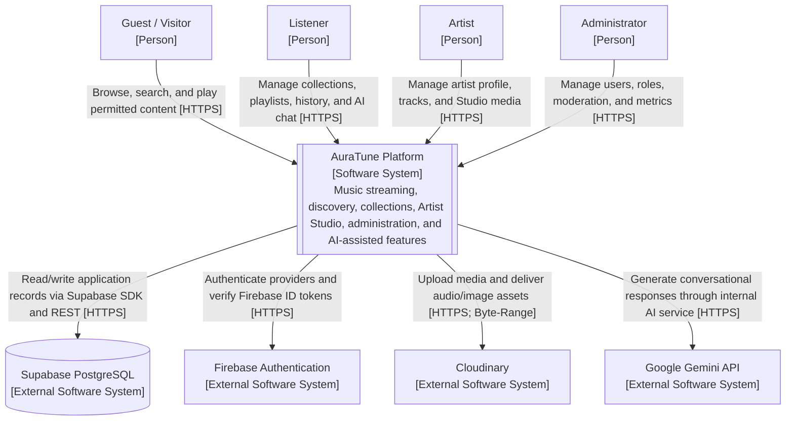
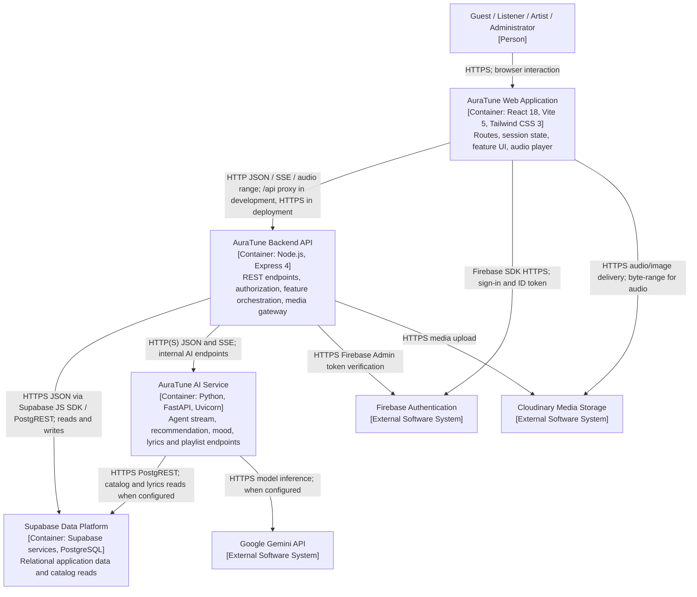
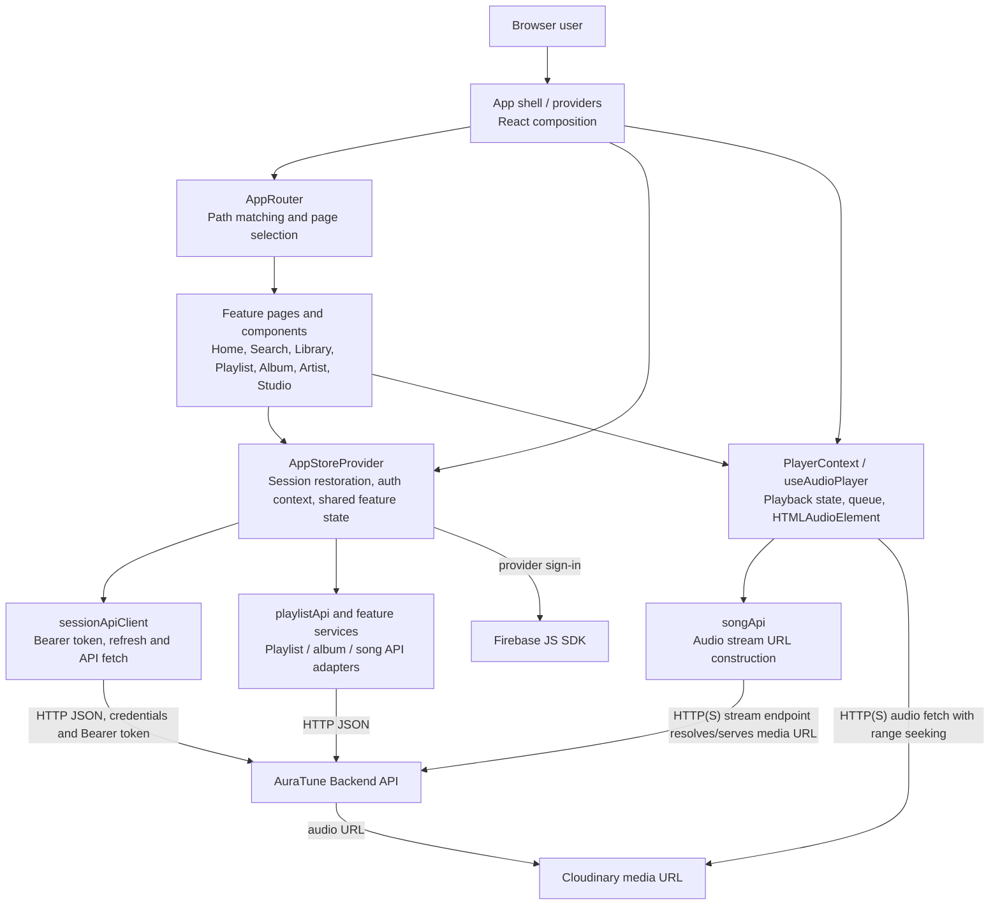
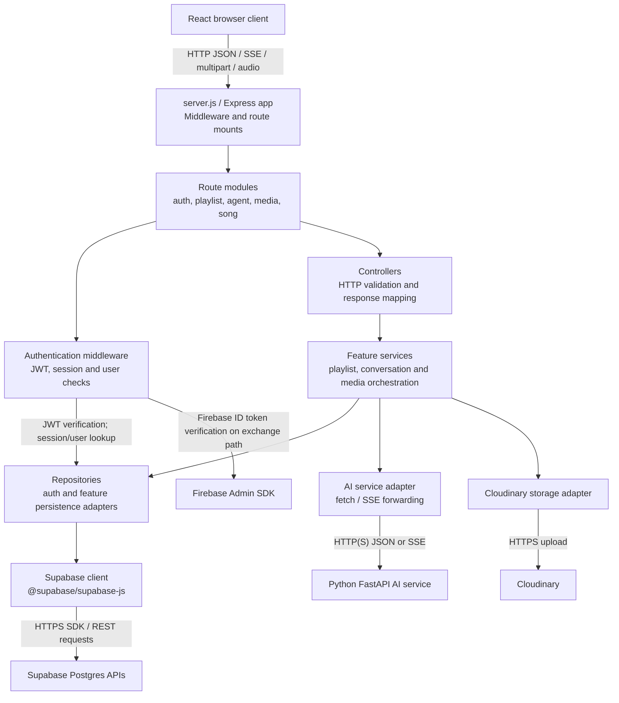
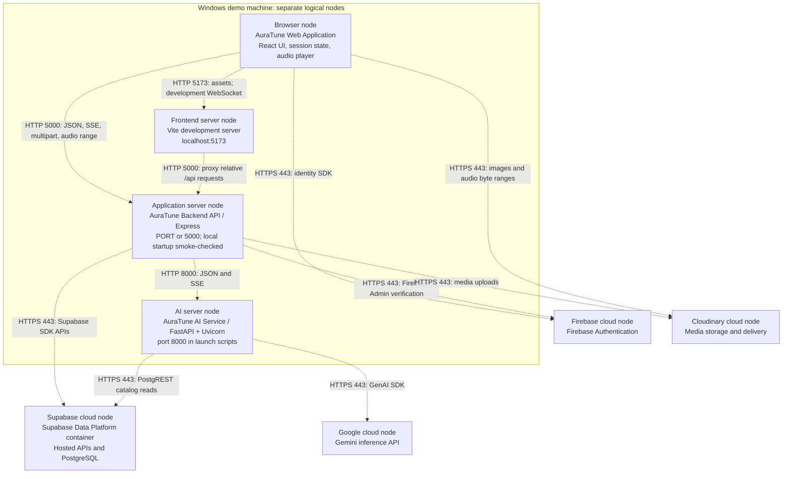

# AuraTune System Architecture: Tech Stack and System Context (C4 Level 1)
Performed by: Nguyễn Khánh Đăng, Mai Đăng Khoa | Reviewed by: Group 10 team | Edited by: Lê Công Minh Nhựt

## 1. Purpose and scope
Performed by: Nguyễn Khánh Đăng | Reviewed by: Group 10 team | Edited by: Nguyễn Khánh Đăng

This document records the implementation-based technology stack and the C4 Level 1 System Context for AuraTune at PA4. It covers the web application, Express API, Supabase persistence, Python AI service, identity integration, cloud media storage, and Google Gemini integration. The system boundary follows the use-case model: the AuraTune application UI, Express API, Python orchestration, and application-owned logic are inside the boundary; identity, media storage, database hosting, and model inference are external services.

The document describes the current repository snapshot. It does not treat a route, UI screen, configured provider, or local fallback as proof that an end-to-end feature is complete or persistent.

## 2. Technology stack
Performed by: Nguyễn Khánh Đăng | Reviewed by: Group 10 team | Edited by: Nguyễn Khánh Đăng

| Layer | Technologies and versions | Responsibilities and actual boundary |
| --- | --- | --- |
| Frontend Web App | React `18.3.1`, React DOM `18.3.1`, Vite `5.4.11`, Tailwind CSS `3.4.17`, Firebase JS SDK `13.2.0` | Browser UI for public discovery, playback, queues, collections, Artist Studio, administration views, and AI-assisted features. Vite proxies `/api` to `http://localhost:5000` in development. The frontend does not call the Python AI service directly. Firebase client authentication is the exception to the Backend API path: the browser obtains a Firebase ID token, then exchanges it with Express. |
| Backend API | Node.js ES modules, Express `4.21.2`, `jsonwebtoken` `9.0.2`, `cookie-parser` `1.4.6`, `bcryptjs` `2.4.3`, `multer` `2.5.0`, CORS `2.8.5` | REST API under `/api/v1`. It validates requests, authenticates Bearer access tokens and refresh-token cookies, applies role/session checks, coordinates application logic, invokes Supabase repositories, brokers AI requests, accepts multipart media uploads, and exposes audio streaming with range support. The repository does not pin a Node.js version in `package.json`; the runtime version is therefore an environment concern rather than a source-level claim. |
| Database and persistence | PostgreSQL hosted by Supabase, `@supabase/supabase-js` `2.119.0`, SQL migrations in `src/database/migrations/` | Server-side relational persistence for authentication/session records, listening history indexes, artist visibility/follows, playlists, and related application data. The backend client uses `SUPABASE_SERVICE_ROLE_KEY` and Supabase HTTPS APIs; it is not a direct PostgreSQL socket connection. |
| AI and semantic service | Python 3.x, FastAPI `>=0.115.0`, Uvicorn `>=0.30.0`, Pydantic `>=2.8.0`, `google-genai` `>=3.0.0`, `httpx` `>=0.27.0`, `requests` `>=2.31.0`, `sentence-transformers` `>=3.0.0`, ChromaDB `>=0.5.0` | Internal FastAPI service for conversational streaming, recommendation endpoints, lyrics search, semantic search support, playlist generation, and health checks. The service is reached by the backend, not by the browser. It calls Supabase PostgREST directly for song lyrics and semantic catalog data when credentials are configured. |
| Identity provider | Firebase Authentication; Firebase Admin SDK `14.5.0` and Firebase client SDK `13.2.0` | Verifies email, Google, and Facebook Firebase ID tokens. Express exchanges a verified Firebase token for an AuraTune-managed session and refresh-token cookie. Firebase is responsible for provider identity verification; AuraTune remains responsible for application sessions, roles, and authorization. |
| Cloud media storage | Cloudinary `2.11.0` | Stores uploaded audio and image assets. The backend accepts a validated in-memory multipart upload with Multer, uploads it to Cloudinary, and returns a secure URL. Audio is configured as a Cloudinary `video` resource and is consumed by the player with HTTP byte-range requests for seeking. |

## 3. Runtime responsibilities and integration boundaries
Performed by: Nguyễn Khánh Đăng | Reviewed by: Group 10 team | Edited by: Mai Đăng Khoa

### Frontend to backend boundary

The React application sends user-facing API requests to Express over HTTPS in a deployed environment, or through the Vite `/api` proxy during local development. Express is the public application gateway for catalogue, authentication exchange, playlists, recommendations, lyrics search, media, and agent routes. The frontend never calls `/ai/*` directly.

### Backend to database boundary

Backend repositories use the Supabase JavaScript client with the service-role key. The resulting calls are HTTPS requests to Supabase services, backed by PostgreSQL. SQL migrations show the intended relational schema, but a schema or repository does not by itself prove that every UI feature is using it in the current build.

### Backend to AI-service boundary

The Express API acts as the application-facing broker for AI features. The Python service exposes these implemented routes:

- `POST /ai/agent/stream` returns Server-Sent Events (`text/event-stream`) for the conversational agent.
- `POST /ai/recommend` returns recommendation results and may use deterministic local catalog ordering.
- `POST /ai/recommend/mood` returns mood-based results from the service mapping.
- `POST /ai/search/lyrics` reads the lyrics catalog from Supabase REST when configured.
- `POST /ai/playlist/generate` generates a playlist from the service's available catalog.
- `GET /ai/health` reports service health; `/` and `/health` are also defined as local health routes.

`src/ai-service/main.py` reads Supabase PostgREST `/rest/v1/songs` for semantic catalog and lyrics queries. `src/ai-service/agent.py` uses the Google GenAI SDK for Gemini inference when `GEMINI_API_KEY` is available and has a local deterministic fallback when it is unavailable or fails. This means that AI endpoint availability, Gemini inference, Supabase-backed search, and personalized ranking are separate claims.

### Database-backed modules and fallbacks

The current source mixes persistence levels. Authentication/session repositories, playlist paths, artist follow/visibility paths, and agent conversation schemas have Supabase/migration support. Saved album IDs are held in a process-local RAM `Map` in the album route. Admin user/role changes are represented in frontend `AppStore` state and do not have a mounted backend admin route in the current entrypoint. Some Home/Search and AI paths use local demo catalogs or mock fallbacks when live data is unavailable. History and some administrative views use client state or local behavior. These fallbacks are documented as current implementation boundaries, not as equivalent database persistence.

### Offline data preparation

Spotify is used only as an offline source for preparing or importing metadata. It is not an external runtime system in the AuraTune context diagram and is not called by the deployed user-facing flow.

### Current entrypoint status

`server.js` imports each router once and registers feature routes before the fallback 404 and error handlers. The Express app starts listening after route registration. Syntax and representative route reachability have been smoke-checked; full end-to-end acceptance and external provider operations are summarized in section 11.

## 4. C4 Level 1: System Context Diagram
Performed by: Nguyễn Khánh Đăng | Reviewed by: Group 10 team | Edited by: Nguyễn Khánh Đăng

At C4 Level 1, AuraTune is one software system. The diagram shows only the four human actors required by the use-case model and the four external runtime systems requested for PA4. Internal frontend, backend, database adapter, and AI-service modules are intentionally not separate C4 systems at this level.

## 5. System context explanation
Performed by: Nguyễn Khánh Đăng | Reviewed by: Group 10 team | Edited by: Nguyễn Khánh Đăng

### 5.1 Human actors

The actor names and boundary follow `docs/requirements/use-case-model.md`. Playlist Owner and Playlist Collaborator are resource-specific Listener specializations, not additional top-level actors in this Level 1 context diagram.

**Guest / Visitor (`ACT-01`).** An unauthenticated visitor browses public discovery surfaces, metadata, charts, public artist or album information, and permitted audio. Public access does not imply access to authenticated collections, personalized history, or Listener-only semantic search.

**Listener (`ACT-02`).** An authenticated user manages personal playlists and collections, follows artists, interacts with tracks, views history and recommendations, and uses the conversational AI experience. Playlist ownership and collaboration permissions remain limited to the relevant playlist resource.

**Artist (`ACT-04`).** An authenticated user with Artist capabilities inherits Listener behavior and can manage the user's own Artist Profile and Artist Studio content, including track metadata, visibility, and media uploads. The Artist role does not grant access to another artist's studio.

**Administrator (`ACT-05`).** An authorized operator performs platform-level account, role, moderation, and metric tasks. The role is constrained by server-side authorization where those routes exist; the current frontend-only admin state is not evidence of complete persistent administration.

### 5.2 External systems and integration boundaries

**Supabase PostgreSQL.** Supabase is the hosted relational data platform for AuraTune application records. Express accesses it through `@supabase/supabase-js` over HTTPS using the server-side service-role key. The Python AI service also calls Supabase PostgREST directly at `/rest/v1/songs` for lyrics and semantic catalog reads. This is a data-service boundary, not an assumption that the browser has direct database access.

**Firebase Authentication.** Firebase verifies email, Google, and Facebook identity tokens. The browser uses the Firebase client SDK for provider sign-in; Express verifies the resulting ID token through Firebase Admin and issues the AuraTune session. Firebase does not decide AuraTune roles or replace the application's authorization checks.

**Cloudinary.** Cloudinary is the binary media boundary for uploaded audio, cover art, and artist media. Express validates the multipart upload, sends it to Cloudinary over HTTPS, and exposes the resulting secure media URL to the application flow. Audio playback uses byte-range requests so the browser can seek without downloading the entire file.

**Google Gemini API.** Gemini is the external model-inference boundary used by the Python AI service through `google-genai`, primarily for the conversational agent. AuraTune sends prompt/context data from the internal service over HTTPS and streams the result back through the internal AI endpoint as SSE. If Gemini is unavailable or unconfigured, the agent's local fallback can respond; that fallback does not mean that Gemini was called successfully.

## 6. Source references
Performed by: Nguyễn Khánh Đăng | Reviewed by: Group 10 team | Edited by: Nguyễn Khánh Đăng

- `src/frontend/package.json`, `src/frontend/vite.config.js`, and `src/frontend/src/config/firebase.js`
- `src/backend/package.json`, `src/backend/server.js`, middleware, Firebase exchange controller, Cloudinary configuration, and media storage service
- `src/database/supabaseClient.js` and `src/database/migrations/`
- `src/ai-service/requirements.txt`, `src/ai-service/main.py`, and `src/ai-service/agent.py`
- `docs/requirements/use-case-model.md`, `docs/proposal/project_plan.md` section 2.4.4, and the PA4 readiness checklist

## 7. C4 Level 2: Container diagram
Performed by: Mai Đăng Khoa | Reviewed by: Group 10 team | Edited by: Mai Đăng Khoa

The container diagram expands the AuraTune software system into its independently running or hosted application containers. “Container” here is the C4 term; it does not imply that Docker images are present. In local development the browser uses Vite on port 5173, Express defaults to port 5000, and the Python service is configured separately (normally port 8000). The browser's `/api` calls are proxied by Vite to Express. In deployment, the browser-to-Express edge is HTTPS. Express uses HTTP(S) JSON/SSE to the AI service and the Supabase SDK over HTTPS to Supabase. The Python service also reads Supabase through PostgREST HTTPS; it does not open a direct PostgreSQL socket.

### Container responsibilities and communication

| Container | Responsibility and technology | Communication |
| --- | --- | --- |
| AuraTune Web Application | React 18 UI bundled/served by Vite 5 and styled with Tailwind CSS 3. Contains browser routes, session and feature state, API clients, and the shared audio player. Some screens/data paths still use local demo state. | Calls Express using JSON APIs and SSE; Vite proxies `/api` to `http://localhost:5000` in development. Uses Firebase client SDK for provider sign-in. Requests audio URLs from the API and streams media from the returned Cloudinary URL. |
| AuraTune Backend API | Node.js ES modules and Express 4. Provides `/api/v1` routes, token/session checks, controllers and services, media upload/streaming, and integration adapters. | Receives browser HTTP(S). Uses Supabase JS SDK (HTTPS), Firebase Admin (HTTPS), Cloudinary SDK (HTTPS), and HTTP(S) fetch to the Python AI service. Agent conversation forwards SSE events from Python to the browser. |
| AuraTune AI Service | Python FastAPI/Uvicorn service. Implements agent streaming and AI-related endpoints; Gemini-backed response generation has a local fallback, while recommendation/catalog behavior can also be deterministic/local. | Receives backend HTTP(S) requests, returns JSON or SSE, reads Supabase PostgREST over HTTPS when configured, and calls Gemini over HTTPS when configured. The browser does not call this container directly. |
| Supabase Data Platform | Hosted Supabase services backed by PostgreSQL. SQL migrations define application schemas; actual feature persistence varies by path. | Backend's `@supabase/supabase-js` and AI service PostgREST calls use HTTPS. These are API calls to Supabase, not direct SQL connections from either application container. |

Firebase Authentication and Cloudinary are external systems, not application containers. Firebase handles provider identity verification; AuraTune session and role authorization remain in the backend. Cloudinary stores and serves uploaded binary media. Google Gemini is an optional external model provider called by the AI service. A configured integration is not evidence that the provider is reachable in a particular run.

## 8. C4 Level 3: Representative frontend components
Performed by: Mai Đăng Khoa | Reviewed by: Group 10 team | Edited by: Mai Đăng Khoa

The following Level 3 view selects shared components that participate in navigation, session management and playback, plus a representative feature service. It does not enumerate every page or UI component.

| Component | Responsibility | Relationships |
| --- | --- | --- |
| App shell and providers | Composes the React application and shared providers for global state and playback. | Renders `AppRouter`; provides AppStore and player context to page components. |
| AppRouter | Matches the current pathname and selects the corresponding page; scrolls the page content to the top on navigation. | Renders feature pages, which consume shared state and services. |
| AppStoreProvider | Restores backend sessions using the refresh cookie, maintains auth context and shared application state, and coordinates selected playlist/album/follow operations. The source explicitly retains browser localStorage demo state for some behavior. | Uses `sessionApiClient`, Firebase auth helpers and feature services; exposes state/actions to pages and player-facing UI. |
| PlayerContext / `useAudioPlayer` | Owns playback track, queue, position, volume, repeat/shuffle and status; controls the browser `HTMLAudioElement`, persists a player snapshot and reports listening progress through available app callbacks. | Consumed by shared player controls and pages. Uses `songApi` to construct the stream endpoint and the browser fetches media bytes from the returned media URL. |
| Feature pages and components | Present route-level experiences such as search, playlists, albums, artists and Studio. | Read/update AppStore and PlayerContext; invoke feature services for backend-backed operations. Some screens still use mock/demo catalog data. |
| `sessionApiClient` | Central authenticated fetch wrapper; adds Bearer token, includes cookies and coordinates refresh/revocation handling. | Sends HTTP requests to Express; auth context is configured by AppStoreProvider. |
| Feature API services (`playlistApi`, album/song clients) | Translate feature operations into endpoint requests and normalize responses where needed. | Called by AppStore or page components; requests flow to Express via the API base URL/Vite proxy. |
| `songApi` | Builds the backend song/audio endpoint used by playback. | Called by `useAudioPlayer`; the API response/stream path ultimately supplies media consumed by the browser. |

## 9. C4 Level 3: Representative backend components
Performed by: Mai Đăng Khoa | Reviewed by: Group 10 team | Edited by: Mai Đăng Khoa

This Level 3 view represents authentication, playlist, agent and media paths through the current Express application.

| Component | Responsibility | Relationships |
| --- | --- | --- |
| `server.js` / Express app | Loads environment/configuration, installs CORS/body/cookie middleware, registers feature routes and fallback handling, and starts the HTTP listener. | Dispatches requests through registered route modules and then to fallback handling. |
| Route modules | Bind URL and HTTP method to middleware/controller functions. Representative modules include auth, playlist, agent, media and song routes. | Receive dispatch from Express; attach authentication middleware to protected operations; invoke controllers. |
| Authentication middleware | Verifies AuraTune JWTs, resolves user/session state and attaches the authenticated principal to the request. Specialized middleware enforces route-specific session requirements. | Runs before protected controllers; uses auth repository/in-memory fallback as implemented. Firebase token exchange is verified through Firebase Admin in its controller path. |
| Controllers | Validate request input, call application services/adapters and map outcomes to HTTP status and response bodies. `agentController` also establishes and manages the browser-facing SSE response. | Called by routes; invoke services and return JSON/SSE/stream responses. |
| Feature services | Coordinate use-case behavior. `playlistService` handles playlist operations; `agentConversationService` validates and forwards a conversation to the Python service, with a local simulator fallback; media logic coordinates uploads/streaming. | Called by controllers; use repositories, AI adapter or media adapter according to the feature. |
| Repositories | Encapsulate persistence operations for supported domains such as users, sessions and playlists. Some code paths retain in-memory/demo fallbacks, so persistence is feature-specific. | Called by middleware and services; reach Supabase through the database client where configured. |
| Supabase client | Creates a backend-only Supabase JS client using service-role credentials when configured. | Repository calls become HTTPS requests to Supabase APIs/PostgREST; no direct PostgreSQL socket is used by this adapter. |
| AI service adapter | Sends internal JSON requests to AI endpoints; for the agent path, parses upstream SSE events and forwards them through the backend SSE emitter. | Called by services and communicates with FastAPI over HTTP(S). Agent adapter is implemented in `agentConversationService`; recommendation adapters include `clients/aiServiceClient.js`. |
| Cloudinary storage adapter | Uploads validated audio/image files to Cloudinary and returns secure media metadata/URLs. | Called by media feature logic; communicates with Cloudinary over HTTPS. |
| Firebase Admin SDK | Verifies Firebase ID tokens submitted during identity exchange. | Used by Firebase exchange/auth controller paths; AuraTune then issues its own session token/cookie. |

## 10. Diagram verification notes
Performed by: Mai Đăng Khoa | Reviewed by: Group 10 team | Edited by: Mai Đăng Khoa

- Development browser-to-API routing is based on `src/frontend/vite.config.js`: Vite listens on 5173 and proxies `/api` to `http://localhost:5000`.
- The frontend API client uses `fetch`, credentials and Bearer authorization; the backend AI client uses HTTP `fetch` with JSON and an internal-secret header. The agent service forwards SSE rather than presenting a browser-to-AI connection.
- `src/database/supabaseClient.js` creates a server-side Supabase JS client. AI catalog/lyrics reads use Supabase PostgREST. Both are HTTPS API paths, not direct database sockets.
- Playback uses the browser audio element and song API URL; media delivery supports byte-range behavior as documented by the backend source and prior audit.
- Integrated runtime smoke checks: `node --check src/backend/server.js` passed. Express `/api/health` and Vite `/` returned HTTP 200; the Vite `/api/health` proxy also returned 200. Representative Artist invalid-ID, Studio/User unauthenticated, and unmatched paths returned the expected 400, 401, 401 and 404 responses, confirming the tested route handling before fallback.
- Backend-to-AI checks: FastAPI `/health` returned 200; the backend AI client received a JSON recommendation response, and the agent service received `thinking`, `text` and `done` SSE events. The AI service had no Gemini key, so the agent response used its local fallback; this does not verify external Gemini inference.

## 11. Deployment (D-26)
Performed by: Nguyễn Khánh Đăng | Reviewed by: Group 10 team | Edited by: Mai Đăng Khoa

The demo configuration uses one Windows development machine and hosted provider services. The local processes are separate logical deployment nodes, as permitted by Part D of `docs/PA/PA4-2026.pdf` (page 3). This maps all four containers in section 7 to their execution environments. Vite is an additional development server that delivers the Web Application to the browser. No Docker image, public application host or TLS terminator is claimed here.

The diagram shows the configured local demo topology. Dashed arrows show communication paths between local processes and hosted services. Smoke checks confirmed the browser-to-Vite page, Vite-to-Express health proxy and backend-to-AI JSON/SSE paths; cloud-provider operations remain unverified. Independent peer review remains pending.

### 11.1 Nodes and container placement
Performed by: Nguyễn Khánh Đăng | Reviewed by: Group 10 team | Edited by: Mai Đăng Khoa

| Node / infrastructure | Hosted container or component | Connections and configuration |
| --- | --- | --- |
| Browser on the local Windows machine | Section 7 Web Application: React routes, AppStore, player and API clients | Loads assets from Vite over HTTP. Most session/song clients default to `http://localhost:5000/api/v1`; search and lyrics clients default to `http://localhost:5000` and append their API path. Firebase sign-in and Cloudinary media use provider HTTPS URLs. |
| Local frontend server process | Vite 5 development server, serving the Web Application bundle | `npm run dev:frontend` from the repository root. `vite.config.js` requests port 5173, leaves host at the Vite localhost default and does not set `strictPort`; a busy port can cause selection of another port. Relative `/api` requests proxy to `http://localhost:5000`. Vite's development WebSocket supports hot reload; application chat uses SSE. |
| Local application server process | Section 7 Backend API: Express routes, middleware, controllers, services and repositories | `npm start` from the root runs `node src/backend/server.js`; `npm run dev:backend` enables watch mode. `app.listen(PORT)` uses `process.env.PORT` or 5000 with no explicit bind host, so it is not restricted to loopback by source. The printed localhost URL is an access URL, not a bind restriction. No TLS listener is configured. Outbound calls reach AI over HTTP and cloud providers over HTTPS. |
| Local Python process | Section 7 AI Service: FastAPI endpoints and agent orchestration | Root `npm run dev:ai` uses `py -3.13 -m uvicorn main:app --app-dir src/ai-service --port 8000 --reload`, with Uvicorn's default loopback host. `start-all.bat` and `src/ai-service/start.ps1` / `start.bat` instead pass `--host 0.0.0.0`. Direct execution of `main.py` uses `AI_SERVICE_HOST` (default `0.0.0.0`) and `AI_SERVICE_PORT` (default 8000). CLI launch arguments govern the npm/script launch path. |
| Supabase managed cloud service | Section 7 Supabase Data Platform, including hosted PostgreSQL | Backend repositories use server-side Supabase JS SDK calls over HTTPS; Python reads `/rest/v1/songs` over HTTPS. Neither application process opens a direct PostgreSQL TCP connection. Feature-specific memory and demo fallbacks described in section 3 still apply. |
| Firebase managed cloud service | External Authentication service from section 7 | Browser client SDK obtains identity tokens; the backend Firebase Admin path verifies them over HTTPS and AuraTune issues its own session. |
| Cloudinary managed cloud service | External media storage and delivery from section 7 | Backend sends uploads over HTTPS. Browser loads returned image/audio URLs over HTTPS, with byte-range requests for audio seeking. API audio routes also participate in playback. |
| Google managed cloud service | External Gemini inference service from section 7 | Python calls Gemini through `google-genai` over HTTPS when configured. Local agent fallback responses do not verify this edge. |

### 11.2 Configuration and verification boundary
Performed by: Nguyễn Khánh Đăng | Reviewed by: Group 10 team | Edited by: Mai Đăng Khoa

`start-all.bat` records the intended three-process local demo. The individual commands above allow each process to be inspected separately. These commands describe how to start the application; they are not a record of a successful demo run.

The backend recommendation adapter reads `AI_SERVICE_URL`, while the agent adapter reads `AI_AGENT_SERVICE_URL`; both default to `http://localhost:8000` (`config/aiConfig.js` and `config/agentConfig.js`). Both must target the Python listener if its address changes. Frontend `VITE_API_BASE_URL` overrides are client-specific: session clients expect a base containing `/api/v1`, while search clients append that prefix themselves. The Vite proxy target is fixed at port 5000, so changing Express `PORT` alone does not update the proxy. A Vite port change may also require updating `CORS_ALLOWED_ORIGINS`; Express's development allowlist includes localhost and 127.0.0.1 on 5173 and 3000.

Environment loading also depends on the entrypoint and working directory. Express calls `dotenv.config()`; the database client additionally checks root `.env`, `src/backend/.env` and `src/.env`. Python checks `src/ai-service/.env` before root `.env`. Provider keys stay on the server; this document does not reproduce credential values or infer provider reachability from their presence.

| Verification | Evidence and remaining work |
| --- | --- |
| Source mapping and configured ports | Root/frontend/backend scripts, Vite, Express, AI adapters, Python configuration/start scripts and the Supabase client were checked against the diagrams. Configured ports describe runtime settings, not deployment evidence. |
| Backend entrypoint and representative routes | `node --check src/backend/server.js` passes. `/api/health` returned 200; representative Artist, Studio and User paths reached their validation/authentication handlers, and an unmatched path reached the 404 handler. Feature routes are registered before fallback handling. |
| Frontend and API proxy | Vite served `/`; its `/api/health` proxy reached Express. Both returned HTTP 200. |
| Backend-to-AI communication | FastAPI health returned 200. The recommendation adapter returned JSON data and the agent adapter received SSE events. With no Gemini key configured, the agent used its local fallback. |
| External provider paths | Supabase operations, Firebase token exchange, Cloudinary upload/playback and live Gemini inference were not verified in these runtime checks. |
| Diagram consistency and peer review | The C4 views and component relationships were cross-checked against current source. Independent team review remains outstanding. |
