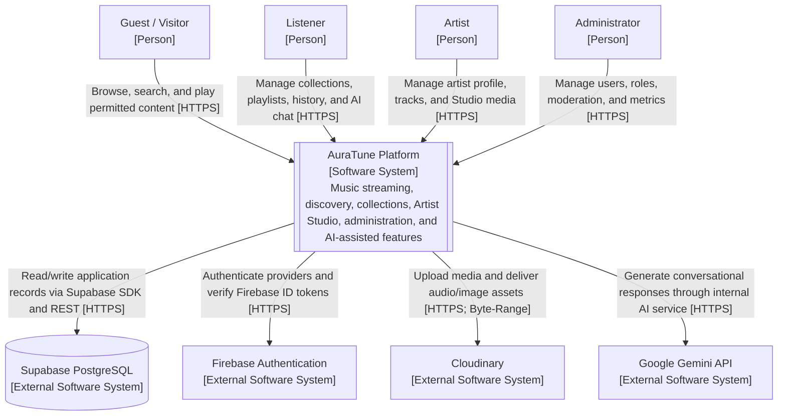

# AuraTune System Architecture: Tech Stack and System Context (C4 Level 1)
Performed by: Nguyễn Khánh Đăng | Reviewed by: Pending team review | Edited by: Nguyễn Khánh Đăng

## 1. Purpose and scope
Performed by: Nguyễn Khánh Đăng | Reviewed by: Pending team review | Edited by: Nguyễn Khánh Đăng

This document records the implementation-based technology stack and the C4 Level 1 System Context for AuraTune at PA4. It covers the web application, Express API, Supabase persistence, Python AI service, identity integration, cloud media storage, and Google Gemini integration. The system boundary follows the use-case model: the AuraTune application UI, Express API, Python orchestration, and application-owned logic are inside the boundary; identity, media storage, database hosting, and model inference are external services.

The document describes the current repository snapshot. It does not treat a route, UI screen, configured provider, or local fallback as proof that an end-to-end feature is complete or persistent.

## 2. Technology stack
Performed by: Nguyễn Khánh Đăng | Reviewed by: Pending team review | Edited by: Nguyễn Khánh Đăng

| Layer | Technologies and versions | Responsibilities and actual boundary |
| --- | --- | --- |
| Frontend Web App | React `18.3.1`, React DOM `18.3.1`, Vite `5.4.11`, Tailwind CSS `3.4.17`, Firebase JS SDK `13.2.0` | Browser UI for public discovery, playback, queues, collections, Artist Studio, administration views, and AI-assisted features. Vite proxies `/api` to `http://localhost:5000` in development. The frontend does not call the Python AI service directly. Firebase client authentication is the exception to the Backend API path: the browser obtains a Firebase ID token, then exchanges it with Express. |
| Backend API | Node.js ES modules, Express `4.21.2`, `jsonwebtoken` `9.0.2`, `cookie-parser` `1.4.6`, `bcryptjs` `2.4.3`, `multer` `2.5.0`, CORS `2.8.5` | REST API under `/api/v1`. It validates requests, authenticates Bearer access tokens and refresh-token cookies, applies role/session checks, coordinates application logic, invokes Supabase repositories, brokers AI requests, accepts multipart media uploads, and exposes audio streaming with range support. The repository does not pin a Node.js version in `package.json`; the runtime version is therefore an environment concern rather than a source-level claim. |
| Database and persistence | PostgreSQL hosted by Supabase, `@supabase/supabase-js` `2.119.0`, SQL migrations in `src/database/migrations/` | Server-side relational persistence for authentication/session records, listening history indexes, artist visibility/follows, playlists, and related application data. The backend client uses `SUPABASE_SERVICE_ROLE_KEY` and Supabase HTTPS APIs; it is not a direct PostgreSQL socket connection. |
| AI and semantic service | Python 3.x, FastAPI `>=0.115.0`, Uvicorn `>=0.30.0`, Pydantic `>=2.8.0`, `google-genai` `>=3.0.0`, `httpx` `>=0.27.0`, `requests` `>=2.31.0`, `sentence-transformers` `>=3.0.0`, ChromaDB `>=0.5.0` | Internal FastAPI service for conversational streaming, recommendation endpoints, lyrics search, semantic search support, playlist generation, and health checks. The service is reached by the backend, not by the browser. It calls Supabase PostgREST directly for song lyrics and semantic catalog data when credentials are configured. |
| Identity provider | Firebase Authentication; Firebase Admin SDK `14.5.0` and Firebase client SDK `13.2.0` | Verifies email, Google, and Facebook Firebase ID tokens. Express exchanges a verified Firebase token for an AuraTune-managed session and refresh-token cookie. Firebase is responsible for provider identity verification; AuraTune remains responsible for application sessions, roles, and authorization. |
| Cloud media storage | Cloudinary `2.11.0` | Stores uploaded audio and image assets. The backend accepts a validated in-memory multipart upload with Multer, uploads it to Cloudinary, and returns a secure URL. Audio is configured as a Cloudinary `video` resource and is consumed by the player with HTTP byte-range requests for seeking. |

## 3. Runtime responsibilities and integration boundaries
Performed by: Nguyễn Khánh Đăng | Reviewed by: Pending team review | Edited by: Nguyễn Khánh Đăng

### Frontend to backend boundary

The React application sends user-facing API requests to Express over HTTPS in a deployed environment, or through the Vite `/api` proxy during local development. Express is the public application gateway for catalogue, authentication exchange, playlists, recommendations, lyrics search, media, and agent routes. The frontend never calls `/ai/*` directly.

### Backend to database boundary

Backend repositories use the Supabase JavaScript client with the service-role key. The resulting calls are HTTPS requests to Supabase services, backed by PostgreSQL. SQL migrations show the intended relational schema, but a schema or repository does not by itself prove that every UI feature is using it in the current build.

### Backend to AI-service boundary

The Express API acts as the application-facing broker for AI features. The Python service exposes these implemented routes:

- `POST /ai/agent/stream` returns Server-Sent Events (`text/event-stream`) for the conversational agent.
- `POST /ai/recommend` returns recommendation results and may use deterministic local catalog ordering.
- `POST /ai/recommend/mood` returns mood-based results from the service mapping.
- `POST /ai/search/lyrics` reads the lyrics catalog from Supabase REST when configured.
- `POST /ai/playlist/generate` generates a playlist from the service's available catalog.
- `GET /ai/health` reports service health; `/` and `/health` are also defined as local health routes.

`src/ai-service/main.py` reads Supabase PostgREST `/rest/v1/songs` for semantic catalog and lyrics queries. `src/ai-service/agent.py` uses the Google GenAI SDK for Gemini inference when `GEMINI_API_KEY` is available and has a local deterministic fallback when it is unavailable or fails. This means that AI endpoint availability, Gemini inference, Supabase-backed search, and personalized ranking are separate claims.

### Database-backed modules and fallbacks

The current source mixes persistence levels. Authentication/session repositories, playlist paths, artist follow/visibility paths, and agent conversation schemas have Supabase/migration support. Saved album IDs are held in a process-local RAM `Map` in the album route. Admin user/role changes are represented in frontend `AppStore` state and do not have a mounted backend admin route in the current entrypoint. Some Home/Search and AI paths use local demo catalogs or mock fallbacks when live data is unavailable. History and some administrative views use client state or local behavior. These fallbacks are documented as current implementation boundaries, not as equivalent database persistence.

### Offline data preparation

Spotify is used only as an offline source for preparing or importing metadata. It is not an external runtime system in the AuraTune context diagram and is not called by the deployed user-facing flow.

### Current entrypoint caveat

The repository snapshot contains backend entrypoint wiring issues that must be resolved before claiming a clean integrated runtime: `server.js` declares `mediaRoutes` twice, and several route mounts appear after the fallback 404 handler and `listen` call. The architecture below describes the intended boundaries visible in source while retaining this limitation.

## 4. C4 Level 1: System Context Diagram
Performed by: Nguyễn Khánh Đăng | Reviewed by: Pending team review | Edited by: Nguyễn Khánh Đăng

At C4 Level 1, AuraTune is one software system. The diagram shows only the four human actors required by the use-case model and the four external runtime systems requested for PA4. Internal frontend, backend, database adapter, and AI-service modules are intentionally not separate C4 systems at this level.

## 5. System context explanation
Performed by: Nguyễn Khánh Đăng | Reviewed by: Pending team review | Edited by: Nguyễn Khánh Đăng

### 5.1 Human actors

The actor names and boundary follow `docs/requirements/use-case-model.md`. Playlist Owner and Playlist Collaborator are resource-specific Listener specializations, not additional top-level actors in this Level 1 context diagram.

**Guest / Visitor (`ACT-01`).** An unauthenticated visitor browses public discovery surfaces, metadata, charts, public artist or album information, and permitted audio. Public access does not imply access to authenticated collections, personalized history, or Listener-only semantic search.

**Listener (`ACT-02`).** An authenticated user manages personal playlists and collections, follows artists, interacts with tracks, views history and recommendations, and uses the conversational AI experience. Playlist ownership and collaboration permissions remain limited to the relevant playlist resource.

**Artist (`ACT-04`).** An authenticated user with Artist capabilities inherits Listener behavior and can manage the user's own Artist Profile and Artist Studio content, including track metadata, visibility, and media uploads. The Artist role does not grant access to another artist's studio.

**Administrator (`ACT-05`).** An authorized operator performs platform-level account, role, moderation, and metric tasks. The role is constrained by server-side authorization where those routes exist; the current frontend-only admin state is not evidence of complete persistent administration.

### 5.2 External systems and integration boundaries

**Supabase PostgreSQL.** Supabase is the hosted relational data platform for AuraTune application records. Express accesses it through `@supabase/supabase-js` over HTTPS using the server-side service-role key. The Python AI service also calls Supabase PostgREST directly at `/rest/v1/songs` for lyrics and semantic catalog reads. This is a data-service boundary, not an assumption that the browser has direct database access.

**Firebase Authentication.** Firebase verifies email, Google, and Facebook identity tokens. The browser uses the Firebase client SDK for provider sign-in; Express verifies the resulting ID token through Firebase Admin and issues the AuraTune session. Firebase does not decide AuraTune roles or replace the application's authorization checks.

**Cloudinary.** Cloudinary is the binary media boundary for uploaded audio, cover art, and artist media. Express validates the multipart upload, sends it to Cloudinary over HTTPS, and exposes the resulting secure media URL to the application flow. Audio playback uses byte-range requests so the browser can seek without downloading the entire file.

**Google Gemini API.** Gemini is the external model-inference boundary used by the Python AI service through `google-genai`, primarily for the conversational agent. AuraTune sends prompt/context data from the internal service over HTTPS and streams the result back through the internal AI endpoint as SSE. If Gemini is unavailable or unconfigured, the agent's local fallback can respond; that fallback does not mean that Gemini was called successfully.

## 6. Source references
Performed by: Nguyễn Khánh Đăng | Reviewed by: Pending team review | Edited by: Nguyễn Khánh Đăng

- `src/frontend/package.json`, `src/frontend/vite.config.js`, and `src/frontend/src/config/firebase.js`
- `src/backend/package.json`, `src/backend/server.js`, middleware, Firebase exchange controller, Cloudinary configuration, and media storage service
- `src/database/supabaseClient.js` and `src/database/migrations/`
- `src/ai-service/requirements.txt`, `src/ai-service/main.py`, and `src/ai-service/agent.py`
- `docs/requirements/use-case-model.md`, `docs/proposal/project_plan.md` section 2.4.4, and the PA4 readiness checklist
