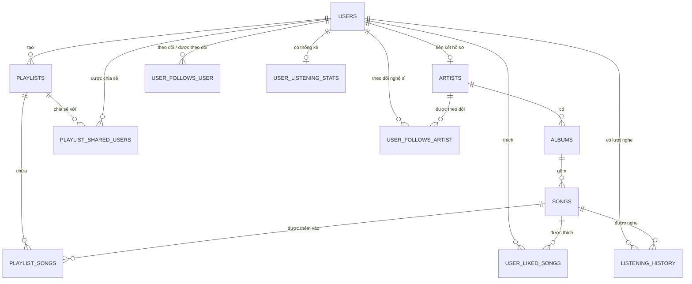

# Sơ đồ ER — AuraTune

## 1. Mục đích

Tài liệu mô tả các thực thể và quan hệ trong schema PostgreSQL được cung cấp cho AuraTune. Đây là tài liệu diễn giải schema hiện có, không phải migration SQL có thể chạy trực tiếp.

## 2. Sơ đồ quan hệ

## 3. Thực thể và khóa

| Bảng | Khóa chính | Khóa ngoại / ràng buộc chính |
|---|---|---|
| `users` | `user_id` | `email` là `UNIQUE`; `role` có CHECK với `user`, `artist`, `admin` |
| `artists` | `artist_id` | `user_id` tham chiếu `users.user_id`, có `UNIQUE` |
| `albums` | `album_id` | `artist_id` tham chiếu `artists.artist_id` |
| `songs` | `song_id` | `album_id` tham chiếu `albums.album_id` |
| `playlists` | `playlist_id` | `user_id_creator` tham chiếu `users.user_id`; `status` có CHECK |
| `playlist_songs` | `(playlist_id, song_id)` | Tham chiếu playlist và song |
| `playlist_shared_users` | `(playlist_id, shared_with_user_id)` | Tham chiếu playlist và user |
| `user_follows_user` | `(follower_id, followee_id)` | Cả hai cột tham chiếu `users.user_id` |
| `user_follows_artist` | `(user_id, artist_id)` | Tham chiếu user và artist |
| `user_liked_songs` | `(user_id, song_id)` | Tham chiếu user và song |
| `listening_history` | `history_id` | `user_id` và `song_id` tham chiếu user/song |
| `user_listening_stats` | `user_id` | `user_id` tham chiếu `users.user_id` |

## 4. Ghi chú quan trọng

- Quan hệ `users`–`artists` là tùy chọn ở phía artist do `artists.user_id` có thể `NULL`; nếu có giá trị thì duy nhất.
- `playlist_songs`, `playlist_shared_users`, `user_follows_user`, `user_follows_artist` và `user_liked_songs` dùng khóa chính ghép.
- Trong schema được cung cấp, một số khóa ngoại không được khai báo `NOT NULL`. Vì vậy sơ đồ ER thể hiện quan hệ tham chiếu, nhưng không nên suy luận mọi quan hệ đều bắt buộc.
- Schema không chỉ định hành vi `ON DELETE`; cần thống nhất hành vi xóa trước khi triển khai.
- `user_listening_stats.top_genres` hiện là `text`; tài liệu này không giả định định dạng nội dung của cột đó.

## 5. Nguồn và phạm vi

Sơ đồ được lập từ schema SQL do nhóm cung cấp. Hãy cập nhật khi schema hoặc migration thực tế thay đổi. Kiểm tra lại với database và migration trong repository trước khi dùng sơ đồ làm nguồn triển khai chính thức.
