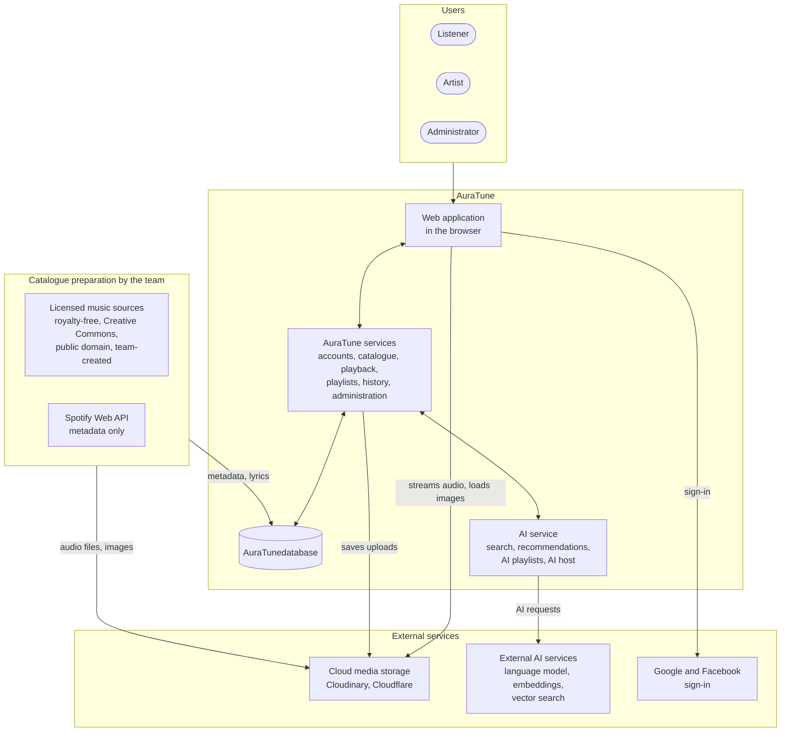
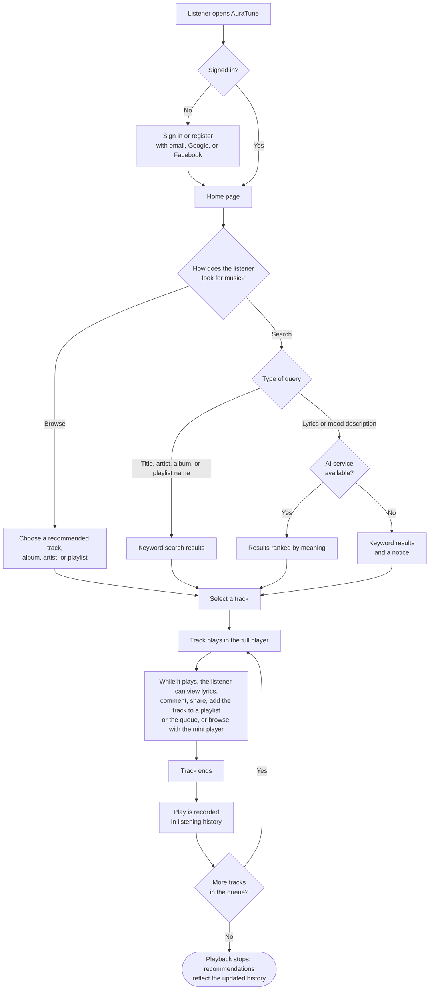
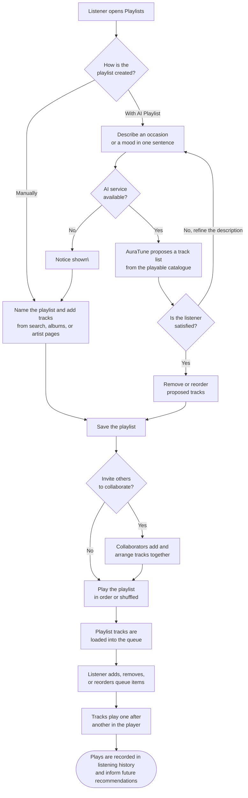

# **1. Introduction**

*Performed by: Lê Công Minh Nhựt, Reviewed by: Mai Đăng Khoa, Edited by: Lê Công Minh Nhựt*

## 1.1. Purpose of the Document

*Performed by: Lê Công Minh Nhựt, Reviewed by: Mai Đăng Khoa, Edited by: Lê Công Minh Nhựt*

The Vision Document is developed to identify and describe the main user needs, product goals, and key features that AuraTune aims to provide. It helps the development team understand the problems the product intends to solve, its target users, and the value the system delivers.
In addition, the Vision Document provides an overview of AuraTune’s development direction, including the product’s positioning, stakeholders, user needs, key features, and non-functional requirements. It serves as a basis for establishing a shared understanding of the product scope and supports requirements analysis, design, implementation, and testing activities in subsequent stages of the project.
This initial version of the document is prepared as part of PA2-2026. It will be reviewed and updated in PA3-2026 based on feedback from the teaching assistants (TAs), further research, and agreement among the development team.

## 1.2. Scope of the Document

*Performed by: Lê Công Minh Nhựt, Reviewed by: Mai Đăng Khoa, Edited by: Lê Công Minh Nhựt*

The Vision Document describes AuraTune at a high level without going into detailed technical implementation. Its scope includes:
  - **Product Positioning:** Identifying the problem to be solved, the affected users, and the value AuraTune aims to deliver.
  - **Stakeholder and User Descriptions:** Identifying the groups involved with the product, their characteristics, and their usage environment.
  - **User Needs:** Summarizing key user needs and examining existing solutions or applications.
  - **Product Overview:** Describing the product context, assumptions, and dependencies that may affect the product.
  - **Product Features:** Describing the key features, their benefits, and important user workflows.
  - **Non-Functional Requirements:** Identifying requirements related to performance, security, platforms, and other quality attributes.
The details of individual features will be further clarified in related requirements specifications and design documents as the project progresses.

## 1.3. Document Organization

*Performed by: Lê Công Minh Nhựt, Reviewed by: Mai Đăng Khoa, Edited by: Lê Công Minh Nhựt*

The Vision Document is organized into six main sections:
1.  **Introduction:** Presents the purpose of the document and its references.
2.  **Positioning:** Describes the problem to be solved and the positioning of AuraTune.
3.  **Stakeholder and User Descriptions:** Identifies stakeholders, user groups, the user environment, key needs, and competing alternatives.
4.  **Product Overview:** Presents the product perspective, assumptions, and dependencies.
5.  **Product Features:** Describes AuraTune’s key features and illustrates important user workflows.
6.  **Non-Functional Requirements:** Presents the non-functional requirements applicable to the product.

## 1.4 References

*Performed by: Lê Công Minh Nhựt, Reviewed by: Mai Đăng Khoa, Edited by: Lê Công Minh Nhựt*

This section lists the documents and information sources used to develop the Vision Document. The initial references include:
|  |  |  |
| :- | :- | :- |
| **No.** | **Document** | **Purpose** |
| 1 | **PA2-2026 - Project Assignment 2**, Introduction to Software Engineering | Defines the required sections and requirements for the Vision Document in PA2. |
| 2 | **Project Proposal - PA1**, AuraTune | Provides background information about the project idea, goals, scope, and planned features. |
| 3 | **Existing Application Survey - PA1** | Supports the analysis of alternative solutions, competing applications, and the needs that AuraTune aims to address. |
| 4 | **Vision Template - rup_vision_sp.docx** | Provides the structure and guidance for preparing the Vision Document. |

# **2. Positioning**

*Performed by: Mai Đăng Khoa, Reviewed by: Nguyễn Khánh Đăng, Edited by: Mai Đăng Khoa*

## 2.1 Problem Statement

*Performed by: Mai Đăng Khoa, Reviewed by: Nguyễn Khánh Đăng, Edited by: Mai Đăng Khoa*

|  |  |
| :- | :- |
| **Item** | **Description** |
| **The problem of** | Difficulty in finding music based on abstract moods, emotions, or incomplete lyrical fragments. |
| **Affects** | Students, office workers, and general listeners who want to match their auditory environment to their current feelings or activities. |
| **The impact of which is** | Frustration during music discovery, repetitive listening due to lack of discovery tools, and inability to find specific songs from memory. |
| **A successful solution would be** | A smart music platform utilizing AI-powered semantic vector search to understand emotional contexts and retrieve tracks based on natural language descriptions. |

## 2.2 Product Position Statement

*Performed by: Mai Đăng Khoa, Reviewed by: Nguyễn Khánh Đăng, Edited by: Mai Đăng Khoa*
| | |
| :- | :- |
| **Item** | **Description** |
| **For** | Music enthusiasts and focused workers. |
| **Who** | Seek a deeply personalized and intuitive music discovery experience. |
| **The product name** | AuraTune |
| **That** | Is an AI-powered smart music streaming platform providing seamless playback and emotion-driven recommendations. |
| **Our product** | Offers an "AI DJ" experience through advanced vector search and deep listening habit analytics. |

# **3. Stakeholder and User Descriptions**

*Performed by: Nguyễn Khánh Đăng, Thái Hoàng; Reviewed by: Thái Hoàng, Nguyễn Thanh Huy; Edited by: Nguyễn Khánh Đăng, Thái Hoàng*

This section describes the various stakeholders and users involved in the AuraTune project, outlining their roles, responsibilities, and the environments in which they will interact with the system.

## 3.1 Stakeholder Summary

*Performed by: Nguyễn Khánh Đăng, Reviewed by: Thái Hoàng, Edited by: Nguyễn Khánh Đăng*

Stakeholders are individuals or groups who have an interest in the project but may not necessarily use the core streaming features as end-users. For AuraTune, the key stakeholders include:
  - **Development Team**: A five-member team of undergraduate students acting as Full-stack Engineers. They are responsible for planning, designing, implementing, testing, and delivering the AuraTune system within the academic semester timeframe.
  - **Course Evaluators / Instructors**: Academic staff who evaluate the project artifacts, review the system's alignment with software engineering principles, and grade the final live demonstration.
  - **System Administrators**: Personnel responsible for managing the platform's ecosystem. They handle content moderation, manage user account permissions, ban violating users, and ensure that the platform strictly operates without commercially copyrighted music.

## 3.2 User Summary

*Performed by: Nguyễn Khánh Đăng, Reviewed by: Thái Hoàng, Edited by: Nguyễn Khánh Đăng*

Users are the individuals who directly interact with AuraTune's core features. The system targets two primary user groups:
  - **Listeners**: General users—specifically students, office workers, or individuals looking to adjust their mood and focus. Their responsibilities and interactions include streaming music, utilizing AI-powered semantic search to find songs based on mood/lyrics, creating and sharing playlists, and tracking their listening analytics.
  - **Independent Artists**: Musicians who use the platform as a launchpad for their original works. Their responsibilities include managing their dedicated artist profiles, uploading albums and audio files, and maintaining full ownership and control over their distributed content.

## 3.3 User Environment

*Performed by: Nguyễn Khánh Đăng, Reviewed by: Thái Hoàng, Edited by: Nguyễn Khánh Đăng*

The AuraTune application will be accessed and operated under the following environmental conditions:
  - **Platform Constraints**: AuraTune is developed as a responsive Web Application. It is accessed through recent versions of modern desktop browsers (Chrome, Edge, Firefox, Safari) and mobile browsers (Chrome on Android, Safari on iOS).
  - **No Native Applications**: The project focuses solely on the web platform; no native mobile applications for iOS or Android will be developed, and legacy web browsers are not supported.
  - **Playback Technology**: The environment relies on standard HTML5 audio playback capabilities (\<audio\> element) without requiring Digital Rights Management (DRM) or custom streaming protocols.
  - **Connectivity Requirements**: Users are assumed to have a stable internet connection to stream audio, fetch AI recommendations, and interact with the database. Offline playback functionality is strictly out of scope.

## 3.4 Summary of Key Stakeholder or User Needs

*Performed by: Thái Hoàng, Reviewed by: Nguyễn Thanh Huy, Edited by: Thái Hoàng*

This section summarizes what the users and stakeholders of AuraTune need and why. The users are the Listener, the Artist and the Administrator (Project Proposal, Section 3). The project team and the university also have a stakeholder need, which is to operate within legal limits. Each need has an ID so that features and use cases can refer to it later.
**Priority.** High means the product does not meet its purpose without the need. Medium means the need improves the experience but the core product can work without it. The priorities are the team's initial judgement and are reviewed when the use cases are written.
|  |  |  |  |  |  |  |
| :- | :- | :- | :- | :- | :- | :- |
| **ID** | **Need** | **Who** | **Priority** | **Current solution** | **Proposed solution in AuraTune** | **Related feature** |
| N-01 | Create an account and sign in quickly and safely | All users | High | A separate account for each music service | Sign-up and login by email or OAuth (Google, Facebook), so that one identity keeps the listening history and recommendations | Authentication |
| N-02 | Find a song without knowing its exact title | Listener | High | Text matching by title, artist or album (Proposal, Section 7) | Text search, plus AI semantic search by description, mood or lyric fragment, with filters and sorting | Advanced search |
| N-03 | Discover music that matches taste and mood without searching manually | Listener | High | Recommended sections on the home pages of existing apps (survey, Section 2.1) | AI recommendation engine and a home dashboard with personalized sections, recent plays, trending charts and new albums | Home dashboard, AI recommendation engine |
| N-04 | Listen without interruption and control playback from any page | Listener | High | A player fixed at the bottom of the screen in Spotify and Zing MP3 (survey, Section 4) | A persistent player with play, pause, skip, seek, volume, shuffle and repeat, and a queue that can be viewed, reordered and edited | Core music player, Queue management |
| N-05 | Follow the lyrics while listening | Listener | Medium | Lyrics views in both apps; Zing MP3 highlights the current line (survey, Section 3.1) | Synchronized lyrics with the current line highlighted and smooth scrolling, when lyrics data is available | Core music player |
| N-06 | Organize and share personal collections of music | Listener | High | Playlists in existing apps (survey, Section 2.2) | Create, edit and delete playlists, AI-assisted playlists, collaborative playlists, and sharing of songs and albums | Playlist management, Album interaction |
| N-07 | Understand one's own listening habits | Listener | Medium | Not covered by the PA1 survey | Listening history, total listening time, and top artists and genres | Listening analytics |
| N-08 | Explore albums and artists | Listener | Medium | Content cards and detail pages in existing apps (survey, Sections 2.1 and 2.2) | Album details (cover, release year, duration, tracklist), saving and sharing albums, artist biographies and following artists | Album interaction, Artist profile and studio |
| N-09 | Publish music and manage one's own content directly | Artist | High | Not covered by the PA1 survey | A profile with a biography, upload of new songs, and the ability to edit, hide or delete one's own tracks | Artist profile and studio |
| N-10 | Keep the platform safe and moderated | Administrator | High | Not covered by the PA1 survey, because administration tools are not visible to listeners | An administration interface to ban users, manage account permissions, remove copyrighted songs and view system statistics | Platform administration |
| N-11 | Operate within legal limits for music and personal data | Project team, university | High | Commercial services sign licence contracts with rights organizations (Proposal, Section 4.2) | A non-commercial academic scope; royalty-free or CC0 music for any public demonstration; a privacy policy, user consent and data encryption (Decree 13/2023/ND-CP) | All features |
| N-12 | Get music help through a natural conversation | Listener | Medium | An AI DJ in Spotify, for Premium subscribers | An AI conversational agent that acts as a real-time host and DJ for the listener | AI conversational agent |

Related features follow the Project Proposal (Section 5) and the Team Contract; the AI conversational agent is the "AI DJ" of the Proposal introduction.

## 3.5 Alternatives and Competition

*Performed by: Thái Hoàng, Reviewed by: Nguyễn Thanh Huy, Edited by: Thái Hoàng*

Listeners who want to stream music today have three alternatives: use Spotify, use Zing MP3, or keep the habits they already have. Spotify and Zing MP3 are the two applications examined in the PA1 UI/UX survey. Spotify is also a possible source of song metadata for AuraTune, which is described in the Product Overview.

### 3.5.1 Alternatives

*Performed by: Thái Hoàng, Reviewed by: Nguyễn Thanh Huy, Edited by: Thái Hoàng*

|  |  |  |  |
| :- | :- | :- | :- |
| **Alternative** | **Strengths** | **Weaknesses and limits** | **What AuraTune takes from it** |
| Spotify | A familiar layout with a sidebar, content sections and cards. A dark theme that highlights cover art. A clear playlist page with a prominent Play button. A bottom player that stays available. AI features such as the AI DJ and Prompted Playlists | The AI DJ is for Premium subscribers only. Prompted Playlists were rolled out to Premium subscribers in the U.S. and Canada in January 2026, so the team has not verified that they are available to Vietnamese listeners. Actions that appear only on hover need another form on touch devices (survey, Section 2.2) | The dark theme, the Card component, the song row layout and a player fixed in the main layout |
| Zing MP3 | Familiar to Vietnamese listeners. A lyrics view that follows the song and highlights the current line. Free to use, with paid subscription tiers for extra features | No AI-assisted discovery was observed in the PA1 survey, which covered layout, playback controls and lyrics. Some features are in paid tiers. Lyrics can be hard to read over cover-art backgrounds (survey, Section 3.1) | Smooth lyric scrolling, a highlighted current line, and enough contrast for the text |
| Keeping the current habits | No effort to switch and no new account | Listeners must use several services to combine large catalogues, AI search and direct access to independent artists | None |

### 3.5.2 Comparison of capabilities

*Performed by: Thái Hoàng, Reviewed by: Nguyễn Thanh Huy, Edited by: Thái Hoàng*

"Not assessed" means that the PA1 survey did not cover the point. The team extends the survey for these points if its understanding of the project requires it.
|  |  |  |  |
| :- | :- | :- | :- |
| **Capability** | **Spotify** | **Zing MP3** | **AuraTune (planned)** |
| Sidebar navigation | Yes | Yes | Yes |
| Content sections with cards | Yes | Yes | Yes |
| Player fixed at the bottom | Yes | Yes | Yes, in the main layout |
| Lyrics view | Yes | Yes, with the current line highlighted | Synchronized lyrics, when lyrics data is available |
| AI features driven by natural language | AI DJ and Prompted Playlists, for Premium subscribers | Not observed | AI semantic search, AI-assisted playlists and an AI conversational host |
| Open-copyright catalogue with direct upload by independent artists | Not assessed | Not assessed | Yes (Proposal, Sections 1 and 5) |
| Personal listening analytics | Not assessed | Not assessed | Yes |

### 3.5.3 Position of AuraTune

*Performed by: Thái Hoàng, Reviewed by: Nguyễn Thanh Huy, Edited by: Thái Hoàng*

AuraTune does not aim to match the catalogue or the scale of commercial services. It is an academic, non-commercial project (Proposal, Section 4.1). Since Spotify already offers AI features, AuraTune does not claim that AI itself is new. Its position rests on four points taken from the Project Proposal:
  - an open-copyright music model that gives independent artists a place to publish;
  - semantic search by description, mood or lyric fragment, built on a vector database;
  - an AI conversational host that acts as a DJ;
  - a small social network with shared playlists, followed artists and personal listening statistics.
**Sources checked on 20 October 2026.**
  - Spotify AI announcements timeline: <https://www.annielytics.com/tools/ai-timeline/topic/spotify-announcement/>
  - Zing MP3 application description: <https://apkmirror.com/apk/zalo-group/zing-mp3-2/zing-mp3-2-24-12-02-release/zing-mp3-24-12-02-android-apk-download>
  - Zing MP3 subscription tiers: <https://dienmaycholon.com/kinh-nghiem-mua-sam/trai-nghiem-zing-mp3-phien-ban-moi-giao-dien-thu-hut-kho-nhac-phong-phu>

# **4. Product Overview**

*Performed by: Nguyễn Thanh Huy, Reviewed by: Lê Công Minh Nhựt, Edited by: Nguyễn Thanh Huy*

This section places AuraTune in the context of its users and of the external services it relies on. It also lists the assumptions and dependencies that would change this Vision Document if they stopped being true. Implementation details, such as frameworks, database design, and API structure, are left to the requirements and design artifacts produced in later Sprints.

## 4.1. Product Perspective

*Performed by: Nguyễn Thanh Huy, Reviewed by: Lê Công Minh Nhựt, Edited by: Nguyễn Thanh Huy*

AuraTune is a new, independent, and self-contained web application for streaming and discovering music. It is not a component of a larger system and does not replace an existing product. Listeners, artists, and administrators use it through a web browser on a desktop or mobile device. AuraTune is a non-commercial academic prototype developed by Group 10 for CS300 / CSC13002 Introduction to Software Engineering. During the project, it is used only by team members, course evaluators, and test accounts.
AuraTune offers the core experience of mainstream services such as Spotify, Zing MP3, and SoundCloud: browsing, playback, a queue, and playlists. On top of this, it adds AI-assisted discovery. Listeners can search by lyrics or mood, generate playlists from a short description, receive personalized recommendations, and talk to a conversational AI host. Section 3.5 compares AuraTune with these alternatives.
**System context.** From the user's point of view, AuraTune consists of three parts:
  - the **web application**, which runs in the user's browser;
  - the **AuraTune services**, which handle accounts, the music catalogue, playback, playlists, listening history, and administration, together with an **AI service** that connects AuraTune to external AI providers;
  - the **AuraTune database**, which stores accounts, catalogue metadata, playlists, listening history, comments, and links to media files.
Figure 4.1 shows these parts, the three user roles, and the external systems that AuraTune interacts with.

**Figure 4.1 — AuraTune system context**

**External interfaces.** AuraTune does not depend on any other application at run time apart from the services below. Each entry corresponds to an assumption or dependency in Section 4.2.
|  |  |  |  |
| :- | :- | :- | :- |
| **External system** | **Role for AuraTune** | **Features that use it** | **How AuraTune interacts with it** |
| Google and Facebook sign-in | Lets users sign in with an existing account. A local email and password account is always available as an alternative. | G01 | The user is redirected to the provider at sign-in and returns to AuraTune once the provider confirms the identity (AD-07). |
| Cloud media storage (Cloudinary and Cloudflare) | Stores and delivers audio files, cover art, and artist images. | G02, G04, G08, G09, G11 | The browser streams audio and loads images through links stored in the AuraTune database. Uploads by artists and administrators are saved to this storage (AD-04). |
| External AI services (language model, text-embedding model, vector search) | Interpret natural-language requests, compare their meaning with track lyrics and descriptions, and generate playlists, recommendations, and AI host replies. | G03, G06, G10, G12 | Only the AuraTune AI service calls these services; the browser never calls them directly. Providers are selected after a proof of concept in Sprint 3 (PA3), and no direct personal identifiers are sent (AD-06, AD-09). |
| Spotify Web API | Source of track, album, and artist metadata. | G02, G03, G08, G09 | Used only by the team's catalogue preparation scripts, never by end users at run time. No audio is taken from Spotify, and continued use is subject to AD-05. |
| Licensed music sources | Source of playable audio and lyrics. | G03, G04 | The team selects tracks whose licence allows non-commercial online streaming and keeps a licence record for each one (AD-03). |

**Product boundaries.** In line with the project scope in the Project Plan, AuraTune does not include:
  - native mobile applications;
  - payments, subscriptions, or advertising;
  - commercially copyrighted recordings;
  - offline listening.

## 4.2. Assumptions and Dependencies

*Performed by: Nguyễn Thanh Huy, Reviewed by: Lê Công Minh Nhựt, Edited by: Nguyễn Thanh Huy*

The factors below affect the features described in Section 5. An **assumption** is a condition the team currently treats as true but has not yet verified. A **dependency** is an external service, dataset, or condition that AuraTune relies on. For each item, the last column but one states how the vision would change if the item stopped holding. The last column links each item to the Assumptions and Constraints register in the Project Plan (Section 2.2), where its verification step, owner, and schedule are recorded.
|  |  |  |  |  |  |
| :- | :- | :- | :- | :- | :- |
| **ID** | **Type** | **Assumption or dependency** | **Features affected** | **Impact on this vision if it no longer holds** | **Project Plan reference** |
| AD-01 | Assumption | Users access AuraTune through recent versions of mainstream desktop and mobile web browsers, with a stable internet connection. | All | If a significant group of target users needs a native application or offline listening, Section 4.1 and the platform requirements in Section 6 must be revised. | TA-01, TA-03 |
| AD-02 | Assumption | Standard browser audio playback is sufficient for streaming, seeking, and moving between tracks. No DRM or special streaming protocol is required. | G04, G05 | If mobile browsers block autoplay or background playback, some player and queue behaviour (e.g., automatically starting the next track) must be adjusted and documented as a known limitation. | TA-02 |
| AD-03 | Dependency | A legally usable catalogue of audio and lyrics can be assembled from royalty-free, Creative Commons, public-domain, or team-created content whose licence allows non-commercial online streaming. | G03, G04, G06, G10, G12 | If the catalogue is too small or lacks lyrics, lyric-based search and the lyrics view use team-written sample lyrics, and AI results may be less relevant than described. | PC-04, ED-06 |
| AD-04 | Dependency | Audio files and images are stored and delivered through cloud media storage (Cloudinary and Cloudflare). The storage allows listeners to seek within audio files, and free-tier quotas are sufficient for a demo-scale catalogue. | G02, G04, G08, G09, G11 | If storage fails, playback and image display stop. If quotas are tighter than expected, the catalogue is reduced. | ED-04, ED-05 |
| AD-05 | Dependency | Track, album, and artist metadata is collected with the team's Spotify Web API scripts. It is shown with Spotify attribution, is not used as input to AI features, and is not used to calculate popularity. Showing it to users depends on confirmation from the course instructor. | G02, G03, G08, G09 | If Spotify metadata may not be shown, these features use metadata from the licensed sources or prepared by the team. The features themselves do not change. | ED-01, ED-02, ED-03, ED-11 |
| AD-06 | Dependency | AI-assisted features rely on external AI services: a language model, a text-embedding model, and vector search. Providers have not been selected yet. A proof of concept in Sprint 3 (PA3) will choose a free-tier option with acceptable quality, speed, and data-use terms. | G03, G06, G10, G12 | If no adequate free option exists, AI features are reduced in scope (e.g., fewer AI requests or shorter conversations) rather than removed. When an AI service is unavailable, each feature switches to the fallback described in Section 5.2. | ED-07, ED-08 |
| AD-07 | Dependency | Google and Facebook sign-in remain available, and course evaluators can sign in through them, either because the sign-in apps are published or because evaluators are registered as test users. | G01 | If social sign-in is unavailable, users sign in with a local email and password account. | ED-09 |
| AD-08 | Assumption | Free-tier hosting, database, and service quotas are sufficient for demo-scale use by team members and course evaluators. | All | If quotas or start-up times are not acceptable, the hosting choice is reviewed in Sprint 3 (PA3), and the performance targets in Section 6 may need adjustment. | PC-03, TA-05 |
| AD-09 | Assumption | AuraTune is used only by team members, course evaluators, and test accounts. Personal data is limited to what each feature needs, and no direct identifiers, such as names or email addresses, are sent to external AI services. | G01, G07, G10, G12 | If AuraTune were opened to the public, privacy, consent, and content moderation requirements would have to be added to this vision. | PC-06 |
| AD-10 | Assumption | Artist accounts upload only tracks they have the right to distribute. During the project, artist accounts are test accounts that use licensed or team-created content. | G09, G11 | If the rights to uploaded content cannot be trusted, an administrator review step must be added before uploaded tracks become playable. | PC-04 |

# **5. Product Features**

*Performed by: Nguyễn Thanh Huy, Reviewed by: Lê Công Minh Nhựt, Edited by: Nguyễn Thanh Huy*

AuraTune's features are organized into twelve functional groups, G01 to G12, which are the same groups used in the Project Plan. They refine the Key Features of the PA1 Project Proposal according to the scope agreed in the Project Plan. Features are described as users perceive them. How each one is implemented will be specified later in use cases and Spec Kit specifications.
AuraTune serves three user roles:
  - a **listener** is a registered user who listens to and organizes music;
  - an **artist** is an account that publishes and manages its own tracks;
  - an **administrator** maintains the catalogue and the platform.
## 5.1. Feature Summary

*Performed by: Nguyễn Thanh Huy, Reviewed by: Lê Công Minh Nhựt, Edited by: Nguyễn Thanh Huy*

|  |  |  |  |
| :- | :- | :- | :- |
| **ID** | **Feature** | **Primary users** | **AI-assisted** |
| G01 | Account Registration and Sign-In | Listeners, artists, administrators | No |
| G02 | Home Page | Listeners | Partly (recommendations) |
| G03 | Search and AI Semantic Search | Listeners | Yes (search by lyrics or mood) |
| G04 | Music Player (Full and Mini) | Listeners | No |
| G05 | Queue Management | Listeners | No |
| G06 | Playlist Management and AI Playlist | Listeners | Yes (AI Playlist) |
| G07 | Listening History and Statistics | Listeners | No |
| G08 | Album Details | Listeners | No |
| G09 | Artist Profile | Listeners, artists | No |
| G10 | AI Recommendations | Listeners | Yes |
| G11 | Administration | Administrators | No |
| G12 | AI Conversational Agent / Real-time Host | Listeners | Yes |

## 5.2. Feature Descriptions

*Performed by: Nguyễn Thanh Huy, Reviewed by: Lê Công Minh Nhựt, Edited by: Nguyễn Thanh Huy*

**G01 — Account Registration and Sign-In.** Users can create an AuraTune account with an email address and password, or sign in with an existing Google or Facebook account. An account lets AuraTune keep each listener's playlists, liked tracks, listening history, and recommendations between sessions and devices. It also gives artists and administrators access to the functions of their role. Social sign-in saves new users from creating another password, while email sign-in remains available to anyone without a Google or Facebook account.

**G02 — Home Page.** The Home page is the first screen that a signed-in listener sees. It shows recommended tracks, recently played tracks, popular tracks and charts, new albums, featured artists, suggested public playlists, and music genres. Popular tracks and charts are calculated from AuraTune's own play counts. The Home page is needed because listeners often open a music application without a specific track in mind and want something to play within one or two clicks. Listeners benefit most, and new releases from artists in the catalogue also gain visibility.

**G03 — Search and AI Semantic Search.** Listeners can search the catalogue by track title, artist name, album name, or playlist name. They can also describe what they want in their own words, such as a lyric line they remember or a mood like "calm songs for a rainy evening". AuraTune then returns tracks whose lyrics or descriptions match the meaning of the request, not only its exact words. This is needed because listeners often remember a feeling or a fragment of a lyric but not the title, and keyword search alone cannot find such tracks. Listeners find music faster, and semantic search is one of the main differences between AuraTune and the alternatives in Section 3.5.

**G04 — Music Player (Full and Mini).** The music player plays the selected track and provides play, pause, previous, next, seek, volume, shuffle, and repeat controls, along with the track's cover art, title, artist, and duration. The full player shows the lyrics and lets listeners read and post comments, share the track, and add it to a playlist or to the queue. Lyrics follow the playback position when time-stamped lyrics are available. A mini player stays at the bottom of every page, so music keeps playing and remains controllable while the listener browses other pages. Listeners benefit directly, and comments and sharing help artists reach their audience and receive feedback.

**G05 — Queue Management.** The queue shows the tracks that will play after the current one. Listeners can add tracks to it, choose a track to play next, remove tracks, and reorder them by dragging. When the current track ends, the next track in the queue starts automatically. A visible, editable queue lets listeners shape a listening session, for example while studying or at a gathering, without building a permanent playlist.

**G06 — Playlist Management and AI Playlist.** Listeners can create, rename, describe, and delete playlists, add and remove tracks, reorder them, and play a playlist in order or shuffled, and tracks they like are kept in a "Liked Songs" playlist. A playlist can also be made collaborative so that several listeners add and arrange tracks together. With AI Playlist, a listener describes an occasion or a mood in one sentence, and AuraTune proposes a playlist that the listener can review, edit, and save. Playlists let listeners keep and return to the music they have chosen, and AI Playlist saves them from assembling a playlist track by track. Listeners who want ready-made playlists for specific activities benefit most, and collaborative playlists let friends or study groups share music.

**G07 — Listening History and Statistics.** AuraTune records every track that a listener plays. Listeners can view their recently played tracks, the number of plays of each track, their listening time per artist, and their most-played tracks and artists. History helps listeners find a track they heard but did not save, and the statistics show how their taste changes over time. The same history is the main input for AI Recommendations (G10), so collecting it benefits both the listener and the quality of personalization.

**G08 — Album Details.** An album page shows the album's title, cover art, artist, release year, total duration, and track list, with the play count of each track. Listeners can play the whole album or a single track, save the album to their library, and share it. Album pages are needed because many listeners prefer to hear a release as a whole and in the order the artist intended. Listeners get a complete view of a release, and artists benefit from having their albums presented as a whole.

**G09 — Artist Profile.** An artist profile shows the artist's name, picture, biography, most-played tracks on AuraTune, albums, and related playlists, and listeners can follow or share the artist. Artist accounts can upload their own tracks and edit, hide, or remove them (see AD-10). Profiles are needed so that listeners can explore more music from an artist they like and keep track of the artists they follow. Listeners discover music more easily, and artists gain a space to present and manage their work.

**G10 — AI Recommendations.** AuraTune suggests tracks to each listener based on their listening history, their liked tracks, and the artists and genres they play most, combined with tracks that are popular on AuraTune. Recommendations appear on the Home page and change as the listener's history grows. They are needed because a catalogue is hard to explore without guidance, and listeners otherwise tend to stay with the few tracks they already know. Listeners discover new music that matches their taste, and less well-known artists in the catalogue gain a chance to be heard.

**G11 — Administration.** Administrators manage the platform through a dedicated dashboard. They can add, edit, and remove tracks and artists, create editorial playlists, view platform-wide statistics such as the numbers of users and plays, and suspend or ban accounts that break the platform rules. These functions keep the catalogue accurate, keep its content within the licensing limits in AD-03, and allow administrators to deal with misuse such as abusive comments. Administrators use these functions directly, while listeners and artists benefit from a well-maintained and safe platform.

**G12 — AI Conversational Agent / Real-time Host.** The AI host is a chat assistant that listeners can talk to in everyday language while they listen. Listeners can ask it for music for a situation, such as "something upbeat for a morning run", ask about the track or artist that is playing, or ask it to add suggested tracks to the queue. Its answers are based on AuraTune's own catalogue, so it suggests only tracks that can actually be played. This feature is needed because some listeners find it easier to say what they want than to search or browse, and it makes discovery feel like talking to a radio host. Listeners who are new to the catalogue or unsure what they want to hear benefit most.

**Behaviour when an AI service is unavailable.** Every AI-assisted feature has a fallback so that core user flows remain usable when an external AI service is slow, over its quota, or offline. A fallback keeps the application working, but it does not replace the AI feature itself.

|  |  |  |
| :- | :- | :- |
| **Feature** | **Normal behaviour** | **Fallback** |
| G03 Search and AI Semantic Search | Results ranked by the meaning of a lyric or mood description | Keyword search on titles, artists, albums, and playlists, with a notice that AI search is temporarily unavailable |
| G06 AI Playlist | A proposed playlist based on the listener's description | A notice to the listener; manual playlist creation remains available |
| G10 AI Recommendations | Personalized suggestions | Popular tracks on AuraTune and tracks from the listener's most-played artists and genres |
| G12 AI Conversational Agent / Real-time Host | Conversation with the AI host | A message that the host is unavailable; all other features keep working |

## 5.3. Key User Workflows

*Performed by: Nguyễn Thanh Huy, Reviewed by: Lê Công Minh Nhựt, Edited by: Nguyễn Thanh Huy*

The two workflows below illustrate the most important journeys in AuraTune. The first is finding and playing music, which every listener performs. The second is building a listening session with an AI playlist, which combines AuraTune's AI features with its core player, queue, and playlist features.

**Workflow 1 — Discover and play music (G01, G02, G03, G04, G05, G07, G10).** A listener signs in, finds a track by browsing the Home page or by searching, and plays it. While the track plays, the listener can use the player's functions or keep browsing with the mini player. Each completed play is recorded in the listening history, which updates future recommendations.

**Workflow 2 — Build a listening session with an AI playlist (G06, G05, G04, G07, G10).** A listener creates a playlist, either manually or by describing an occasion or mood to AI Playlist, and reviews the proposal before saving it. The listener can invite others to invite others to edit it together. Playing the playlist loads its tracks into the queue, where the listener can still adjust the order before the tracks play one after another.

# **6. Non-Functional Requirements**

*Performed by: Mai Đăng Khoa, Reviewed by: Nguyễn Khánh Đăng, Edited by: Mai Đăng Khoa*

## 6.1 Performance

*Performed by: Mai Đăng Khoa, Reviewed by: Nguyễn Khánh Đăng, Edited by: Mai Đăng Khoa*

*Note: The following targets are proposed and subject to verification during testing.*
  - The application aims to load the initial home dashboard within 2 seconds under standard network conditions.
  - AI semantic search results are targeted to return within 3 seconds.
  - Audio playback is intended to start within 500ms of the user clicking the play button for a buffered track.

## 6.2 Security

*Performed by: Mai Đăng Khoa, Reviewed by: Nguyễn Khánh Đăng, Edited by: Mai Đăng Khoa*

  - User passwords must be hashed using industry-standard algorithms (e.g., Argon2 or bcrypt) before storage.
  - All data transmission between the client and server must be encrypted via HTTPS/TLS 1.3.
  - Personal data access (OAuth tokens, listening history) must be strictly restricted to the authorized user and the system's personalization engine.

## 6.3 Platform Requirements

*Performed by: Mai Đăng Khoa, Reviewed by: Nguyễn Khánh Đăng, Edited by: Mai Đăng Khoa*

  - The web application must support the latest stable versions of Google Chrome, Safari, Mozilla Firefox, and Microsoft Edge on both desktop and mobile devices.
  - The UI must be responsive, adapting to different screen sizes on PCs, laptops, tablets, and mobile phones.
  - The application must provide a consistent user experience across devices, with interfaces optimized for mouse, keyboard, and touch interactions.

## 6.4 Quality Attributes

*Performed by: Mai Đăng Khoa, Reviewed by: Nguyễn Khánh Đăng, Edited by: Mai Đăng Khoa*

  - **Availability**: The platform aims for 99.5% uptime during the project demonstration phase (subject to free-tier hosting limitations).
  - **Reliability**: The music player should automatically handle temporary network drops by pre-buffering at least 30 seconds of audio.