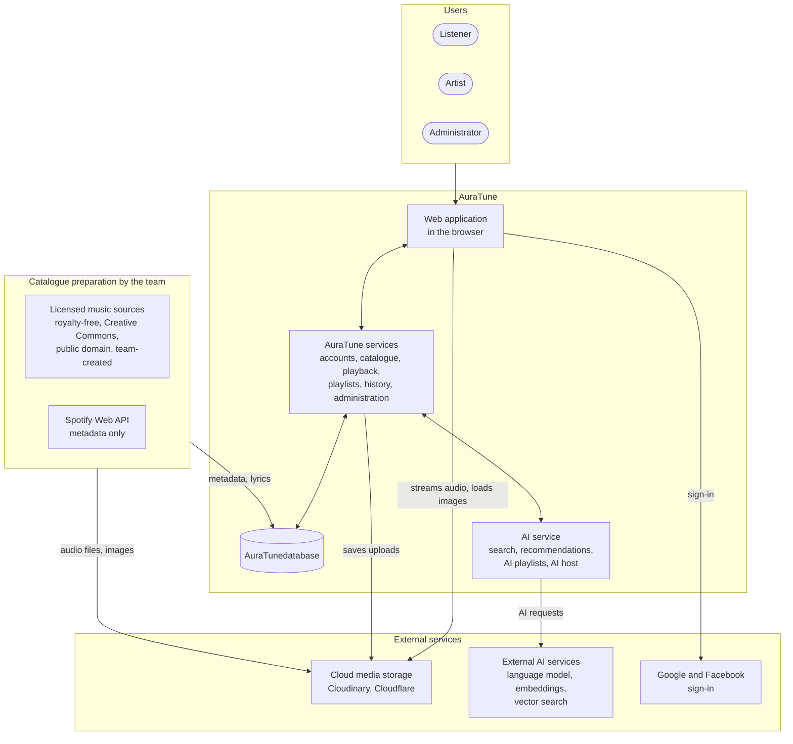
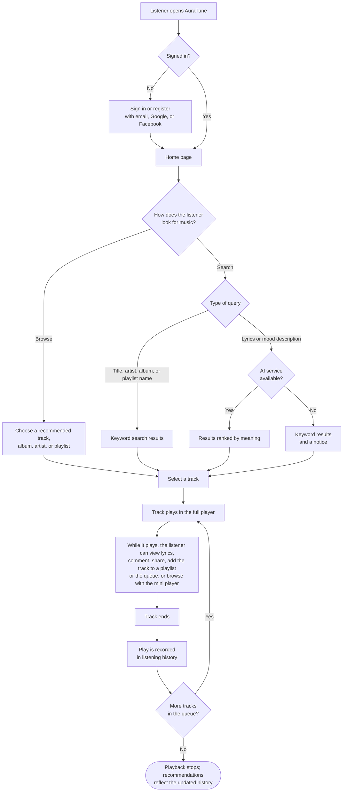
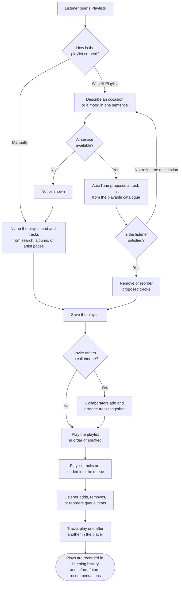

# **1. Introduction**

*Performed by: Lê Công Minh Nhựt, Reviewed by: Mai Đăng Khoa, Edited by: Lê Công Minh Nhựt, Nguyễn Khánh Đăng*

## 1.1. Purpose of the Document

*Performed by: Lê Công Minh Nhựt, Reviewed by: Mai Đăng Khoa, Edited by: Lê Công Minh Nhựt*

The Vision Document is developed to identify and describe the main user needs, product goals, and key features that AuraTune aims to provide. It helps the development team understand the problems the product intends to solve, its target users, and the value the system delivers.
In addition, the Vision Document provides an overview of AuraTune’s development direction, including the product’s positioning, stakeholders, user needs, key features, and non-functional requirements. It serves as a basis for establishing a shared understanding of the product scope and supports requirements analysis, design, implementation, and testing activities in subsequent stages of the project.
This second revision of the document is prepared as part of PA3-2026. It formalizes detailed Functional Requirements mapped directly to the System-Level Use-Case Model, establishes measurable Non-Functional Requirements, details realistic user environments, and expands competitor analysis based on feedback from the teaching assistants (TAs) and course requirements. All changes from the PA2 baseline are tracked in `docs/PA/Changes.md`.

## 1.2. Scope of the Document

*Performed by: Lê Công Minh Nhựt, Reviewed by: Mai Đăng Khoa, Edited by: Lê Công Minh Nhựt*

The Vision Document describes AuraTune at a high level without going into detailed technical implementation. Its scope includes:
  - **Product Positioning:** Identifying the problem to be solved, the affected users, and the value AuraTune aims to deliver.
  - **Stakeholder and User Descriptions:** Identifying the groups involved with the product, their characteristics, and their usage environment.
  - **User Needs:** Summarizing key user needs and examining existing solutions or applications.
  - **Product Overview:** Describing the product context, assumptions, and dependencies that may affect the product.
  - **Product Features:** Describing the key features, their benefits, and important user workflows.
  - **Non-Functional Requirements:** Identifying requirements related to performance, security, platforms, and other quality attributes.
The details of individual features will be further clarified in related requirements specifications and design documents as the project progresses.

## 1.3. Document Organization

*Performed by: Lê Công Minh Nhựt, Reviewed by: Mai Đăng Khoa, Edited by: Nguyễn Khánh Đăng*

The Vision Document is organized into six main sections:
1.  **Introduction:** Presents the purpose, scope, and organization of the document, along with its references.
2.  **Positioning:** Describes the problem to be solved and the positioning of AuraTune.
3.  **Stakeholder and User Descriptions:** Identifies stakeholders, user groups, the user environment, key needs, and competing alternatives.
4.  **Product Overview:** Presents the product perspective, assumptions, and dependencies.
5.  **Product Features:** Describes AuraTune’s key features and illustrates important user workflows.
6.  **Non-Functional Requirements:** Presents the non-functional requirements applicable to the product.

## 1.4. References

*Performed by: Lê Công Minh Nhựt, Reviewed by: Mai Đăng Khoa, Edited by: Nguyễn Khánh Đăng*

This section lists the documents and information sources used to develop the Vision Document. The initial references include:
|  |  |  |
| :- | :- | :- |
| **No.** | **Document** | **Purpose** |
| 1 | **PA3-2026 - Project Assignment 3**, Introduction to Software Engineering | Defines the required sections, detailed functional/non-functional requirements, and evaluation criteria for the Vision Document (2nd submission). |
| 2 | **Project Assignment 2 (PA2-2026)**, Introduction to Software Engineering | Baseline document for initial requirements, vision scope, and deliverables. |
| 3 | **Project Proposal - PA1**, AuraTune | Provides background information about the project idea, goals, scope, and planned features. |
| 4 | **System-Level Use-Case Model - PA3**, AuraTune (`docs/requirements/use-case-model.md`) | Authoritative source of actors, system boundaries, and 12-group use-case specifications directly mapped to Section 5 FRs. |
| 5 | **Existing Application Survey - PA1**, AuraTune | Supports the analysis of alternative solutions, competing applications, and the user needs that AuraTune aims to address. |
| 6 | **Project Plan (SPMP) - PA3**, AuraTune | Defines the agreed project scope, functional groups (G01–G12), sprint schedule, and the Assumptions and Constraints register. |
| 7 | **Team Contract - PA1**, AuraTune | Establishes team roles, workflow agreements, and feature ownership referenced across project artifacts. |
| 8 | **Vision Template - rup_vision_sp.docx** | Provides the structure and guidance for preparing the Vision Document. |

# **2. Positioning**

*Performed by: Mai Đăng Khoa, Reviewed by: Nguyễn Khánh Đăng, Edited by: Mai Đăng Khoa*

## 2.1. Problem Statement

*Performed by: Mai Đăng Khoa, Reviewed by: Nguyễn Khánh Đăng, Edited by: Mai Đăng Khoa*

|  |  |
| :- | :- |
| **Item** | **Description** |
| **The problem of** | Difficulty in finding music based on abstract moods, emotions, or incomplete lyrical fragments. |
| **Affects** | Students, office workers, and general listeners who want to match their auditory environment to their current feelings or activities. |
| **The impact of which is** | Frustration during music discovery, repetitive listening due to lack of discovery tools, and inability to find specific songs from memory. |
| **A successful solution would be** | A smart music platform utilizing AI-powered semantic vector search to understand emotional contexts and retrieve tracks based on natural language descriptions. |

## 2.2. Product Position Statement

*Performed by: Mai Đăng Khoa, Reviewed by: Nguyễn Khánh Đăng, Edited by: Mai Đăng Khoa*
| | |
| :- | :- |
| **Item** | **Description** |
| **For** | Music enthusiasts and focused workers. |
| **Who** | Seek a deeply personalized and intuitive music discovery experience. |
| **The product name** | AuraTune |
| **That** | Is an AI-powered smart music streaming platform providing seamless playback and emotion-driven recommendations. |
| **Our product** | Offers an "AI DJ" experience through advanced vector search and deep listening habit analytics. |

# **3. Stakeholder and User Descriptions**

*Performed by: Nguyễn Khánh Đăng, Thái Hoàng; Reviewed by: Thái Hoàng, Nguyễn Thanh Huy; Edited by: Nguyễn Khánh Đăng, Thái Hoàng*

This section describes the various stakeholders and users involved in the AuraTune project, outlining their roles, responsibilities, and the environments in which they will interact with the system.

## 3.1. Stakeholder Summary

*Performed by: Nguyễn Khánh Đăng, Reviewed by: Thái Hoàng, Edited by: Nguyễn Khánh Đăng*

Stakeholders are individuals or groups who have an interest in the project but may not necessarily use the core streaming features as end-users. For AuraTune, the key stakeholders include:
  - **Development Team**: A five-member team of undergraduate students acting as Full-stack Engineers. They are responsible for planning, designing, implementing, testing, and delivering the AuraTune system within the academic semester timeframe.
  - **Course Evaluators / Instructors**: Academic staff who evaluate the project artifacts, review the system's alignment with software engineering principles, and grade the final live demonstration.

## 3.2. User Summary

*Performed by: Nguyễn Khánh Đăng, Reviewed by: Thái Hoàng, Edited by: Nguyễn Khánh Đăng*

Users are the individuals who directly interact with AuraTune's core features. The system targets three primary user groups:
  - **Listeners**: General users—specifically students, office workers, or individuals looking to adjust their mood and focus. Their responsibilities and interactions include streaming music, utilizing AI-powered semantic search to find songs based on mood/lyrics, creating and sharing playlists, and tracking their listening analytics.
  - **Artists**: Musicians who use the platform as a launchpad for their original works. Their responsibilities include managing their dedicated artist profiles, uploading albums and audio files, and maintaining full ownership and control over their distributed content.
   - **Administrators**: Personnel responsible for managing the platform's ecosystem. They handle content moderation, manage user account permissions, ban violating users, and ensure that the platform strictly operates without commercially copyrighted music.

## 3.3. User Environment

*Performed by: Nguyễn Khánh Đăng, Reviewed by: Thái Hoàng, Edited by: Nguyễn Khánh Đăng*

The AuraTune application operates as a cloud-hosted, responsive single-page web application (SPA). It is accessed and operated under the following realistic hardware, software, network, and peripheral conditions:

- **Browser Compatibility**: AuraTune supports modern evergreen web browsers on desktop, laptop, tablet, and mobile platforms. The minimum supported browser versions are:
  - Google Chrome: Version 110 or later (Windows, macOS, Linux, Android)
  - Microsoft Edge: Version 110 or later (Windows, macOS)
  - Mozilla Firefox: Version 115 ESR or later (Windows, macOS, Linux)
  - Apple Safari: Version 16 or later (macOS, iOS, iPadOS)
  Legacy browsers (e.g., Internet Explorer, pre-Chromium Edge) are explicitly unsupported.
- **Display Resolutions and Responsive Breakpoints**: The web client provides an adaptive layout tailored to diverse form factors:
  - *Desktop / Laptop (Wide Viewport)*: 1920×1080 (FHD), 1440×900, 1366×768, with a minimum desktop width of 1024px displaying the full 3-column layout (collapsible navigation sidebar, main content area, persistent now-playing bar, and optional right drawer).
  - *Tablet (Medium Viewport)*: 768px to 1023px, featuring a collapsed icon sidebar and slide-over panels for the queue and conversational agent.
  - *Mobile Phone (Compact Viewport)*: 375px to 767px (e.g., iPhone 13/14/15, Samsung Galaxy S21/S22/S23), replacing the desktop sidebar with a bottom tab bar, full-screen overlay for the full player, and responsive drawer sheets.
- **Network Bandwidth and Latency**:
  - *Broadband / Wi-Fi*: Recommended download bandwidth of ≥ 5 Mbps and latency < 100ms to ensure instant audio playback, smooth seeking, and fast vector search responses.
  - *Mobile Data (4G / 5G)*: Minimum download bandwidth of ≥ 2 Mbps. Under intermittent or constrained connections, the player prioritizes audio streaming over high-resolution cover art loading.
  - Offline playback is strictly out of scope; an active internet connection is required to authenticate, fetch audio streams, and interact with backend AI services.
- **Audio Output and Peripherals**:
  - Operates using the standard HTML5 `<audio>` engine without custom browser plugins or proprietary Digital Rights Management (DRM) software.
  - Audio output is routed to any system-default stereo output device (built-in speakers, 3.5mm wired headphones, USB DACs, Bluetooth headsets/speakers) supporting 44.1 kHz / 48 kHz 16-bit PCM playback.
- **Client Operating Systems**: Windows 10/11, macOS 12 Monterey or later, Ubuntu 20.04/22.04 LTS, Android 11 or later, and iOS 15 or later.

## 3.4. Summary of Key Stakeholder or User Needs

*Performed by: Thái Hoàng, Reviewed by: Nguyễn Thanh Huy, Edited by: Nguyễn Khánh Đăng*

This section summarizes what the users and stakeholders of AuraTune need and why. The users are the Listener, the Artist and the Administrator (Project Proposal, Section 3). The project team and the university also have a stakeholder need, which is to operate within legal limits. Each need has an ID so that features and use cases can refer to it later.
**Priority.** High means the product does not meet its purpose without the need. Medium means the need improves the experience but the core product can work without it. The priorities are the team's initial judgement and are reviewed when the use cases are written.
|  |  |  |  |  |  |  |
| :- | :- | :- | :- | :- | :- | :- |
| **ID** | **Need** | **Who** | **Priority** | **Current solution** | **Proposed solution in AuraTune** | **Related feature** |
| N-01 | Create an account and sign in quickly and safely | All users | High | A separate account for each music service | Sign-up and login by email or OAuth (Google, Facebook), so that one identity keeps the listening history and recommendations | G01 Account Registration and Sign-In |
| N-02 | Find a song without knowing its exact title | Listener | High | Text matching by title, artist or album (Proposal, Section 7) | Text search, plus AI semantic search by description, mood or lyric fragment, with filters and sorting | G03 Search and AI Semantic Search |
| N-03 | Discover music that matches taste and mood without searching manually | Listener | High | Recommended sections on the home pages of existing apps (survey, Section 2.1) | AI recommendation engine and a home dashboard with personalized sections, recent plays, trending charts and new albums | G02 Home Page, G10 AI Recommendations |
| N-04 | Listen without interruption and control playback from any page | Listener | High | A player fixed at the bottom of the screen in Spotify and Zing MP3 (survey, Section 4) | A persistent player with play, pause, skip, seek, volume, shuffle and repeat, and a queue that can be viewed, reordered and edited | G04 Music Player (Full and Mini), G05 Queue Management |
| N-05 | Follow the lyrics while listening | Listener | Medium | Lyrics views in both apps; Zing MP3 highlights the current line (survey, Section 3.1) | Synchronized lyrics with the current line highlighted and smooth scrolling, when lyrics data is available | G04 Music Player (Full and Mini) |
| N-06 | Organize and share personal collections of music | Listener | High | Playlists in existing apps (survey, Section 2.2) | Create, edit and delete playlists, AI-assisted playlists, collaborative playlists, and sharing of songs and albums | G06 Playlist Management and AI Playlist, G08 Album Details |
| N-07 | Understand one's own listening habits | Listener | Medium | Not covered by the PA1 survey | Listening history, total listening time, and top artists and genres | G07 Listening History and Statistics |
| N-08 | Explore albums and artists | Listener | Medium | Content cards and detail pages in existing apps (survey, Sections 2.1 and 2.2) | Album details (cover, release year, duration, tracklist), saving and sharing albums, artist biographies and following artists | Album interaction, G08 Album Details, G09 Artist Profile |
| N-09 | Publish music and manage one's own content directly | Artist | High | Not covered by the PA1 survey | A profile with a biography, upload of new tracks and albums, and the ability to edit, hide, or delete one's own content | G09 Artist Profile |
| N-10 | Keep the platform safe and moderated | Administrator | High | Not covered by the PA1 survey, because administration tools are not visible to listeners | An administration interface to ban users, manage account permissions, remove copyrighted songs and view system statistics | G11 Administration |
| N-11 | Operate within legal limits for music and personal data | Project team, university | High | Commercial services sign licence contracts with rights organizations (Proposal, Section 4.2) | A non-commercial academic scope; royalty-free or CC0 music for any public demonstration; a privacy policy, user consent and data encryption (Decree 13/2023/ND-CP) | All features |
| N-12 | Get music help through a natural conversation | Listener | Medium | An AI DJ in Spotify, for Premium subscribers | An AI conversational agent that acts as a real-time host and DJ for the listener | G12 AI Conversational Agent / Real-time Host |

Related features follow the Project Proposal (Section 5) and the Team Contract; the AI conversational agent is the "AI DJ" of the Proposal introduction.

## 3.5. Alternatives and Competition

*Performed by: Thái Hoàng, Reviewed by: Nguyễn Thanh Huy, Edited by: Thái Hoàng*

Listeners seeking digital music streaming and discovery today interact with established mainstream commercial platforms including Spotify, SoundCloud, YouTube Music, and regional Vietnamese services such as Zing MP3. While these platforms provide extensive commercial libraries, they impose significant subscription paywalls for advanced AI capabilities and lack direct channels for open-copyright streaming and indie collaboration.

### 3.5.1. Detailed Competitor Analysis

*Performed by: Thái Hoàng, Reviewed by: Nguyễn Thanh Huy, Edited by: Thái Hoàng*

| Competitor Platform | Key Strengths | Major Weaknesses & Bottlenecks | AuraTune Architectural Differentiation |
| :--- | :--- | :--- | :--- |
| **Spotify** | Market leader with 100M+ commercial tracks, sophisticated collaborative filtering, polished multi-device UI, dark theme, and generative features (AI DJ, Prompted Playlists). | Generative AI features (AI DJ) require recurring monthly Premium subscriptions ($10.99/mo). Direct music publishing requires third-party aggregators (DistroKid, TuneCore). Semantic lyric-concept search is restricted. | Provides free, open AI semantic search and conversational agent access. Direct artist publishing without distributor intermediaries. Clean open-copyright model. |
| **SoundCloud** | Premier platform for grassroots indie artists, open uploads, direct commenting on audio waveforms, and underground remix culture. | Lacks semantic AI vector search (limited to basic metadata keywords/tags). No native LLM conversational companion. Interface cluttered with intrusive advertisements on free tiers. | Implements vector embedding search for lyric fragments and vague mood descriptions. Integrates context-aware AI music host with direct queue controls. |
| **YouTube Music** | Vast catalogue including live performances, covers, video-audio integration, and strong Google search recommendation graph. | Discovery relies primarily on past YouTube watch history rather than nuanced conversational guidance. No open prompt-driven playlist generation for free users. Heavy video data overhead. | Lightweight, audio-first responsive web client with dedicated AI conversational chat interface and transparent personal listening analytics. |
| **Zing MP3** | Deep localization for Vietnamese listeners, synchronized karaoke lyrics display, high domestic brand awareness. | Discovery is strictly limited to exact keyword metadata matches; completely lacks AI semantic comprehension, vector search, or conversational DJ capabilities. | Adds LLM-driven intent parsing, mood vector retrieval, and collaborative playlist creation tailored for students and focused workers. |

### 3.5.2. Systematic Capability Matrix

*Performed by: Thái Hoàng, Reviewed by: Nguyễn Thanh Huy, Edited by: Thái Hoàng*

| Product Capability / Feature | Spotify | SoundCloud | YouTube Music | Zing MP3 | AuraTune (Group 10) |
| :--- | :---: | :---: | :---: | :---: | :---: |
| **Responsive Persistent Bottom Player** | Yes | Yes | Yes | Yes | **Yes** (HTML5, mini & full player) |
| **Synchronized Lyrics Display** | Yes | No | Yes | Yes | **Yes** (Auto-scroll & highlight) |
| **Exact Metadata Search (Title/Artist/Album)** | Yes | Yes | Yes | Yes | **Yes** (Diacritic-insensitive) |
| **AI Semantic Search (Lyrics Fragment & Mood Vector)** | Limited | No | No | No | **Yes** (Vector database embeddings) |
| **Interactive AI Conversational Host / DJ** | Premium only | No | No | No | **Yes** (Integrated text chat agent) |
| **Prompt-Driven AI Playlist Synthesis** | Premium only | No | No | No | **Yes** (One-sentence prompt to playlist) |
| **Collaborative Playlist Co-Curation** | Yes | No | Yes | No | **Yes** (Multi-user playlist editing) |
| **Independent Artist Self-Publishing Studio** | Via Aggregator | Yes | Via Distributor | Via Label | **Yes** (AuraTune Studio upload & manage) |
| **Detailed Listening Duration Analytics** | Wrapped (Annual) | Stats (Pro only)| Recap (Seasonal) | Limited | **Yes** (Real-time 7-day, 30-day, all-time) |
| **Free-Tier Access to AI Features** | No | No | No | No | **Yes** (100% free academic prototype) |
| **Strict Open-Copyright & Non-Commercial Safety** | No | No | No | No | **Yes** (CC0, public domain & licensed) |

### 3.5.3. Strategic Positioning of AuraTune

*Performed by: Thái Hoàng, Reviewed by: Nguyễn Thanh Huy, Edited by: Thái Hoàng*

AuraTune operates within an academic, non-commercial research scope (Proposal Section 4.1). Rather than competing with commercial services on catalog volume, AuraTune differentiates itself by unifying three technological pillars:
1. **Semantic and Conversational Music Discovery**: Democratizing AI-powered search by allowing listeners to find tracks through vague lyrical memories ("that song talking about raining in autumn") and natural mood prompts, guided by an interactive conversational host.
2. **Open-Copyright & Independent Artist Launchpad**: Fostering an ethical, legally compliant music ecosystem where independent musicians directly publish, manage, and distribute original works without distributor fees or rights litigation risks.
3. **Transparent Personal Analytics & Collaboration**: Offering listeners real-time ownership over their listening habits and facilitating collaborative playlist curation without subscription paywalls.

# **4. Product Overview**

*Performed by: Nguyễn Thanh Huy, Reviewed by: Lê Công Minh Nhựt, Edited by: Nguyễn Thanh Huy, Nguyễn Khánh Đăng*

This section places AuraTune in the context of its users and of the external services it relies on. It also lists the assumptions and dependencies that would change this Vision Document if they stopped being true. Implementation details, such as frameworks, database design, and API structure, are left to the requirements and design artifacts produced in later Sprints.

## 4.1. Product Perspective

*Performed by: Nguyễn Thanh Huy, Reviewed by: Lê Công Minh Nhựt, Edited by: Nguyễn Thanh Huy*

AuraTune is a new, independent, and self-contained web application for streaming and discovering music. It is not a component of a larger system and does not replace an existing product. Listeners, artists, and administrators use it through a web browser on a desktop or mobile device. AuraTune is a non-commercial academic prototype developed by Group 10 for CS300 / CSC13002 Introduction to Software Engineering. During the project, it is used only by team members, course evaluators, and test accounts.
AuraTune offers the core experience of mainstream services such as Spotify, Zing MP3, and SoundCloud: browsing, playback, a queue, and playlists. On top of this, it adds AI-assisted discovery. Listeners can search by lyrics or mood, generate playlists from a short description, receive personalized recommendations, and talk to a conversational AI host. Section 3.5 compares AuraTune with these alternatives.
**System context.** From the user's point of view, AuraTune consists of three parts:
  - the **web application**, which runs in the user's browser;
  - the **AuraTune services**, which handle accounts, the music catalogue, playback, playlists, listening history, and administration, together with an **AI service** that connects AuraTune to external AI providers;
  - the **AuraTune database**, which stores accounts, catalogue metadata, playlists, listening history, comments, and links to media files.
Figure 4.1 shows these parts, the three user roles, and the external systems that AuraTune interacts with.

**Figure 4.1 — AuraTune system context**

**External interfaces.** AuraTune does not depend on any other application at run time apart from the services below. Each entry corresponds to an assumption or dependency in Section 4.2.
|  |  |  |  |
| :- | :- | :- | :- |
| **External system** | **Role for AuraTune** | **Features that use it** | **How AuraTune interacts with it** |
| Google and Facebook sign-in | Lets users sign in with an existing account. A local email and password account is always available as an alternative. | G01 | The user is redirected to the provider at sign-in and returns to AuraTune once the provider confirms the identity (AD-07). |
| Cloud media storage (Cloudinary and Cloudflare) | Stores and delivers audio files, cover art, and artist images. | G02, G04, G08, G09, G11 | The browser streams audio and loads images through links stored in the AuraTune database. Uploads by artists and administrators are saved to this storage (AD-04). |
| External AI services (language model, text-embedding model, vector search) | Interpret natural-language requests, compare their meaning with track lyrics and descriptions, and generate playlists, recommendations, and AI host replies. | G03, G06, G10, G12 | Only the AuraTune AI service calls these services; the browser never calls them directly. Providers are selected after a proof of concept in Sprint 3 (PA3), and no direct personal identifiers are sent (AD-06, AD-09). |
| Spotify Web API | Source of track, album, and artist metadata. | G02, G03, G08, G09 | Used only by the team's catalogue preparation scripts, never by end users at run time. No audio is taken from Spotify, and continued use is subject to AD-05. |
| Licensed music sources | Source of playable audio and lyrics. | G03, G04 | The team selects tracks whose licence allows non-commercial online streaming and keeps a licence record for each one (AD-03). |

**Product boundaries.** In line with the project scope in the Project Plan, AuraTune does not include:
  - native mobile applications;
  - payments, subscriptions, or advertising;
  - commercially copyrighted recordings;
  - offline listening.

## 4.2. Assumptions and Dependencies

*Performed by: Nguyễn Thanh Huy, Reviewed by: Lê Công Minh Nhựt, Edited by: Nguyễn Khánh Đăng*

The factors below affect the features described in Section 5. An **assumption** is a condition the team currently treats as true but has not yet verified. A **dependency** is an external service, dataset, or condition that AuraTune relies on. For each item, the last column but one states how the vision would change if the item stopped holding. The last column links each item to the Assumptions and Constraints register in the Project Plan (Section 2.2), where its verification step, owner, and schedule are recorded.
|  |  |  |  |  |  |
| :- | :- | :- | :- | :- | :- |
| **ID** | **Type** | **Assumption or dependency** | **Features affected** | **Impact on this vision if it no longer holds** | **Project Plan reference** |
| AD-01 | Assumption | Users access AuraTune through recent versions of mainstream desktop and mobile web browsers, with a stable internet connection. | All | If a significant group of target users needs a native application or offline listening, Section 4.1 and the platform requirements in Section 6 must be revised. | TA-01, TA-03 |
| AD-02 | Assumption | Standard browser audio playback is sufficient for streaming, seeking, and moving between tracks. No DRM or special streaming protocol is required. | G04, G05 | If mobile browsers block autoplay or background playback, some player and queue behaviour (e.g., automatically starting the next track) must be adjusted and documented as a known limitation. | TA-02 |
| AD-03 | Dependency | A legally usable catalogue of audio and lyrics can be assembled from royalty-free, Creative Commons, public-domain, or team-created content whose licence allows non-commercial online streaming. | G03, G04, G06, G10, G12 | If the catalogue is too small or lacks lyrics, lyric-based search and the lyrics view use team-written sample lyrics, and AI results may be less relevant than described. | PC-04, ED-06 |
| AD-04 | Dependency | Audio files and images are stored and delivered through cloud media storage (Cloudinary and Cloudflare). The storage allows listeners to seek within audio files, and free-tier quotas are sufficient for a demo-scale catalogue. | G02, G04, G08, G09, G11 | If storage fails, playback and image display stop. If quotas are tighter than expected, the catalogue is reduced. | ED-04, ED-05 |
| AD-05 | Dependency | Track, album, and artist metadata is collected with the team's Spotify Web API scripts. It is shown with Spotify attribution, is not used as input to AI features, and is not used to calculate popularity. Showing it to users depends on confirmation from the course instructor. | G02, G03, G08, G09 | If Spotify metadata may not be shown, these features use metadata from the licensed sources or prepared by the team. The features themselves do not change. | ED-01, ED-02, ED-03, ED-11 |
| AD-06 | Dependency | AI-assisted features rely on external AI services: a language model, a text-embedding model, and vector search. Providers have not been selected yet. A proof of concept in Sprint 3 (PA3) will choose a free-tier option with acceptable quality, speed, and data-use terms. | G03, G06, G10, G12 | If no adequate free option exists, AI features are reduced in scope (e.g., fewer AI requests or shorter conversations) rather than removed. When an AI service is unavailable, each feature switches to the fallback described in Section 5.2. | ED-07, ED-08 |
| AD-07 | Dependency | Google and Facebook sign-in remain available, and course evaluators can sign in through them, either because the sign-in apps are published or because evaluators are registered as test users. | G01 | If social sign-in is unavailable, users sign in with a local email and password account. | ED-09 |
| AD-08 | Assumption | Free-tier hosting, database, and service quotas are sufficient for demo-scale use by team members and course evaluators. | All | If quotas or start-up times are not acceptable, the hosting choice is reviewed in Sprint 3 (PA3), and the performance targets in Section 6 may need adjustment. | PC-03, TA-05 |
| AD-09 | Assumption | During the academic evaluation phase, AuraTune is accessed primarily by team members, course evaluators, and test accounts. Basic data protection measures (encryption, password hashing, and stripping personal identifiers such as names or email addresses before sending requests to external AI services) are enforced in alignment with Decree 13/2023/ND-CP. | G01, G07, G10, G12 | If AuraTune were opened to the general public, formal legal compliance workflows, explicit cookie/tracking consent banners, and full-scale content moderation pipelines would have to be expanded in this vision. | PC-06 |
| AD-10 | Assumption | Artist accounts upload only tracks they have the right to distribute. During the project, artist accounts are test accounts that use licensed or team-created content. | G09, G11 | If the rights to uploaded content cannot be trusted, an administrator review step must be added before uploaded tracks become playable. | PC-04 |

# **5. Product Features**

*Performed by: Nguyễn Thanh Huy, Reviewed by: Lê Công Minh Nhựt, Edited by: Nguyễn Thanh Huy, Nguyễn Khánh Đăng*

AuraTune's features are organized into twelve functional groups, G01 to G12, which are the same groups used in the Project Plan. They refine the Key Features of the PA1 Project Proposal according to the scope agreed in the Project Plan. Features are described as users perceive them. How each one is implemented will be specified later in use cases and Spec Kit specifications.
AuraTune serves three user roles:
  - a **listener** is a registered user who listens to and organizes music;
  - an **artist** is an account that publishes and manages its own tracks;
  - an **administrator** maintains the catalogue and the platform.
## 5.1. Feature Summary

*Performed by: Nguyễn Thanh Huy, Reviewed by: Lê Công Minh Nhựt, Edited by: Nguyễn Thanh Huy*

|  |  |  |  |
| :- | :- | :- | :- |
| **ID** | **Feature** | **Primary users** | **AI-assisted** |
| G01 | Account Registration and Sign-In | Listeners, artists, administrators | No |
| G02 | Home Page | Listeners | Partly (recommendations) |
| G03 | Search and AI Semantic Search | Listeners | Yes (search by lyrics or mood) |
| G04 | Music Player (Full and Mini) | Listeners | No |
| G05 | Queue Management | Listeners | No |
| G06 | Playlist Management and AI Playlist | Listeners | Yes (AI Playlist) |
| G07 | Listening History and Statistics | Listeners | No |
| G08 | Album Details | Listeners | No |
| G09 | Artist Profile | Listeners, artists | No |
| G10 | AI Recommendations | Listeners | Yes |
| G11 | Administration | Administrators | No |
| G12 | AI Conversational Agent / Real-time Host | Listeners | Yes |

## 5.2. Feature Descriptions

*Performed by: Nguyễn Thanh Huy, Reviewed by: Lê Công Minh Nhựt, Edited by: Nguyễn Thanh Huy, Nguyễn Khánh Đăng*

**G01 — Account Registration and Sign-In.** Users can create an AuraTune account with an email address and password, or sign in with an existing Google or Facebook account. An account lets AuraTune keep each listener's playlists, liked tracks, listening history, and recommendations between sessions and devices. It also gives artists and administrators access to the functions of their role. Social sign-in saves new users from creating another password, while email sign-in remains available to anyone without a Google or Facebook account.

**G02 — Home Page.** The Home page is the first screen that a signed-in listener sees. It shows recommended tracks, recently played tracks, popular tracks and charts, new albums, featured artists, suggested public playlists, and music genres. Popular tracks and charts are calculated from AuraTune's own play counts. The Home page is needed because listeners often open a music application without a specific track in mind and want something to play within one or two clicks. Listeners benefit most, and new releases from artists in the catalogue also gain visibility.

**G03 — Search and AI Semantic Search.** Listeners can search the catalogue by track title, artist name, album name, or playlist name. They can also describe what they want in their own words, such as a lyric line they remember or a mood like "calm songs for a rainy evening". AuraTune then returns tracks whose lyrics or descriptions match the meaning of the request, not only its exact words. This is needed because listeners often remember a feeling or a fragment of a lyric but not the title, and keyword search alone cannot find such tracks. Listeners find music faster, and semantic search is one of the main differences between AuraTune and the alternatives in Section 3.5.

**G04 — Music Player (Full and Mini).** The music player plays the selected track and provides play, pause, previous, next, seek, volume, shuffle, and repeat controls, along with the track's cover art, title, artist, and duration. The full player shows the lyrics and lets listeners read and post comments, share the track, and add it to a playlist or to the queue. Lyrics follow the playback position when time-stamped lyrics are available. A mini player stays at the bottom of every page, so music keeps playing and remains controllable while the listener browses other pages. Listeners benefit directly, and comments and sharing help artists reach their audience and receive feedback.

**G05 — Queue Management.** The queue shows the tracks that will play after the current one. Listeners can add tracks to it, choose a track to play next, remove tracks, and reorder them by dragging. When the current track ends, the next track in the queue starts automatically. A visible, editable queue lets listeners shape a listening session, for example while studying or at a gathering, without building a permanent playlist.

**G06 — Playlist Management and AI Playlist.** Listeners can create, rename, describe, and delete playlists, add and remove tracks, reorder them, and play a playlist in order or shuffled, and tracks they like are kept in a "Liked Songs" playlist. A playlist can also be made collaborative so that several listeners add and arrange tracks together. With AI Playlist, a listener describes an occasion or a mood in one sentence, and AuraTune proposes a playlist that the listener can review, edit, and save. Playlists let listeners keep and return to the music they have chosen, and AI Playlist saves them from assembling a playlist track by track. Listeners who want ready-made playlists for specific activities benefit most, and collaborative playlists let friends or study groups share music.

**G07 — Listening History and Statistics.** AuraTune records every track that a listener plays. Listeners can view their recently played tracks, the number of plays of each track, their total listening time and listening time per artist, as well as their most-played tracks, artists, and genres. History helps listeners find a track they heard but did not save, and the statistics show how their taste changes over time. The same history is the main input for AI Recommendations (G10), so collecting it benefits both the listener and the quality of personalization.

**G08 — Album Details.** An album page shows the album's title, cover art, artist, release year, total duration, and track list, with the play count of each track. Listeners can play the whole album or a single track, save the album to their library, and share it. Album pages are needed because many listeners prefer to hear a release as a whole and in the order the artist intended. Listeners get a complete view of a release, and artists benefit from having their albums presented as a whole.

**G09 — Artist Profile.** An artist profile shows the artist's name, picture, biography, most-played tracks on AuraTune, albums, and related playlists, and listeners can follow or share the artist. Artist accounts can upload their own tracks, organize them into albums, and edit, hide, or remove their published content (see AD-10). Profiles are needed so that listeners can explore more music from an artist they like and keep track of the artists they follow. Listeners discover music more easily, and artists gain a space to present and manage their work.

**G10 — AI Recommendations.** AuraTune suggests tracks to each listener based on their listening history, their liked tracks, and the artists and genres they play most, combined with tracks that are popular on AuraTune. Recommendations appear on the Home page and change as the listener's history grows. They are needed because a catalogue is hard to explore without guidance, and listeners otherwise tend to stay with the few tracks they already know. Listeners discover new music that matches their taste, and less well-known artists in the catalogue gain a chance to be heard.

**G11 — Administration.** Administrators manage the platform through a dedicated dashboard. They can add, edit, and remove tracks, albums, and artists, create editorial playlists, view platform-wide statistics such as the numbers of users and plays, and suspend or ban accounts that break the platform rules. These functions keep the catalogue accurate, keep its content within the licensing limits in AD-03, and allow administrators to deal with misuse such as abusive comments. Administrators use these functions directly, while listeners and artists benefit from a well-maintained and safe platform.

**G12 — AI Conversational Agent / Real-time Host.** The AI host is a chat assistant that listeners can talk to in everyday language while they listen. Listeners can ask it for music for a situation, such as "something upbeat for a morning run", ask about the track or artist that is playing, or ask it to add suggested tracks to the queue. Its answers are based on AuraTune's own catalogue, so it suggests only tracks that can actually be played. This feature is needed because some listeners find it easier to say what they want than to search or browse, and it makes discovery feel like talking to a radio host. Listeners who are new to the catalogue or unsure what they want to hear benefit most.

**Behaviour when an AI service is unavailable.** Every AI-assisted feature has a fallback so that core user flows remain usable when an external AI service is slow, over its quota, or offline. A fallback keeps the application working, but it does not replace the AI feature itself.

|  |  |  |
| :- | :- | :- |
| **Feature** | **Normal behaviour** | **Fallback** |
| G03 Search and AI Semantic Search | Results ranked by the meaning of a lyric or mood description | Keyword search on titles, artists, albums, and playlists, with a notice that AI search is temporarily unavailable |
| G06 AI Playlist | A proposed playlist based on the listener's description | A notice to the listener; manual playlist creation remains available |
| G10 AI Recommendations | Personalized suggestions | Popular tracks on AuraTune and tracks from the listener's most-played artists and genres |
| G12 AI Conversational Agent / Real-time Host | Conversation with the AI host | A message that the host is unavailable; all other features keep working |

## 5.3. Detailed Functional Requirements

*Performed by: Lê Công Minh Nhựt, Nguyễn Khánh Đăng; Reviewed by: Mai Đăng Khoa; Edited by: Lê Công Minh Nhựt*

To establish unambiguous traceability with the Use-Case Model (`docs/requirements/use-case-model.md`) and technical feature specifications (`specs/`), the system capabilities across all twelve functional groups (G01–G12) are formalized into explicit Functional Requirements (FR). Each requirement specifies precise system behavior ("The system shall..."), inputs, triggers, expected outcomes, participating actors, and MoSCoW prioritization.

### 5.3.1. Group 010 (G01) — Account Registration and Sign-In

| FR ID | Functional Requirement Statement | Mapped Use Case | Primary Actor | Priority |
| :--- | :--- | :--- | :--- | :--- |
| **FR-010-001** | The system shall register a new user account when a guest provides an email address, display name, and password meeting complexity rules (minimum 8 characters, letters and numbers), hashing the password with Argon2/bcrypt prior to database persistence. | `UC-010-001` | Guest | Must Have |
| **FR-010-002** | The system shall authenticate user credentials and issue a dual-token session (15-minute JWT Access Token and 7-day rotating Refresh Token in a secure HttpOnly cookie) upon valid email and password submission. | `UC-010-002` | Guest / Listener | Must Have |
| **FR-010-003** | The system shall authenticate users via Google OAuth 2.0 authorization code flow, automatically linking or provisioning the user profile and returning valid session credentials. | `UC-010-003` | Guest / Listener | Must Have |
| **FR-010-004** | The system shall authenticate users via Facebook Login OAuth flow and provision active session credentials upon receiving verified profile claims. | `UC-010-004` | Guest / Listener | Should Have |
| **FR-010-005** | The system shall exchange a valid, unrevoked Refresh Token cookie for a newly minted JWT Access Token when the active access token expires. | `UC-010-005` | Listener | Must Have |
| **FR-010-006** | The system shall generate a cryptographically random, 15-minute time-limited reset token and dispatch a recovery email when a user requests password reset. | `UC-010-006` | Guest / Listener | Should Have |
| **FR-010-007** | The system shall invalidate the active session record in the database and purge the client HttpOnly Refresh Token cookie upon user logout. | `UC-010-007` | Listener | Must Have |
| **FR-010-008** | The system shall revoke all active session records across all devices associated with the user account upon a global logout request. | `UC-010-008` | Listener | Could Have |
| **FR-010-009** | The system shall allow a user to unlink third-party OAuth providers (Google or Facebook) provided that a valid local email password has been established. | `UC-010-009` | Listener | Could Have |

### 5.3.2. Group 020 (G02) — Home Dashboard

| FR ID | Functional Requirement Statement | Mapped Use Case | Primary Actor | Priority |
| :--- | :--- | :--- | :--- | :--- |
| **FR-020-001** | The system shall dynamically aggregate and render modular content sections on the home screen (Hero Banner, Personalized Recommendations, Recently Played, Trending Charts, New Album Releases, Featured Artists, Suggested Public Playlists, and Genre Grid). | `UC-020-001` | Guest / Listener | Must Have |
| **FR-020-002** | The system shall immediately initialize playback and populate the playback queue when a listener clicks the primary play action on any home recommendation card. | `UC-020-002` | Guest / Listener | Must Have |
| **FR-020-003** | The system shall display the authenticated listener's recently streamed tracks ordered by last played timestamp with direct resume capability. | `UC-020-003` | Listener | Must Have |
| **FR-020-004** | The system shall calculate platform-wide stream counts and render the Top 50 Trending Charts with dynamic period filters (Today, This Week, All Time) and genre selectors. | `UC-020-004` | Guest / Listener | Must Have |
| **FR-020-005** | The system shall display newly uploaded and approved albums and tracks ordered by release date with release-type badges ("Single", "EP", "Album"). | `UC-020-005` | Guest / Listener | Should Have |

### 5.3.3. Group 030 (G03) — Search and AI Semantic Search

| FR ID | Functional Requirement Statement | Mapped Use Case | Primary Actor | Priority |
| :--- | :--- | :--- | :--- | :--- |
| **FR-030-001** | The system shall execute diacritic-insensitive, prefix-matching text search across song titles, artist names, album titles, and playlist names, returning categorized results within 1.0 second. | `UC-030-001` | Guest / Listener | Must Have |
| **FR-030-002** | The system shall analyze natural-language lyric fragments and retrieve matching songs from the licensed catalog with matched text snippets highlighted. | `UC-030-002` | Guest / Listener | Must Have |
| **FR-030-003** | The system shall convert abstract emotional prompts (e.g., "gentle acoustic melodies for late night study") into text embeddings and perform vector cosine similarity search to retrieve contextual tracks. | `UC-030-003` | Guest / Listener | Must Have |
| **FR-030-004** | The system shall store the last 10 search queries in browser LocalStorage, supporting query re-execution and individual or full deletion. | `UC-030-004` | Guest / Listener | Should Have |

### 5.3.4. Group 040 (G04) — Music Player (Full and Mini)

| FR ID | Functional Requirement Statement | Mapped Use Case | Primary Actor | Priority |
| :--- | :--- | :--- | :--- | :--- |
| **FR-040-001** | The system shall control audio playback (play, pause, next track, and previous track with a 3-second restart threshold) using standard HTML5 audio APIs. | `UC-040-001` | Guest / Listener | Must Have |
| **FR-040-002** | The system shall adjust audio volume smoothly between 0% and 100%, provide instantaneous mute toggling, and persist volume preference across page navigations. | `UC-040-002` | Guest / Listener | Must Have |
| **FR-040-003** | The system shall seek to any arbitrary time position in the track via HTTP 206 Partial Content byte-range requests without requiring full audio buffer download. | `UC-040-003` | Guest / Listener | Must Have |
| **FR-040-004** | The system shall toggle Shuffle playback (randomized queue order) and Repeat modes (Off, Repeat All, Repeat One). | `UC-040-004` | Guest / Listener | Must Have |
| **FR-040-005** | The system shall synchronize lyrics display with current playback time, highlighting the active vocal line and auto-scrolling smoothly. | `UC-040-005` | Guest / Listener | Should Have |
| **FR-040-006** | The system shall maintain an uninterrupted bottom mini-player during application routing and support one-click expansion to a modal/full-page player. | `UC-040-006` | Guest / Listener | Must Have |
| **FR-040-007** | The system shall generate track sharing links using Web Share API or system clipboard copy. | `UC-040-007` | Guest / Listener | Should Have |
| **FR-040-008** | The system shall render public user comments on track full view ordered chronologically with author avatars. | `UC-040-008` | Guest / Listener | Should Have |
| **FR-040-009** | The system shall validate and persist public comments submitted by authenticated listeners on track pages. | `UC-040-009` | Listener | Should Have |
| **FR-040-010** | The system shall allow comment authors and platform administrators to delete comments. | `UC-040-010` | Listener / Administrator | Should Have |

### 5.3.5. Group 050 (G05) — Queue Management

| FR ID | Functional Requirement Statement | Mapped Use Case | Primary Actor | Priority |
| :--- | :--- | :--- | :--- | :--- |
| **FR-050-001** | The system shall render an accessible queue drawer displaying the currently playing track and upcoming queue list (up to 50 tracks). | `UC-050-001` | Guest / Listener | Must Have |
| **FR-050-002** | The system shall append selected songs to the end of the upcoming queue without interrupting active playback. | `UC-050-002` | Guest / Listener | Must Have |
| **FR-050-003** | The system shall prioritize selected tracks using Play Next (LIFO), inserting them at index 0 of the upcoming queue to play immediately after the current song. | `UC-050-003` | Guest / Listener | Must Have |
| **FR-050-004** | The system shall support drag-and-drop manual reordering of tracks within the upcoming playback queue. | `UC-050-004` | Guest / Listener | Should Have |
| **FR-050-005** | The system shall allow listeners to remove individual tracks from the upcoming queue. | `UC-050-005` | Guest / Listener | Must Have |
| **FR-050-006** | The system shall clear all upcoming tracks in the queue with a single action while preserving the current playing song. | `UC-050-006` | Guest / Listener | Must Have |
| **FR-050-007** | The system shall export the current queue sequence into a newly created personal playlist. | `UC-050-007` | Listener | Could Have |

### 5.3.6. Group 060 (G06) — Playlist Management and AI Playlist

| FR ID | Functional Requirement Statement | Mapped Use Case | Primary Actor | Priority |
| :--- | :--- | :--- | :--- | :--- |
| **FR-060-001** | The system shall create custom playlists with title, description, and cover image, defaulting to Private visibility. | `UC-060-001` | Listener | Must Have |
| **FR-060-002** | The system shall display playlist metadata, track count, total duration, and tracklist for any authorized playlist. | `UC-060-002` | Guest / Listener | Must Have |
| **FR-060-003** | The system shall allow playlist owners to edit title, description, and Public/Private visibility. | `UC-060-003` | Listener | Must Have |
| **FR-060-004** | The system shall allow owners to delete playlists with automatic cleanup of song mappings. | `UC-060-004` | Listener | Must Have |
| **FR-060-005** | The system shall add tracks to playlists and prevent duplicate song additions. | `UC-060-005` | Listener / Collaborator | Must Have |
| **FR-060-006** | The system shall remove tracks from playlists and re-index the sequence. | `UC-060-006` | Listener / Collaborator | Must Have |
| **FR-060-007** | The system shall persist manual song reordering within a playlist. | `UC-060-007` | Listener / Collaborator | Should Have |
| **FR-060-008** | The system shall load an entire playlist into the playback queue and start playback in sequential or shuffled order. | `UC-060-008` | Guest / Listener | Must Have |
| **FR-060-009** | The system shall toggle track favorite status and maintain the dedicated "Liked Songs" collection. | `UC-060-009` | Listener | Must Have |
| **FR-060-010** | The system shall synthesize a curated 10–20 song playlist from a single-sentence natural language prompt via LLM and vector search, allowing review and editing before saving. | `UC-060-010` | Listener | Must Have |
| **FR-060-011** | The system shall enable invited collaborators to add, reorder, and remove tracks in shared collaborative playlists with contributor attribution. | `UC-060-011` | Listener / Collaborator | Should Have |
| **FR-060-012** | The system shall allow listeners to bookmark public playlists into their personal library. | `UC-060-012` | Listener | Should Have |

### 5.3.7. Group 070 (G07) — Listening History and Statistics

| FR ID | Functional Requirement Statement | Mapped Use Case | Primary Actor | Priority |
| :--- | :--- | :--- | :--- | :--- |
| **FR-070-001** | The system shall log a playback history event in the database whenever a user listens to a song for at least 30 continuous seconds. | `UC-070-001` | System | Must Have |
| **FR-070-002** | The system shall display a reverse-chronological list of recently played tracks for authenticated users. | `UC-070-002` | Listener | Must Have |
| **FR-070-003** | The system shall allow listeners to remove individual song entries from their listening history. | `UC-070-003` | Listener | Should Have |
| **FR-070-004** | The system shall permanently purge all listening history records and exclude them from future AI personalization profiles upon user confirmation. | `UC-070-004` | Listener | Should Have |
| **FR-070-005** | The system shall calculate and render cumulative listening duration trends across daily (last 7 days), weekly, and monthly intervals. | `UC-070-005` | Listener | Should Have |
| **FR-070-006** | The system shall compute and rank the listener's Top 10 artists and most-streamed genres over 4-week, 6-month, and all-time horizons. | `UC-070-006` | Listener | Should Have |

### 5.3.8. Group 080 (G08) — Album Interaction

| FR ID | Functional Requirement Statement | Mapped Use Case | Primary Actor | Priority |
| :--- | :--- | :--- | :--- | :--- |
| **FR-080-001** | The system shall display album metadata (cover art, title, artist, release year, total duration, track play counts) and tracklist. | `UC-080-001` | Guest / Listener | Must Have |
| **FR-080-002** | The system shall load all album tracks into the playback queue in chronological sequence and commence playback upon clicking "Play Album". | `UC-080-002` | Guest / Listener | Must Have |
| **FR-080-003** | The system shall play a selected album track directly and queue the remaining album tracks after it. | `UC-080-003` | Guest / Listener | Must Have |
| **FR-080-004** | The system shall bookmark albums into the user's personal library for quick retrieval. | `UC-080-004` | Listener | Should Have |
| **FR-080-005** | The system shall generate shareable permalinks to album detail pages. | `UC-080-005` | Guest / Listener | Should Have |

### 5.3.9. Group 090 (G09) — Artist Profile and Studio

| FR ID | Functional Requirement Statement | Mapped Use Case | Primary Actor | Priority |
| :--- | :--- | :--- | :--- | :--- |
| **FR-090-001** | The system shall render an artist's public profile including biography, avatar, top 5 streamed tracks, complete discography, and related playlists. | `UC-090-001` | Guest / Listener | Must Have |
| **FR-090-002** | The system shall allow authenticated listeners to follow or unfollow artists and update follower counts in real time. | `UC-090-002` | Listener | Must Have |
| **FR-090-003** | The system shall list all followed artists within the user's personal library. | `UC-090-003` | Listener | Should Have |
| **FR-090-004** | The system shall provide a dedicated AuraTune Studio (`/studio`) dashboard restricted to artist accounts, displaying metrics on tracks, total plays, and listener trends. | `UC-090-004` | Artist | Must Have |
| **FR-090-005** | The system shall upload original audio files (MP3/FLAC) and cover images to cloud media storage with mandatory rights confirmation. | `UC-090-005` | Artist | Must Have |
| **FR-090-006** | The system shall allow artists to edit song metadata (title, genre, lyrics, release date, and album associations). | `UC-090-006` | Artist | Must Have |
| **FR-090-007** | The system shall support soft-hiding published tracks from public discovery without deleting data. | `UC-090-007` | Artist | Should Have |
| **FR-090-008** | The system shall permanently delete tracks uploaded by the artist and purge references from active queues. | `UC-090-008` | Artist | Should Have |

### 5.3.10. Group 100 (G10) — AI Recommendations

| FR ID | Functional Requirement Statement | Mapped Use Case | Primary Actor | Priority |
| :--- | :--- | :--- | :--- | :--- |
| **FR-100-001** | The system shall analyze user listening history, liked tracks, and skip rates to synthesize a multidimensional taste profile embedding vector. | `UC-100-001` | System | Must Have |
| **FR-100-002** | The system shall generate a personalized recommended song feed on the home dashboard based on the user's taste profile. | `UC-100-002` | Listener | Must Have |
| **FR-100-003** | The system shall provide curated mood and activity presets (Chill, Focus, Workout, Study, Sleep) dynamically filtering recommended tracks. | `UC-100-003` | Listener | Should Have |

### 5.3.11. Group 110 (G11) — Administration

| FR ID | Functional Requirement Statement | Mapped Use Case | Primary Actor | Priority |
| :--- | :--- | :--- | :--- | :--- |
| **FR-110-001** | The system shall provide administrators with a searchable, filterable list of all registered platform users, roles, and account statuses. | `UC-110-001` | Administrator | Must Have |
| **FR-110-002** | The system shall suspend violating user accounts, record mandatory ban justification, and invalidate active sessions immediately. | `UC-110-002` | Administrator | Must Have |
| **FR-110-003** | The system shall restore suspended user accounts upon administrative review. | `UC-110-003` | Administrator | Must Have |
| **FR-110-004** | The system shall update user permission roles (`user`, `artist`, `admin`) while preventing administrators from demoting themselves. | `UC-110-004` | Administrator | Must Have |
| **FR-110-005** | The system shall permit administrators to edit track metadata, hide infringing tracks, or permanently purge unauthorized content. | `UC-110-005` | Administrator | Must Have |
| **FR-110-006** | The system shall allow administrators to delete toxic, offensive, or infringing comments platform-wide. | `UC-110-006` | Administrator | Must Have |
| **FR-110-007** | The system shall render platform-wide metrics (total users, active sessions, audio streams, catalog size, and AI service latency). | `UC-110-007` | Administrator | Should Have |
| **FR-110-008** | The system shall provide master toggles for AI services and an automated database reset/seeding tool for evaluation demos. | `UC-110-008` | Administrator | Should Have |

### 5.3.12. Group 120 (G12) — AI Conversational Agent / Real-time Host

| FR ID | Functional Requirement Statement | Mapped Use Case | Primary Actor | Priority |
| :--- | :--- | :--- | :--- | :--- |
| **FR-120-001** | The system shall render an interactive chat drawer with message history, typing indicators, auto-scroll, and quick-prompt chips. | `UC-120-001` | Listener | Must Have |
| **FR-120-002** | The system shall parse user natural-language queries into structured intents (`play_music`, `queue_song`, `recommend_mood`, `ask_track_info`, `control_player`). | `UC-120-002` | Listener | Must Have |
| **FR-120-003** | The system shall dispatch client-side actions to the music player and queue (e.g., adding recommended songs to queue) directly from conversation turns. | `UC-120-003` | Listener | Must Have |
| **FR-120-004** | The system shall allow users to purge chat conversation history locally and reset conversation session context via `/clear` command or UI button. | `UC-120-004` | Listener | Should Have |

---

## 5.4. Functional Requirements to Use-Case Traceability Matrix

*Performed by: Lê Công Minh Nhựt; Reviewed by: Nguyễn Thanh Huy; Edited by: Lê Công Minh Nhựt*

The matrix below establishes 100% bidirectional traceability between the Functional Requirements defined in Section 5.3 and the System-Level Use-Case Model (`docs/requirements/use-case-model.md`).

| Functional Group | Verified FR IDs | Mapped System Use Cases | Implementation Specification Reference | Verification Status |
| :--- | :--- | :--- | :--- | :---: |
| **010 Authentication** | `FR-010-001` to `FR-010-009` | `UC-010-001` through `UC-010-009` | `specs/010-authentication/` (011, 012, 013) | Confirmed (100%) |
| **020 Home Dashboard** | `FR-020-001` to `FR-020-005` | `UC-020-001` through `UC-020-005` | `specs/020-home-dashboard/` (021 to 025) | Confirmed (100%) |
| **030 Search** | `FR-030-001` to `FR-030-004` | `UC-030-001` through `UC-030-004` | `specs/030-search/` (031, 032, 033) | Confirmed (100%) |
| **040 Music Player** | `FR-040-001` to `FR-040-010` | `UC-040-001` through `UC-040-010` | `specs/040-music-player/` (041 to 046) | Confirmed (100%) |
| **050 Queue Management** | `FR-050-001` to `FR-050-007` | `UC-050-001` through `UC-050-007` | `specs/050-queue-management/` (051 to 054) | Confirmed (100%) |
| **060 Playlist Management** | `FR-060-001` to `FR-060-012` | `UC-060-001` through `UC-060-012` | `specs/060-playlist-management/` (061 to 065) | Confirmed (100%) |
| **070 Listening History** | `FR-070-001` to `FR-070-006` | `UC-070-001` through `UC-070-006` | `specs/070-listening-history/` (071, 072, 073) | Confirmed (100%) |
| **080 Album Interaction** | `FR-080-001` to `FR-080-005` | `UC-080-001` through `UC-080-005` | `specs/080-album-interaction/` (081, 082, 083) | Confirmed (100%) |
| **090 Artist Profile & Studio**| `FR-090-001` to `FR-090-008` | `UC-090-001` through `UC-090-008` | `specs/090-artist-profile-studio/` (091, 092, 093) | Confirmed (100%) |
| **100 AI Recommendations** | `FR-100-001` to `FR-100-003` | `UC-100-001` through `UC-100-003` | `specs/100-ai-recommendations/` (101, 102, 103) | Confirmed (100%) |
| **110 Admin Functions** | `FR-110-001` to `FR-110-008` | `UC-110-001` through `UC-110-008` | `specs/110-admin-functions/` (111, 112, 113) | Confirmed (100%) |
| **120 AI Conversational Agent**| `FR-120-001` to `FR-120-004` | `UC-120-001` through `UC-120-004` | `specs/120-ai-conversational-agent/` (121, 122, 123)| Confirmed (100%) |

---

## 5.5. Key User Workflows

*Performed by: Nguyễn Thanh Huy, Reviewed by: Lê Công Minh Nhựt, Edited by: Nguyễn Thanh Huy*

The two workflows below illustrate the most important journeys in AuraTune. The first is finding and playing music, which every listener performs. The second is building a listening session with an AI playlist, which combines AuraTune's AI features with its core player, queue, and playlist features.

**Workflow 1 — Discover and play music (G01, G02, G03, G04, G05, G07, G10).** A listener signs in, finds a track by browsing the Home page or by searching, and plays it. While the track plays, the listener can use the player's functions or keep browsing with the mini player. Each completed play is recorded in the listening history, which updates future recommendations.

**Workflow 2 — Build a listening session with an AI playlist (G06, G05, G04, G07, G10).** A listener creates a playlist, either manually or by describing an occasion or mood to AI Playlist, and reviews the proposal before saving it. The listener can invite others to invite others to edit it together. Playing the playlist loads its tracks into the queue, where the listener can still adjust the order before the tracks play one after another.

# **6. Non-Functional Requirements**

*Performed by: Mai Đăng Khoa, Reviewed by: Nguyễn Khánh Đăng, Edited by: Mai Đăng Khoa, Nguyễn Khánh Đăng*

## 6.1. Performance

*Performed by: Mai Đăng Khoa, Reviewed by: Nguyễn Khánh Đăng, Edited by: Mai Đăng Khoa*

The system performance criteria are quantified and verifiable through automated lighthouse benchmarks, network throttle tests, and backend APM monitoring:

- **Initial Page Load & Dashboard Hydration**: Under broadband network conditions (≥ 5 Mbps download), the initial Single Page Application payload and Home Dashboard must achieve Time to Interactive (TTI) within **2.0 seconds** and First Contentful Paint (FCP) within **1.0 second**. Under simulated 4G mobile conditions, total dashboard load must not exceed **3.5 seconds**.
- **Audio Playback Latency**:
  - For a buffered or cached audio track, playback must commence within **500 ms** of the listener clicking the play button.
  - For cold audio streams, the initial byte playback must initiate within **1,200 ms** via HTTP 206 Partial Content byte-range streaming from cloud media storage.
- **Search and Vector Retrieval Speed**:
  - Exact text metadata search queries (title, artist, album) must return ranked results within **300 ms** (95th percentile).
  - AI semantic vector search queries (lyrics and mood similarity) must complete inference and return results within **3.0 seconds** under normal AI service load.
- **AI Conversational Host Response Latency**:
  - Initial conversational Server-Sent Events (SSE) token must render in the chat drawer within **1,500 ms** of query submission.
  - Full natural language response and associated action payload dispatch must complete within **4.0 seconds**.
- **Database Query Latency**: Core PostgreSQL queries for metadata, user profiles, and playlists must execute with a p95 response time under **100 ms**.

## 6.2. Security and Regulatory Compliance

*Performed by: Mai Đăng Khoa, Reviewed by: Nguyễn Khánh Đăng, Edited by: Mai Đăng Khoa, Nguyễn Khánh Đăng*

- **Password Hashing & Storage**: Passwords must never be stored in plaintext. Passwords must be hashed using industry-standard **Argon2id** (or **bcrypt** with a minimum work factor of 12) with unique cryptographic salts.
- **In-Transit Encryption**: All communication between web browser clients, backend application servers, database instances, and cloud media storage must be strictly encrypted using **HTTPS / TLS 1.3**. Plain HTTP requests must be automatically redirected via HTTP 301.
- **Session Authentication Security**: The system must enforce a secure dual-token authentication model:
  - Short-lived JWT Access Tokens (15-minute expiration) transmitted in `Authorization: Bearer` headers.
  - Long-lived Refresh Tokens (7-day expiration) stored exclusively in `HttpOnly`, `Secure`, and `SameSite=Strict` cookies to mitigate Cross-Site Scripting (XSS) and Cross-Site Request Forgery (CSRF) attack vectors.
- **Personal Data Protection & AI Anonymization (Decree 13/2023/ND-CP)**:
  - Personal identifiable information (such as full legal names, email addresses, and client IP addresses) must be completely stripped from queries before dispatching requests to external third-party AI foundation models.
  - Users retain the right to inspect, export, or permanently purge their personal listening history and listening analytics.
- **Brute-Force & Abuse Mitigation**:
  - The authentication API must enforce rate limiting: maximum of **5 failed consecutive login attempts** within a 15-minute rolling window before a temporary account/IP lockout.
  - Administrative endpoints (`/api/v1/admin/*`) and artist studio endpoints (`/api/v1/studio/*`) must enforce strict Role-Based Access Control (RBAC) token claims.

## 6.3. Platform & Accessibility Requirements

*Performed by: Mai Đăng Khoa, Reviewed by: Nguyễn Khánh Đăng, Edited by: Mai Đăng Khoa*

- **Cross-Browser Parity**: The web application must render consistently and pass automated end-to-end tests across the latest two major releases of Google Chrome, Microsoft Edge, Mozilla Firefox, and Apple Safari.
- **Responsive Layout Integrity**: The user interface must adapt without visual breaking, text truncation, or horizontal scrolling across viewport widths ranging from **375px to 2560px**.
- **Input Accessibility & Multi-Modal Navigation**:
  - The UI must be fully navigable via keyboard: `Tab` / `Shift+Tab` focus indicators, `Enter` / `Space` playback toggling, and `Arrow` keys for volume adjustment and slider seeking.
  - Touch interactions on mobile and tablet devices must support standard gestures: tap, long-press, swipe-to-dismiss drawer sheets, and touch drag-and-drop for playlist and queue reordering.

## 6.4. Quality Attributes

*Performed by: Mai Đăng Khoa, Reviewed by: Nguyễn Khánh Đăng, Edited by: Mai Đăng Khoa*

- **Availability**: The application aims for **99.5% uptime** during the academic semester evaluation window, subject to the service-level agreements (SLAs) of free-tier cloud hosting providers.
- **Reliability & Network Resilience**:
  - The HTML5 player audio buffer must pre-buffer at least **30 seconds** of audio ahead of the playback position to absorb transient network drops without playback interruption.
  - When an external AI service becomes slow (> 3.0s), throttled, or unreachable, the system must trigger graceful degradation to local database fallbacks without crashing the frontend application.
- **Maintainability & API Contract Adherence**: All backend endpoints must conform strictly to documented OpenAPI 3.0.3 contract specifications (`contracts/*.json`) and maintain clear architectural modularity across frontend, backend, and database persistence layers.