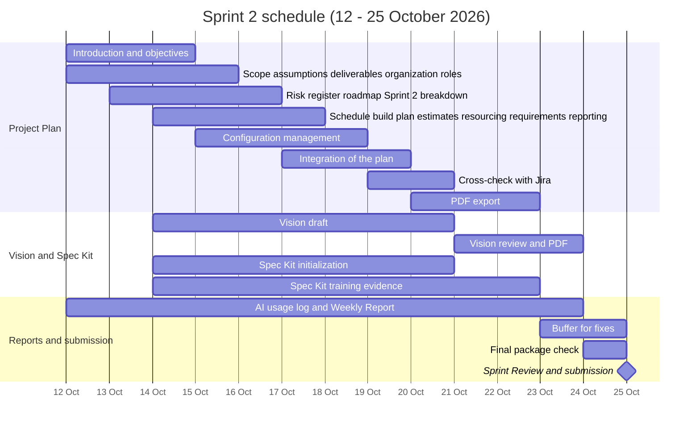

# AuraTune Project Plan

## 1. Introduction

Performed by: [Lê Công Minh Nhựt] | Reviewed by: [Nguyễn Khánh Đăng] | Edited by: [Lê Công Minh Nhựt]

### 1.1 Introduction

AuraTune is a software development project focused on building a music application. The project is carried out by a five-member team as part of the course project. The team will plan, develop, test, and evaluate the application according to the agreed project requirements and course deliverables.

### 1.2 Purpose

The purpose of this Project Plan is to provide a structured approach to planning, executing, monitoring, and controlling the AuraTune project. It defines the planned project activities, team responsibilities, project schedule, resource allocation, estimation approach, and management procedures. This document also serves as a shared reference for coordinating team activities, tracking project progress, identifying potential risks, managing changes to requirements and project plans, and ensuring that the team works toward the agreed project objectives.

## 2. Project Overview

Performed by: [Lê Công Minh Nhựt] | Reviewed by: [Nguyễn Khánh Đăng] | Edited by: [Lê Công Minh Nhựt]

This document is organized into sections covering the project scope and objectives, development approach, project schedule, effort and resource estimates, team responsibilities, requirements management, risk management, project reporting and measurement, and configuration management. Together, these sections provide a consistent basis for collaboration, progress evaluation, and project control throughout the project lifecycle. The Project Plan will be reviewed and updated when necessary to reflect approved changes during the development process.

### 2.1 Project Purpose

Performed by: [Lê Công Minh Nhựt] | Reviewed by: [Nguyễn Thanh Huy] | Edited by: [Lê Công Minh Nhựt]

The purpose of this Project Plan is to provide a structured approach to planning, executing, monitoring, and controlling the AuraTune project. It defines the planned project activities, team responsibilities, project schedule, resource allocation, estimation approach, and management procedures. This document also serves as a shared reference for coordinating team activities, tracking project progress, identifying potential risks, managing changes to requirements and project plans, and ensuring that the team works toward the agreed project objectives.

### 2.2 Project Objectives

Performed by: [Lê Công Minh Nhựt] | Reviewed by: [Nguyễn Thanh Huy] | Edited by: [Lê Công Minh Nhựt]

The product objectives describe the outcomes that AuraTune is expected to achieve as a software application. These objectives are to:

- Implement the core application features defined in the approved project requirements.
- Support the agreed user workflows from beginning to end.
- Provide a working build or demonstration that can be used to evaluate the implemented features.
- Verify the implemented functionality through appropriate tests against the agreed requirements and acceptance criteria.

#### 2.2.1 Project Management Objectives

The project management objectives describe how the team will organize and control the work required to deliver AuraTune. These objectives are to:

- Assign clear responsibilities for project tasks and deliverables.
- Plan and track tasks, milestones, and deadlines using the team's agreed project management tools.
- Coordinate integration and testing activities to identify issues before project submission.
- Monitor progress, document risks and changes, and review deliverables against the agreed acceptance criteria.
- Complete the required project deliverables according to the course requirements and the team's approved schedule.

#### 2.2.2 Success Criteria

The AuraTune project will be considered successful when the following criteria have been met:

- **Requirements coverage:** All core features included in the approved project scope have been implemented or their status has been explicitly documented and agreed upon by the team.
- **Core workflow verification:** The agreed core user workflows have been tested, and their results have been recorded.
- **Working demonstration:** A build or demonstration is available to show the implemented functionality within the agreed scope.
- **Testing evidence:** Appropriate test cases and results are documented for the implemented core features.
- **Project documentation:** The required project documents and deliverables are completed and reviewed against the course requirements.
- **Project tracking:** Task status, responsibilities, and significant project changes are recorded using the team's agreed management process.

These criteria will be evaluated using the approved requirements, test results, demonstration, project records, and course deliverable checklist. Any quantitative targets or additional quality criteria must be agreed upon by the team before being added to the final Project Plan.

### 2.3 Project Scope

Performed by: [Lê Công Minh Nhựt, Nguyễn Khánh Đăng] | Reviewed by: [Nguyễn Thanh Huy, Lê Công Minh Nhựt] | Edited by: [Lê Công Minh Nhựt, Nguyễn Khánh Đăng]

The project scope is based on the requirements defined in the approved PA1 proposal and the AuraTune Vision Document. The application will include the features and workflows agreed upon by the team. Features outside the approved scope will not be included unless the team reviews and approves the corresponding changes.

The team will focus on implementing the agreed requirements, integrating the developed components, testing the core workflows, and preparing a working build or demonstration for evaluation. Any technical limitations, dependencies, and exclusions will be documented in the relevant sections of the Project Plan.

#### 2.3.1 In Scope

The AuraTune project commits to completing and delivering the following core features, ensuring consistency with the initial design:
- Application Platform: Develop the system as a Web Application optimized for web browsers.
- Identity Management: Support registration and login via local accounts (Email/Password) and OAuth integration (Google, Facebook).
- Home Dashboard: Automatically aggregate and display AI-recommended songs, trending charts, and newly released albums.
- Core Music Player: Support continuous music streaming with basic playback controls, real-time synchronized lyrics, interactive comments, and drag-and-drop queue management.
- Personal Library Management: Allow users to create, edit, and delete playlists, as well as save favorite albums.
- Semantic Vector Search: Implement a song search engine based on lyrical semantics and emotional descriptions using AI models combined with a Vector Database.
- AI Recommendation: Analyze user listening habits and history to generate personalized music streams.
- Authorization and Administration: Provide a dedicated music upload space for Artists and a platform management dashboard for Administrators to handle violating users.
- Legal Compliance: The system exclusively utilizes non-copyrighted music sources (NCS) or those under Creative Commons (CC0) licenses to completely eliminate copyright infringement risks.
- Collaborative Playlist: Allows multiple users to co-create and edit playlists together. 

#### 2.3.2 Out Scope

The following items are not included in the implementation commitments for this project phase:
- Native Mobile App: The project solely focuses on building a Web Application platform and will not develop standalone applications for iOS or Android.
- Business and Commercial Payments: As the project operates in an academic environment, it will not integrate payment gateways, run advertisements, or distribute commercially copyrighted musical works.

#### 2.3.3 Scope Change Control Process

Any new feature requests arising during a Sprint will not be directly incorporated into the development pipeline. Instead, these requests will be logged into the Product Backlog. The development team will evaluate their technical complexity and available resources before deciding whether to include them in the next Sprint plan.

### 2.4 Deliverables

Performed by: [Thái Hoàng] | Reviewed by: [Lê Công Minh Nhựt] | Edited by: [Thái Hoàng]

This section lists what the AuraTune team delivers in each Sprint, who is responsible, and how each deliverable is verified. The project follows Scrum with five Sprints, each aligned with one Project Assignment (PA). Sprint 1 (PA1) ended on 11 October 2026\. Sprints 2–5 are planned as two-week Sprints that end on a Sunday, the day of the weekly review meeting (see Team Contract, Section 3).

Status values: **Completed**, **In progress** (current Sprint), **Planned** (future Sprint). Deliverables for Sprints 3–5 follow the PA3, PA4 and PA5 assignment descriptions and will be refined when each Sprint begins.

#### 2.4.1 Sprint 1 / PA1 (20 Sep – 11 Oct 2026\)

| ID | Deliverable | Description | Owner | Status | Verification |
| :---- | :---- | :---- | :---- | :---- | :---- |
| D-01 | Team Contract | Roles, communication plan, schedule, standards, accountability and decision rules | Team | Completed | `docs/management/team-contract.md` |
| D-02 | Project Proposal | Project proposal with key features | Team | Completed | `docs/proposal/`, Markdown and PDF |
| D-03 | Existing App / UI-UX Survey | Survey of existing music applications with screenshots | Team | Completed | `docs/proposal/`, Markdown and PDF |
| D-04 | Repository foundation | Repository structure, README, Git workflow and initial API contract | Team | Completed | `README.md`, `docs/management/git-workflow.md`, `docs/analysis-and-design/api-contract.md` |
| D-05 | Sprint 1 Weekly Report | Meeting record and Jira screenshot for Sprint 1 | Hoàng (D) | Completed | `docs/weekly-reports/` |

#### 2.4.2 Sprint 2 / PA2 (12 – 25 Oct 2026\)

| ID | Deliverable | Description | Owner | Status | Verification |
| :---- | :---- | :---- | :---- | :---- | :---- |
| D-06 | Project Plan (initial version) | Introduction, overview, organization, risk management, Sprint plan, schedule and build plan. Detailed tasks for Sprint 2 only; later Sprints are listed at planning level | Nhựt (A), with all members | In progress | `project-plan.md` and `project-plan.pdf`; schedule consistent with the Jira board; peer-reviewed |
| D-07 | Vision Document (initial version) | Positioning, stakeholders and users, product overview, product features with paragraph descriptions, 1–2 Mermaid workflow diagrams, non-functional requirements | Khoa (B), with the team | In progress | `vision.md` and `vision.pdf`; peer-reviewed |
| D-08 | Updated existing-app survey | Update of the PA1 survey if the team's understanding of the project has evolved | Huy (E) | In progress | Updated survey file, only if changes are needed |
| D-09 | Spec Kit initialization | `constitution.md` and all other Markdown files generated during initialization. Spec Kit agent skills were already added in PR \#1 | Nhựt (A), Đăng (C) | In progress | Spec Kit artifacts, including the constitution file, in `src/.specify/` |
| D-10 | Spec Kit training evidence | Evidence that each member completed the official Spec Kit tutorials (screenshots, training log or short summary) | Each member (A–E) | In progress | `training-evidence/`: five files, one per member |
| D-11 | AI Usage Report | Declaration of AI tool use in this Sprint and a detailed log of every use | Hoàng (D) consolidates; each member logs own usage | In progress | `reports/ai-usage-report.md` |
| D-12 | Weekly Report | Minutes of Sprint Planning, Scrum meetings and Sprint Review, commit statistics and Jira screenshots showing assignments and progress | Hoàng (D), Meeting Secretary | In progress | `reports/weekly-report.md`; Jira screenshots in `evidence/jira/` |
| D-13 | PA2 submission package | Folder `PA2-Group10/` with the Markdown and PDF documents, `src/.specify/`, `training-evidence/`, `reports/` and `evidence/` (Jira screenshots and `git-log.png`), compressed as `PA2-Group10.zip` | Hoàng (D) | Planned | Folder layout matches the PA2 submission structure; `evidence/git-log.png` matches the repository history |

#### 2.4.3 Sprint 3 / PA3 (26 Oct – 8 Nov 2026\)

| ID | Deliverable | Description | Owner | Status | Verification |
| :---- | :---- | :---- | :---- | :---- | :---- |
| D-14 | Revised Project Plan (2nd submission) | Plan revised from TA feedback with updated schedule | Nhựt (A) | Planned | `.md` and PDF; all changes listed in `Changes.md` |
| D-15 | Revised Vision Document (2nd submission) | Detailed functional and non-functional requirements, competitors and user environments | Khoa (B) | Planned | `.md` and PDF; all changes listed in `Changes.md` |
| D-16 | Use-Case Model | Mermaid use-case diagrams (actors, use cases, include/extend/generalization) covering all functional requirements in the Vision Document | Each member, for their own feature groups | Planned | Diagrams embedded in Markdown; coverage checked against the Vision Document |
| D-17 | Use-Case Specifications | A specification for every use case (basic flow, all alternative flows, pre/postconditions, special requirements) with UI prototype screenshots | Each member, for their own feature groups | Planned | One complete specification and prototype set per use case |
| D-18 | First functional group (end-to-end) | One functional group implemented across frontend, backend and database using the Spec Kit workflow. The group is selected at Sprint 3 Planning | Owner of the selected group | Planned | Source code, Spec Kit artifacts (spec, plan, tasks, generated tests), narrated YouTube demo video |
| D-19 | Changes.md (PA3) | Single file listing every change made to the Project Plan and Vision Document since PA2, with a separate section per document | Nhựt (A) | Planned | Without this file the revised documents receive no points |
| D-20 | AI Usage Report, Weekly Report and PA3 package | Same reports as Sprint 2, plus `PA3-Group10.zip` | Hoàng (D) | Planned | Same checks as D-11, D-12 and D-13 |

#### 2.4.4 Sprint 4 / PA4 (9 – 22 Nov 2026\)

| ID | Deliverable | Description | Owner | Status | Verification |
| :---- | :---- | :---- | :---- | :---- | :---- |
| D-21 | Revised Use-Case Model and Specifications (2nd submission) | Revision based on TA feedback from PA3, with added detail and consistency with the Vision Document and the implemented features | Each member, for their own feature groups | Planned | Updated files in `docs/requirements/`; all changes listed in `Changes.md` |
| D-22 | Changes.md (PA4) | Single file listing every change made to the use-case documents since PA3, with a separate section per revised document | Nhựt (A) | Planned | Without this file the revised documents receive no points |
| D-23 | Architecture: tech stack and C4 Level 1 | Technologies used for frontend, backend, database and other components (authentication, cloud storage, APIs), plus a System Context diagram with a written explanation | Nhựt (A) | Planned | Markdown with Mermaid diagram in `docs/analysis-and-design/` |
| D-24 | Architecture: C4 Level 2 (Container Diagram) | Container diagram and a description of each container: responsibility, technology and communication protocols | Nhựt (A), with Đăng (database) and Hoàng (cloud storage) | Planned | Mermaid diagram; matches the source code |
| D-25 | Architecture: C4 Level 3 (Component Diagrams) | Component diagrams for the frontend and the backend, with the responsibility and relationships of each component | Nhựt (A), with input from each feature-group owner | Planned | Mermaid diagrams; matches the source code |
| D-26 | Deployment Diagram | Mermaid diagram mapping containers to infrastructure nodes, with the service, containers and protocols for each node | Nhựt (A) | Planned | Matches the containers in D-24 and the real deployment |
| D-27 | Two more functional groups (end-to-end) | Two functional groups, selected at Sprint 4 Planning, implemented across frontend, backend and database using the full Spec Kit workflow | Owners of the selected groups | Planned | Source code, Spec Kit artifacts including generated tests, narrated YouTube demo video |
| D-28 | AI Usage Report, Weekly Report and PA4 package | Same reports as Sprint 2, plus `PA4-Group10.zip` | Hoàng (D) | Planned | Same checks as D-11, D-12 and D-13 |

#### 2.4.5 Sprint 5 / PA5 (23 Nov – 6 Dec 2026\)

The PA5 demo date and venue have not been announced yet.

| ID | Deliverable | Description | Owner | Status | Verification |
| :---- | :---- | :---- | :---- | :---- | :---- |
| D-29 | Test Plan | Test objectives and scope, features to be tested, test environment and tools, test schedule and responsibilities, entry and exit criteria | Huy (E) | Planned | `docs/test/` |
| D-30 | Test Cases | At least 5 use cases with at least 10 test cases each (50 in total). Spec Kit generated tests are reviewed, refined and extended to cover missing features; AI-powered features are tested for functional correctness | Each member, for their own feature groups | Planned | `docs/test/`; refinements are visible compared with the generated tests |
| D-31 | Test Execution, Bug Report and Test Summary | For each test case: ID, execution date, Pass or Fail, and actual result. Each failed case is linked to a bug report (ID, description, steps to reproduce, expected vs. actual result, severity, status). The summary gives features tested and passed/failed cases per feature | Each member, for their own feature groups; Huy (E) consolidates | Planned | `docs/test/`; bugs found and fixed during testing are also recorded |
| D-32 | Final product | All functional groups fully implemented using the Spec Kit workflow, integrated on the `develop` branch | Team; Integrator assigned by the Team Leader | Planned | Final build runs with all features working |
| D-33 | Final product demo | About 15 minutes without slides: introduction (1–2 min), live demo of all key features with 2–3 complete workflows (10–12 min), technical overview with C4 diagrams and Spec Kit use (2–3 min) | All five members; each presents at least one feature | Planned | Live demo on the date and venue to be announced |
| D-34 | Reflective Report | Team experience, Spec Kit experience, AI tools usage, SDLC feedback, and a 3–5 sentence individual reflection from each member | Each member (individual part); Hoàng (D) consolidates | Planned | Specific examples; five individual reflections |
| D-35 | Final versions of all documents | All PA1–PA5 documents reviewed and updated to match the final state of the project, including the architecture diagrams | Document owners as in earlier Sprints | Planned | No document contradicts the final source code |
| D-36 | Final submission package | `PA5-Group10.zip` with all documents (`.md` and PDF), complete source code without `node_modules`, `venv` and build artifacts, all Spec Kit artifacts (specs, plans, tasks, generated tests), test documents, the AI Usage Report for the whole project, and the Git log | Hoàng (D) | Planned | Checklist of PA5 Section D completed |

#### 2.4.6 Functional groups to be delivered by PA5

The Team Contract divides the product into 12 functional groups. The assignments require 1 group in PA3 and 2 more in PA4, but the PA5 demo requires all 12 to be fully implemented. The remaining 9 groups are therefore planned as additional coding tasks across Sprints 3–5, and the order is decided at each Sprint Planning meeting.

| Member | Functional groups (Team Contract, Section 1\) |
| :---- | :---- |
| Nhựt (A) | Group 10 AI Recommendations; Group 12 AI Conversational Agent; system architecture and deployment |
| Khoa (B) | Group 01 Auth & Login; Group 06 Playlist Management; Group 07 Listening History |
| Đăng (C) | Group 03 Search (Text & AI Semantic); Group 08 Album Details; database schema design |
| Hoàng (D) | Group 09 Artist Profile; Group 11 Admin Functions; cloud storage and data fetching |
| Huy (E) | Group 02 Home Page; Group 04 Music Player; Group 05 Queue Management |

#### 2.4.7 Rules applying to every submission

- All documents are written in English in Markdown, and diagrams use Mermaid syntax.  
- Each section states who performed, reviewed and edited it, on the first line after the section header.  
- Each submission contains the original `.md` files, the PDF files converted from them, a Git log, and a zip file named `PA[n]-Group[GroupId]`.  
- The architecture documents must match the source code at the time of each submission and are kept up to date as features are added.  
- Dates follow the Jira board and the Sunday review meeting. They will be revised in the PA3 version of this plan if the official course schedule differs.

### 2.5 Assumptions and Constraints

Performed by: [Nguyễn Thanh Huy] | Reviewed by: [Thái Hoàng] | Edited by: [Nguyễn Thanh Huy]

This section records the conditions under which the AuraTune project is planned. Every item has an **ID**, a **category**, and a **verification status**.
Categories (ID prefix):
  - **Project Constraint (PC)** — limits imposed by the course, the team, or the budget.
  - **Technical & Environment (TA)** — conditions about the runtime and development environments.
  - **External & Data (ED)** — external services, policies, datasets, and tools that the project relies on.
Verification statuses:
  - **Confirmed Constraint** — a fixed limitation, verified by the team, that the plan must work within and that is not expected to change during the project.
  - **Confirmed Dependency** — an external service, dataset, or tool that the team has verified and has decided to rely on.
  - **Unverified Assumption** — a condition that the plan currently treats as true but that has not yet been tested. Each one has a validation step with a pass condition, scheduled between PA2 and PA5 (see 2.2.2).
**Register maintenance.** The register is reviewed at every Sprint Planning. When an Unverified Assumption passes its validation, its status is changed to Confirmed Constraint or Confirmed Dependency and the result is recorded in 2.2.2. When it fails, it is escalated to the Risk Register and handled at the next Sprint Planning through scope reduction, a fallback, or re-planning.
**Linked Risk IDs** refer to the team's Risk Register: **R1** – delay of AI/vector search features; **R2** – shortage of legally usable, good-quality test data; **R3** – task delay or member overload. A dash (—) means that the item has no Risk Register entry and is tracked through its validation step in 2.2.2.

#### 2.5.1 Assumptions, Constraints, and Dependencies Register

| **ID** | **Category** | **Verification Status** | **Description** | **Expected Impact** | **Planned Response** | **Linked Risk ID** |
| :- | :- | :- | :- | :- | :- | :- |
| PC-01 | Project Constraint | Confirmed Constraint | The project runs on a fixed academic timeline of exactly five Scrum Sprints of 2–3 weeks each (Sprint 1/PA1 to Sprint 5/PA5), aligned with the university semester. Sprint deadlines and required deliverables are set by the course and cannot be extended. | There is no buffer Sprint. Work that is not finished in its Sprint reduces the final scope instead of moving the deadline. | Sprint Goals are sized to the fixed cadence, and the Product Backlog is kept ordered by priority so that the lowest-priority items are descoped first. A feature that is not stable by PA5 is descoped rather than delayed. | R3 |
| PC-02 | Project Constraint | Confirmed Constraint | The team consists of five undergraduate students who work on the project part-time while taking other university courses, with workload peaks around midterm and final examination periods. | Team velocity is limited and uneven across Sprints, and one overloaded member can block tasks that depend on their work. | Sprint commitments are kept conservative and workload is rebalanced at each Sprint Planning. Every Jira task has one assignee and one reviewer, so work can be handed over if a member is overloaded. | R3 |
| PC-03 | Project Constraint | Confirmed Constraint | The project has no commercial budget. Hosting, database, media storage, and AI/LLM services must run on free tiers or student credits only. | Usage quotas, storage limits, API rate limits, and the absence of paid service-level guarantees constrain architecture choices, catalogue size, and AI feature behaviour. Free-tier services may sleep, throttle, or reject requests under load. | Candidate services are compared on their free-tier limits (TA-05, ED-05, ED-08), and quotas are checked before every checkpoint demo (ED-09). | R1, R2 |
| PC-04 | Project Constraint | Confirmed Constraint | AuraTune is a non-commercial academic prototype. Copyrighted commercial recordings and full commercial lyrics may not be hosted, streamed, or redistributed without a licence. Only royalty-free, Creative Commons, public-domain, or team-created sample content whose licence allows non-commercial online streaming may be stored and played. | The playable catalogue is smaller and less familiar than on commercial platforms, and lyric-based features must be tested with licensed or mock lyrics. | A licence and attribution record is kept for every track (ED-06), and attribution is shown in the app wherever the licence requires it. | R2 |
| PC-05 | Project Constraint | Confirmed Constraint | The team must follow the course's Scrum workflow and deliver the artifacts required for each PA (e.g., project-plan.md, vision.md, Spec Kit artifacts in src/.specify/, Scrum and AI usage reports). All code and document changes go through Pull Requests with cross-review under branch protection, and all work is tracked in Jira. | Documentation and review effort competes with implementation time, and mandatory Pull Request review adds lead time before each merge. | Documentation and review effort is included when estimating Sprint capacity, and reviewers are assigned at Sprint Planning. | R3 |
| PC-06 | Project Constraint | Confirmed Constraint | During the project, AuraTune is used only by team members, course evaluators, and test accounts. Personal data (account details, OAuth profile data, listening history, comments) is limited to what each feature needs, and data sent to external AI services contains no direct identifiers such as names or email addresses. | AI features that use listening history (G10 AI Recommendations, G12 AI Conversational Agent) must send only non-identifying data, such as internal track IDs and team-authored tags. The free tiers of some AI providers may allow the provider to use submitted content, which limits which providers are suitable. A public privacy notice is also needed to publish the Facebook Login app (ED-09). | Data sent to AI services is checked in Pull Request review of AI endpoints, and each candidate provider's data-use terms are compared in the ED-08 Proof of Concept (PoC). | — |
| TA-01 | Technical & Environment | Unverified Assumption | End users access AuraTune through recent versions of modern desktop browsers (Chrome, Edge, Firefox, Safari) and mobile browsers (Chrome on Android, Safari on iOS). No native mobile application and no legacy-browser support are planned. | If layouts or behaviours differ significantly across browsers, responsive-UI and compatibility fixes are needed, mainly in PA4–PA5, which takes capacity from feature work. | Cross-browser checks start with BLD-02 (see 2.2.2), and differences are logged as defects with a severity. | R3 |
| TA-02 | Technical & Environment | Unverified Assumption | Standard HTML5 audio playback (the \<audio\> element and related browser APIs) is sufficient for streaming, play/pause, seeking, the full and mini player, and moving between tracks in the queue. No DRM or custom streaming protocol is required. | If browser restrictions (e.g., autoplay and background-playback limits on mobile browsers) or seeking problems appear, the Player (G04) and Queue (G05) need workarounds, which reduces PA3–PA4 capacity. Seeking also depends on ED-05. | Playback behaviour is validated on target browsers in PA3. Platform limits that cannot be worked around, such as playback that must start from a user tap on mobile, are designed into the UI and documented. | R3 |
| TA-03 | Technical & Environment | Unverified Assumption | Users and the demo environment have a stable internet connection. Offline playback is out of scope. | Unstable connectivity during a demo could interrupt streaming and AI features. | A backup demo (local build or recorded walkthrough) is prepared for every checkpoint demo. | — |
| TA-04 | Technical & Environment | Unverified Assumption | Every member can run the full stack locally (frontend, backend, database) from the shared repository by following a documented setup guide, an environment-variable template, and a runnable project scaffold, all established at the start of PA3 (Sprint 3) before BLD-02 integration begins. | Inconsistent local environments would cause integration failures and lost time when the first integrated build is assembled in PA3. | Validated at the start of PA3 (Sprint 3), before BLD-02 integration begins; problems found are fixed in the setup guide before integration work starts. | R3 |
| TA-05 | Technical & Environment | Unverified Assumption | Free-tier hosting is sufficient to deploy the frontend, backend, and database for demo-scale usage (team members and course evaluators) with start-up and response times that are acceptable in a live demo. | Cold starts, sleeping services, or paused free-tier databases could slow or interrupt demos. | Services are warmed up before each demo, and the hosting option is revisited in PA3 if the measured times are not acceptable (see 2.2.2). | — |
| ED-01 | External & Data | Confirmed Dependency | Track, album, and artist metadata (titles, artist names, album details, cover-art references, release information) is fetched with the team's Spotify Web API scripts and stored in the AuraTune database. Spotify is used as a metadata source only; no audio is obtained from Spotify. | Data population for Home (G02), Search (G03), Album (G08), and Artist Profile (G09) depends on these scripts and a valid Spotify developer app. Metadata may describe tracks that have no licensed audio file, and its use is limited by ED-02, ED-03, and ED-11. | Spotify-sourced records are mapped to the playable catalogue through the catalogue record (ED-06), and Spotify-sourced fields are stored separately from team-owned fields (ED-02). | R2 |
| ED-02 | External & Data | Confirmed Constraint | The Spotify Developer Policy (version effective 15 May 2025) sets conditions on Spotify-sourced data: (a) it may not be used to train, or otherwise be fed into, a machine-learning or AI model, so it cannot be used for embeddings, LLM prompts, or recommendation models; (b) displayed Spotify metadata and cover art must be attributed to Spotify and accompanied by a link back to the item on Spotify; (c) Spotify content may not be analysed to create derived listenership or usage metrics. AI features may only use data the team owns or is licensed to use: team-authored descriptions and mood/genre tags, licensed or sample lyrics, the licensed source's own track metadata, and AuraTune's own user activity data. The exact data boundary is documented in PA3 before any embeddings are generated. | The database design must separate Spotify-sourced fields from AI-eligible fields. Semantic Search (G03), AI Playlist (G06), AI Recommendations (G10), and the AI Conversational Agent (G12) need an AI-eligible copy of each playable track's title and artist name, taken from its licensed source rather than from Spotify. Spotify attribution and links must appear wherever Spotify data is shown, and popularity-based lists must use AuraTune's own play counts. | Each stored field records its source; the data boundary document is written in PA3; Spotify attribution and link-back are included in the UI design of the affected views. | R1, R2 |
| ED-03 | External & Data | Unverified Assumption | Spotify Web API access remains sufficient through PA5 under the Development Mode rules applied since February–March 2026: the app owner must keep an active Spotify Premium subscription; batch endpoints that return several tracks, albums, or artists in one request are unavailable; new releases, browse categories, and artist top tracks are unavailable; popularity, record label, and follower counts are no longer returned; and search returns at most 10 results per request. Endpoints restricted earlier (e.g., recommendations, audio features, preview clips) are not relied upon. | The scripts must request items one at a time, which increases request counts and the chance of hitting rate limits. Home (G02) and Artist Profile (G09) cannot use Spotify popularity, top tracks, or follower counts. If the owner's Premium subscription lapses, the scripts stop working. | Metadata is fetched once at a limited request rate and stored; the scripts are re-tested whenever Spotify publishes an API change; manually prepared metadata is the fallback. | R2 |
| ED-04 | External & Data | Confirmed Dependency | Audio files, cover images, and artist images are stored and delivered through cloud media storage, with Cloudinary and Cloudflare as the selected services. Which service hosts images and which hosts audio, and the exact Cloudflare product, are confirmed in PA3. | The Player (G04), Album (G08), Artist Profile (G09), and Admin uploads (G11) depend on media URLs from this storage. Outages or misconfigured access rules would block playback and image display, and storage limits cap how many licensed tracks can be made playable for testing and demos. | Media URLs and access rules are covered by the smoke checklist and API integration tests (see 4.2.3). | R2 |
| ED-05 | External & Data | Unverified Assumption | Free-tier storage and bandwidth quotas are sufficient for the curated catalogue and for demo-scale streaming, and the storage service supports HTTP range requests so that audio can be seeked without downloading the whole file. | If quotas are exceeded, the catalogue must be reduced or audio compressed further. If range requests are not supported, seeking in the Player must be reworked. | Quota usage is monitored from the first upload in PA3, and range-request support is checked before the Player relies on it. | R2 |
| ED-06 | External & Data | Unverified Assumption | A legally usable dataset of audio tracks and matching lyrics can be assembled from royalty-free, Creative Commons, or public-domain sources, or created by the team as mock/sample data, and it is large and varied enough (genres, moods, lyric content) to exercise search, recommendations, playlists, and lyrics display. | Many royalty-free tracks are instrumental or have no published lyrics, so lyric-based Semantic Search (G03) and the Lyrics view (G04) may need team-written sample lyrics. An insufficient dataset weakens AI result quality and demo credibility. | A catalogue record is kept for every track (source, licence, attribution text, licensed-source title and artist, lyric status). The minimum catalogue size and genre/mood coverage are agreed at PA3 Sprint Planning. | R2 |
| ED-07 | External & Data | Confirmed Dependency | Semantic Search by lyrics/mood (G03), AI Playlist (G06), AI Recommendations (G10), and the AI Conversational Agent / Real-time Host (G12) depend on external LLM and embedding-model APIs and on vector search infrastructure. The team does not train its own models. | These four feature groups cannot reach full scope without working AI endpoints, and repeated test calls consume free-tier quota. | Each group has a non-AI fallback (keyword search, lists based on AuraTune's own play counts or listening history, a clear error message in the conversational host) so that core user flows still work when an AI service is unavailable. Repeated test runs use stubbed AI responses (see 4.2.3). | R1 |
| ED-08 | External & Data | Unverified Assumption | The LLM provider, embedding model, and vector database have not been finalised. Candidate options are hosted LLM APIs with a free or student tier; hosted or open-source sentence-embedding models; and either a vector extension of the project database (e.g., pgvector, if PostgreSQL is adopted) or a managed free-tier vector database. It is assumed that at least one combination offers acceptable result quality, latency, rate limits, quota, and data-use terms (PC-06) for demo-scale use at no cost. If the Real-time Host (G12) needs speech output or streamed responses, the PoC also covers the required speech service and the hosting's support for long-lived connections. | If no free option is adequate, AI features are reduced in scope (e.g., precomputed embeddings, cached recommendations, limited conversation length) rather than removed. A late decision would compress all AI integration into PA4. | The PoC is time-boxed to the first half of PA3, and the decision is recorded by the PA3 Sprint Review. AI feature groups are ordered by priority so that, if time runs short, the lowest-priority group is reduced first. | R1 |
| ED-09 | External & Data | Unverified Assumption | API keys and credentials for AI services, Spotify, and the OAuth providers (Google, Facebook) remain valid from PA3 through PA5 and are stored as environment variables or secrets, never committed to the repository. The OAuth apps can be configured so that course evaluators can sign in: a Google OAuth app in Testing status accepts only listed test users (up to 100) and their authorisations expire after seven days, and a Facebook app in development mode accepts only users who have a role on the app. | Expired keys, exhausted quotas, or unpublished OAuth apps would break login (G01) or AI features during a demo. | Before each checkpoint demo, either both OAuth apps are published (Facebook Live mode needs a privacy policy URL and user data deletion instructions) or evaluator accounts are registered as test users. Local email/password login is the fallback sign-in method. | R1 (AI keys) |
| ED-10 | External & Data | Confirmed Dependency | The team relies on a private GitHub repository with branch protection and Pull Request cross-review, Jira for Product Backlog and Sprint Backlog tracking, Discord/Zalo for communication, and Spec Kit (src/.specify/) for specification artifacts. Branch protection on a private repository requires a paid GitHub plan: GitHub Pro for a repository owned by a personal account (available to students through GitHub Education) or GitHub Team for a repository owned by an organisation. | Losing a tool or plan feature would disrupt the review workflow and the traceability required for PA evaluation. | Repository plan status and branch protection rules are checked at the start of each Sprint. | — |
| ED-11 | External & Data | Unverified Assumption | The rest of the Spotify Developer Policy does not prevent AuraTune's design. The policy prohibits products that are integrated with streams or content from another service, and products that replicate a core Spotify user experience. AuraTune shows Spotify metadata next to audio from its own storage and offers a full player, queue, and playlists, so these clauses may apply. | If they apply, Spotify metadata cannot be shown in Home (G02), Search (G03), the Player (G04), Album (G08), or Artist Profile (G09), and these groups must use metadata from the licensed sources or team-prepared data, which requires re-populating data in PA3–PA4. | The interpretation is confirmed with the course instructor before more features are built on Spotify data. Licensed-source metadata is kept for every playable track (ED-06), so Spotify data can be removed without blocking the demo. | R2 |

#### 2.5.2 Validation Plan for Unverified Assumptions

| **ID** | **Validation Method** | **Pass Condition** | **Target Sprint** | **Owner** | **Status (PA2)** |
| :- | :- | :- | :- | :- | :- |
| TA-01 | Cross-browser smoke test of the first integrated build on the listed desktop browsers and on at least one Android and one iOS browser | Core routes render and the core journey completes on every listed browser; differences are logged as defects with a severity | PA3 (BLD-02); re-checked in PA5 | Huy | Planned |
| TA-02 | Playback, seek, and next-track checks of the Player and Queue on target browsers, including mobile autoplay and background-playback behaviour | Play, pause, seek, next, and auto-advance work on every target browser; each mobile limitation is documented with its workaround or accepted behaviour | PA3–PA4 | Huy | Planned |
| TA-03 | Check network conditions at the demo venue and prepare a local or recorded fallback demo | The backup demo runs without an internet connection | PA4–PA5 | Nhựt | Planned |
| TA-04 | Each member runs the stack from a fresh clone by following only the setup guide and the environment-variable template | All five members start the frontend, backend, and database locally; every problem found is fixed in the guide | Start of PA3 (before BLD-02 integration) | Nhựt, Đăng | Planned |
| TA-05 | Deploy BLD-02 to the selected free-tier hosting and measure cold-start and response times under demo-like use | Measured times are recorded, and the team confirms at the PA3 Sprint Review that the core journey is usable in a live demo after warm-up | PA3 | Nhựt | Planned |
| ED-03 | Run the metadata scripts against every endpoint they call under Development Mode, record rate-limit behaviour, and confirm the app owner's Premium status | Every required field is returned, and the full catalogue metadata is fetched without being blocked by rate limits | PA3 | Hoàng | Planned |
| ED-05 | Upload the sample catalogue, monitor quota usage, verify seeking through HTTP range requests, and confirm the image/audio split between Cloudinary and Cloudflare (ED-04) | The catalogue fits the free-tier quota with room for demo traffic; seeking to an unbuffered position works (the storage answers range requests with HTTP 206 Partial Content) | PA3 | Hoàng, Huy | Planned |
| ED-06 | Compile the catalogue with a licence and attribution record per track; identify lyric gaps and prepare sample lyrics | Every track has a complete record, and the catalogue meets the size and genre/mood coverage agreed at PA3 Sprint Planning | PA3 (initial set); PA4 (final set) | Hoàng, Đăng | Planned |
| ED-08 | PoC comparing candidate LLM, embedding, and vector-search options on a fixed set of test queries | Quality, latency, rate limits, cost, and data-use terms are recorded for each candidate, and one combination is selected and recorded by the PA3 Sprint Review | PA3 (first half) | Nhựt, Đăng | Planned |
| ED-09 | Credential, quota, and evaluator sign-in check before every checkpoint demo | All keys are valid, quotas cover the demo script, and an evaluator account signs in with Google and with Facebook | PA3–PA5 | Khoa (OAuth), Nhựt (AI keys) | Planned |
| ED-11 | Present the planned use of Spotify data to the course instructor and record the guidance | The decision to keep or remove Spotify metadata in user-facing views is recorded in the meeting minutes before PA3 feature work depends on it | End of PA2 / start of PA3 | Hoàng | Planned |

## 3. Project Organization

### 3.1 Organizational Structure

Performed by: [Lê Công Minh Nhựt] | Reviewed by: [Thái Hoàng] | Edited by: [Lê Công Minh Nhựt]

#### 3.1.1 Team Organization

The AuraTune project is developed by a team of five members. The team works collaboratively to plan, implement, test, and deliver the project according to the agreed requirements and schedule. Each member is assigned responsibilities for specific tasks or project components, while team members coordinate with one another when tasks have dependencies or require integration.

Nhựt (A) coordinates the team's project activities and maintains an overview of task progress and project deliverables. Hoàng (D) is responsible for recording meeting discussions and decisions. All team members are expected to communicate their progress, raise issues, and contribute to resolving problems that affect the project.

#### 3.1.2 Work Coordination and Communication

The team coordinates its work through shared planning, task assignment, progress tracking, and review activities. Tasks are assigned according to the agreed responsibilities, project priorities, and dependencies between components. Team members update task status and communicate delays or blockers so that the team can discuss solutions and adjust the plan when necessary.

The team uses GitHub and Jira to support project coordination. GitHub is used to manage source code and collaborate on code changes, while Jira is used to organize tasks, assign responsibilities, and track progress. The team follows the agreed Git workflow and review practices documented in the Team Contract and development guidelines.

#### 3.1.3 Review and Blocker Resolution

Team members review relevant work before it is considered complete. Code changes and integrated components are checked according to the team's review and testing practices. When a blocker occurs, the responsible member communicates the issue to the team, explains its impact, and works with relevant teammates to identify a solution. Issues that affect the project schedule, scope, or other team members are discussed collectively, and agreed changes are recorded in the appropriate project management tools.

The team follows the roles, responsibilities, and working agreements defined in the Team Contract. Changes to these arrangements are discussed and agreed upon by the team before they are reflected in the Project Plan.

### 3.2 Roles and Responsibilities

Performed by: [Mai Đăng Khoa] | Reviewed by: [Thái Hoàng] | Edited by: [Mai Đăng Khoa]

The AuraTune team consists of five members, all acting as Full-stack Engineers to ensure a comprehensive understanding of the system. Specific responsibilities and feature groups are assigned as follows:

| Name | Role | Primary Responsibilities |
| :---- | :---- | :---- |
| **Lê Công Minh Nhựt** | Full-stack Engineer(Team Leader) | AI Recommendations (Group 10), AI Conversational Agent (Group 12), System Architecture & Deployment. |
| **Mai Đăng Khoa** | Full-stack Engineer | Authentication & Login (Group 01), Playlist Management (Group 06), Listening History (Group 07). |
| **Nguyễn Khánh Đăng** | Full-stack Engineer | Search (Text & AI Semantic) (Group 03), Album Details (Group 08), Database Schema Design. |
| **Thái Hoàng** | Full-stack Engineer | Artist Profile (Group 09), Admin Functions (Group 11), Cloud Storage & Data Fetching. Responsible for recording meeting minutes, compiling weekly reports, and managing the project's documentation repository. |
| **Nguyễn Thanh Huy** | Full-stack Engineer | Home Page (Group 02), Music Player (Group 04), Queue Management (Group 05). |

#### Responsibility Breakdown

- **Feature Lead:** Each member takes full ownership of their assigned feature groups, from requirement specification to UI/UX design, implementation, and testing.  
- **Cross-Reviewing:** All documentation and code must be reviewed by at least one other team member before being finalized or merged into the main branch.  
- **Support Mechanism:** If a member encounter blockers, the issue is raised in the Discord channel or during weekly meetings for collective problem-solving.  
- **Leadership:** The Team Leader (Nhựt) coordinates overall system architecture and manages deployment pipelines, while holding the final decision-making authority in case of technical disputes.  
- **Alignment:** Roles and feature assignments are strictly synchronized with the Team Contract and the Jira board. Any discrepancies are resolved during the weekly sprint planning.  
- **Role Updates:** Responsibilities and feature assignments are reviewed at the end of each sprint. Any changes based on workload or evolving project needs are documented in the meeting minutes and updated in this Project Plan.

### 3.3 Risk Management

Performed by: [Thái Hoàng], Reviewed by: [Nguyễn Khánh Đăng], Edited by: [Thái Hoàng]

This section lists the main risks to the AuraTune project, how serious each one is, who watches it, and what the team does to prevent it or to recover from it. The assessment below is the initial version prepared on 14 October 2026\. The ratings are the team's estimates, not measurements, and are confirmed or changed at the Sprint 2 team meeting.

**Rating scale.** Likelihood and Impact are each rated Low (1), Medium (2) or High (3). Priority is Likelihood × Impact: **High** for 6–9, **Medium** for 3–4, and **Low** for 1–2.

**Review rule.** The risk owner checks the warning signs every week. The whole register is reviewed at every Sprint Planning and Sprint Review, and immediately when a major blocker appears. Changes to a rating or status are recorded in the Weekly Report.

#### 3.3.1 Risk register

| ID | Risk | Likelihood | Impact | Priority | Owner | Status |
| :---- | :---- | :---- | :---- | :---- | :---- | :---- |
| R1 | **Spotify data is not available as planned.** Since February 2026, Spotify apps in Development Mode need a Premium-subscribed owner, are limited to five users and lose several endpoints (for example artist top tracks, new releases and browse categories). Features that need this data (Home Page, Artist Profile, AI Recommendations) may be affected | High | High | High (9) | Hoàng (D) | Open |
| R2 | **No lawful source for audio files.** The Spotify Web API gives metadata, not audio files that the app could store on Cloudflare. Zing MP3 has no official public API (only unofficial wrappers were found), so using it could breach its terms, break without notice, or involve copyrighted audio | Medium | High | High (6) | Huy (E) | Open |
| R3 | **AI features are late or unreliable.** The Tech Stack names a Python FastAPI service, but no AI model provider, embedding model or vector store is chosen yet. Response time, cost or usage quotas may not fit AI Recommendations, Semantic Search or the real-time AI Conversational Agent | Medium | High | High (6) | Nhựt (A) | Open |
| R4 | **Open technology decisions delay implementation.** The database is listed as "Azure Database / Google Cloud" (undecided), and nothing is chosen for semantic search storage. Late decisions force schema changes and block the architecture documents required in PA4 | Medium | Medium | Medium (4) | Đăng (C) | Open |
| R5 | **The planned workload is larger than the team's capacity.** The Team Contract defines 12 functional groups. PA3 and PA4 require only 1 and 2 groups, but the PA5 demo needs all 12, so 9 groups are extra work on top of documents, architecture and testing | High | High | High (9) | Nhựt (A) | Open |
| R6 | **Scope creep and documents drifting from the product.** Requirements may change between the Vision Document, use cases, API contract and code. PA4 warns of a grade penalty when architecture documents do not match the code | Medium | Medium | Medium (4) | Khoa (B) | Open |
| R7 | **Frontend, backend and AI service do not fit together.** React, Express and FastAPI parts are built by different members, and endpoint formats or data shapes may differ | Medium | Medium | Medium (4) | Khoa (B) | Open |
| R8 | **Hosting or storage limits cause failures during testing or the live demo.** The product relies on Vercel or Render, Cloudinary, Cloudflare, a cloud database and external APIs. The PA5 demo is live and its venue is not yet announced | Medium | High | High (6) | Huy (E) | Open |
| R9 | **A member becomes unavailable or falls behind** (illness, exams, other courses), which blocks tasks that depend on their work | Medium | Medium | Medium (4) | Hoàng (D) | Open |
| R10 | **Secrets are committed to the repository.** The project uses several keys and credentials (Spotify, Cloudinary, Cloudflare, database, AI service). A leaked key can lead to misuse or loss of access | Low | High | Medium (3) | Đăng (C) | Open |

#### 3.3.2 Warning signs, mitigation and contingency

| ID | Warning signs | Mitigation (done in advance) | Contingency (if the risk happens) |
| :---- | :---- | :---- | :---- |
| R1 | Spotify calls return 403 Forbidden; a required field (genre, image, top tracks) is missing; team test accounts cannot authorize | Run a data-access test in Sprint 2–3 that calls every endpoint and field the Vision Document needs and records what works. Put all Spotify calls in one backend module so the source can be replaced. Read the Spotify Developer Terms on storing data and on AI use before building the database and AI features | Fill the gap with a curated seed dataset that is legal to use, or with Zing MP3 metadata where its terms allow. Reduce the affected feature to what is available, agreed by team vote |
| R2 | No confirmed audio source by the end of Sprint 2; an unofficial endpoint stops working; a TA questions the data source | Decide the audio source in Sprint 2 and record it in Assumptions and Constraints. Store only royalty-free, Creative Commons or self-owned tracks in Cloudflare. Use Zing MP3 only for metadata or links, as far as its terms allow. Ask the TA or instructor whether the chosen sources are acceptable | Demo with a small licensed library of tracks. Remove any questionable file from storage and the repository immediately |
| R3 | No working end-to-end call (backend to AI service to model) by the end of Sprint 3; responses are too slow; quota errors appear | Build a thin proof of concept early in Sprint 3\. Prepare a small set of test inputs with expected outputs (needed later for PA5 testing of AI features). Choose a provider with a free tier. Keep the AI service behind a stable HTTP contract so the model can be replaced. Cache repeated results | Switch to rule-based or popularity-based recommendations and keyword search, agreed by the team. Limit the Conversational Agent to text if real-time voice is not feasible |
| R4 | No database or vector-search decision by the end of Sprint 2; schema is changed after features were started | Set a decision deadline at the end of Sprint 2 with Nhựt as final authority (Team Contract, Section 6). Compare options on free tier, setup effort and team skills. Record the decisions in the architecture document. Đăng finalizes the schema right after the decision | Pick the option with the least setup effort. Use basic SQL text search until a vector solution is ready |
| R5 | Fewer groups finished than planned for two Sprints in a row; members carry overdue tasks into the next Sprint | At Sprint 3 Planning, order the groups by dependency (authentication, database schema and music player first) and assign the extra groups early. Keep Jira tasks small. Use the Spec Kit workflow for every group. Define a minimal "demo-ready" version of each group. Check Jira progress every week | By team vote, simplify lower-priority groups so that 2–3 complete workflows still work in the demo. The Team Leader reassigns tasks as allowed by the Team Contract |
| R6 | A feature exists in code but not in the Vision or use cases; the API contract changes without a Pull Request; TA feedback lists inconsistencies | Treat the Vision Document, use cases and API contract as the single source of truth. Propose every change as a Jira ticket stating the effect on scope and schedule, and approve it at the weekly meeting. Update the affected documents in the same Pull Request. Keep `Changes.md` current for each PA | Freeze scope for the current Sprint and move unapproved items to the backlog. Run a consistency check between plan, Jira, Vision, API contract and code before each submission |
| R7 | Frontend calls fail after a merge; the same endpoint behaves differently in Postman and in the app | Agree on the API contract before coding. Test each endpoint in Postman before the frontend uses it. The Integrator merges into `develop` each week and confirms the build passes before the Sunday meeting. Share sample responses | Use fixtures or a mock server so the frontend can continue. Roll back to the last working `develop` state and fix the mismatch in a pair session |
| R8 | Services sleep or respond slowly; storage or bandwidth usage nears the free limit; no full rehearsal is done before the demo | Check quota usage each Sprint. Prepare seed data. Provide a script that runs the whole product locally. Rehearse the full demo at least twice. Record a backup demo video | Run the product locally during the demo. Play the backup video if a live service fails |
| R9 | A member misses meetings or deadlines; no commits for a week; no reply within 24 hours | Follow the Team Contract: notify the team before Wednesday so tasks can be reallocated. Give every task a reviewer who understands the feature. Track attendance and commit statistics each week. Share progress in Scrum meetings | Reassign tasks by majority vote, with the Team Leader deciding in a tie. Escalate to the TA or instructor if the team cannot solve it (Team Contract, Section 7\) |
| R10 | A key or `.env` file appears in a commit; GitHub reports an exposed secret | Keep `.env` in `.gitignore` and share only a `.env.example` file. Turn on GitHub secret scanning if available. Include a secrets check in the Pull Request review | Revoke and replace the exposed key immediately, then remove it from the repository history |

## 4. Project Plan

### 4.1 Sprint Roadmap

Performed by: [Lê Công Minh Nhựt], Reviewed by: [Mai Đăng Khoa], Edited by: [Lê Công Minh Nhựt]

The AuraTune project follows the Scrum process and is organized into five sprints, with each sprint corresponding to one project assignment (PA1–PA5). The roadmap summarizes the objectives, major activities, and expected outcomes of each sprint. Sprint 2 provides more detailed planning because it is the current sprint, while the remaining sprints present high-level plans that will be refined as the project progresses.

| Sprint | Objective | Major Tasks | Expected Outcome |
| ----- | ----- | ----- | ----- |
| **Sprint 1 (PA1)** | Establish the project idea, initial requirements, team organization, and development process. | \- Prepare the project proposal and identify target users and key features. \- Survey existing applications and compare their features and user experiences. \- Establish the team contract, communication plan, and member responsibilities. \- Set up the project repository and agree on the development tools and Scrum workflow. | An approved project proposal, an existing-app survey, a team contract, and an initial development workflow. |
| **Sprint 2 (PA2) — Current Sprint** | Develop the initial project plan and vision document, and establish the foundation for specification-driven development. | **Project planning:** \- Define the project objectives, scope, deliverables, assumptions, team organization, and risk management approach. \- Prepare the five-sprint roadmap, schedule, build plan, task assignments, and estimated resources. \- Ensure that the schedule and task responsibilities are consistent with Jira. **Vision document:** \- Describe the problem statement, product positioning, stakeholders, target users, and user environment. \- Refine the product features and describe applicable non-functional requirements. \- Create workflow diagrams for important user journeys using Mermaid. **Development setup and reporting:** \- Initialize Spec Kit and prepare the required constitution and initialization artifacts. \- Complete Spec Kit training and record evidence of completion for each member. \- Prepare the AI Usage Report and Weekly Report, including meeting records and Jira task evidence. \- Review the documents and prepare the Markdown and PDF deliverables for submission. | An initial Project Plan and Vision Document, an initialized Spec Kit repository with the required artifacts, training evidence, and the required reports for PA2. |
| **Sprint 3 (PA3)** | Refine project documentation and specifications, and implement the first functional group using Spec Kit. | \- Revise the Project Plan and Vision Document based on TA feedback. \- Create use-case diagrams covering the documented functional requirements. \- Write use-case specifications and prepare UI prototype screenshots for each use case. \- Implement one functional group end-to-end using Spec Kit, including frontend, backend, and data persistence. \- Prepare the required implementation demo, AI Usage Report, Weekly Report, and `Changes.md`. | Revised project documents, a use-case model, detailed use-case specifications with prototypes, and one implemented functional group with supporting Spec Kit artifacts. |
| **Sprint 4 (PA4)** | Refine use-case documentation, document the software architecture, and extend the working application. | \- Revise the use-case model and specifications based on TA feedback. \- Document the technology stack and create C4 Level 1, Level 2, and selected Level 3 architecture diagrams. \- Prepare the deployment diagram and explain the infrastructure and communication between components. \- Implement two additional functional groups end-to-end using Spec Kit. \- Update architecture documentation to reflect the actual implementation and prepare the required reports and `Changes.md`. | Revised use-case documents, software architecture and deployment documentation, and two additional implemented functional groups with supporting Spec Kit artifacts. |
| **Sprint 5 (PA5)** | Validate the application, stabilize the implemented features, and prepare the final product demonstration and submission. | \- Review and refine Spec Kit-generated test cases from previous sprints. \- Prepare a test plan and at least 50 functional test cases covering at least five use cases, with at least 10 test cases per use case. \- Execute the test cases and record execution dates, statuses, and actual results. \- Document defects, link failed test cases to bug reports, and retest fixes. \- Stabilize the application and prepare a working build for the final demonstration. \- Demonstrate all key features and complete user journeys, with every team member participating. \- Prepare the Reflective Report, update all PA1–PA5 documents, and assemble the final source code, Spec Kit artifacts, reports, and AI Usage Report. | A tested and stabilized application, documented test results and bug reports, a final product demonstration, a Reflective Report, and a complete final submission package. |

### 4.2 Project Schedule

Performed by: [Thái Hoàng], Reviewed by: [Nguyễn Thanh Huy], Edited by: [Thái Hoàng]

This section shows when the work of AuraTune is done. The Jira board is the reference for Sprint 2: the dates in Section 4.2.3 are the start and due dates of the Jira tasks. The five Sprints follow the PA structure of the course, and each Sprint ends on a Sunday, the day of the weekly review meeting.

#### 4.2.1 Sprint calendar

| Sprint | PA | Dates | Length | Main milestone | Dates confirmed |
| :---- | :---- | :---- | :---- | :---- | :---- |
| Sprint 1 | PA1 | 20 Sep – 11 Oct 2026 | 3 weeks | Proposal, survey, Team Contract and repository foundation | Yes (Jira) |
| Sprint 2 | PA2 | 12 Oct – 25 Oct 2026 | 2 weeks | Initial Project Plan and Vision Document, Spec Kit initialized, reports | Yes (Jira, submission 25 Oct) |
| Sprint 3 | PA3 | 26 Oct – 8 Nov 2026 | 2 weeks | Revised plan and Vision, use-case model and specifications, first functional group | Planned |
| Sprint 4 | PA4 | 9 Nov – 22 Nov 2026 | 2 weeks | Architecture and deployment diagrams, two more functional groups | Planned |
| Sprint 5 | PA5 | 23 Nov – 6 Dec 2026 | 2 weeks | Testing, final build, final demo and reflective report | Planned |

The dates of Sprints 3–5 follow the two-week Sprint recommended by the assignment. They are updated in the next version of this plan when the official deadlines of PA3, PA4 and PA5 and the demo date are announced.

#### 4.2.2 Weekly rhythm

The rhythm below comes from the Team Contract and is the same in every Sprint.

| Day | Event |
| :---- | :---- |
| Monday | Main tasks are assigned. Sprint Planning takes place on the first Monday of a Sprint |
| Wednesday | Secondary tasks may be assigned. Last day to tell the team about a deadline problem so that tasks can be reallocated |
| Saturday, 12:00 | Deadline to push code and open Pull Requests for the current week |
| Sunday, 09:00 | Weekly review meeting on Discord. The last Sunday of a Sprint is the Sprint Review |

#### 4.2.3 Sprint 2 milestones

**Project Plan milestones (Jira tasks).**

| Date | Milestone | Completion criteria | Jira tasks |
| :---- | :---- | :---- | :---- |
| Wed 14 Oct | Introduction and objectives drafted | Both sections written and reviewed | SCRUM-57, SCRUM-62 |
| Thu 15 Oct | Overview and organization drafted | Scope, assumptions, deliverables, structure and roles written and reviewed | SCRUM-109, SCRUM-167, SCRUM-134, SCRUM-67, SCRUM-79 |
| Fri 16 Oct | Planning core defined | Risk register with at least 3 risks, 5-Sprint roadmap, and Sprint 2 tasks with owners, dates and dependencies in Jira | SCRUM-140, SCRUM-72, SCRUM-147 |
| Sat 17 Oct (PR before 12:00) | Remaining sections drafted | Schedule, build plan, estimates, resourcing, requirements management and reporting written and reviewed | SCRUM-154, SCRUM-173, SCRUM-115, SCRUM-85, SCRUM-91, SCRUM-97 |
| Sun 18 Oct | Configuration management done | Section written; weekly review meeting records the progress of all section drafts | SCRUM-121 |
| Mon 19 Oct | Project Plan integrated | All sections merged into one file, with no placeholders or template instructions | SCRUM-128 |
| Tue 20 Oct | Cross-check complete | No unexplained difference between the plan, Jira and the Vision Document | SCRUM-161 |
| Thu 22 Oct | Project Plan PDF ready | PDF is readable and has the same content as the Markdown file | SCRUM-103 |

**Other PA2 milestones.** The owners follow Section 2.3.2, and the dates are the due dates of the matching Jira tasks.

| Date | Milestone | Completion criteria | Owner |
| :---- | :---- | :---- | :---- |
| Tue 20 Oct | Vision Document first draft | All required sections, including problem statement, feature descriptions, 1–2 workflow diagrams and non-functional requirements | Khoa |
| Tue 20 Oct | Spec Kit initialized | Constitution file and the other generated Markdown files are in `src/.specify/` | Nhựt, Đăng |
| Thu 22 Oct | Spec Kit training evidence | Five evidence files, one per member | Each member |
| Fri 23 Oct | Vision Document final | Review comments solved and PDF exported | Khoa |
| Fri 23 Oct | AI Usage Report complete | Every use of AI tools in the Sprint is logged | Hoàng |
| Fri 23 Oct | Weekly Report draft complete | Minutes of Sprint Planning and Scrum meetings, commit statistics and Jira screenshots | Hoàng |
| Sat 24 Oct (before 12:00) | Final package checked | All Pull Requests merged, folder `PA2-Group10/` complete, Git log screenshot saved | Hoàng |
| Sun 25 Oct | Sprint Review and submission | Sprint Review minutes added; `PA2-Group10.zip` submitted | Team |

#### 4.2.4 Sprint 2 timeline

#### 4.2.5 Milestones of Sprints 3–5

| Sprint | Planned end | Milestone | Completion criteria |
| :---- | :---- | :---- | :---- |
| Sprint 3 | Sun 8 Nov | PA3 submission | Revised Project Plan and Vision Document with `Changes.md`; use-case diagrams; a specification and prototype screenshots for every use case; one functional group working end-to-end with a narrated demo video; AI Usage and Weekly Reports |
| Sprint 4 | Sun 22 Nov | PA4 submission | Revised use-case specifications with `Changes.md`; architecture document with C4 Level 1–3 diagrams that match the code; deployment diagram; two more functional groups with a narrated demo video; AI Usage and Weekly Reports |
| Sprint 5 | Sun 6 Dec | PA5 submission | Test plan and at least 50 executed test cases with bug reports; all 12 functional groups implemented; reflective report; final documents; final package. The 15-minute demo takes place on the date to be announced |

The build checkpoints inside these Sprints are defined in the Build Plan section.

#### 4.2.6 Buffer and scheduling rules

- The last two days of every Sprint are kept for review comments, fixes and packaging. New work is not started on those days.  
- Code and documents are ready before **Saturday 12:00** of the last week, so the Sunday meeting is used for the Sprint Review and the submission.  
- A task that depends on another task starts after the earlier task has been reviewed (see Section 4.4.1).  
- Any change to a date is made in Jira first, then in this section, and is recorded in the Weekly Report.

#### 4.2.7 Sprint 2 Plan

*Performed by: \[Thái Hoàng\], Reviewed by: \[Nguyễn Thanh Huy\], Edited by: \[Thái Hoàng\]*

Sprint 2 (**SCRUM Sprint 2**) runs from 12 October to 25 October 2026 on the Jira board of the space NMSE\_Group10. This Sprint produces the PA2 submission.

**Sprint Goal.** Complete the PA2 submission: an initial Project Plan and Vision Document, Spec Kit initialized with training evidence from all five members, and the AI Usage and Weekly Reports, with every task assigned, reviewed and tracked in Jira.

##### 4.2.7.1 Project Plan tasks

The table lists the Project Plan tasks of Sprint 2\. Every task has one assignee and one reviewer who is a different member. The task names, Jira keys and dates are the same as in Jira. The reviewer is written on the first line of each Jira description, because Jira has no reviewer field.

| Jira key | Task | Assignee | Reviewer | Start | Due | Depends on |
| :---- | :---- | :---- | :---- | :---- | :---- | :---- |
| SCRUM-57 | Draft the Introduction and Purpose sections | Nhựt | Đăng | 12 Oct | 14 Oct | — |
| SCRUM-62 | Define objectives and success criteria | Nhựt | Huy | 12 Oct | 14 Oct | — |
| SCRUM-67 | Describe the Organizational Structure | Nhựt | Hoàng | 12 Oct | 15 Oct | — |
| SCRUM-79 | Describe Roles and Responsibilities | Khoa | Hoàng | 12 Oct | 15 Oct | — |
| SCRUM-109 | Define scope and out-of-scope items | Đăng | Nhựt | 12 Oct | 15 Oct | — |
| SCRUM-134 | Prepare the Project Deliverables list | Hoàng | Nhựt | 12 Oct | 15 Oct | — |
| SCRUM-167 | List Assumptions and Constraints | Huy | Hoàng | 12 Oct | 15 Oct | — |
| SCRUM-72 | Create the 5-Sprint roadmap | Nhựt | Khoa | 13 Oct | 16 Oct | — |
| SCRUM-140 | Create the Risk Register | Hoàng | Đăng | 13 Oct | 16 Oct | SCRUM-167 |
| SCRUM-147 | Break down Sprint 2 tasks and identify dependencies | Hoàng | Huy | 12 Oct | 16 Oct | — |
| SCRUM-85 | Describe Project Resourcing | Khoa | Hoàng | 14 Oct | 17 Oct | — |
| SCRUM-91 | Describe Requirements Management | Khoa | Đăng | 14 Oct | 17 Oct | — |
| SCRUM-97 | Describe Reporting and Measurement | Khoa | Đăng | 14 Oct | 17 Oct | — |
| SCRUM-115 | Describe Project Estimates | Đăng | Huy | 14 Oct | 17 Oct | SCRUM-147 |
| SCRUM-154 | Create the Project Schedule and milestones | Hoàng | Huy | 14 Oct | 17 Oct | SCRUM-72, SCRUM-147 |
| SCRUM-173 | Create the Build Plan and test plan | Huy | Nhựt | 14 Oct | 17 Oct | SCRUM-72 |
| SCRUM-121 | Describe Configuration Management | Đăng | Khoa | 15 Oct | 18 Oct | — |
| SCRUM-128 | Integrate and edit the Project Plan | Đăng | Khoa | 17 Oct | 19 Oct | All section tasks above |
| SCRUM-161 | Cross-check the Project Plan with Jira and other documents | Hoàng | Nhựt | 19 Oct | 20 Oct | SCRUM-128 |
| SCRUM-103 | Export the PDF and check the Project Plan | Khoa | Huy | 20 Oct | 22 Oct | SCRUM-161 |

&nbsp;

**Dependencies.**

- The assumptions and constraints (SCRUM-167) are finished before the Risk Register (SCRUM-140), so that every high-risk dependency is carried into the register.  
- The 5-Sprint roadmap (SCRUM-72) and the Sprint 2 task breakdown (SCRUM-147) are finished before the Project Schedule (SCRUM-154). The roadmap is also needed for the Build Plan (SCRUM-173), and the task breakdown for the estimates (SCRUM-115).  
- The deliverables list (SCRUM-134) and the Project Schedule (SCRUM-154) must show the same milestones. Whoever finishes second checks the other task.  
- All section tasks are finished before the integration (SCRUM-128), then the cross-check with Jira (SCRUM-161), then the PDF export (SCRUM-103).

##### 4.2.7.2 Workload check

| Member | Tasks as assignee | Tasks as reviewer |
| :---- | :---- | :---- |
| Nhựt | 4 | 4 |
| Khoa | 5 | 3 |
| Đăng | 4 | 4 |
| Hoàng | 5 | 4 |
| Huy | 2 | 5 |

&nbsp;

Khoa and Hoàng have the most tasks (five each), and Huy has the fewest tasks but the most reviews. The Vision Document, Spec Kit, training and report tasks are planned in addition to this table, and the team checks the combined workload at Sprint Planning and moves tasks if one member has too many deadlines in the same days.

##### 4.2.7.3 Keeping the plan consistent with Jira

- Jira is the single source for task status. This plan records names, owners, reviewers and dates only.  
- Each Jira task carries two labels: the Project Plan code of the task and the first name of its owner, so that tasks can be filtered by person.  
- A change of owner, reviewer or date is agreed at the weekly meeting, made in Jira first, and then copied into this table in the same Pull Request.  
- The cross-check task (SCRUM-161) compares this table with Jira before submission and records every correction.

### 4.3 Build Plan

Performed by: [Nguyễn Thanh Huy], Reviewed by: [Lê Công Minh Nhựt], Edited by: [Nguyễn Thanh Huy]

**Status note:** At the time of writing (Sprint 2 / PA2), no executable AuraTune software build has been released, and no test results or defect metrics exist yet. BLD-01 is a specification and environment baseline, not a software release. BLD-02, BLD-03, and BLD-04 are **planned checkpoints** for Sprints 3–5 (PA3–PA5); their scope and exit criteria will be refined with the Product Owner at each Sprint Planning.

#### 4.3.1 Build and Release Strategy
AuraTune follows an incremental release strategy aligned with Scrum. The project runs five Sprints of 2–3 weeks each (PC-01). Each Sprint ends with a reviewable Increment, and each Increment builds on the previous one, growing from a specification baseline (PA2) to a final stable release (PA5). Feature groups are integrated continuously rather than in one final merge, which reduces integration risk.
  - **Sprint Review and acceptance:** each checkpoint is demonstrated at the Sprint Review. The Product Owner accepts or rejects each item against the team's Definition of Done and the checkpoint exit criteria below. Accepted items, rejected items, and follow-up actions are recorded in the meeting minutes by the Meeting Secretary (Hoàng); unfinished items return to the Product Backlog.
  - **Weekly review meeting:** the team meets every Sunday at 09:00 on Discord, as set in the Team Contract. From BLD-02 onwards, the current develop build is shown at this meeting through screen sharing. It is an internal progress check, not a Scrum event; formal acceptance of each Increment remains at the Sprint Review.
  - **Environments:** each member runs a local environment (TA-04). From BLD-02, one free-tier deployed environment is used: it runs develop during the Sprint and the tagged main build from the code freeze until the checkpoint demo.
  - **Branching:** each Jira task is developed on its own feature branch and merged into develop through a Pull Request approved by the assigned reviewer. At each checkpoint, develop is merged into the protected main branch only after the checkpoint tests pass.
  - **Versioning (planned convention):** each checkpoint on main is tagged: pa2-baseline for BLD-01, v1.0.0-alpha.1 for BLD-02, v1.0.0-rc.1 for BLD-03 (later release-candidate fixes become v1.0.0-rc.2, v1.0.0-rc.3, and so on), and v1.0.0 for BLD-04.
  - **Feature freeze:** after BLD-03, no new scope is added; only defect fixes, UI/UX polish, and documentation are merged. A feature group that is integrated at BLD-03 but still has defects is fixed in PA5. A feature group that is not integrated at BLD-03 is reduced in scope or descoped by the Product Owner at PA5 Sprint Planning, and the decision is recorded.
  - **Checkpoint not met:** if a build does not meet its exit criteria by the Sprint Review, it is not tagged, the previous tag remains the reference build, and the failing items return to the Product Backlog for re-prioritisation at the next Sprint Planning. Because there is no buffer Sprint (PC-01), the final demo uses the last build that passed the full regression run, and any feature that is still failing is documented as a known issue or descoped.

#### 4.3.2 Build Checkpoint Plan

| **Build / Checkpoint ID** | **Target Sprint** | **Status** | **Build Meaning & Core Scope** | **Planned Testing Activities** | **Demo Readiness / Exit Criteria** |
| :- | :- | :- | :- | :- | :- |
| BLD-01 | Sprint 2 / PA2 | Current Sprint | **Specification & Environment Readiness Baseline** (not a software release). \- project-plan.md and vision.md \- Spec Kit artifacts in src/.specify/ \- API contract and DB schema, updated from the PA1 drafts \- Repository structure, branch protection, and Jira board with a refined Product Backlog | \- Peer review of every artifact through Pull Requests (one reviewer each) \- Consistency check between the specifications, the API contract, and the DB schema | \- All PA2 artifacts merged into main through reviewed Pull Requests \- API contract and DB schema baselined as input for PA3 \- Product Backlog refined and ordered in Jira, with candidate items for Sprint 3 estimated \- Tagged pa2-baseline \- Demo: walkthrough of documents and artifacts only; no software demo |
| BLD-02 | Sprint 3 / PA3 | Planned | **First Integrated Build (Alpha Checkpoint)**, the first executable Increment: an end-to-end skeleton connecting the React/Next.js and Tailwind CSS web frontend to the backend APIs and database, deployed to the free-tier environment. \- Auth (G01): local registration and login; Google/Facebook OAuth is included if it passes testing in PA3, otherwise it returns to the Product Backlog for PA4 \- Home page (G02) with data from the database \- Basic Music Player (G04): play, pause, and seek a track streamed from cloud storage \- Basic text search (G03) The AI/vector-search PoC (ED-08) runs in parallel as a technical spike and is not part of this build. | \- Smoke testing of the build and core routes, locally and on the deployed environment \- API integration testing of auth, catalogue, search, and media-URL endpoints against the API contract, including database read/write and range requests (ED-05) \- E2E testing of the core journey: sign up or log in → Home → search → play a track \- Cross-browser checks for TA-01 and TA-02; timing check for TA-05 \- Baseline regression checklist (Auth, Player) | \- Clean build from develop; the app boots and core routes render without crashes, locally and on the deployed environment \- The core journey passes on the deployed environment in at least one desktop and one mobile browser \- Implemented endpoints conform to the API contract \- No open Critical defects on the core journey \- Tagged v1.0.0-alpha.1; core journey demonstrated at the Sprint Review |
| BLD-03 | Sprint 4 / PA4 | Planned | **Feature-Complete / Release Candidate Build**: all 12 functional groups integrated. \- G01 Auth, G02 Home, G03 Text & AI Semantic Search \- G04 Full & Mini Player with Lyrics, Comments, and Share; G05 Queue \- G06 Playlist & AI Playlist; G07 Listening History & Stats \- G08 Album; G09 Artist Profile; G10 AI Recommendations \- G11 Admin; G12 AI Conversational Agent / Real-time Host | \- Smoke testing after each merge to develop and on the deployed build \- API integration testing including AI endpoints: valid responses, timeout and rate-limit handling, and fallback behaviour \- E2E testing of the primary flow of each of the 12 groups \- Regression testing of Auth, Player, Queue, and completed groups before each weekly review meeting | \- The primary flow of every in-scope group passes E2E testing on the deployed build \- Each AI feature returns results from its live AI service under normal conditions, and its fallback is verified by simulating a service failure; a working fallback alone does not count as a complete AI feature \- No open Critical defects; any open High defect is outside the demo script and has an owner and a fix planned for PA5 \- Feature freeze declared \- Tagged v1.0.0-rc.1; full-feature demo at the Sprint Review |
| BLD-04 | Sprint 5 / PA5 | Planned | **Final Stable Release & Demo Build**: the stabilised and polished version of BLD-03, covering all features that are in scope at PA5 Sprint Planning. \- UI/UX refinements and defect fixes \- Stabilised end-to-end workflows \- Final demo dataset loaded, with a complete licence record for every track (ED-06) \- Final documentation (setup guide, feature overview, list of known issues and descoped features, final reports) | \- Full regression pass of all E2E scenarios on the release build \- Smoke testing on the deployed environment and target browsers \- Re-testing of all fixed defects \- Full demo rehearsal following the demo script, including a check that the backup demo starts | \- All in-scope E2E scenarios pass in the final regression run \- No open Critical or High defects; remaining Medium/Low issues documented as known issues \- At least one successful demo rehearsal on the deployed environment \- Backup demo prepared (local build and/or recorded walkthrough) \- Tagged v1.0.0; final demo for course evaluation |

#### 4.3.3 Testing Strategy
Testing is mainly manual and scenario-based, sized to the capacity of a five-member part-time team. Each feature owner maintains the test scenarios for their own feature groups, and the reviewer assigned in Jira checks the behaviour of a change as part of Pull Request review.
  - **Test evidence:** for each checkpoint, results are recorded in a test log (scenario, tester, build tag, result, linked Jira defects) that is kept in the repository and linked from the Sprint Review minutes.
  - **Test data:** testing and demos use a seeded dataset of licensed or sample tracks. Scenarios that create or delete data (playlists, comments, admin edits) run with test accounts, and the deployed database is re-seeded before each demo rehearsal so that test activity does not change the demo data.
  - **AI features:** AI output varies between runs, so AI scenarios are judged against acceptance rules rather than exact output (e.g., a response arrives within the endpoint's timeout, every returned track exists in the catalogue, and results match the requested mood or genre according to the team-authored tags). Repeated integration runs use stubbed AI responses to save free-tier quota; live AI calls are made in checkpoint test runs and demo rehearsals.
Defects are logged in Jira with one of the following severity levels, which are used in the exit criteria above. Severity is proposed by the reporter and confirmed by the feature owner.
  - **Critical:** crash, data loss, a security exposure (e.g., a committed secret, or an admin function reachable without admin rights), or a blocked core journey (e.g., a user cannot log in or play a track).
  - **High:** a feature's primary flow fails under a tested condition and there is no reasonable workaround.
  - **Medium:** the feature works but requires a workaround, or a secondary behaviour is incorrect.
  - **Low:** cosmetic or minor UI issues.

##### 4.3.3.1 Planned test types

| **Test Type** | **Objective** | **Typical Checks** | **When / Trigger** | **Performed By** |
| :- | :- | :- | :- | :- |
| Smoke Testing | Confirm that a build is usable enough for further testing | The project builds without errors; frontend and backend start; the database connects; the core routes that exist in the build (Login, Home, Search, Player, Playlist, Admin) render without crashes or console errors; media loads from storage. A CI build check on Pull Requests (planned with GitHub Actions from PA3) may automate the build step; route checks remain manual. | After each merge to develop; on each new deployment; before every demo | PR author and reviewer; deployment check by Nhựt |
| API Integration Testing | Verify that the frontend, backend, database, and external services work together as defined in the API contract | Request/response formats and status codes against the API contract, using a shared request collection stored in the repository (tool chosen in PA3); database read/write (e.g., creating a playlist, recording listening history, admin edits); Cloudinary/Cloudflare media URLs stream and seek correctly; OAuth callbacks; AI endpoints return valid results and fall back correctly on timeout, rate limit, or error | When an endpoint is implemented or changed; at every checkpoint from BLD-02 | Backend owner of the endpoint, verified by the member whose frontend consumes it |
| User Flow / Functional E2E Testing | Verify that primary user journeys work end-to-end from the user's perspective | At least one scenario per feature group, for example: log in with Local/Google/Facebook → Home; search by text and by lyrics/mood → play a result; switch between mini and full player, view lyrics, comment, share; add, reorder, and skip queue items; create a playlist and generate an AI playlist; view listening history and stats; open album and artist pages; receive AI recommendations; talk to the AI host; manage tracks and users as admin | BLD-02 (core journey), BLD-03 (all 12 groups), BLD-04 (full pass) | Scenario written by the feature owner; executed at checkpoints by a different member |
| Regression Testing | Ensure that newly merged Pull Requests do not break existing high-use flows | A fixed regression checklist covering Auth (login, logout, session persistence), Player (play, pause, seek, next, mini/full switch), and Queue (add, remove, reorder, auto-advance), extended with each newly completed feature group; only the parts that exist in the build are run | Before each weekly review meeting and checkpoint, after the latest merges to develop; before merging develop into main | A member who did not author the latest changes; checklists maintained by Huy (Player, Queue) and Khoa (Auth) |

##### 4.3.3.2 Test coverage by checkpoint

| **Test Type** | **BLD-01 (PA2)** | **BLD-02 (PA3)** | **BLD-03 (PA4)** | **BLD-04 (PA5)** |
| :- | :- | :- | :- | :- |
| Smoke Testing | Not applicable (artifact review only) | Core routes, locally and on the deployed environment | All routes | All routes on the deployed environment and target browsers |
| API Integration Testing | API contract review only | Core endpoints (auth, catalogue, search, media including range requests) | All endpoints, including AI endpoints and fallbacks | Re-check of all endpoints |
| User Flow / Functional E2E Testing | Not applicable | Core journey on one desktop and one mobile browser | Primary flow of all 12 groups | Full pass of all scenarios |
| Regression Testing | Not applicable | Baseline checklist (Auth, Player) | Before every weekly review meeting (Auth, Player, Queue, plus completed groups) | Final full regression run |

#### 4.3.4 Demo Qualification Criteria
From BLD-02 onwards, a build qualifies for the weekly review meeting or a checkpoint Sprint Review only when all of the following conditions are met (the BLD-01 review is a document walkthrough):
1.  The demo build is taken from develop (weekly review meeting) or from the tagged main build (checkpoint demo) and passes the smoke checklist in the environment used for the demo.
2.  The regression checklist that applies to that checkpoint (see the coverage table) passes after the last merge included in the build.
3.  No open Critical defect affects any scenario in the demo script.
4.  Demo data (licensed or sample tracks, lyrics, and metadata) is loaded from the seed, plays correctly, and has a complete licence record.
5.  Each AI service responds within the timeout documented for its endpoint in the API contract, or its fallback behaviour has been verified; API keys, quotas, and evaluator sign-in (ED-09) are checked on the day of the demo.
6.  No changes are merged into the demo build after the final regression run; for checkpoint demos, a code freeze begins at least 24 hours before the demo.
7.  For checkpoint demos, a backup (local build or recorded walkthrough) is ready.
**Out of scope for testing:** given the team size and the fixed timeline, load/performance testing, security penetration testing, formal usability studies, and automated test-coverage targets are not planned. Basic security hygiene (no secrets in the repository, protected routes requiring authentication, admin functions limited to admin accounts) is checked during Pull Request review.

### 4.4 Project Estimates

Performed by: [Nguyễn Khánh Đăng], Reviewed by: [Nguyễn Thanh Huy], Edited by: [Nguyễn Khánh Đăng]

#### 4.4.1 Estimation Methodology and Process

The project applies a practical estimation method, focusing on comparison and evaluation based on tasks with similar overall difficulty and execution time. Instead of using complex point scales, the estimation process is conducted through the following standardized steps:
- Proposal: The initial workload estimate and time projection will be developed and proposed by the Leader.
- Alignment: Following the Leader's proposal, all team members will collaboratively discuss, review, and finalize the conclusive estimate.

#### 4.4.2 Evaluation Basis

Time estimations are determined based on the following core factors:
- Similarity Level: Evaluating new tasks against similar tasks in terms of total technical difficulty and completion time to propose a reasonable figure.
- Distinct Technical Difficulty: Highly complex items requiring further research, such as AI models, Vector Database processing, and third-party service integration, will be allocated significantly more time compared to standard CRUD functions and APIs.
- Functional Volume: Estimations based on the specific number of API Endpoints to be developed and the number of user interface screens to be completed.
- Capacity and Availability: Calculations based on task dependencies, as well as the capabilities and actual available time of each team member.

#### 4.4.3 Re-estimation

The initial estimation table serves as a reference and forecast, and the team will re-evaluate and adjust it under the following circumstances:
- Periodic re-evaluation after each Sprint Review to adjust the workload for the subsequent Sprint.
- Significant changes in project requirements or scope.
- The emergence of prolonged blockers or severe technical issues that derail the initial schedule (e.g., AI Service unresponsiveness).

### 4.5 Project Resourcing

Performed by: [Mai Đăng Khoa], Reviewed by: [Thái Hoàng], Edited by: [Mai Đăng Khoa]

The AuraTune project leverages both human and technical resources to ensure successful delivery within the semester timeline.

#### 4.5.1 Human Resources

- **Team Size:** 5 Full-stack Engineers.  
- **Member Competencies:**  
  - **Lê Công Minh Nhựt:** Expertise in System Architecture, Deployment pipelines, and AI integration (Python/FastAPI).  
  - **Mai Đăng Khoa:** Experienced in Authentication flows, state management, and relational/NoSQL data modeling.  
  - **Nguyễn Khánh Đăng:** Skilled in Database schema design, advanced search algorithms, and backend API optimization.  
  - **Thái Hoàng:** Proficient in administrative coordination, cloud storage integration, and frontend UI components.  
  - **Nguyễn Thanh Huy:** Strong focus on frontend user experience, music playback logic, and real-time UI synchronization.

#### 4.5.2 Technical Resources

- **Development Environment (Ready):** VS Code, Git, Node.js environment.  
- **Collaboration Tools (Ready):** GitHub, Jira, Discord, Zalo.  
- **Deployment & Cloud (Planned):** Firebase Hosting, Firestore, Firebase Auth, and dedicated server for AI services.  
- **Technology Stack:**  
  - **Frontend:** React, Tailwind CSS.  
  - **Database:** Firebase Firestore.  
  - **AI/Vector Search:** Python, FastAPI, Embedding models (to be finalized by Sprint 3).

#### 4.5.3 Training Requirements

- **Spec Kit Methodology:** All members must complete training on creating and managing Spec Kit artifacts. **Target completion: 2026-10-25 (D10)**. Verification via completed and reviewed Specs in the `specs/` directory.  
- **Git Workflow:** Standardizing branch naming and PR review processes based on `git-workflow.md`.

#### 4.5.4 Resource Gaps and Support

- **Peer Coaching:** If a member lacks specific knowledge (e.g., Vector DB or React patterns), members with expertise will provide 1-on-1 coaching or recommended learning paths.  
- **Environment Support:** The team assists in troubleshooting local development environments or identifying suitable open-source alternatives if hardware constraints arise.  
- **Load Balancing:** If a member is overwhelmed or faces a significant knowledge gap that blocks progress, the Team Leader may re-allocate tasks during the sprint.

### 4.6 Requirements Management

Performed by: [Mai Đăng Khoa], Reviewed by: [Nguyễn Khánh Đăng], Edited by: [Mai Đăng Khoa]

The process for capturing and maintaining system requirements is structured as follows:

#### 4.6.1 Requirements Capture

- **Source Documents:** Vision Document, Project Proposal, and initial User Stories.  
- **Specification:** Detailed requirements are expanded into Spec Kit artifacts (Specs) for each feature module.

#### 4.6.2 Tracking and Traceability

- **Jira Integration:** Each requirement is linked to a specific Jira issue (User Story or Task).  
- **Traceability Matrix:** Requirements in the Vision Document are mapped to Spec Kit artifacts, which are then linked to implementation tasks and corresponding test cases to ensure full coverage.  
- **Status Monitoring:** The Jira board reflects real-time status: To Do, In Progress, In Review, and Done.

#### 4.6.3 Change Management

- **Proposal:** Any changes to the approved scope or specific requirements must be proposed in the team's Discord channel.  
- **Evaluation:** The team evaluates the impact on dependencies, schedule, and resources.  
- **Approval:** Changes require a majority consensus.  
- **Decision Log:** Once approved, the decision is recorded in the comments of the relevant Jira issue and the meeting minutes.  
- **Update Responsibilities:**  
  - **Vision Document:** Updated by the Vision Owner (Khoa).  
  - **Spec Kit & API Contract:** Updated by the relevant Feature Lead.  
  - **Jira Backlog:** Adjusted by the Team Leader or Secretary to reflect the new scope.

#### 4.6.4 Documentation-Code Alignment

- **Spec-First Approach:** Implementation should only begin once the corresponding specification artifact (Spec) has been reviewed.  
- **PR Verification:** Reviewers are responsible for ensuring that the code implementation accurately reflects the behavior and constraints defined in the documentation.  
- **Syncing Updates:** If implementation discoveries necessitate logic changes, the documentation must be updated before the task is marked as Done.

### 4.7 Reporting and Measurement

Performed by: [Mai Đăng Khoa], Reviewed by: [Nguyễn Khánh Đăng], Edited by: [Mai Đăng Khoa]

Systematic reporting ensures transparency and timely identification of risks.

#### 4.7.1 Progress Reporting

- **Weekly Meetings:** Held every Sunday at 09:00 via Discord to review progress and plan the next sprint.  
- **Required Deliverables:**  
  - **Weekly Reports:** Summary of tasks completed, blockers, and next steps.  
  - **AI Usage Log:** Documentation of how AI tools assisted in development.  
  - **Meeting Minutes:** Formal record of discussions and decisions.  
- **Recipients:** Reports are shared with all team members, the Team Leader for synthesis, and made available for the course instructor/evaluator.

#### 4.7.2 Measurement and Metrics

- **Completion Rate:** Tasks completed vs. planned. If the rate falls below 80%, the team triggers a "Recovery Meeting" to re-prioritize or re-allocate tasks.  
- **Bug Tracking:** Number of open bugs. High bug counts in a module will shift priority from new features to stabilization.  
- **Velocity Tracking:** Actual vs. estimated time. Used to adjust expectations for future sprints and identify members who may need support.  
- **Decision Making:**  
  - **High Latency/Blockers:** Immediate re-allocation of resources or scope reduction.  
  - **Positive Velocity:** Pulling forward low-priority "Stretch Goals" from future sprints.

### 4.8 Configuration Management

Performed by: [Nguyễn Khánh Đăng], Reviewed by: [Mai Đăng Khoa], Edited by: [Nguyễn Khánh Đăng]

#### 4.8.1 Repository and Branching Model

- Repository: All source code and project documentation are stored and centrally managed on GitHub.
- Git Workflow: The branching system adheres to the following rules:
  - main: The primary branch containing stable, tested, and deployment-ready source code.
  - Sub-branches: Branches for the continuous integration of the latest features from the development environment.
  - Feature/Fix branches: Created from sub-branches using standardized formats: feature/[feature-name], bugfix/[bug-name], and hotfix/[urgent-bug-name] (branched directly from main).

#### 4.8.2 Commit and Pull Request Standards

- Commit Message: Must comply with Conventional Commits conventions to clearly describe the purpose of the change (e.g., feat: add semantic search endpoint, fix: resolve token expiration issue).
- Pull Request (PR): All source code intended to be merged into the main branch must go through a Pull Request. The team applies a cross-review principle: contributors are strictly prohibited from approving their own Pull Requests. At least one other team member must review and approve it.

#### 4.8.3 Version Control and Issue Management

- File Management: The .gitignore file is strictly configured across all sub-projects. Environment configuration files (.env), security keys (API Keys, authentication credentials), database connection strings, and build directories must never be committed to the repository.
- Change/Issue Management: All bugs or enhancement requests must be logged as Issues on GitHub and appropriately labeled before a branch is assigned for resolution.