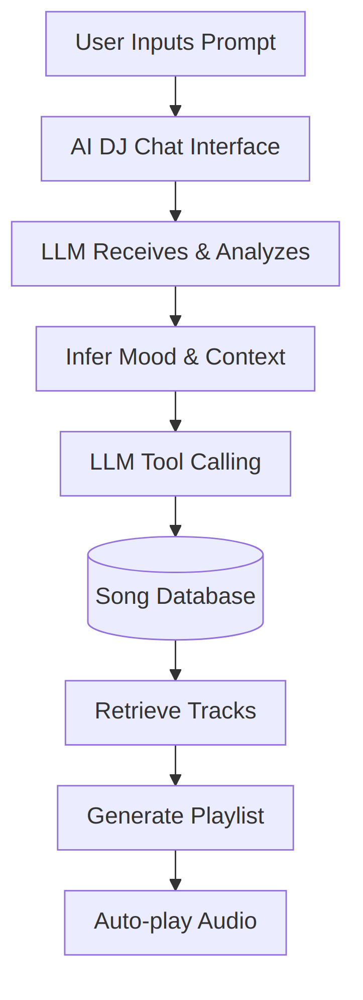
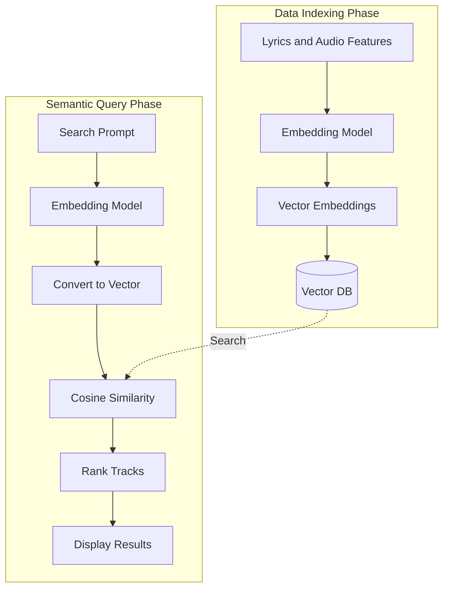

# PROJECT PROPOSAL: AURATUNE

---

## 1. INTRODUCTION

_Performed by: Nguyễn Khánh Đăng, Reviewed by: Mai Đăng Khoa, Edited by: Lê Công Minh Nhựt_

AuraTune is a smart music streaming platform that combines an open-copyright music distribution model with artificial intelligence. Unlike systems relying solely on standard SQL queries, AuraTune utilizes LLMs and Vector Databases to act as an AI DJ capable of deep semantic analysis, understanding the listener's mood and context. The system not only provides a continuous streaming experience but also builds a micro-social network where users can share playlists, follow artists, and receive personalized listening habit analytics.

---

## 2. TARGET USERS AND ENVIRONMENTS

_Performed by: Nguyễn Khánh Đăng, Reviewed by: Mai Đăng Khoa, Edited by: Lê Công Minh Nhựt_

* **Target Users**: Students, office workers, or individuals needing to adjust their focus and mood through complex music queries. The second group consists of independent artists needing an accessible launchpad for their music.
* **Environments**: A responsive Web Application that operates smoothly on web browsers.

---

## 3. ACTORS IDENTIFICATION

_Performed by: Nguyễn Khánh Đăng, Reviewed by: Mai Đăng Khoa, Edited by: Lê Công Minh Nhựt_

* **Listener**: General users who want to listen to music, search using AI, create/share playlists, follow others, and store their listening history.
* **Artist**: Independent artists who have the right to manage their artist profiles, and upload albums and songs to the system.
* **Administrator**: System administrators responsible for content moderation, account management, and ensuring the system does not contain commercially copyrighted music.

---

## 4. LEGAL ISSUES & COMPLIANCE

_Performed by: Nguyễn Khánh Đăng, Reviewed by: Mai Đăng Khoa, Edited by: Lê Công Minh Nhựt_

### 4.1. Legal Safe Zone
If the AuraTune system remains an internal research project, running on a localhost or internal server for academic reporting, database architecture testing, or AI recommendation model training, it will not violate Vietnamese copyright laws. According to Article 25 of the Intellectual Property Law, the non-commercial use of published works for teaching or scientific research is exempt from permission and royalty payments. Fetching APIs from external data repositories to serve as mock data within this scope does not constitute a copyright infringement.

### 4.2. Violation Risks Upon Public Release
As soon as the website is deployed to a public domain allowing external users to access, create accounts, and stream music, the team will face three major legal risks:
* **Copyright Infringement (Copyright & Related Rights)**: Using automated scripts to scrape data or utilizing third-party APIs to stream music on the web without a B2B contract is copyright infringement (Article 28 of the Intellectual Property Law). To operate legally, the team must sign paid contracts with VCPMC (Vietnam Center for Protection of Music Copyright - representing songwriters) and RIAV (Recording Industry Association of Vietnam - representing singers and record labels). Large-scale violations can lead to criminal prosecution (Article 225 of the Penal Code).
* **Website Operating License Violation**: If the website allows users to create playlists, comment, and share music with each other, the team is essentially operating a social network and strictly requires a Social Network Establishment License from the Ministry of Information and Communications.
* **Personal Data Protection Violation**: When the system features an AI music recommender, it inherently must collect and store listening history, habits, and user account information. According to Decree 13/2023/ND-CP, you must have a clear privacy policy displayed during registration, obtain user consent, and implement data encryption mechanisms. If the database is leaked, platform owners will face heavy administrative fines.

### 4.3. Proposed Solutions
If the team wishes to move the website out of the university environment to serve as a portfolio or public demo, all commercially copyrighted music should be removed. Instead, utilize NCS (NoCopyrightSounds) libraries or music under Creative Commons (CC0) licenses. The AI system and Database will still function perfectly to demonstrate technical capabilities, but legal risks will be reduced to zero.

---

## 5. FUNCTIONAL GROUPS & USE CASES

_Performed by: Nguyễn Khánh Đăng, Reviewed by: Mai Đăng Khoa, Edited by: Lê Công Minh Nhựt_

1. **AI DJ & Conversational Discovery**: Interact with AI via chat; Analyze complex prompts; Automatically generate playlists based on emotional arcs.
2. **Semantic Vector Search**: Search for songs by semantics/feelings; Search by lyrics; Filter results by metadata.
3. **Core Audio Streaming & Tracking**: Continuous background music playback; Record listening history (save timestamp and listening duration); Update total play counts.
4. **Artist Studio & Content Management**: Update artist profiles; Create new albums; Upload and manage songs.
5. **Library & Social Playlists**: Create playlists; Add/remove songs from playlists; Share playlists with specific users.
6. **Social Connectivity**: Follow other users; Follow favorite artists.
7. **Engagement & Interactions**: Like songs; Rate and curate personal libraries.
8. **User Listening Analytics**: Analyze listening data; Display total listening time; Summarize top favorite genres.
9. **Authentication & Profile Management**: Sign up/Log in; Manage account information; Role-based access control.
10. **Platform Administration**: Ban/Lock violating accounts; Remove copyrighted songs; View system statistics.
11. **Real-time Lyrics & Player Controls**: Synchronize real-time lyrics; Customize playback modes (Repeat, Shuffle); Adjust volume.

---

## 6. KEY FEATURES

_Performed by: Nguyễn Khánh Đăng & Mai Đăng Khoa, Reviewed by: Lê Công Minh Nhựt, Edited by: Thái Hoàng_

### 1. AI DJ & Conversational Discovery
This feature allows users to communicate in natural language with the system to request music based on emotional scenarios or complex activity contexts. It breaks down the barriers of traditional genre filters, helping users instantly receive an audio stream tailored to their current psychological state.

### 2. Semantic Vector Search
The system converts abstract descriptions or vaguely remembered lyric snippets into spatial vectors to match against audio metadata. This function is extremely useful as it permanently resolves the "forgot the song title" barrier, elevating the search experience for the user.

### 3. Core Audio Streaming & Tracking
The music player runs continuously in the background while silently recording the actual duration users listen to each song. This not only maintains a seamless auditory experience but also generates raw data for the AI to learn user habits.

### 4. Artist Studio & Content Management
Provides independent artists with a dedicated interface to set up their personal profiles, create albums, and upload standard audio files. This feature empowers creators with content control, helping them easily distribute their work and connect directly with fans on the platform.

### 5. Library & Social Playlists
Users can group their favorite songs into playlists and adjust privacy settings (Public, Private, or Shared with specific users). This not only helps organize personal music spaces but also fosters social interaction when users directly share their musical taste with friends.

### 6. Social Connectivity
Allows users to follow friends and independent artists on the platform to stay updated with their music activities and fresh releases. This bridges the gap between listeners and creators, fostering a micro-social music community that empowers independent artists to distribute their work directly without commercial intermediaries.

### 7. Engagement & Interactions
Provides interactive tools for users to like songs, rate tracks, and curate their personal audio collections with ease. This allows listeners to organize their personalized music space while supplying valuable interaction data for the system to optimize recommendation algorithms.

### 8. User Listening Analytics
Collects, processes, and visualizes user streaming data through periodic analytical reports, highlighting metrics like total listening time, top artists, and favorite genres. This enhances personalization by reflecting user emotional trends and music habits, ultimately driving higher user engagement and retention.

### 9. Authentication & Profile Management
Handles secure user registration, authentication, and role-based access control across Listener, Artist, and Administrator accounts. This ensures data protection compliance (such as Decree 13/2023/ND-CP) and prevents unauthorized access to role-restricted system features.

### 10. Platform Administration
A central management dashboard for administrators to moderate content, handle violating accounts, and remove commercially copyrighted tracks. This maintains system operation within the legal safe zone, ensures adherence to Intellectual Property law, and preserves a safe music-sharing environment.

### 11. Real-time Lyrics & Player Controls
A continuous background music player featuring advanced playback controls along with time-synchronized real-time lyrics display. This delivers a seamless, immersive, and highly interactive audio streaming experience across all device interfaces.

---

## 7. AI FEATURES & USER EXPERIENCE IMPROVEMENTS

_Performed by: Mai Đăng Khoa, Reviewed by: Nguyễn Khánh Đăng, Edited by: Lê Công Minh Nhựt_

### 7.1. Real-time Conversational AI Host (AI DJ)

* **Problem & Description**: Users often find static playlists or traditional random shuffle algorithms repetitive and lacking emotional empathy. They desire an intelligent companion that understands their mood and real-time activity context.
* **AI Mechanism**: Integrates a Large Language Model (LLM) acting as a smart conversational AI DJ. The LLM receives and analyzes complex natural language prompts from users (e.g., *"I'm feeling stressed while coding my thesis, give me some chill lofi tracks that boost focus without being too sad"*). It infers the user's emotion (stress), context (coding/study), and desired musical tone (chill lofi, uplifting). Subsequently, the LLM executes **Tool / Function Calling** to query matching songs from the database and stream them directly to the user.
* **UX Improvement**:
    * Delivers an interactive 1-on-1 experience similar to conversing with a personal radio host.
    * Instantly generates tailored playlists matching the user's current psychological state without requiring manual track searches.

### 7.2. Semantic Vector Search

* **Problem & Description**: Listeners frequently cannot remember exact song titles or lyrics, or they are searching for a specific vibe or mood rather than exact keywords. Traditional text-matching search engines (e.g., Elasticsearch) fail to handle such abstract queries.
* **AI Mechanism**: Utilizes an LLM combined with a Vector Database (ChromaDB / Pinecone). The system analyzes metadata, lyrics, and audio features (e.g., tempo, BPM, acoustics, mood) and transforms them into spatial vector embeddings. When users search using complex descriptions (e.g., *"A sad indie song with rain sound effects at the beginning for listening at 2 AM"* or *"Upbeat EDM music for running at 140 BPM"*), the system converts the prompt into a vector and performs spatial similarity matching to retrieve the best-suited songs.
* **UX Improvement**:
    * Eliminates the "forgot the song title or lyrics" barrier completely.
    * Allows users to express their music discovery needs naturally using descriptive language and emotional contexts.

---

## 8. MERMAID WORKFLOW DIAGRAMS FOR AI FEATURES

_Performed by: Mai Đăng Khoa, Reviewed by: Nguyễn Khánh Đăng, Edited by: Lê Công Minh Nhựt_

### 8.1. Workflow 1: Real-time Conversational AI DJ

### 8.2. Workflow 2: Semantic Vector Search

