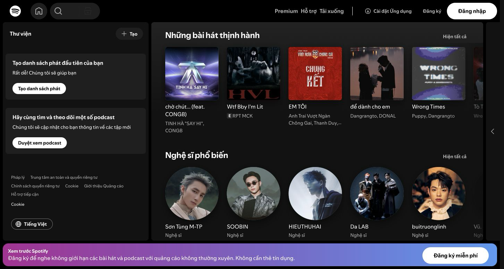
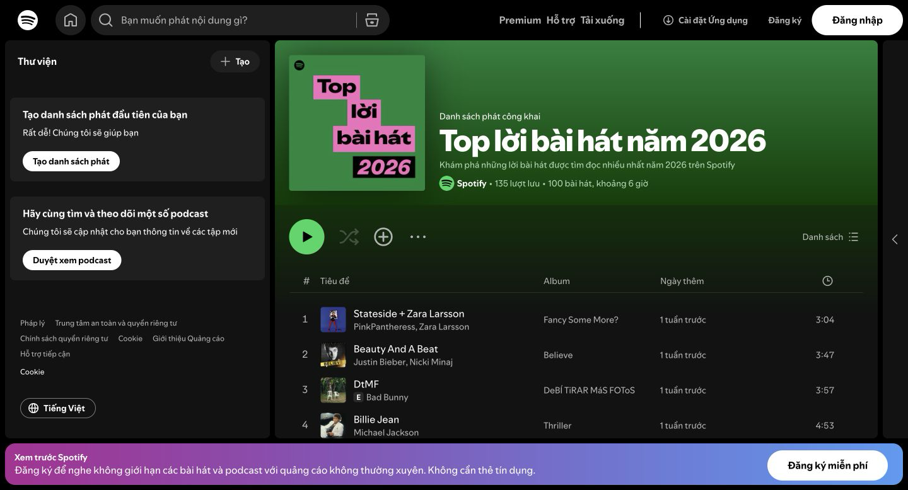

# UI/UX Survey of Music Streaming Applications
_Performed by: Nguyễn Thanh Huy, Reviewed by: Lê Công Minh Nhựt, Edited by: Nguyễn Thanh Huy_

## 1. Reasons for Selecting the Applications

**Spotify** was selected for its globally popular interface and smart layout. The sidebar, content area, and music player are clearly separated, making music discovery and playlist management convenient.

**Zing MP3** was selected because it suits the listening habits of Vietnamese users. Its content is presented in a familiar way, and its lyrics interface helps listeners follow the lyrics during playback.

The survey focuses on layout, content presentation, playback controls, and the lyrics experience to identify suitable patterns for AuraTune.

## 2. Spotify Survey

### 2.1. Home Page

- The sidebar provides familiar access points to the main sections and the personal library.
- Content is organized into sections such as recommended playlists and previously played content. Section headings help users quickly identify the content they want to explore.
- Cards use cover art, playlist titles, and short descriptions to help users recognize content before opening it.
- The dark theme highlights cover art and creates visual consistency between the discovery area and the player.

**Lesson for AuraTune:** organize the home page into sections, use a reusable Card component, and maintain clear navigation when users switch pages.

### 2.2. Playlist Page

- The top section focuses on the cover art, playlist title, description, and summary information.
- A prominent Play button helps users start listening to the playlist easily.
- Songs are presented in rows that prioritize the song title and artist; album details, duration, and secondary actions are placed where users can easily scan them.
- Actions that appear on hover reduce the number of visible buttons, but clear interactions are still needed on touch devices.

**Lesson for AuraTune:** establish a clear information hierarchy for playlists, make playback actions obvious, and use SongRow/SongTable to present songs consistently.

### 2.3. Bottom Player

- The player is fixed at the bottom, keeping playback controls accessible at all times.
- The left section displays the current song; the center contains Play/Pause, Previous, Next, and playback progress; the right section contains additional controls such as volume.
- The player remains available as users navigate through content, so they do not need to return to the song page to control playback.

**Lesson for AuraTune:** place the Bottom Player in the main layout, manage player state separately from individual pages, and leave enough space so the player does not cover the content.

## 3. Zing MP3 Survey

### 3.1. Lyrics Interface

- Lyrics are divided into individual lines, making them easy to follow.
- The current line is highlighted to indicate the current position in the song.
- Scrolling and transitions between lines should be smooth, avoiding abrupt jumps that distract listeners.
- The background and text should have sufficient contrast to keep lyrics readable, including when cover art is used as the background.

**Lesson for AuraTune:** use smooth scrolling, highlight the current line, and maintain readability when implementing Lyrics. Synchronization with playback time should be added when lyrics and audio data become available.

## 4. General Comparison

| Component | Spotify | Zing MP3 | Application to AuraTune |
| --- | --- | --- | --- |
| Sidebar | Navigation and library access | Navigation through music discovery sections | A left sidebar with clear navigation items |
| Card UI | Presents playlists and recommended content | Presents playlists, albums, and themes | Cards with cover art, titles, and short descriptions |
| Sticky Bottom Player | Playback controls remain accessible | Music player fixed at the bottom | A fixed player that does not cover content |
| Lyrics | Helps listeners follow song lyrics | Emphasizes following lyrics and scrolling | Smooth scrolling with the current line highlighted |

Both applications use a sidebar, Card UI, and a player fixed at the bottom to provide a familiar structure for navigation and listening.

## 5. AuraTune Differentiators and Intended UI/UX Improvements

### 5.1. AI Song Recommendations Based on Listening Habits

AuraTune plans to recommend songs based on listening history, liked songs, frequently played artists, frequently played genres, and popular songs. The home page includes a section for recommended songs.

**UX value:** helps users discover songs that match their preferences and reduces the effort of searching manually. Source: sections 2 and 10 of the feature document.

### 5.2. AI Search by Song Lyrics

In addition to searching by song title, artist, album, and playlist, AuraTune includes AI search by song lyrics.

**UX value:** provides another way to find music when users remember the lyrics but do not know the song title or artist. Source: section 3 of the feature document.

### 5.3. AI Playlist Creation

The document specifies AI playlist creation alongside playlist management actions such as editing information, adding or removing songs, and changing the song order.

**UX value:** helps users create listening collections more conveniently. Source: section 6 of the feature document.

### 5.4. Collaborative Playlists

AuraTune plans to support collaborative playlists alongside playlist creation, editing, and playback.

**UX value:** provides a shared music space for users who want to build a playlist together. Source: section 6 of the feature document.

### 5.5. Listening History and Personal Statistics

Users can view recently played songs, play counts for each song, listening time for each artist, and top N rankings of their most played artists and songs.

**UX value:** helps users find songs they previously listened to and understand their musical preferences through personal statistics. Source: section 7 of the feature document.

## 6. UI/UX Patterns to Adopt

- **Dark theme & Card layout — Spotify:** use dark backgrounds, organize content into sections, and present consistent Card components on the home page.
- **Lyrics scrolling — Zing MP3:** use smooth scrolling and highlight the current line when implementing the Lyrics interface.
- **A fixed player in the layout:** keep playback controls in a stable position while users navigate.

## 7. Actual Screenshots

The screenshots were captured directly from Spotify Web and Zing MP3 Web on 07/10/2026 and saved in the `images/` folder:

1. `spotify_home.png`
2. `spotify_playlist.png`
3. `spotify_player.png`
4. `zingmp3_lyrics.png`

The Spotify home and playlist pages were captured while signed out. The Bottom Player was captured after signing in, while playing “Để Dành Khi Thức Giấc” by SIVAN. The Zing MP3 screenshot shows Lyrics mode for “Ngân Hàng Nỗi Nhớ” by Đạt G. The actual interface may vary by account and time of access.
