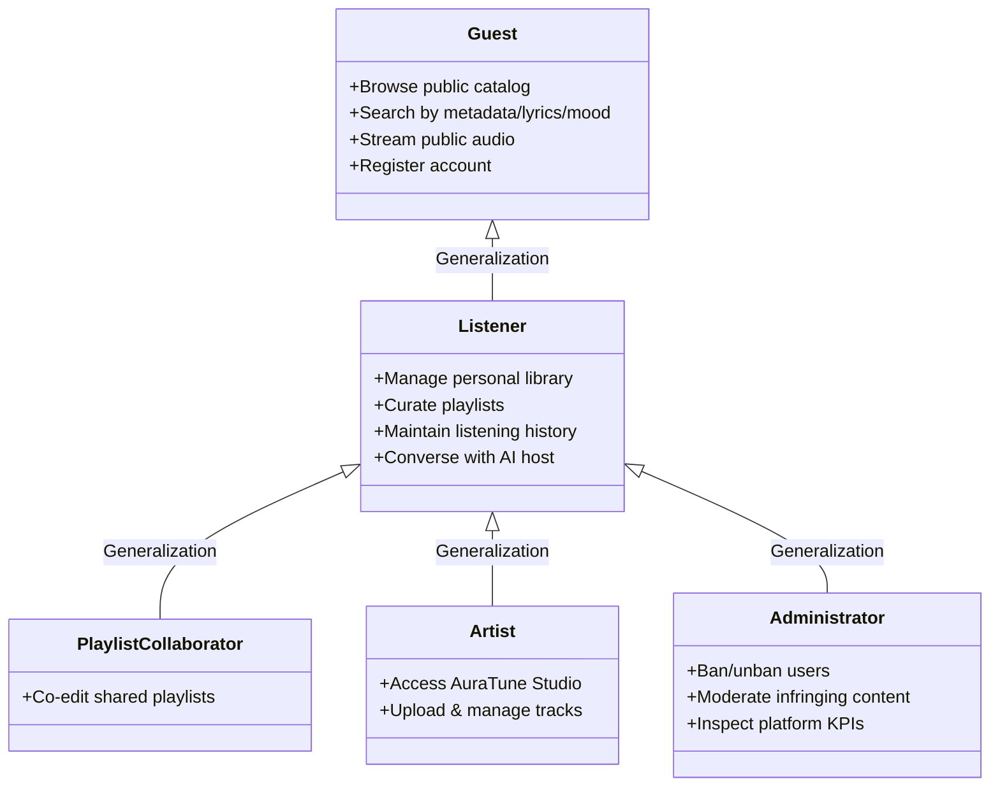

# AuraTune — System-Level Use-Case Model

---

## 1. Document Information

- **Document Title**: AuraTune System-Level Use-Case Model
- **Document Version**: 1.0.0
- **Status**: Baselined for PA3 Review
- **Last Updated**: 2026-11-03
- **Primary Authors**: Group 10 Requirements Engineering Team
- **Approval Authority**: Lê Công Minh Nhựt (Team Leader / Architecture Lead)
- **Source Baseline Documents**:
  - `docs/proposal/proposal.md` (Sections 1–8)
  - `docs/proposal/Auratune_Vision_Document.md` (Sections 1–6)
  - `docs/proposal/project_plan.md` (Sections 2.3, 2.4, 2.5, 4.3)
  - `docs/management/team-contract.md` (Section 1)
  - `docs/analysis-and-design/api-contract.md` (Sections 1–2)
  - `docs/design/database/er-diagram.md`
  - `specs/` (Functional feature specifications for groups `010` to `120`)

---

## 2. System Overview

AuraTune is a smart, cloud-backed music streaming and discovery web platform designed to combine open-copyright music distribution with artificial intelligence. Unlike conventional streaming services that rely exclusively on standard SQL metadata lookups, AuraTune integrates Large Language Models (LLMs) and vector similarity search to act as an intelligent "AI DJ" and conversational music companion capable of deep semantic comprehension.

The platform addresses two primary stakeholder groups:
1. **Listeners and Focused Workers**: Students, office workers, and general listeners who seek to adapt their auditory environment to shifting emotions, focus levels, and activities (e.g., finding tracks from vague memories, mood prompts, or fragmented lyrics).
2. **Independent Artists**: Musicians seeking an accessible, direct-to-consumer launchpad to publish, distribute, and manage their original, non-commercially copyrighted audio tracks.

AuraTune operates within an academic, non-commercial research scope (Proposal Section 4.1; Vision Document Section 3.3). To guarantee legal compliance with Vietnam's Intellectual Property Law (Article 25) and Personal Data Protection Decree (Decree 13/2023/ND-CP), the platform streams strictly royalty-free, Creative Commons (CC0), public-domain, or team-licensed audio, while enforcing rigorous anonymization before dispatching user queries to external AI services.

---

## 3. System Boundary

### 3.1 What is Inside AuraTune
- **Web Application Client (SPA)**: Responsive browser frontend providing home discovery, multi-modal search, persistent mini/full playback, queue drawer, playlist management, user library, and conversational chat interfaces.
- **AuraTune Application Backend**: RESTful API services handling authentication, authorization, session management, catalog indexing, playlist persistence, listening history logging, user stats aggregation, and administrative moderation.
- **AuraTune Database**: PostgreSQL relational database storing user credentials, profiles, sessions, catalog metadata (songs, albums, artists, genres), playlists, likes, and listening history events.
- **AuraTune AI Orchestrator**: Python/FastAPI microservice orchestrating semantic embedding lookups, vector similarity scoring, mood tag extraction, prompt-driven playlist generation, and chat intent resolution.

### 3.2 What is Outside AuraTune
- **External OAuth Identity Providers**: Third-party identity services (Google, Facebook) managing user identity verification outside AuraTune's boundaries.
- **Cloud Media Storage / CDN**: Cloud object storage (Cloudinary / Cloudflare CDN) storing raw binary audio files (MP3), high-resolution cover art, and artist avatars, serving audio streams via HTTP Range requests.
- **External AI Foundation Models**: Third-party language models, embedding models, and managed vector infrastructure providing inference endpoints consumed by AuraTune's backend.
- **Client Web Browsers**: Standard modern desktop and mobile browsers (Chrome, Edge, Firefox, Safari) providing standard HTML5 `<audio>` playback engines.

### 3.3 External Systems & Cross-Boundary Responsibilities

| External System | Type | Cross-Boundary Responsibility | Source Document | Status |
|---|---|---|---|---|
| **Google OAuth 2.0** | External System | Authenticates users; returns user identity token, email, display name, and avatar URL via callback. | `Vision Document` AD-07; `012/spec.md` | Confirmed |
| **Facebook Login** | External System | Authenticates users; returns OAuth authorization code and profile claims. | `Vision Document` AD-07; `012/spec.md` | Confirmed |
| **Cloud Media Storage (CDN)** | External System | Stores uploaded audio files and images; handles progressive streaming and HTTP 206 Partial Content byte-range requests. | `Vision Document` AD-04, ED-05; `042/spec.md` | Confirmed |
| **External AI / LLM Provider** | External System | Generates vector embeddings for lyrics/queries; performs LLM completion for AI playlist generation and conversational host dialogues. | `Vision Document` AD-06, ED-08; `proposal.md` | Confirmed |
| **Spotify Web API** | Offline Ingestion Tool | Source of catalog metadata during team preparation scripts; **not** invoked at runtime by end users or backend APIs. | `Vision Document` Section 4.1, AD-05, ED-01 | Confirmed (Offline only) |

---

## 4. Actor Catalog

### 4.1 Detailed Actor Specifications

| Actor ID | Actor Name | Actor Type | Description & Responsibilities | Related Use Cases | Source |
|---|---|---|---|---|---|
| `ACT-01` | **Guest / Visitor** | Primary Human Actor | Unauthenticated visitor accessing AuraTune via a web browser. Can browse public content, execute searches, and stream music without logging in. Prompted to authenticate when attempting personal actions. | `UC-010-001` through `UC-010-004`, `UC-020-001`, `UC-020-002`, `UC-020-004`, `UC-020-005`, `UC-030-001` through `UC-030-004`, `UC-040-001` through `UC-040-008`, `UC-050-001` through `UC-050-006`, `UC-080-001` through `UC-080-003`, `UC-080-005`, `UC-090-001` | `proposal.md` Section 3; `Vision Document` Section 3.2 |
| `ACT-02` | **Listener** | Primary Human Actor | Authenticated standard user. Inherits all capabilities of Guest. Manages personal playlists, bookmarks albums, tracks listening history, generates AI playlists, and interacts with the AI Conversational Host. | All Guest use cases plus: `UC-010-005` through `UC-010-009`, `UC-020-003`, `UC-040-009`, `UC-040-010`, `UC-050-007`, `UC-060-001` through `UC-060-012`, `UC-070-002` through `UC-070-006`, `UC-080-004`, `UC-090-002`, `UC-090-003`, `UC-100-002`, `UC-100-003`, `UC-120-001` through `UC-120-004` | `proposal.md` Section 3; `Vision Document` Section 3.2 |
| `ACT-03` | **Playlist Collaborator** | Supporting Human Actor | Authenticated listener who has been invited by a playlist owner to co-curate a shared playlist. Can add, remove, and reorder songs within the specific shared collection. | `UC-060-005`, `UC-060-006`, `UC-060-007`, `UC-060-011` | `Vision Document` Section 5.2 G06; `065/spec.md` |
| `ACT-04` | **Artist** | Primary Human Actor | Musician with an authenticated account assigned the `artist` role. Inherits all Listener capabilities. Granted access to AuraTune Studio (`/studio`) to upload tracks, edit metadata, hide, or delete audio. | All Listener use cases plus: `UC-090-004` through `UC-090-008` | `proposal.md` Section 3; `Vision Document` Section 3.2 |
| `ACT-05` | **Administrator** | Administrative Human Actor | Platform operator assigned the `admin` role. Inherits all Listener capabilities. Granted access to Admin Dashboard (`/admin`) to manage accounts, ban violators, moderate infringing tracks/comments, and inspect stats. | All Listener use cases plus: `UC-040-010`, `UC-110-001` through `UC-110-008` | `proposal.md` Section 3; `Vision Document` Section 3.2 |
| `ACT-EXT-01` | **Google OAuth Provider** | External System | Third-party identity provider implementing OAuth 2.0 / OpenID Connect. Authenticates users and returns identity profiles. | `UC-010-003` | `Vision Document` AD-07; `012/spec.md` |
| `ACT-EXT-02` | **Facebook Login Provider** | External System | Third-party social login provider implementing OAuth 2.0. Authenticates users and returns user profile data. | `UC-010-004` | `Vision Document` AD-07; `012/spec.md` |
| `ACT-EXT-03` | **Cloud Media Storage (CDN)** | External System | Cloudinary / Cloudflare CDN storing audio files (MP3) and images. Serves byte-range streaming requests for audio playback and seeking. | `UC-040-001`, `UC-040-003`, `UC-090-005` | `Vision Document` AD-04, ED-05; `042/spec.md` |
| `ACT-EXT-04` | **External AI Service Provider** | External System | Cloud LLM and embedding infrastructure providing vector similarity lookups, prompt analysis, and conversational dialogue completion. | `UC-030-002`, `UC-030-003`, `UC-060-010`, `UC-100-001` through `UC-100-003`, `UC-120-001` through `UC-120-003` | `Vision Document` AD-06, ED-08; `proposal.md` Section 7 |

---

## 5. Functional Group Overview

The AuraTune system encompasses 12 official functional groups established in the project charter and Team Contract:

### 5.1 Group 010 – Authentication
- **Purpose**: Establishes, validates, and maintains user identity and session security across local and third-party login methods.
- **Confirmed Capabilities**: Local email/password registration and login; Google OAuth2 and Facebook OAuth2 sign-in; account linking across methods; dual-token session management (JWT Access Token + rotating Refresh Token in HttpOnly cookie); 15-minute account lockout on brute-force attempts; self-service password reset; multi-device session limits (max 5) and revocation.
- **Main Actors**: Guest (`ACT-01`), Listener (`ACT-02`), Google OAuth (`ACT-EXT-01`), Facebook Login (`ACT-EXT-02`).
- **Related FR IDs**: `011-FR-001` to `011-FR-011`; `012-FR-001` to `012-FR-011`; `013-FR-001` to `013-FR-014`.
- **Dependencies**: Database (PostgreSQL `users`, `user_sessions`, `oauth_links`).
- **Source References**: `proposal.md` 6.1; `Vision Document` G01; `specs/010-authentication/`.
- **Unresolved Questions**: Free-tier SMTP mail service selection for password recovery emails (PC-03, Q-010-1).

### 5.2 Group 020 – Home Dashboard
- **Purpose**: Acts as the central discovery surface, aggregating personalized music, recent plays, charts, and new releases.
- **Confirmed Capabilities**: Section ordering (Hero → Recommendations → New Albums → Trending Charts → Featured Artists → Suggested Playlists → Genres); guest vs. authenticated partition; direct one-click playback initializing queue; failure isolation per section; dedicated `/charts` page with period and genre filters.
- **Main Actors**: Guest (`ACT-01`), Listener (`ACT-02`).
- **Related FR IDs**: `021-FR-001` to `021-FR-008`; `022-FR-001` to `022-FR-004`; `023-FR-001` to `023-FR-003`; `024-FR-001` to `024-FR-004`; `025-FR-001` to `025-FR-003`.
- **Dependencies**: Groups `010`, `040`, `050`, `070`, `080`, `090`, `100`.
- **Source References**: `proposal.md` 6.2; `Vision Document` G02; `specs/020-home-dashboard/`.
- **Unresolved Questions**: Single composite endpoint `GET /home` vs. granular parallel client requests (Q-020-1).

### 5.3 Group 030 – Search
- **Purpose**: Delivers multi-modal music discovery via metadata, lyric fragments, and emotional descriptions.
- **Confirmed Capabilities**: Text search by song, artist, album, playlist with diacritic-insensitivity and filters; AI lyric search with matched excerpt highlight; semantic mood/context vector search; 3-second timeout triggering automatic keyword fallback; client-side LocalStorage search history (max 10); PII sanitization.
- **Main Actors**: Guest (`ACT-01`), Listener (`ACT-02`), External AI Service (`ACT-EXT-04`).
- **Related FR IDs**: `031-FR-001` to `031-FR-007`; `032-FR-001` to `032-FR-005`; `033-FR-001` to `033-FR-005`.
- **Dependencies**: Database (PostgreSQL), External AI / Vector Database (pgvector / ChromaDB).
- **Source References**: `proposal.md` 6.3, 7; `Vision Document` G03; `specs/030-search/`.
- **Unresolved Questions**: Vector database selection (PostgreSQL `pgvector` vs. ChromaDB/Pinecone) under free-tier limits (R4, Q-030-1).

### 5.4 Group 040 – Music Player
- **Purpose**: Provides uninterrupted, continuous audio streaming and playback controls across all pages.
- **Confirmed Capabilities**: Play, pause, skip, previous (with 3-second restart rule); elapsed/duration display; seeking via HTTP 206 range requests; volume slider and mute; shuffle and repeat modes; synchronized lyrics scrolling; persistent bottom mini-player; full player modal; song sharing; public comment reading; authenticated comment posting and deletion; 30-second listening history dispatch.
- **Main Actors**: Guest (`ACT-01`), Listener (`ACT-02`), Administrator (`ACT-05`), Cloud Media Storage (`ACT-EXT-03`).
- **Related FR IDs**: `041-FR-001` to `041-FR-006`; `042-FR-001` to `042-FR-004`; `043-FR-001` to `043-FR-002`; `044-FR-001` to `044-FR-003`; `045-FR-001` to `045-FR-003`; `046-FR-001` to `046-FR-004`.
- **Dependencies**: Group `050` (Queue), Group `070` (History), Cloud Media Storage (Cloudinary/Cloudflare).
- **Source References**: `proposal.md` 6.4; `Vision Document` G04; `specs/040-music-player/`.
- **Unresolved Questions**: Cloud media storage range request verification on free tier (Q-040-1).

### 5.5 Group 050 – Queue Management
- **Purpose**: Provides real-time dynamic control over the upcoming playback waitlist.
- **Confirmed Capabilities**: Slide-out queue drawer UI; now-playing top card; upcoming tracks list (max 50 tracks); jump to track; clear upcoming queue; append to queue; de-duplication of manual additions; drag-and-drop reordering; step up/down accessibility buttons; LIFO Play Next prioritization; Play Next override over Shuffle; LocalStorage session persistence across page reload.
- **Main Actors**: Guest (`ACT-01`), Listener (`ACT-02`).
- **Related FR IDs**: `051-FR-001` to `051-FR-008`; `052-FR-001` to `052-FR-004`; `053-FR-001` to `053-FR-003`; `054-FR-001` to `054-FR-004`.
- **Dependencies**: Group `040` (Player), Group `060` (Playlist creation from queue).
- **Source References**: `proposal.md` 6.5; `Vision Document` G05; `specs/050-queue-management/`.
- **Unresolved Questions**: Behavior when clicking a single song from search (queue replacement vs. index 0 insertion, Q-050-2).

### 5.6 Group 060 – Playlist Management
- **Purpose**: Empowers listeners to assemble, curate, share, and collaborate on personal music collections.
- **Confirmed Capabilities**: Playlist CRUD (title max 80 chars, description max 300 chars, default Private); song addition/removal; song reordering; full playlist playback; Liked Songs special collection; prompt-driven AI playlist generation (10–20 songs with explanation, review, and edit flow); collaborative playlists (invite by email, co-editing, contributor attribution, owner revocation); following public playlists.
- **Main Actors**: Listener (`ACT-02`), Playlist Collaborator (`ACT-03`), External AI Service (`ACT-EXT-04`).
- **Related FR IDs**: `061-FR-001` to `061-FR-006`; `062-FR-001` to `062-FR-004`; `063-FR-001` to `063-FR-002`; `064-FR-001` to `064-FR-005`; `065-FR-001` to `065-FR-004`.
- **Dependencies**: Database (PostgreSQL), Group `010`, Group `040`, Group `050`, External AI Service.
- **Source References**: `proposal.md` 6.6; `Vision Document` G06; `specs/060-playlist-management/`.
- **Unresolved Questions**: Real-time collaborative sync mechanism (REST polling vs. WebSockets, Q-060-1).

### 5.7 Group 070 – Listening History
- **Purpose**: Captures user playback activity and generates personal listening habit analytics.
- **Confirmed Capabilities**: Automatic play event recording upon reaching 30s playback threshold; recently played list display; individual record deletion; "Clear All History" full purge (removing records and excluding them from AI profile); cumulative listening duration tracking (daily, weekly, total); last 7 days usage trend visualization; top 10 artists by play frequency; top genres analysis across configurable time horizons (4 weeks, 6 months, all-time/365 days).
- **Main Actors**: Listener (`ACT-02`), System / Player Internal Service.
- **Related FR IDs**: `071-FR-001` to `071-FR-004`; `072-FR-001` to `072-FR-003`; `073-FR-001` to `073-FR-003`.
- **Dependencies**: Database (`listening_history`, `user_listening_stats`), Group `040` (Player trigger), Group `010`.
- **Source References**: `proposal.md` 6.7; `Vision Document` G07; `specs/070-listening-history/`.
- **Unresolved Questions**: Data aggregation schedule for top genres (on-demand SQL query vs. pre-aggregated summary table).

### 5.8 Group 080 – Album Interaction
- **Purpose**: Presents structured musical releases in their complete artist-intended context.
- **Confirmed Capabilities**: Album detail view (cover art, title, artist, release year, release type badge "Đĩa đơn" vs "Album", total duration, track-level play counts); complete tracklist rendering; Play Album action (loading entire album into queue in order); individual track playback; Save Album to personal library; Share Album via Web Share API or clipboard URL copy.
- **Main Actors**: Guest (`ACT-01`), Listener (`ACT-02`).
- **Related FR IDs**: `081-FR-001` to `081-FR-002`; `082-FR-001` to `082-FR-003`; `083-FR-001` to `083-FR-002`.
- **Dependencies**: Database (`albums`, `songs`, `artists`), Group `040` (Player), Group `050` (Queue), Group `010`.
- **Source References**: `proposal.md` 6.8; `Vision Document` G08; `specs/080-album-interaction/`.
- **Unresolved Questions**: Display of multi-disc releases (confirmed as flat ordered list in 081 specification).

### 5.9 Group 090 – Artist Profile & Studio
- **Purpose**: Connects listeners with artist discographies and provides musicians with a dedicated content management workspace.
- **Confirmed Capabilities**: Public artist profile (avatar, bio, top 5 songs by AuraTune play count, released albums, related playlists); Follow/Unfollow artist; Following artists list in library; AuraTune Studio (`/studio`) restricted to `artist` role; Studio metrics dashboard (track count, public count, total plays); audio file upload with metadata (`POST /songs`); track metadata editing; track hiding (soft-hide); track permanent deletion.
- **Main Actors**: Guest (`ACT-01`), Listener (`ACT-02`), Artist (`ACT-04`), Cloud Media Storage (`ACT-EXT-03`).
- **Related FR IDs**: `091-FR-001` to `091-FR-003`; `092-FR-001` to `092-FR-004`; `093-FR-001` to `093-FR-005`.
- **Dependencies**: Database (`artists`, `songs`, `albums`, `user_follows_artist`), Group `010`, Cloud Media Storage.
- **Source References**: `proposal.md` 6.9; `Vision Document` G09; `specs/090-artist-profile-studio/`.
- **Unresolved Questions**: Workflow for artist verification/elevation (handled by Administrator via Group 110).

### 5.10 Group 100 – AI Recommendations
- **Purpose**: Generates passive, automated song recommendations matching individual listener taste and emotional context.
- **Confirmed Capabilities**: Analysis of `listening_history` and liked songs to identify taste profile; `GET /recommendations/songs` personalized feed; curated mood and context preset chips (Chill, Energetic, Focus, Workout, Study, Sleep); fallback to platform popular tracks when AI service is offline or for new users without history.
- **Main Actors**: Listener (`ACT-02`), External AI Service (`ACT-EXT-04`).
- **Related FR IDs**: `101-FR-001` to `101-FR-002`; `102-FR-001` to `102-FR-004`; `103-FR-001` to `103-FR-003`.
- **Dependencies**: Database (`listening_history`, `user_liked_songs`), Group `010`, Group `070`, External AI Service.
- **Source References**: `proposal.md` 6.10; `Vision Document` G10; `specs/100-ai-recommendations/`.
- **Unresolved Questions**: Algorithm model selection (collaborative filtering vs. content-based embeddings, PoC ED-08).

### 5.11 Group 110 – Admin Functions
- **Purpose**: Provides administrative oversight, user access management, content moderation, and platform health analytics.
- **Confirmed Capabilities**: User management dashboard (`GET /admin/users` with search, role, and ban status filters); banning users with mandatory reason; unbanning accounts; session blocking for banned users; changing user roles (`user`, `artist`, `admin`) with self-modification prevention; content moderation (hiding/removing infringing tracks, editing track metadata, deleting abusive comments); platform statistics dashboard (KPI cards for total users, artists, songs, plays); system controls (AI availability toggle and browser demo data reset).
- **Main Actors**: Administrator (`ACT-05`).
- **Related FR IDs**: `111-FR-001` to `111-FR-007`; `112-FR-001` to `112-FR-004`; `113-FR-001` to `113-FR-004`.
- **Dependencies**: Database, Group `010` (Role verification), Group `040` (Comment deletion), Group `090` (Track metadata).
- **Source References**: `proposal.md` 6.11; `Vision Document` G11; `specs/110-admin-functions/`.
- **Unresolved Questions**: Audit log persistence for administrative actions (in-memory vs. dedicated database audit table).

### 5.12 Group 120 – AI Conversational Agent
- **Purpose**: Acts as an interactive real-time musical host/DJ that users converse with via natural language text to discover music and control playback.
- **Confirmed Capabilities**: Chat workspace interface with message thread; prompt history navigation (Up/Down arrow keys, max 30 prompts); `/clear` command; music intent parsing (identifying intents: `play_music`, `queue_song`, `recommend_mood`, `ask_track_info`, `control_player`); client-side action execution via `client_actions` payload (controlling bottom player and queue directly from chat); interactive confirmation for destructive actions (`clear_queue`); graceful degradation notice when AI host is suspended.
- **Main Actors**: Listener (`ACT-02`), External AI Service (`ACT-EXT-04`).
- **Related FR IDs**: `121-FR-001` to `121-FR-007`; `122-FR-001` to `122-FR-005`; `123-FR-001` to `123-FR-005`.
- **Dependencies**: Group `010`, Group `040`, Group `050`, Group `060`, External AI Service.
- **Source References**: `proposal.md` Section 1, 5.12, 6.12; `Vision Document` G12; `specs/120-ai-conversational-agent/`.
- **Unresolved Questions**: Voice speech synthesis/recognition scope (Project Plan 2.3.1 notes voice is unconfirmed; text-only confirmed for baseline).

---

## 6. System-Level Use-Case Diagram

```mermaid
flowchart TB
    subgraph EXT[External Systems]
        OAUTH_G[Google OAuth Provider]
        OAUTH_F[Facebook Login Provider]
        CDN[Cloud Media Storage]
        AI_SRV[External AI Service]
    end

    subgraph ACTORS[AuraTune Actors]
        GUEST([Guest / Visitor])
        USER([Listener])
        COLLAB([Playlist Collaborator])
        ARTIST([Artist])
        ADMIN([Administrator])
    end

    USER -.->|extends role| GUEST
    COLLAB -.->|extends role| USER
    ARTIST -.->|extends role| USER
    ADMIN -.->|extends role| USER

    subgraph SYS[AuraTune System Boundary]
        subgraph G010[010 Authentication]
            UC010_1["Register Account (UC-010-001)"]
            UC010_2["Log In with Email (UC-010-002)"]
            UC010_3["Log In with Google (UC-010-003)"]
            UC010_4["Log In with Facebook (UC-010-004)"]
            UC010_5["Refresh Session Token (UC-010-005)"]
            UC010_6["Reset Password via Email (UC-010-006)"]
            UC010_7["Log Out (UC-010-007)"]
            UC010_8["Log Out from All Devices (UC-010-008)"]
            UC010_9["Unlink Social Account (UC-010-009)"]
        end

        subgraph G020[020 Home Dashboard]
            UC020_1["Browse Home Dashboard (UC-020-001)"]
            UC020_2["Stream Recommended Music (UC-020-002)"]
            UC020_3["Replay Recent Music (UC-020-003)"]
            UC020_4["Browse Trending Charts (UC-020-004)"]
            UC020_5["Explore New Releases (UC-020-005)"]
        end

        subgraph G030[030 Search]
            UC030_1["Search Catalog by Text (UC-030-001)"]
            UC030_2["Search Music by Lyrics (UC-030-002)"]
            UC030_3["Discover by Mood & Context (UC-030-003)"]
            UC030_4["Manage Search History (UC-030-004)"]
        end

        subgraph G040[040 Music Player]
            UC040_1["Control Audio Playback (UC-040-001)"]
            UC040_2["Adjust Volume & Mute (UC-040-002)"]
            UC040_3["Seek Audio Position (UC-040-003)"]
            UC040_4["Toggle Shuffle & Repeat (UC-040-004)"]
            UC040_5["View Synchronized Lyrics (UC-040-005)"]
            UC040_6["Toggle Mini & Full Player (UC-040-006)"]
            UC040_7["Share Song (UC-040-007)"]
            UC040_8["Read Track Comments (UC-040-008)"]
            UC040_9["Post Track Comment (UC-040-009)"]
            UC040_10["Delete Track Comment (UC-040-010)"]
        end

        subgraph G050[050 Queue Management]
            UC050_1["View Playback Queue (UC-050-001)"]
            UC050_2["Add Track to Queue (UC-050-002)"]
            UC050_3["Play Track Next (UC-050-003)"]
            UC050_4["Reorder Upcoming Queue (UC-050-004)"]
            UC050_5["Remove Track from Queue (UC-050-005)"]
            UC050_6["Clear Upcoming Queue (UC-050-006)"]
            UC050_7["Save Queue as Playlist (UC-050-007)"]
        end

        subgraph G060[060 Playlist Management]
            UC060_1["Create Playlist (UC-060-001)"]
            UC060_2["View Playlist Details (UC-060-002)"]
            UC060_3["Edit Playlist Metadata (UC-060-003)"]
            UC060_4["Delete Playlist (UC-060-004)"]
            UC060_5["Add Track to Playlist (UC-060-005)"]
            UC060_6["Remove Track from Playlist (UC-060-006)"]
            UC060_7["Reorder Playlist Tracks (UC-060-007)"]
            UC060_8["Play Playlist (UC-060-008)"]
            UC060_9["Manage Liked Songs (UC-060-009)"]
            UC060_10["Generate Playlist with AI (UC-060-010)"]
            UC060_11["Manage Collaborative Playlist (UC-060-011)"]
            UC060_12["Bookmark Public Playlist (UC-060-012)"]
        end

        subgraph G070[070 Listening History]
            UC070_1["Record Track Play Event (UC-070-001)"]
            UC070_2["View Listening History (UC-070-002)"]
            UC070_3["Delete History Record (UC-070-003)"]
            UC070_4["Purge Entire History (UC-070-004)"]
            UC070_5["View Duration Analytics (UC-070-005)"]
            UC070_6["View Top Artists & Genres (UC-070-006)"]
        end

        subgraph G080[080 Album Interaction]
            UC080_1["View Album Details (UC-080-001)"]
            UC080_2["Play Entire Album (UC-080-002)"]
            UC080_3["Play Specific Album Track (UC-080-003)"]
            UC080_4["Save Album to Library (UC-080-004)"]
            UC080_5["Share Album (UC-080-005)"]
        end

        subgraph G090[090 Artist Profile & Studio]
            UC090_1["View Public Artist Profile (UC-090-001)"]
            UC090_2["Follow or Unfollow Artist (UC-090-002)"]
            UC090_3["View Followed Artists (UC-090-003)"]
            UC090_4["Access Studio Dashboard (UC-090-004)"]
            UC090_5["Upload Audio Track (UC-090-005)"]
            UC090_6["Edit Track Metadata (UC-090-006)"]
            UC090_7["Hide or Unhide Track (UC-090-007)"]
            UC090_8["Delete Track from Studio (UC-090-008)"]
        end

        subgraph G100[100 AI Recommendations]
            UC100_1["Analyze Listening Profile (UC-100-001)"]
            UC100_2["Receive Personalized Picks (UC-100-002)"]
            UC100_3["Discover by Mood Tags (UC-100-003)"]
        end

        subgraph G110[110 Admin Functions]
            UC110_1["View & Search Users (UC-110-001)"]
            UC110_2["Ban User Account (UC-110-002)"]
            UC110_3["Unban User Account (UC-110-003)"]
            UC110_4["Manage User Roles (UC-110-004)"]
            UC110_5["Moderate Tracks (UC-110-005)"]
            UC110_6["Moderate Comments (UC-110-006)"]
            UC110_7["View Platform KPIs (UC-110-007)"]
            UC110_8["Manage System & Reset (UC-110-008)"]
        end

        subgraph G120[120 AI Conversational Agent]
            UC120_1["Converse with AI Host (UC-120-001)"]
            UC120_2["Interpret Music Intent (UC-120-002)"]
            UC120_3["Execute Music Actions (UC-120-003)"]
            UC120_4["Clear Chat History (UC-120-004)"]
        end
    end

    %% Actor to Use Case associations
    GUEST --> UC010_1
    GUEST --> UC010_2
    GUEST --> UC010_3
    GUEST --> UC010_4
    GUEST --> UC020_1
    GUEST --> UC030_1
    GUEST --> UC040_1
    GUEST --> UC080_1
    GUEST --> UC090_1

    USER --> UC010_5
    USER --> UC010_7
    USER --> UC020_3
    USER --> UC040_9
    USER --> UC050_1
    USER --> UC060_1
    USER --> UC070_2
    USER --> UC080_4
    USER --> UC090_2
    USER --> UC100_2
    USER --> UC120_1

    COLLAB --> UC060_5
    COLLAB --> UC060_6
    COLLAB --> UC060_7

    ARTIST --> UC090_4
    ARTIST --> UC090_5
    ARTIST --> UC090_6
    ARTIST --> UC090_7
    ARTIST --> UC090_8

    ADMIN --> UC110_1
    ADMIN --> UC110_2
    ADMIN --> UC110_3
    ADMIN --> UC110_4
    ADMIN --> UC110_5
    ADMIN --> UC110_6
    ADMIN --> UC110_7
    ADMIN --> UC110_8
    ADMIN --> UC040_10

    %% External Systems associations
    UC010_3 --> OAUTH_G
    UC010_4 --> OAUTH_F
    UC040_1 --> CDN
    UC040_3 --> CDN
    UC090_5 --> CDN
    UC030_2 --> AI_SRV
    UC030_3 --> AI_SRV
    UC060_10 --> AI_SRV
    UC100_2 --> AI_SRV
    UC120_1 --> AI_SRV
```

---

## 7. Consolidated Use-Case Catalog

*Naming Convention: `UC-[GROUP]-[SEQUENCE]-[short-name]` (Provisional project standard matching `AuraTune_Use_Case_Documentation_Guide.md`).*

| UC ID | Use-Case Name | Primary Actor | Supporting Actors | Functional Group | Related FR IDs | Source References | Status |
|---|---|---|---|---|---|---|---|
| `UC-010-001` | Register Account | Guest | None | 010 Authentication | `011-FR-001..003`, `011-FR-008..010` | `011/spec.md` US1 | Confirmed |
| `UC-010-002` | Log In with Email and Password | Guest / Listener | None | 010 Authentication | `011-FR-004`, `011-FR-006`, `011-FR-009`, `013-FR-001..003` | `011/spec.md` US2 | Confirmed |
| `UC-010-003` | Log In with Google | Guest / Listener | Google OAuth Provider | 010 Authentication | `012-FR-001`, `012-FR-003..008`, `013-FR-001..003` | `012/spec.md` US1, US2 | Confirmed |
| `UC-010-004` | Log In with Facebook | Guest / Listener | Facebook Login Provider | 010 Authentication | `012-FR-002..008`, `013-FR-001..003` | `012/spec.md` US1, US2 | Confirmed |
| `UC-010-005` | Refresh Session Token | Listener | None | 010 Authentication | `013-FR-004..005`, `013-FR-009`, `013-FR-011`, `013-FR-014` | `013/spec.md` US1 | Confirmed |
| `UC-010-006` | Reset Password via Email | Guest / Listener | Email Service | 010 Authentication | `011-FR-011` | `011/spec.md` US4 | Confirmed |
| `UC-010-007` | Log Out | Listener | None | 010 Authentication | `013-FR-006` | `013/spec.md` US2 | Confirmed |
| `UC-010-008` | Log Out from All Devices | Listener | None | 010 Authentication | `013-FR-008` | `013/spec.md` US3 | Confirmed |
| `UC-010-009` | Unlink Social Account | Listener | None | 010 Authentication | `012-FR-011` | `012/spec.md` US4 | Confirmed |
| `UC-020-001` | Browse Home Dashboard | Guest / Listener | None | 020 Home Dashboard | `021-FR-001..004`, `021-FR-006` | `021/spec.md` US1, US2 | Confirmed |
| `UC-020-002` | Stream Recommended Music from Home | Guest / Listener | None | 020 Home Dashboard | `022-FR-001..004` | `022/spec.md` US1 | Confirmed |
| `UC-020-003` | Replay Recently Played Music | Listener | None | 020 Home Dashboard | `023-FR-001..003` | `023/spec.md` US1 | Confirmed |
| `UC-020-004` | Browse Trending Charts | Guest / Listener | None | 020 Home Dashboard | `024-FR-001..004` | `024/spec.md` US1, US2 | Confirmed |
| `UC-020-005` | Explore New Album Releases | Guest / Listener | None | 020 Home Dashboard | `025-FR-001..003` | `025/spec.md` US1, US2 | Confirmed |
| `UC-030-001` | Search Catalog by Text Metadata | Guest / Listener | None | 030 Search | `031-FR-001..006` | `031/spec.md` US1, US2 | Confirmed |
| `UC-030-002` | Search Music by Lyric Fragment | Guest / Listener | External AI Service | 030 Search | `032-FR-001..005` | `032/spec.md` US1 | Confirmed |
| `UC-030-003` | Discover Music by Semantic Mood or Context | Guest / Listener | External AI Service | 030 Search | `033-FR-001..005` | `033/spec.md` US1, US2 | Confirmed |
| `UC-030-004` | Manage Local Search History | Guest / Listener | None | 030 Search | `031-FR-007` | `031/spec.md` US3 | Confirmed |
| `UC-040-001` | Control Audio Playback | Guest / Listener | Cloud Media Storage | 040 Music Player | `041-FR-001..004`, `041-FR-006` | `041/spec.md` US1, US2 | Confirmed |
| `UC-040-002` | Adjust Volume and Mute | Guest / Listener | None | 040 Music Player | `042-FR-003..004` | `042/spec.md` US2 | Confirmed |
| `UC-040-003` | Seek Audio Playback Position | Guest / Listener | Cloud Media Storage | 040 Music Player | `042-FR-001..002` | `042/spec.md` US1 | Confirmed |
| `UC-040-004` | Toggle Shuffle and Repeat Modes | Guest / Listener | None | 040 Music Player | `043-FR-001..002` | `043/spec.md` US1, US2 | Confirmed |
| `UC-040-005` | View Synchronized Lyrics | Guest / Listener | None | 040 Music Player | `044-FR-001..003` | `044/spec.md` US1, US2 | Confirmed |
| `UC-040-006` | Toggle Persistent Mini and Full Player | Guest / Listener | None | 040 Music Player | `045-FR-001..003` | `045/spec.md` US1, US2 | Confirmed |
| `UC-040-007` | Share Song | Guest / Listener | None | 040 Music Player | `046-FR-001` | `046/spec.md` US1 | Confirmed |
| `UC-040-008` | Read Track Comments | Guest / Listener | None | 040 Music Player | `046-FR-002` | `046/spec.md` US2 | Confirmed |
| `UC-040-009` | Post Track Comment | Listener | None | 040 Music Player | `046-FR-003` | `046/spec.md` US3 | Confirmed |
| `UC-040-010` | Delete Track Comment | Listener / Administrator | None | 040 Music Player | `046-FR-004`, `112-FR-004` | `046/spec.md` US3 | Confirmed |
| `UC-050-001` | View Playback Queue | Guest / Listener | None | 050 Queue Management | `051-FR-001..003`, `051-FR-006`, `051-FR-008` | `051/spec.md` US1, US2 | Confirmed |
| `UC-050-002` | Add Track to Queue | Guest / Listener | None | 050 Queue Management | `052-FR-001..002`, `052-FR-004` | `052/spec.md` US1 | Confirmed |
| `UC-050-003` | Play Track Next | Guest / Listener | None | 050 Queue Management | `054-FR-001..004` | `054/spec.md` US1, US2 | Confirmed |
| `UC-050-004` | Reorder Upcoming Queue | Guest / Listener | None | 050 Queue Management | `053-FR-001..003` | `053/spec.md` US1, US2 | Confirmed |
| `UC-050-005` | Remove Track from Queue | Guest / Listener | None | 050 Queue Management | `052-FR-003` | `052/spec.md` US2 | Confirmed |
| `UC-050-006` | Clear Upcoming Queue | Guest / Listener | None | 050 Queue Management | `051-FR-005` | `051/spec.md` US2 | Confirmed |
| `UC-050-007` | Save Queue as Playlist | Listener | None | 050 Queue Management | `051-FR-007` | `051/spec.md` US2 | Confirmed |
| `UC-060-001` | Create Playlist | Listener | None | 060 Playlist Management | `061-FR-001..002` | `061/spec.md` US1 | Confirmed |
| `UC-060-002` | View Playlist Details | Guest / Listener | None | 060 Playlist Management | `061-FR-003` | `061/spec.md` US1 | Confirmed |
| `UC-060-003` | Edit Playlist Metadata and Visibility | Listener | None | 060 Playlist Management | `061-FR-002`, `061-FR-004` | `061/spec.md` US2 | Confirmed |
| `UC-060-004` | Delete Playlist | Listener | None | 060 Playlist Management | `061-FR-005` | `061/spec.md` US3 | Confirmed |
| `UC-060-005` | Add Track to Playlist | Listener / Collaborator | None | 060 Playlist Management | `062-FR-001`, `065-FR-002` | `062/spec.md` US1 | Confirmed |
| `UC-060-006` | Remove Track from Playlist | Listener / Collaborator | None | 060 Playlist Management | `062-FR-002`, `065-FR-002` | `062/spec.md` US2 | Confirmed |
| `UC-060-007` | Reorder Playlist Tracks | Listener / Collaborator | None | 060 Playlist Management | `062-FR-003`, `065-FR-002` | `062/spec.md` US3 | Confirmed |
| `UC-060-008` | Play Playlist | Guest / Listener | None | 060 Playlist Management | `063-FR-001..002` | `063/spec.md` US1, US2 | Confirmed |
| `UC-060-009` | Manage Liked Songs | Listener | None | 060 Playlist Management | `062-FR-004` | `062/spec.md` US4 | Confirmed |
| `UC-060-010` | Generate Playlist with AI | Listener | External AI Service | 060 Playlist Management | `064-FR-001..005` | `064/spec.md` US1..US3 | Confirmed |
| `UC-060-011` | Manage Collaborative Playlist | Listener | None | 060 Playlist Management | `065-FR-001`, `065-FR-004` | `065/spec.md` US1, US3 | Confirmed |
| `UC-060-012` | Bookmark Public Playlist | Listener | None | 060 Playlist Management | `061-FR-006` | `061/spec.md` US1 | Confirmed |
| `UC-070-001` | Record Track Play Event | System / Player | None | 070 Listening History | `071-FR-001` | `071/spec.md` US1 | Confirmed |
| `UC-070-002` | View Recently Played History | Listener | None | 070 Listening History | `071-FR-002` | `071/spec.md` US2 | Confirmed |
| `UC-070-003` | Delete History Record | Listener | None | 070 Listening History | `071-FR-003` | `071/spec.md` US3 | Confirmed |
| `UC-070-004` | Purge Entire Listening History | Listener | None | 070 Listening History | `071-FR-004` | `071/spec.md` US3 | Confirmed |
| `UC-070-005` | View Listening Duration Analytics | Listener | None | 070 Listening History | `072-FR-001..003` | `072/spec.md` US1, US2 | Confirmed |
| `UC-070-006` | View Top Artists and Genres Statistics | Listener | None | 070 Listening History | `073-FR-001..003` | `073/spec.md` US1, US2 | Confirmed |
| `UC-080-001` | View Album Details and Tracklist | Guest / Listener | None | 080 Album Interaction | `081-FR-001..002`, `082-FR-001` | `081/spec.md` US1 | Confirmed |
| `UC-080-002` | Play Entire Album | Guest / Listener | None | 080 Album Interaction | `082-FR-002` | `082/spec.md` US2 | Confirmed |
| `UC-080-003` | Play Specific Album Track | Guest / Listener | None | 080 Album Interaction | `082-FR-003` | `082/spec.md` US1 | Confirmed |
| `UC-080-004` | Save Album to Library | Listener | None | 080 Album Interaction | `083-FR-001` | `083/spec.md` WF A | Confirmed |
| `UC-080-005` | Share Album | Guest / Listener | None | 080 Album Interaction | `083-FR-002` | `083/spec.md` WF B | Confirmed |
| `UC-090-001` | View Public Artist Profile | Guest / Listener | None | 090 Artist Profile & Studio | `091-FR-001..003` | `091/spec.md` US1, US2 | Confirmed |
| `UC-090-002` | Follow or Unfollow Artist | Listener | None | 090 Artist Profile & Studio | `092-FR-001..003` | `092/spec.md` US1, US2 | Confirmed |
| `UC-090-003` | View Followed Artists | Listener | None | 090 Artist Profile & Studio | `092-FR-004` | `092/spec.md` US3 | Confirmed |
| `UC-090-004` | Access Artist Studio Dashboard | Artist | None | 090 Artist Profile & Studio | `093-FR-001` | `093/spec.md` US1 | Confirmed |
| `UC-090-005` | Upload Audio Track | Artist | Cloud Media Storage | 090 Artist Profile & Studio | `093-FR-002` | `093/spec.md` US2 | Confirmed |
| `UC-090-006` | Edit Track Metadata | Artist | None | 090 Artist Profile & Studio | `093-FR-003` | `093/spec.md` US3 | Confirmed |
| `UC-090-007` | Hide or Unhide Track | Artist | None | 090 Artist Profile & Studio | `093-FR-004` | `093/spec.md` US4 | Confirmed |
| `UC-090-008` | Delete Track from Studio | Artist | None | 090 Artist Profile & Studio | `093-FR-005` | `093/spec.md` US5 | Confirmed |
| `UC-100-001` | Analyze Listening Profile for Recommendations | System | External AI Service | 100 AI Recommendations | `101-FR-001..002` | `101/spec.md` US1 | Confirmed |
| `UC-100-002` | Receive Personalized Song Recommendations | Listener | External AI Service | 100 AI Recommendations | `102-FR-001..004` | `102/spec.md` US1 | Confirmed |
| `UC-100-003` | Discover Music by Curated Mood Tags | Listener | External AI Service | 100 AI Recommendations | `103-FR-001..003` | `103/spec.md` US1 | Confirmed |
| `UC-110-001` | View and Search Platform Users | Administrator | None | 110 Admin Functions | `111-FR-001..003` | `111/spec.md` US1 | Confirmed |
| `UC-110-002` | Ban User Account | Administrator | None | 110 Admin Functions | `111-FR-004..005` | `111/spec.md` US2 | Confirmed |
| `UC-110-003` | Unban User Account | Administrator | None | 110 Admin Functions | `111-FR-006` | `111/spec.md` US3 | Confirmed |
| `UC-110-004` | Manage User Roles | Administrator | None | 110 Admin Functions | `111-FR-007` | `111/spec.md` US4 | Confirmed |
| `UC-110-005` | Moderate Platform Tracks | Administrator | None | 110 Admin Functions | `112-FR-001..003` | `112/spec.md` US1, US2 | Confirmed |
| `UC-110-006` | Moderate Inappropriate Comments | Administrator | None | 110 Admin Functions | `112-FR-004` | `112/spec.md` US3 | Confirmed |
| `UC-110-007` | View Platform Key Performance Indicators | Administrator | None | 110 Admin Functions | `113-FR-001..003` | `113/spec.md` US1 | Confirmed |
| `UC-110-008` | Manage System Availability and Demo Reset | Administrator | None | 110 Admin Functions | `113-FR-004` | `113/spec.md` US2 | Confirmed |
| `UC-120-001` | Converse with AI Music Host | Listener | External AI Service | 120 AI Conversational Agent | `121-FR-001..007` | `121/spec.md` US1, US2 | Confirmed |
| `UC-120-002` | Interpret Music Intent via Chat | Listener | External AI Service | 120 AI Conversational Agent | `122-FR-001..005` | `122/spec.md` US1, US2 | Confirmed |
| `UC-120-003` | Execute Music Actions via Conversational Agent | Listener | External AI Service | 120 AI Conversational Agent | `123-FR-001..005` | `123/spec.md` US1, US2 | Confirmed |
| `UC-120-004` | Clear Conversation History | Listener | None | 120 AI Conversational Agent | `121-FR-007` | `121/spec.md` US3 | Confirmed |

---

## 8. Use-Case Relationships

### 8.1 Included Behaviors (`<<include>>`)
- **`UC-040-001 Control Audio Playback` <<include>> `UC-070-001 Record Track Play Event`**:
  - *Condition/Behavior*: Whenever continuous playback of a track passes the 30-second mark (or 50% for tracks under 30s), the Music Player *always* issues a call to log the play event in `listening_history`.
- **`UC-120-001 Converse with AI Music Host` <<include>> `UC-120-002 Interpret Music Intent via Chat`**:
  - *Condition/Behavior*: Every incoming chat prompt received by the AI host interface is unconditionally parsed by the intent resolution engine to identify whether musical actions or informational responses are required.
- **`UC-120-003 Execute Music Actions via Conversational Agent` <<include>> `UC-050-002 Add Track to Queue`**:
  - *Condition/Behavior*: When the conversational host executes a `queue_song` action directive, it dispatches the validated track object directly into the active playback queue.

### 8.2 Extended Behaviors (`<<extend>>`)
- **`UC-030-002 Search Music by Lyric Fragment` <<extend>> `UC-030-001 Search Catalog by Text Metadata`**:
  - *Extension Point*: `AI Service Unavailable or Timeout (> 3s)`.
  - *Behavior*: When the AI vector lyrics service fails or times out, the system extends into keyword-based text search over catalog lyrics.
- **`UC-030-003 Discover Music by Semantic Mood or Context` <<extend>> `UC-030-001 Search Catalog by Text Metadata`**:
  - *Extension Point*: `Vector Search Timeout (> 3s)`.
  - *Behavior*: When natural-language vector matching times out, the search engine falls back to metadata keyword querying using the prompt tokens.
- **`UC-050-007 Save Queue as Playlist` <<extend>> `UC-060-001 Create Playlist`**:
  - *Extension Point*: `Queue Action Menu`.
  - *Behavior*: A user curating an active queue can trigger the playlist creation flow pre-populated with current queue items.
- **`UC-120-003 Execute Music Actions` <<extend>> `UC-040-001 Control Audio Playback`**:
  - *Extension Point*: `Chat Action Directive`.
  - *Behavior*: The AI host can initiate, pause, or resume playback directly through client-side action payloads.

### 8.3 Actor Generalizations
- **`Listener` specializes `Guest`**: Authenticated listeners inherit all public catalog discovery, search, and playback capabilities of guests.
- **`Artist` specializes `Listener`**: Artists have all listener capabilities and additionally possess studio upload and track management rights.
- **`Administrator` specializes `Listener`**: Administrators have all listener capabilities and additionally possess platform moderation and user ban privileges.
- **`Playlist Collaborator` specializes `Listener`**: Collaborators possess standard listener rights plus co-editing rights on specifically shared playlists.

---

## 9. Functional Requirements Traceability Matrix

| Functional Group | Verified FR IDs | Mapped Use Cases | Status |
|---|---|---|---|
| **010 Authentication** | `011-FR-001` to `011-FR-011` `012-FR-001` to `012-FR-011` `013-FR-001` to `013-FR-014` | `UC-010-001` through `UC-010-009` | Fully Covered |
| **020 Home Dashboard** | `021-FR-001` to `021-FR-008` `022-FR-001` to `022-FR-004` `023-FR-001` to `023-FR-003` `024-FR-001` to `024-FR-004` `025-FR-001` to `025-FR-003` | `UC-020-001` through `UC-020-005` | Fully Covered |
| **030 Search** | `031-FR-001` to `031-FR-007` `032-FR-001` to `032-FR-005` `033-FR-001` to `033-FR-005` | `UC-030-001` through `UC-030-004` | Fully Covered |
| **040 Music Player** | `041-FR-001` to `041-FR-006` `042-FR-001` to `042-FR-004` `043-FR-001` to `043-FR-002` `044-FR-001` to `044-FR-003` `045-FR-001` to `045-FR-003` `046-FR-001` to `046-FR-004` | `UC-040-001` through `UC-040-010` | Fully Covered |
| **050 Queue Management** | `051-FR-001` to `051-FR-008` `052-FR-001` to `052-FR-004` `053-FR-001` to `053-FR-003` `054-FR-001` to `054-FR-004` | `UC-050-001` through `UC-050-007` | Fully Covered |
| **060 Playlist Management** | `061-FR-001` to `061-FR-006` `062-FR-001` to `062-FR-004` `063-FR-001` to `063-FR-002` `064-FR-001` to `064-FR-005` `065-FR-001` to `065-FR-004` | `UC-060-001` through `UC-060-012` | Fully Covered |
| **070 Listening History** | `071-FR-001` to `071-FR-004` `072-FR-001` to `072-FR-003` `073-FR-001` to `073-FR-003` | `UC-070-001` through `UC-070-006` | Fully Covered |
| **080 Album Interaction** | `081-FR-001` to `081-FR-002` `082-FR-001` to `082-FR-003` `083-FR-001` to `083-FR-002` | `UC-080-001` through `UC-080-005` | Fully Covered |
| **090 Artist Profile & Studio** | `091-FR-001` to `091-FR-003` `092-FR-001` to `092-FR-004` `093-FR-001` to `093-FR-005` | `UC-090-001` through `UC-090-008` | Fully Covered |
| **100 AI Recommendations** | `101-FR-001` to `101-FR-002` `102-FR-001` to `102-FR-004` `103-FR-001` to `103-FR-003` | `UC-100-001` through `UC-100-003` | Fully Covered |
| **110 Admin Functions** | `111-FR-001` to `111-FR-007` `112-FR-001` to `112-FR-004` `113-FR-001` to `113-FR-004` | `UC-110-001` through `UC-110-008` | Fully Covered |
| **120 AI Conversational Agent** | `121-FR-001` to `121-FR-007` `122-FR-001` to `122-FR-005` `123-FR-001` to `123-FR-005` | `UC-120-001` through `UC-120-004` | Fully Covered |

---

## 10. Open Questions and Limitations

1. **Email Service Integration (`Q-010-1`)**: Password recovery (`UC-010-006`) relies on sending emails. Under project constraint PC-03 (zero commercial budget), the specific free-tier SMTP provider (SendGrid, Mailgun, or Gmail SMTP) requires validation in Sprint 3.
2. **Facebook Login Production Status (`Q-010-2`)**: Facebook Login (`UC-010-004`) requires app verification for public access. In Development Mode, course evaluators must be manually registered as test users (AD-07, ED-09).
3. **Vector Database Infrastructure Selection (`Q-030-1`)**: The choice between PostgreSQL `pgvector` and an independent vector store (ChromaDB) remains an open architecture decision for Sprint 3.
4. **Cloud Media Storage Byte-Range Verification (`Q-040-1`)**: Precise seeking (`UC-040-003`) requires verifying that the free tier of Cloudinary or Cloudflare CDN properly supports HTTP 206 Range headers.
5. **Collaborative Playlist Sync Protocol (`Q-060-1`)**: Whether collaborative editing (`UC-060-011`) uses REST polling or WebSocket push remains an unconfirmed technical design detail.
6. **AI Host Voice Capabilities**: Project Plan Section 2.3.1 explicitly records that voice input/speech synthesis is unconfirmed; the baseline Use-Case Model is established as text-only.

---

## 11. References

- `docs/proposal/proposal.md` – Project Proposal: Problem statement, legal safe zone, actors, key features, and semantic search workflow.
- `docs/proposal/Auratune_Vision_Document.md` – Product Vision Document: Positioning, stakeholder/user descriptions, system context (Figure 4.1), assumptions/dependencies (AD-01 to AD-10), feature descriptions (G01 to G12), and non-functional requirements.
- `docs/proposal/project_plan.md` – Software Project Management Plan (SPMP): In-scope features, out-of-scope boundaries, Sprint roadmap (Sprints 1–5), build checkpoints (BLD-01 to BLD-04), and Assumptions & Constraints register (PC-01 to PC-06, TA-01 to TA-05, ED-01 to ED-11).
- `docs/management/team-contract.md` – Roles, functional group ownership assignments, and collaboration rules.
- `docs/analysis-and-design/api-contract.md` – Official API specification across all endpoints (`/auth`, `/home`, `/search`, `/songs`, `/playlists`, `/albums`, `/artists`, `/admin`, `/ai`).
- `docs/design/database/er-diagram.md` – Entity-Relationship model of the relational database.
- `specs/` – Feature specifications (`011` to `123`) establishing functional requirements, acceptance criteria, and UI workflows.
- `docs/PA/AuraTune_Use_Case_Documentation_Guide.md` – PA3 Use-Case modeling guidelines and conventions.
