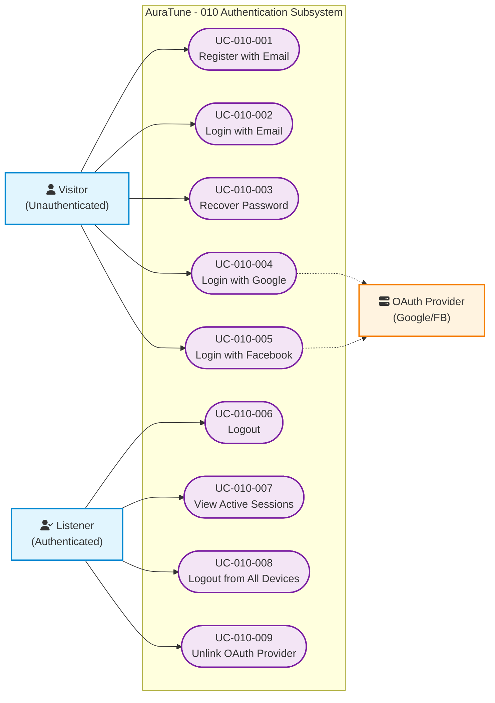

# Functional Group 010: Authentication – Use-Case Documentation

---

## 1. Group Information

| Attribute | Details |
|---|---|
| **Group ID** | 010 |
| **Group Name** | Authentication |
| **Group Owner** | Mai Đăng Khoa |
| **Module Purpose** | Provides secure user identity verification and session management via local email/password and third-party OAuth providers. |
| **Documentation Status** | In Review — Baseline for PA3 Review |
| **Applicable Standards** | AuraTune Use-Case Documentation Guide, Spec Kit Architecture |

---

## 2. Scope

### 2.1 Purpose and Objectives
Functional Group 010 is responsible for the entry point of the AuraTune platform. It ensures that only authorized users can access personalized data while providing a frictionless onboarding experience. It handles account creation, credential verification, social login integration, and secure session maintenance across multiple devices.

### 2.2 In-Scope Capabilities
The verified capabilities within Group 010 comprise:
1. **Local Authentication (Feature 011)**:
   - Email-based registration with password complexity enforcement.
   - Login with temporary account locking for brute-force mitigation.
   - Password recovery via secure email tokens.
2. **OAuth Authentication (Feature 012)**:
   - Fast registration and login via Google and Facebook.
   - Automatic account linking based on unique email addresses.
   - Conditional unlinking of social accounts.
3. **Session Management (Feature 013)**:
   - Dual-token model (JWT Access + HttpOnly Refresh Token).
   - Refresh Token Rotation for replay attack prevention.
   - Global logout (revoke all sessions) and active session monitoring.

### 2.3 Out-of-Scope Exclusions
- **Two-Factor Authentication (2FA)**: Reserved for future security enhancements.
- **User Profile Management**: Editing display names or avatars after registration is owned by **Group 090**.
- **Admin Dashboard UI**: The visual management of users is owned by **Group 110**.

---

## 3. Requirement and Feature Traceability

| Feature ID | Feature Name | Related FR IDs | Spec Kit Specification |
|---|---|---|---|
| **011** | Local Authentication | `FR-011-001` to `FR-011-011` | [../../../specs/010-authentication/011-local-authentication/spec.md](../../../specs/010-authentication/011-local-authentication/spec.md) |
| **012** | OAuth Authentication | `FR-012-001` to `FR-012-011` | [../../../specs/010-authentication/012-oauth-authentication/spec.md](../../../specs/010-authentication/012-oauth-authentication/spec.md) |
| **013** | Session Management | `FR-013-001` to `FR-013-014` | [../../../specs/010-authentication/013-session-management/spec.md](../../../specs/010-authentication/013-session-management/spec.md) |

---

## 4. Actors

| Actor | Actor Type | Description | Related Use Cases |
|---|---|---|---|
| **Visitor** | Primary Human Actor | An unauthenticated individual accessing AuraTune. | `UC-010-001`, `UC-010-002`, `UC-010-003`, `UC-010-004`, `UC-010-005` |
| **Listener** | Primary Human Actor | An authenticated user managing their session. | `UC-010-006`, `UC-010-007`, `UC-010-008`, `UC-010-009` |
| **Google/Facebook** | External System | Third-party identity providers for OAuth. | `UC-010-004`, `UC-010-005` |

---

## 5. Use-Case Diagram

### Diagram Legend
- **Ovals**: Confirmed Use Cases.
- **Solid Arrow**: Primary actor invocation.
- **Dashed Arrow**: External system interaction.

---

## 6. Use-Case Summary

| UC ID | Use-Case Name | Primary Actor | Related FRs | Specification |
|---|---|---|---|---|
| **UC-010-001** | Register with Email | Visitor | `FR-011-001`, `002`, `003` | [./UC-010-001-register-with-email.md](./UC-010-001-register-with-email.md) |
| **UC-010-002** | Login with Email | Visitor | `FR-011-004` | [./UC-010-002-login-with-email.md](./UC-010-002-login-with-email.md) |
| **UC-010-003** | Recover Password | Visitor | `FR-011-011` | [./UC-010-003-recover-password.md](./UC-010-003-recover-password.md) |
| **UC-010-004** | Login with Google | Visitor | `FR-012-001` | [./UC-010-004-login-with-google.md](./UC-010-004-login-with-google.md) |
| **UC-010-005** | Login with Facebook | Visitor | `FR-012-002` | [./UC-010-005-login-with-facebook.md](./UC-010-005-login-with-facebook.md) |
| **UC-010-006** | Logout | Listener | `FR-013-006` | [./UC-010-006-logout.md](./UC-010-006-logout.md) |
| **UC-010-007** | View Active Sessions | Listener | `FR-013-007` | [./UC-010-007-view-active-sessions.md](./UC-010-007-view-active-sessions.md) |
| **UC-010-008** | Logout from All Devices | Listener | `FR-013-008` | [./UC-010-008-logout-all-devices.md](./UC-010-008-logout-all-devices.md) |
| **UC-010-009** | Unlink OAuth Provider | Listener | `FR-012-011` | [./UC-010-009-unlink-oauth-provider.md](./UC-010-009-unlink-oauth-provider.md) |

---

## 7. Prototype Summary

| UC ID | Basic Flow Prototype | Alternative Flow Prototypes | Notes |
|---|---|---|---|
| **UC-010-001** | [../../../specs/010-authentication/011-local-authentication/ui/02-registration-form-filled.png](../../../specs/010-authentication/011-local-authentication/ui/02-registration-form-filled.png) | [../../../specs/010-authentication/011-local-authentication/ui/04-registration-validation-errors.png](../../../specs/010-authentication/011-local-authentication/ui/04-registration-validation-errors.png) | Implemented UI |
| **UC-010-002** | [../../../specs/010-authentication/011-local-authentication/ui/08-login-form-filled.png](../../../specs/010-authentication/011-local-authentication/ui/08-login-form-filled.png) | [../../../specs/010-authentication/011-local-authentication/ui/09-login-invalid-credentials.png](../../../specs/010-authentication/011-local-authentication/ui/09-login-invalid-credentials.png) | Implemented UI |
| **UC-010-004** | [../../../specs/010-authentication/012-oauth-authentication/ui/01-oauth-login-options.png](../../../specs/010-authentication/012-oauth-authentication/ui/01-oauth-login-options.png) | N/A | Implemented UI |
| **UC-010-006** | [../../../specs/010-authentication/013-session-management/ui/03-user-account-session-menu.png](../../../specs/010-authentication/013-session-management/ui/03-user-account-session-menu.png) | N/A | Implemented UI |

---

## 8. Open Issues and Architecture Clarifications
1. **Multi-Factor Authentication (MFA)**: Post-MVP consideration for Group 010.
2. **Session Limit Policy**: Limit of 5 concurrent sessions is enforced by auto-revocation of the oldest entry (`FR-013-012`).

---

## 9. References
- `docs/proposal/Auratune_Vision_Document.md`
- `docs/requirements/use-case-model.md`
- `specs/010-authentication/README.md`
