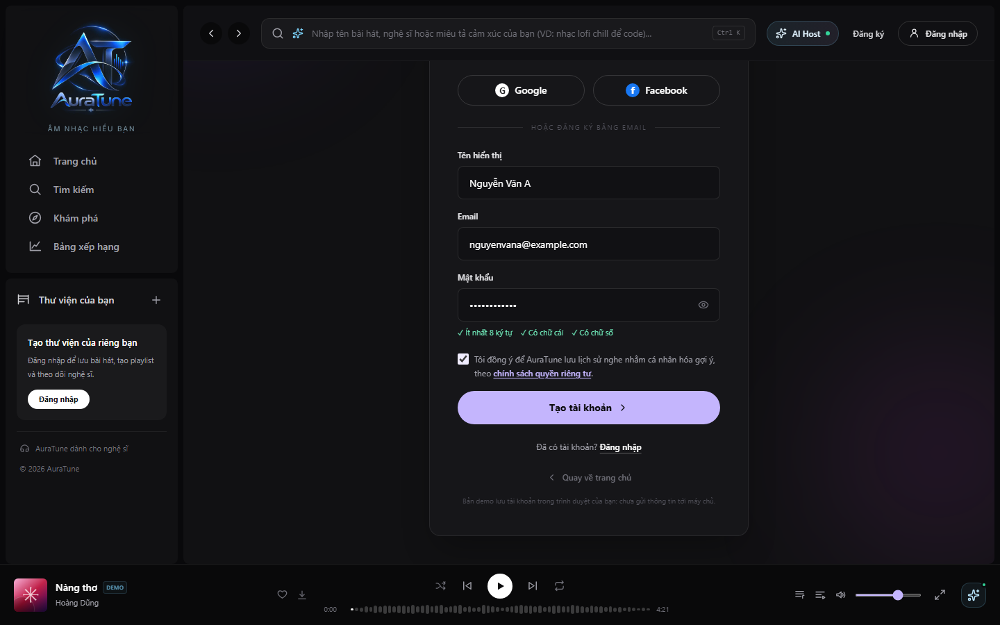
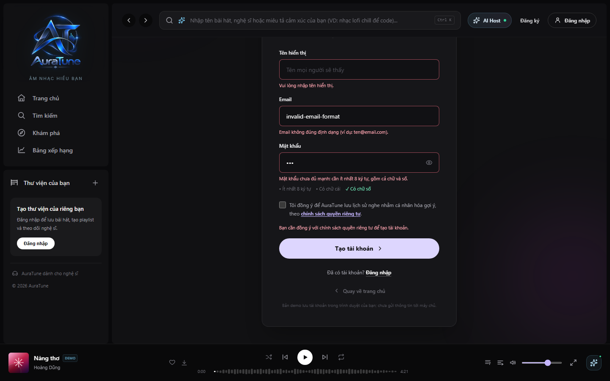

# UC-010-001 – Register with Email

---

## 1. Metadata

| Field | Value |
|---|---|
| **Use Case ID** | UC-010-001 |
| **Use Case Name** | Register with Email |
| **Functional Group** | 010 – Authentication |
| **Primary Actor** | Visitor |
| **Supporting Actors** | None |
| **Related FR IDs** | `FR-011-001`, `FR-011-002`, `FR-011-003`, `FR-011-010` |
| **Related Feature ID** | 011 |
| **Related Spec Kit File** | [`specs/010-authentication/011-local-authentication/spec.md`](../../../../specs/010-authentication/011-local-authentication/spec.md) |
| **Writer** | Roo |
| **Reviewer** | Mai Đăng Khoa |
| **Status** | In Review |
| **Last Updated** | 2026-11-03 |

---

## 2. Goal
The goal is to create a new AuraTune account using a unique email address and a secure password to access personalized features and save playback activity.

## 3. Description
This use case allows a Visitor to register an account. The system validates the email format, password strength, and ensures the email is not already in use. Upon successful registration, a new user record is created with the default 'user' role and the user is granted immediate access.

---

## 4. Preconditions
- The Visitor can access the registration interface.
- The platform database is reachable.

---

## 5. Trigger
The Visitor selects the "Sign up" or "Register" action on the authentication landing page.

---

## 6. Basic Flow

1. **Actor:** Opens the registration page.
2. **System:** Displays the registration form including fields for Display Name, Email, Password, and the TOS consent checkbox.
3. **Actor:** Enters a unique email, a password meeting complexity rules, and a non-unique display name (`FR-011-001`).
4. **Actor:** Checks the box to explicitly accept the Terms of Service and Privacy Policy (`FR-011-010`).
5. **Actor:** Submits the registration form.
6. **System:** Validates that the email address follows a standard format (`FR-011-002`).
7. **System:** Validates that the password meets complexity requirements (minimum 8 characters, combination of letters and numbers) (`FR-011-003`).
8. **System:** Ensures the email is unique in the PostgreSQL database.
9. **System:** Securely hashes the password (`FR-011-006`) and creates a new record in the `users` table with the default 'user' role (`FR-011-005`).
10. **System:** Issues a JWT access token and refresh token, then redirects the user to the authenticated home page (`FR-011-008`, `FR-011-009`).

---

## 7. Alternative Flows

### AF-01 – Email Already in Use
- **Starting step:** 8
- **Condition:** The submitted email already exists in the database.
1. **System:** Displays a specific error message: "Email đã được sử dụng."
2. **Actor:** Corrects the email or navigates to the login page if they already have an account.
- **Outcome:** Resume at Step 3.

### AF-02 – Incomplete or Invalid Input
- **Starting step:** 6
- **Condition:** Fields are empty, email format is invalid, or password is weak.
1. **System:** Identifies the invalid fields and displays relevant validation messages.
2. **Actor:** Corrects the information.
- **Outcome:** Resume at Step 3.

### AF-03 – TOS/Privacy Policy Not Accepted
- **Starting step:** 5
- **Condition:** The user submits without checking the consent box.
1. **System:** Prevents submission and highlights the mandatory consent requirement.
2. **Actor:** Checks the consent box.
- **Outcome:** Resume at Step 5.

---

## 8. Exception Flow

### EF-01 – Database Connection Failure
- **Starting step:** 8
- **Condition:** The system cannot connect to the PostgreSQL database.
1. **System:** Displays a generic error message: "Service temporarily unavailable. Please try again later."
- **Outcome:** Use Case ends in failure.

---

## 9. Postconditions

### 9.1 Success Postconditions
- A new record exists in the `users` table with a unique email and hashed password.
- The user is logged into the application and redirected to the dashboard.

### 9.2 Failure Postconditions
- No account is created.
- System integrity and user privacy boundaries remain intact.

---

## 10. Special Requirements
- **Security:** Passwords MUST be securely hashed before storage.
- **Privacy:** Compliance with Vietnamese Decree 13/2023/ND-CP regarding data consent.
- **Performance:** Registration processing SHOULD complete in under 2 seconds.

---

## 11. Prototype and Screenshots

### 11.1 Basic Flow

*Figure 1: Registration form with valid input and password complexity indicators.*

### 11.2 Alternative Flow – AF-02

*Figure 2: Form state when invalid or incomplete data is submitted.*

---

## 12. Traceability and Sources
- `specs/010-authentication/011-local-authentication/spec.md` – User Story 1 (P1).
- `docs/proposal/Auratune_Vision_Document.md` – Section 3.2.
