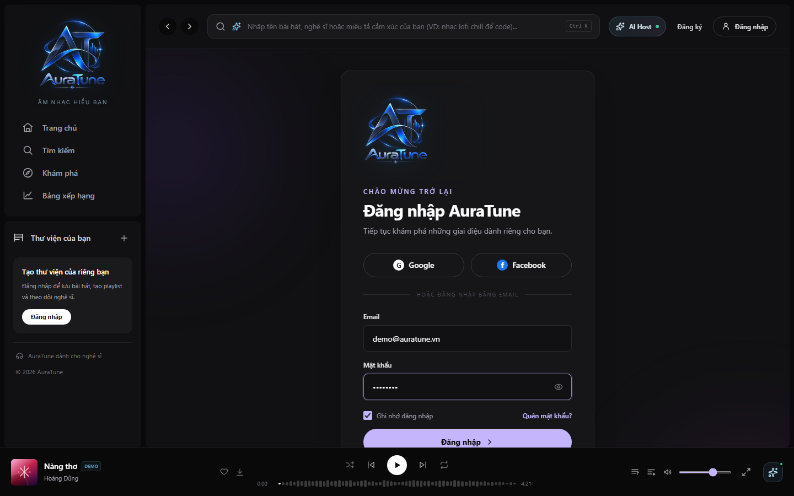
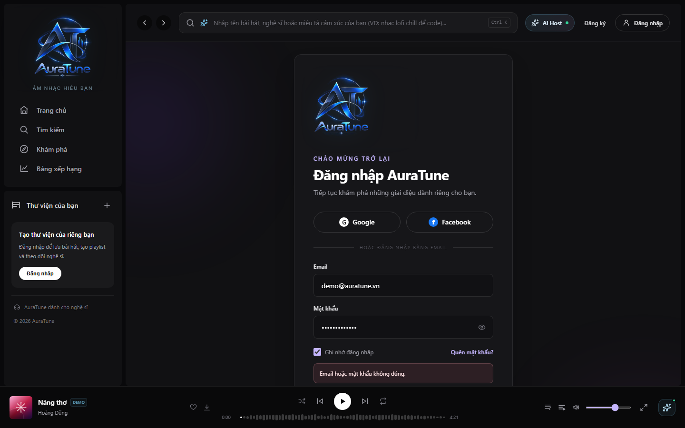
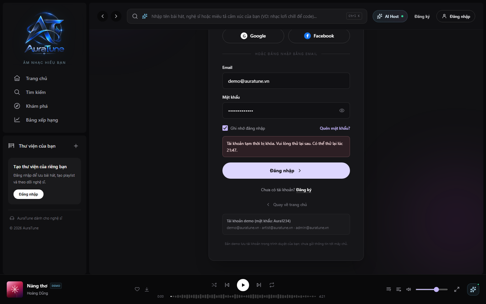

# UC-010-002 – Login with Email
Performed by: Mai Đăng Khoa | Reviewed by: Group 10 team | Edited by: Lê Công Minh Nhựt

---

## 1. Metadata
Performed by: Mai Đăng Khoa | Reviewed by: Group 10 team | Edited by: Lê Công Minh Nhựt

| Field | Value |
|---|---|
| **Use Case ID** | UC-010-002 |
| **Use Case Name** | Login with Email |
| **Functional Group** | 010 – Authentication |
| **Primary Actor** | Visitor |
| **Supporting Actors** | None |
| **Related FR IDs** | `FR-011-004`, `FR-011-009`, `FR-013-009` |
| **Related Feature ID** | 011 |
| **Related Spec Kit File** | [`specs/010-authentication/011-local-authentication/spec.md`](../../../../specs/010-authentication/011-local-authentication/spec.md) |
| Writer | Lê Công Minh Nhựt |
| Original Writer (PA3 draft) | Mai Đăng Khoa |
| Reviewer | Group 10 team |
| **Status** | In Review |
| **Last Updated** | 2026-11-03 |

---

## 2. Goal
Performed by: Mai Đăng Khoa | Reviewed by: Group 10 team | Edited by: Lê Công Minh Nhựt
The goal is to authenticate a registered user using their email and password to access their personalized profile, library, and settings while maintaining a secure session.

## 3. Description
Performed by: Mai Đăng Khoa | Reviewed by: Group 10 team | Edited by: Lê Công Minh Nhựt
This use case describes the process of logging into the AuraTune platform using local credentials. The system verifies the credentials against the database, resets login attempt counters on success, and manages account locking for security. It issues a secure dual-token pair (Access/Refresh) to maintain the authenticated state.

---

## 4. Preconditions
Performed by: Mai Đăng Khoa | Reviewed by: Group 10 team | Edited by: Lê Công Minh Nhựt
- The Visitor has a registered account.
- The Visitor is on the login page.
- The platform database is reachable.

---

## 5. Trigger
Performed by: Mai Đăng Khoa | Reviewed by: Group 10 team | Edited by: Lê Công Minh Nhựt
The Visitor enters their credentials and selects the "Login" or "Sign in" action.

---

## 6. Basic Flow
Performed by: Mai Đăng Khoa | Reviewed by: Group 10 team | Edited by: Lê Công Minh Nhựt

1. **Actor:** Enters their registered email and password (`FR-011-004`).
2. **Actor:** (Optional) Selects "Remember Me" to persist the session beyond the browser restart.
3. **Actor:** Submits the login form.
4. **System:** Validates the email format.
5. **System:** Checks if the account is currently locked due to 5 consecutive failed attempts.
6. **System:** Verifies the provided password against the stored hash in the PostgreSQL database (`FR-011-006`).
7. **System:** Resets the `failed_login_attempts` counter for the user.
8. **System:** Issues a short-lived JWT Access Token and a long-lived Refresh Token stored in a secure HttpOnly cookie (`FR-011-009`, `FR-013-009`).
9. **System:** Redirects the user to the authenticated home page and displays a success message.

---

## 7. Alternative Flows
Performed by: Mai Đăng Khoa | Reviewed by: Group 10 team | Edited by: Lê Công Minh Nhựt

### AF-01 – Invalid Credentials
Performed by: Mai Đăng Khoa | Reviewed by: Group 10 team | Edited by: Lê Công Minh Nhựt
- **Starting step:** 6
- **Condition:** The password does not match or the email is not found.
1. **System:** Increments the `failed_login_attempts` counter for the account.
2. **System:** Displays an error message: "Invalid email or password."
3. **System:** Informs the user of the remaining attempts before temporary lockout.
- **Outcome:** Resume at Step 1.

### AF-02 – Account Temporarily Locked
Performed by: Mai Đăng Khoa | Reviewed by: Group 10 team | Edited by: Lê Công Minh Nhựt
- **Starting step:** 5
- **Condition:** The account has reached 5 consecutive failed login attempts.
1. **System:** Displays a security alert: "Account temporarily locked. Please try again in 15 minutes."
2. **System:** Prevents further verification attempts for that account until the lockout duration expires (`FR-011-004`).
- **Outcome:** Use Case ends in failure.

### AF-03 – User Selects "Remember Me"
Performed by: Mai Đăng Khoa | Reviewed by: Group 10 team | Edited by: Lê Công Minh Nhựt
- **Starting step:** 2
- **Condition:** The "Remember Me" checkbox is checked.
1. **System:** Adjusts the Refresh Token expiration to the maximum allowed duration (e.g., 30 days) and ensures the cookie persistence.
- **Outcome:** Resume at Step 3.

---

## 8. Exception Flow
Performed by: Mai Đăng Khoa | Reviewed by: Group 10 team | Edited by: Lê Công Minh Nhựt

### EF-01 – Database Unreachable
Performed by: Mai Đăng Khoa | Reviewed by: Group 10 team | Edited by: Lê Công Minh Nhựt
- **Starting step:** 5
- **Condition:** The system cannot connect to the database.
1. **System:** Returns a 503 error or displays "Service temporarily unavailable."
- **Outcome:** Use Case ends in failure.

---

## 9. Postconditions
Performed by: Mai Đăng Khoa | Reviewed by: Group 10 team | Edited by: Lê Công Minh Nhựt

### 9.1 Success Postconditions
Performed by: Mai Đăng Khoa | Reviewed by: Group 10 team | Edited by: Lê Công Minh Nhựt
- The user is authenticated and possesses a valid Access/Refresh token pair.
- The `failed_login_attempts` counter is reset to zero.
- The user can access protected platform resources.

### 9.2 Failure Postconditions
Performed by: Mai Đăng Khoa | Reviewed by: Group 10 team | Edited by: Lê Công Minh Nhựt
- No tokens are issued.
- The `failed_login_attempts` counter is incremented (if email is valid).
- The user remains in an unauthenticated state.

---

## 10. Special Requirements
Performed by: Mai Đăng Khoa | Reviewed by: Group 10 team | Edited by: Lê Công Minh Nhựt
- **Security:** Account MUST be locked for 15 minutes after 5 failed attempts.
- **Performance:** Credential verification SHOULD be processed in under 1 second.
- **Privacy:** Credentials MUST NOT be logged in plain text.

---

## 11. Prototype and Screenshots
Performed by: Mai Đăng Khoa | Reviewed by: Group 10 team | Edited by: Lê Công Minh Nhựt

### 11.1 Basic Flow
Performed by: Mai Đăng Khoa | Reviewed by: Group 10 team | Edited by: Lê Công Minh Nhựt

*Figure 1: Login form with valid credentials ready for submission.*

### 11.2 Alternative Flow – AF-01
Performed by: Mai Đăng Khoa | Reviewed by: Group 10 team | Edited by: Lê Công Minh Nhựt

*Figure 2: Error feedback for incorrect credentials.*

### 11.3 Alternative Flow – AF-02
Performed by: Mai Đăng Khoa | Reviewed by: Group 10 team | Edited by: Lê Công Minh Nhựt

*Figure 3: Security lockout notification.*

---

## 12. Traceability and Sources
Performed by: Mai Đăng Khoa | Reviewed by: Group 10 team | Edited by: Lê Công Minh Nhựt
- `specs/010-authentication/011-local-authentication/spec.md` – User Story 2 (P1).
- `specs/010-authentication/013-session-management/spec.md` – Requirements FR-001, FR-009.

## PA4 implementation evidence and acceptance record
Performed by: Mai Đăng Khoa | Reviewed by: Group 10 team | Edited by: Lê Công Minh Nhựt

Authentication routes and repositories exist in `src/backend/routes/authRoutes.js` and `src/backend/repositories/authRepository.js`. Firebase exchange is also present. Validate the actual login/recovery/session route and authoritative account state; frontend navigation alone is insufficient. The integrated backend entrypoint currently has a duplicate import. Automatic refresh is supporting session behavior, not a replacement for the existing View Active Sessions goal.

The flows above state required behavior. This revision records source inspection only; no browser acceptance or new feature-test run is claimed. Before acceptance, execute the basic flow and its applicable alternative/exception flows, checking the documented success and failure postconditions. Record results against this UC ID in [the PA4 review register](../../use-case-model.md#11-pa4-decisions-and-source-review).
