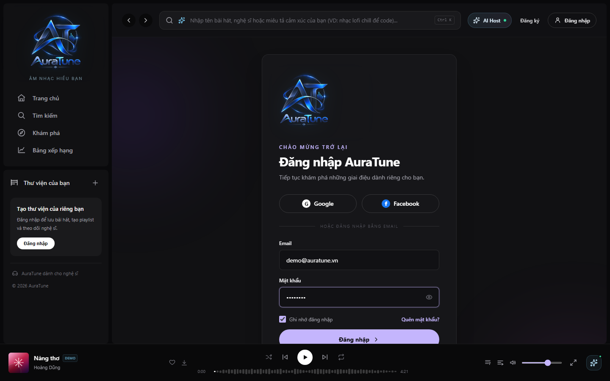
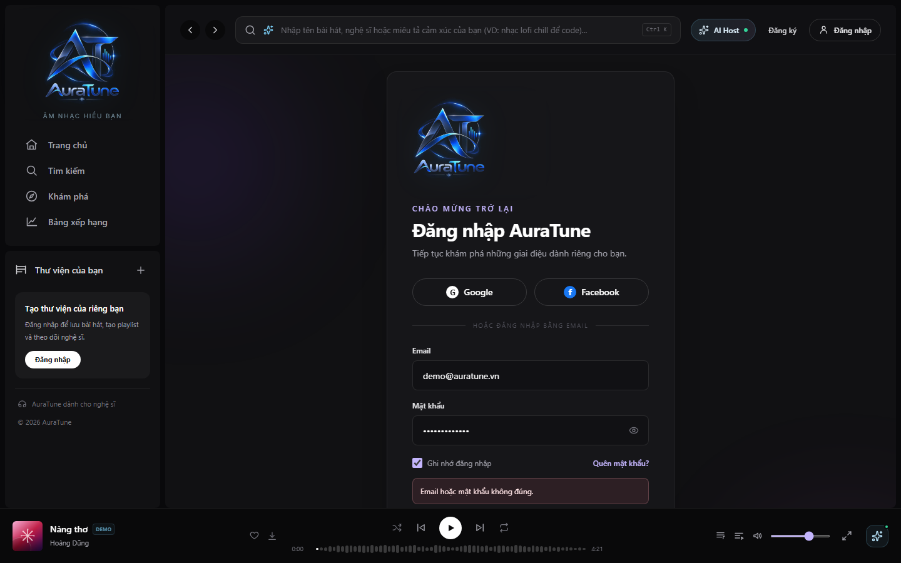
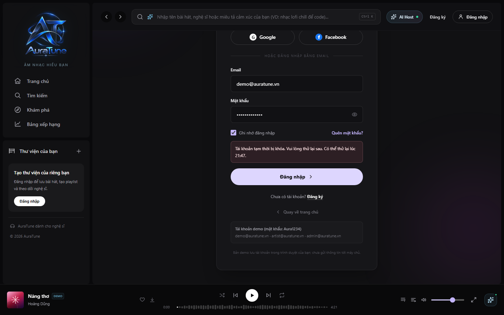

# UC-010-002 – Login with Email

---

## 1. Metadata

| Field | Value |
|---|---|
| **Use Case ID** | UC-010-002 |
| **Use Case Name** | Login with Email |
| **Functional Group** | 010 – Authentication |
| **Primary Actor** | Visitor |
| **Supporting Actors** | None |
| **Related FR IDs** | `FR-011-004`, `FR-011-009`, `FR-013-009` |
| **Related Feature ID** | 011 |
| **Related Spec Kit File** | [`specs/010-authentication/011-local-authentication/spec.md`](../../../../specs/010-authentication/011-local-authentication/spec.md) |
| **Writer** | Mai Đăng Khoa |
| **Reviewer** | TBD |
| **Status** | In Review |
| **Last Updated** | 2026-11-03 |

---

## 2. Goal
The goal is to authenticate a registered user using their email and password to access their personalized profile, library, and settings while maintaining a secure session.

## 3. Description
This use case describes the process of logging into the AuraTune platform using local credentials. The system verifies the credentials against the database, resets login attempt counters on success, and manages account locking for security. It issues a secure dual-token pair (Access/Refresh) to maintain the authenticated state.

---

## 4. Preconditions
- The Visitor has a registered account.
- The Visitor is on the login page.
- The platform database is reachable.

---

## 5. Trigger
The Visitor enters their credentials and selects the "Login" or "Sign in" action.

---

## 6. Basic Flow

1. **Actor:** Enters their registered email and password (`FR-011-004`).
2. **Actor:** (Optional) Selects "Remember Me" to persist the session beyond the browser restart.
3. **Actor:** Submits the login form.
4. **System:** Validates the email format.
5. **System:** Checks if the account is currently locked due to 5 consecutive failed attempts.
6. **System:** Verifies the provided password against the stored hash in the PostgreSQL database (`FR-011-006`).
7. **System:** Resets the `failed_login_attempts` counter for the user.
8. **System:** Issues a short-lived JWT Access Token and a long-lived Refresh Token stored in a secure HttpOnly cookie (`FR-011-009`, `FR-013-009`).
9. **System:** Redirects the user to the authenticated home page and displays a success message.

---

## 7. Alternative Flows

### AF-01 – Invalid Credentials
- **Starting step:** 6
- **Condition:** The password does not match or the email is not found.
1. **System:** Increments the `failed_login_attempts` counter for the account.
2. **System:** Displays an error message: "Invalid email or password."
3. **System:** Informs the user of the remaining attempts before temporary lockout.
- **Outcome:** Resume at Step 1.

### AF-02 – Account Temporarily Locked
- **Starting step:** 5
- **Condition:** The account has reached 5 consecutive failed login attempts.
1. **System:** Displays a security alert: "Account temporarily locked. Please try again in 15 minutes."
2. **System:** Prevents further verification attempts for that account until the lockout duration expires (`FR-011-004`).
- **Outcome:** Use Case ends in failure.

### AF-03 – User Selects "Remember Me"
- **Starting step:** 2
- **Condition:** The "Remember Me" checkbox is checked.
1. **System:** Adjusts the Refresh Token expiration to the maximum allowed duration (e.g., 30 days) and ensures the cookie persistence.
- **Outcome:** Resume at Step 3.

---

## 8. Exception Flow

### EF-01 – Database Unreachable
- **Starting step:** 5
- **Condition:** The system cannot connect to the database.
1. **System:** Returns a 503 error or displays "Service temporarily unavailable."
- **Outcome:** Use Case ends in failure.

---

## 9. Postconditions

### 9.1 Success Postconditions
- The user is authenticated and possesses a valid Access/Refresh token pair.
- The `failed_login_attempts` counter is reset to zero.
- The user can access protected platform resources.

### 9.2 Failure Postconditions
- No tokens are issued.
- The `failed_login_attempts` counter is incremented (if email is valid).
- The user remains in an unauthenticated state.

---

## 10. Special Requirements
- **Security:** Account MUST be locked for 15 minutes after 5 failed attempts.
- **Performance:** Credential verification SHOULD be processed in under 1 second.
- **Privacy:** Credentials MUST NOT be logged in plain text.

---

## 11. Prototype and Screenshots

### 11.1 Basic Flow

*Figure 1: Login form with valid credentials ready for submission.*

### 11.2 Alternative Flow – AF-01

*Figure 2: Error feedback for incorrect credentials.*

### 11.3 Alternative Flow – AF-02

*Figure 3: Security lockout notification.*

---

## 12. Traceability and Sources
- `specs/010-authentication/011-local-authentication/spec.md` – User Story 2 (P1).
- `specs/010-authentication/013-session-management/spec.md` – Requirements FR-001, FR-009.
