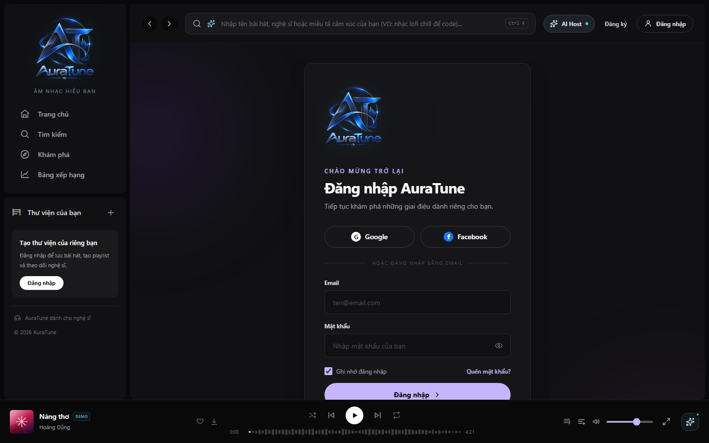

# UC-010-004 – Login with Google

---

## 1. Metadata

| Field | Value |
|---|---|
| **Use Case ID** | UC-010-004 |
| **Use Case Name** | Login with Google |
| **Functional Group** | 010 – Authentication |
| **Primary Actor** | Visitor |
| **Supporting Actors** | Google (OAuth Provider) |
| **Related FR IDs** | `FR-012-001`, `FR-012-003`, `FR-012-004`, `FR-012-007` |
| **Related Feature ID** | 012 |
| **Related Spec Kit File** | [`specs/010-authentication/012-oauth-authentication/spec.md`](../../../../specs/010-authentication/012-oauth-authentication/spec.md) |
| **Writer** | Mai Đăng Khoa |
| **Reviewer** | TBD |
| **Status** | In Review |
| **Last Updated** | 2026-11-03 |

---

## 2. Goal
The goal is to provide a fast, secure, and convenient way for users to log in or register for AuraTune using their existing Google account, reducing onboarding friction.

## 3. Description
This use case describes the OAuth 2.0 / OpenID Connect flow where a Visitor authenticates via Google. The system retrieves verified user information (email, display name, avatar) and either creates a new account or links to an existing one based on the unique email address. It ensures profile synchronization on every login.

---

## 4. Preconditions
- The Visitor has a valid Google account.
- The platform has a valid registered Google Client ID and Secret.

---

## 5. Trigger
The Visitor selects the "Login with Google" button on the login or registration page.

---

## 6. Basic Flow

1. **Actor:** Clicks the "Login with Google" button (`FR-012-001`).
2. **System:** Redirects the Visitor to the Google OAuth 2.0 authentication server.
3. **Actor:** Authenticates with Google and grants the requested permissions (email, profile) to AuraTune.
4. **System:** Receives the authorization code via the callback endpoint (`FR-012-003`).
5. **System:** Exchanges the code for tokens and retrieves user email, display name, and avatar URL (`FR-012-004`).
6. **System:** Queries the database for the retrieved email address (`FR-012-007`).
7. **System:** (If email exists) Links the Google Provider ID to the user record and updates the AuraTune profile with the latest name and avatar.
8. **System:** (If email is new) Creates a new user record with role 'user' and the retrieved profile data (`FR-012-005`).
9. **System:** Issues a JWT Access Token and Refresh Token for AuraTune.
10. **System:** Redirects the user to the authenticated home page.

---

## 7. Alternative Flows

### AF-01 – User Cancels Authentication
- **Starting step:** 3
- **Condition:** The Visitor closes the Google window or clicks "Cancel".
1. **Google:** Redirects the user back to AuraTune with an error parameter.
2. **System:** Displays a message: "Authentication cancelled. Please try again."
- **Outcome:** Use Case ends in failure.

### AF-02 – Account Already Linked to Local/Facebook
- **Starting step:** 6
- **Condition:** The email exists but was previously used for a different login method.
1. **System:** Identifies the existing account.
2. **System:** Automatically links the Google ID to the existing unique email record.
- **Outcome:** Resume at Step 9.

---

## 8. Exception Flow

### EF-01 – Provider Service Unavailable
- **Starting step:** 2 or 5
- **Condition:** Google's identity services are offline.
1. **System:** Displays an error: "Google login is currently unavailable. Please use your email and password."
- **Outcome:** Use Case ends in failure.

---

## 9. Postconditions

### 9.1 Success Postconditions
- The user is authenticated with a valid AuraTune session.
- Profile metadata (name, avatar) is synchronized from the provider.
- Duplicate accounts for the same email are avoided.

### 9.2 Failure Postconditions
- No tokens are issued.
- The user remains in the unauthenticated state.

---

## 10. Special Requirements
- **Security:** Communications MUST use TLS 1.3 (`FR-012-009`).
- **Privacy:** User PII MUST NOT be shared with external AI services during auth (`FR-012-010`).

---

## 11. Prototype and Screenshots

### 11.1 Basic Flow (Login Options)

*Figure 1: Authentication entry point showing Google and Facebook options.*

---

## 12. Traceability and Sources
- `specs/010-authentication/012-oauth-authentication/spec.md` – User Story 1 (P1).
