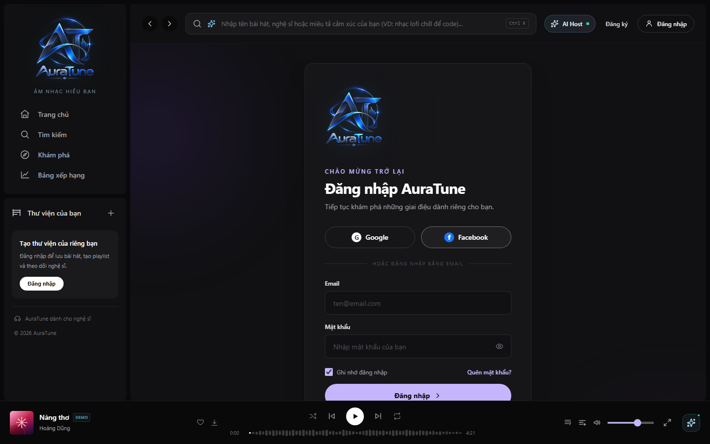

# UC-010-005 – Login with Facebook

---

## 1. Metadata

| Field | Value |
|---|---|
| **Use Case ID** | UC-010-005 |
| **Use Case Name** | Login with Facebook |
| **Functional Group** | 010 – Authentication |
| **Primary Actor** | Visitor |
| **Supporting Actors** | Facebook (OAuth Provider) |
| **Related FR IDs** | `FR-012-002`, `FR-012-003`, `FR-012-004`, `FR-012-007` |
| **Related Feature ID** | 012 |
| **Related Spec Kit File** | [`specs/010-authentication/012-oauth-authentication/spec.md`](../../../../specs/010-authentication/012-oauth-authentication/spec.md) |
| **Writer** | Mai Đăng Khoa |
| **Reviewer** | TBD |
| **Status** | In Review |
| **Last Updated** | 2026-11-03 |

---

## 2. Goal
The goal is to provide a fast and secure way for users to log in or register for AuraTune using their Facebook account, leveraging existing social identities for a seamless onboarding experience.

## 3. Description
This use case describes the OAuth 2.0 flow where a Visitor authenticates via Facebook. The system retrieves the user's email, name, and avatar, ensuring that accounts are correctly linked or created based on the unique email identifier while maintaining profile consistency across platforms.

---

## 4. Preconditions
- The Visitor has a valid Facebook account.
- The platform has a valid registered Facebook App ID and App Secret.

---

## 5. Trigger
The Visitor selects the "Login with Facebook" button on the login or registration page.

---

## 6. Basic Flow

1. **Actor:** Clicks the "Login with Facebook" button (`FR-012-002`).
2. **System:** Redirects the Visitor to the Facebook authentication and authorization dialog.
3. **Actor:** Authenticates with Facebook and grants the requested permissions (email, public profile) to AuraTune.
4. **System:** Receives the authorization code via the callback endpoint (`FR-012-003`).
5. **System:** Exchanges the code for tokens and retrieves user email, display name, and avatar URL (`FR-012-004`).
6. **System:** Queries the database for the retrieved email address (`FR-012-007`).
7. **System:** (If email exists) Links the Facebook Provider ID to the user record and updates the profile data.
8. **System:** (If email is new) Creates a new user record with role 'user' and the retrieved profile data (`FR-012-005`).
9. **System:** Issues a JWT Access Token and Refresh Token for AuraTune.
10. **System:** Redirects the user to the authenticated home page.

---

## 7. Alternative Flows

### AF-01 – User Cancels Authentication
- **Starting step:** 3
- **Condition:** The Visitor closes the Facebook dialog or clicks "Not Now/Cancel".
1. **Facebook:** Redirects the user back to AuraTune with an error indicator.
2. **System:** Displays a message: "Authentication via Facebook was cancelled."
- **Outcome:** Use Case ends in failure.

### AF-02 – Email Conflict with Google/Local
- **Starting step:** 6
- **Condition:** The email is already registered via Local Auth or Google.
1. **System:** Identifies the existing account record.
2. **System:** Links the Facebook ID to the existing account based on the unique email.
- **Outcome:** Resume at Step 9.

---

## 8. Exception Flow

### EF-01 – Facebook API Failure
- **Starting step:** 2 or 5
- **Condition:** Facebook's Graph API or Login service is unreachable.
1. **System:** Displays an error: "Facebook login is currently unavailable. Please try using another sign-in method."
- **Outcome:** Use Case ends in failure.

### EF-02 – Missing or Unverified Facebook Email
- **Starting step:** 5
- **Condition:** Facebook account is not associated with an email address (e.g. registered via phone number), the user declined email permission, or the email address is unverified.
1. **System:** Detects missing or unverified email attribute from the OAuth identity token.
2. **System:** Rejects creation of a new AuraTune session.
3. **System:** Displays an error: "Tài khoản mạng xã hội của bạn chưa liên kết email hoặc chưa được xác minh. Vui lòng cập nhật email trên Facebook hoặc sử dụng phương thức đăng nhập bằng Email."
- **Outcome:** Use Case ends in failure.

---

## 9. Postconditions

### 9.1 Success Postconditions
- The user is authenticated and logged into AuraTune.
- A user record exists and is correctly mapped to the Facebook Provider ID.
- User profile data is synchronized.

### 9.2 Failure Postconditions
- No tokens are issued.
- User session remains unauthenticated.

---

## 10. Special Requirements
- **Security:** All transmissions MUST use HTTPS/TLS 1.3.
- **Privacy:** Compliance with Facebook's Platform Terms and Vietnamese data protection laws.

---

## 11. Prototype and Screenshots

### 11.1 Basic Flow (Facebook Selection Notice)

*Figure 1: Notice displayed during Facebook provider selection.*

---

## 12. Traceability and Sources
- `specs/010-authentication/012-oauth-authentication/spec.md` – User Story 1 (P1).
