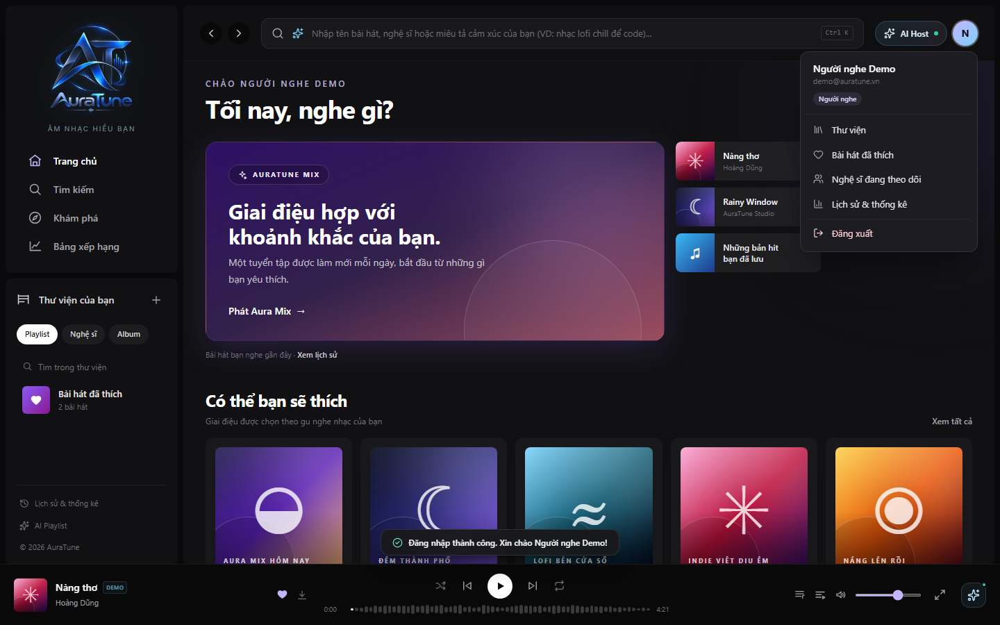
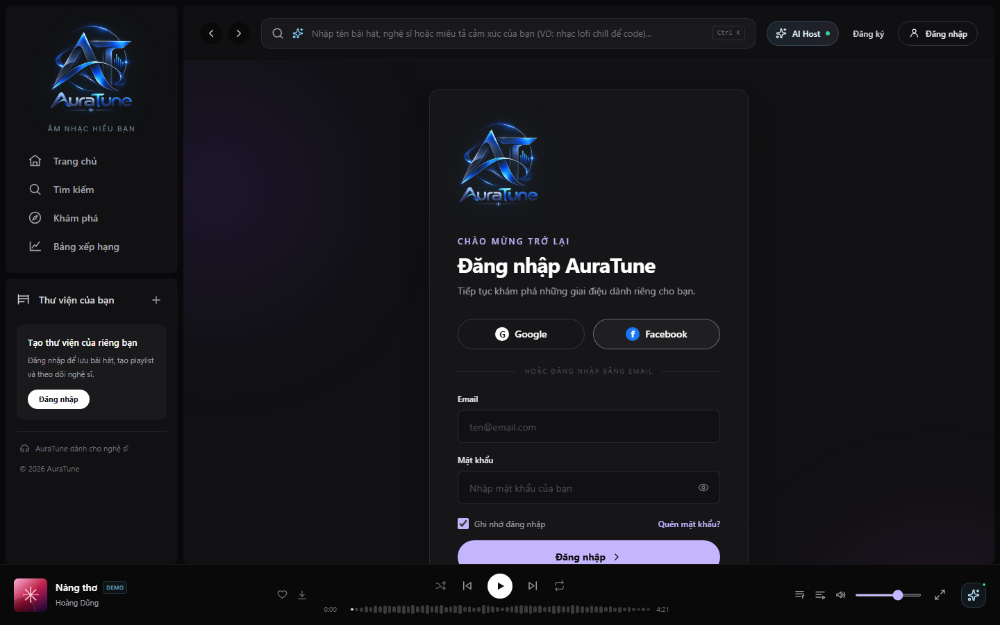

# UC-010-006 – Logout

---

## 1. Metadata

| Field | Value |
|---|---|
| **Use Case ID** | UC-010-006 |
| **Use Case Name** | Logout |
| **Functional Group** | 010 – Authentication |
| **Primary Actor** | Listener |
| **Supporting Actors** | None |
| **Related FR IDs** | `FR-013-006`, `FR-013-009` |
| **Related Feature ID** | 013 |
| **Related Spec Kit File** | [`specs/010-authentication/013-session-management/spec.md`](../../../../specs/010-authentication/013-session-management/spec.md) |
| **Writer** | Mai Đăng Khoa |
| **Reviewer** | TBD |
| **Status** | In Review |
| **Last Updated** | 2026-11-03 |

---

## 2. Goal
The goal is to securely terminate the current authenticated session to protect the user's personal data and library access, preventing unauthorized use on shared or public devices.

## 3. Description
This use case describes the manual logout process. The system revokes the active Refresh Token on the server-side database and instructs the browser to clear the secure HttpOnly cookie, effectively ending the user's authenticated state for the specific device.

---

## 4. Preconditions
- The Listener is currently authenticated with an active session.
- The server database is reachable to revoke the token.

---

## 5. Trigger
The Listener selects the "Logout" (Đăng xuất) action from the user account dropdown menu.

---

## 6. Basic Flow

1. **Actor:** Opens the user account menu by clicking on their avatar.
2. **System:** Displays the account menu with personal options and the "Logout" button (`FR-013-003`).
3. **Actor:** Clicks the "Logout" button.
4. **System:** Dispatches a revocation request to the `/auth/logout` endpoint (`FR-013-006`).
5. **System:** Locates the specific Refresh Token entry in the `user_sessions` table and removes it.
6. **System:** Responds with a command to clear the HttpOnly Refresh Token cookie in the browser (`FR-013-009`).
7. **System:** Invalidates the in-memory Access Token and redirects the user to the login page.
8. **System:** Displays a confirmation toast: "Bạn đã đăng xuất thành công."

---

## 7. Alternative Flows

None identified for the manual logout sequence.

---

## 8. Exception Flow

### EF-01 – Logout Request Timeout
- **Starting step:** 4
- **Condition:** The server fails to respond to the logout request within 5 seconds.
1. **System:** Forcefully clears local session storage and cookies to protect the user immediately.
2. **System:** Redirects the user to the login page.
- **Outcome:** Use Case ends successfully from the user's perspective, though the server-side revocation may be delayed.

---

## 9. Postconditions

### 9.1 Success Postconditions
- The specific Refresh Token is invalidated on the server.
- The user is redirected to a public route and can no longer access protected data.
- The session cookie is removed from the browser.

### 9.2 Failure Postconditions
- The session remains active (if the browser fails to clear cookies and the server request failed).

---

## 10. Special Requirements
- **Security:** Logout MUST be robust against network failures (client-side cleanup is priority).
- **Usability:** The logout action MUST be easily accessible from any page via the navigation bar.

---

## 11. Prototype and Screenshots

### 11.1 Basic Flow (User Menu)

*Figure 1: User account menu featuring the manual logout command.*

### 11.2 Basic Flow (Confirmation)

*Figure 2: UI state following successful logout.*

---

## 12. Traceability and Sources
- `specs/010-authentication/013-session-management/spec.md` – User Story 2 (P1).
