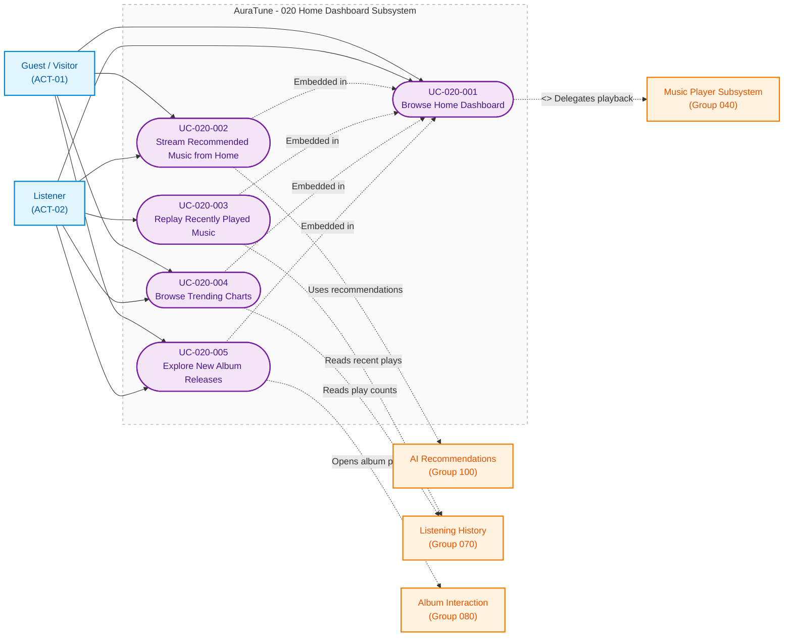

# Functional Group 020: Home Dashboard – Use-Case Documentation

---

## 5.1. Group Information

| Attribute | Details |
|---|---|
| **Group ID** | 020 |
| **Group Name** | Home Dashboard |
| **Group Owner** | Nguyễn Thanh Huy |
| **Module Purpose** | Acts as the central discovery surface of AuraTune, aggregating recommended music, recent plays, popular charts, and new releases so that listeners can start playing without searching. |
| **Documentation Status** | Draft — Baseline for Sprint 3 (PA3) Review |
| **Applicable Standards** | AuraTune Use-Case Documentation Guide, Spec Kit Architecture, PA3 Use-Case Specification Standard |

---

## 5.2. Scope

### 5.2.1 Purpose and Objectives
Functional Group 020 provides the first screen that guests and listeners see. It organizes public and personal content into a predictable sequence of sections, starts playback from any section in one interaction, and keeps each section independent so that one failure never blocks the rest of the page.

### 5.2.2 In-Scope Capabilities
The verified capabilities within Group 020 comprise five subfeatures:

1. **Home Content Layout (Feature 021)**:
   - Fixed section order: hero and quick access, recommended content, new albums, popular tracks, featured artists, curated playlists, and genres.
   - Public streaming for guests, with sign-in required only for personal actions.
   - Personalized greeting for signed-in listeners, at most 5 items per preview section, and per-section loading and failure handling.
   - Featured artists chosen by highest platform-wide play counts.

2. **Recommended Content (Feature 022)**:
   - Recommended songs for signed-in listeners and suggested playlists for all visitors, at most 5 items.
   - One-interaction playback and fallback to popular playlists when AI recommendations are unavailable.

3. **Recently Played (Feature 023)**:
   - Up to 4 distinct, available recent tracks for signed-in listeners, most recent first.
   - Suggested playlist shortcuts for guests and listeners with no history.

4. **Trending Charts (Feature 024)**:
   - Top 5 popular tracks on Home and the top 20 on the Charts page, ranked by AuraTune play counts only.
   - Genre filter, day, week, or month period with week as the default, and play-all.
   - Like and unlike from chart rows for signed-in listeners.

5. **New Releases (Feature 025)**:
   - Up to 5 albums ordered by release date, newest first.
   - Direct album playback from the card using only available tracks.

### 5.2.3 Out-of-Scope Exclusions
- **Recommendation Generation and Ranking**: Owned by **Group 100 – AI Recommendations**.
- **Recording and Managing Listening History**: Owned by **Group 070 – Listening History**.
- **Album Details, Saving, and Sharing**: Owned by **Group 080 – Album Interaction**.
- **Audio Streaming and Player Controls**: Owned by **Group 040 – Music Player**.
- **Queue Editing**: Owned by **Group 050 – Queue Management**.

### 5.2.4 Dependencies
- **Group 010 (Authentication)**: Determines guest or listener state and handles sign-in for personal shortcuts.
- **Group 040 (Music Player)**: Executes playback started from any Home section.
- **Group 050 (Queue Management)**: Receives the queue set by Home playback actions.
- **Group 070 (Listening History)**: Supplies recent plays and the play counts used for charts.
- **Group 080 and Group 090 (Catalog Interaction)**: Provide album and artist detail pages opened from Home.
- **Group 100 (AI Recommendations)**: Supplies recommended songs and playlists.

---

## 5.3. Related Requirements and Features

| Feature ID | Feature Name | Related FR IDs | Spec Path |
|---|---|---|---|
| **021** | Home Content Layout | `021-FR-001` to `021-FR-013` | [`specs/020-home-dashboard/021-home-content-layout/spec.md`](../../../../specs/020-home-dashboard/021-home-content-layout/spec.md) |
| **022** | Recommended Content | `022-FR-001` to `022-FR-011` | [`specs/020-home-dashboard/022-recommended-content/spec.md`](../../../../specs/020-home-dashboard/022-recommended-content/spec.md) |
| **023** | Recently Played | `023-FR-001` to `023-FR-011` | [`specs/020-home-dashboard/023-recently-played/spec.md`](../../../../specs/020-home-dashboard/023-recently-played/spec.md) |
| **024** | Trending Charts | `024-FR-001` to `024-FR-014` | [`specs/020-home-dashboard/024-trending-charts/spec.md`](../../../../specs/020-home-dashboard/024-trending-charts/spec.md) |
| **025** | New Releases | `025-FR-001` to `025-FR-011` | [`specs/020-home-dashboard/025-new-releases/spec.md`](../../../../specs/020-home-dashboard/025-new-releases/spec.md) |

---

## 5.4. Actors

| Actor | Actor Type | Description | Related Use Cases |
|---|---|---|---|
| **Guest / Visitor** (`ACT-01`) | Primary Human Actor | Unauthenticated visitor who browses public sections and streams public music. Prompted to sign in only for personal actions. | `UC-020-001`, `UC-020-002`, `UC-020-004`, `UC-020-005` |
| **Listener** (`ACT-02`) | Primary Human Actor | Authenticated user who additionally sees a personalized greeting, recommended songs, and recent plays. | `UC-020-001` to `UC-020-005` |

---

## 5.5. Use-Case Diagram

The following Mermaid diagram visualizes the boundary, actors, confirmed use cases, and relationships for **Group 020 – Home Dashboard**.

> **Note**: This diagram uses Mermaid `flowchart LR` syntax to represent conceptual UML Use-Case structures within standard Markdown viewers. Rounded nodes denote Use Cases, square nodes represent Actors and related subsystems, and dashed lines represent relationships across boundaries.



### Diagram Legend
- **Rounded nodes (`([ ... ])`)**: Confirmed Use Cases.
- **Solid Arrow (`-->`)**: Direct primary actor invocation.
- **Dashed Arrow (`-.->`)**: Section embedding, cross-group dependency, or `<<include>>` relationship.
- **Subsystem Boundary (`subgraph`)**: Scope boundary of Group 020.

---

## 5.6. Use-Case List

| UC ID | Use-Case Name | Primary Actor | Related FRs | Specification File |
|---|---|---|---|---|
| **UC-020-001** | Browse Home Dashboard | Guest / Listener | `021-FR-001` to `021-FR-013` | [`UC-020-001-browse-home-dashboard.md`](./UC-020-001-browse-home-dashboard.md) |
| **UC-020-002** | Stream Recommended Music from Home | Listener / Guest | `022-FR-001` to `022-FR-011` | [`UC-020-002-stream-recommended-music-from-home.md`](./UC-020-002-stream-recommended-music-from-home.md) |
| **UC-020-003** | Replay Recently Played Music | Listener | `023-FR-001` to `023-FR-011` | [`UC-020-003-replay-recently-played-music.md`](./UC-020-003-replay-recently-played-music.md) |
| **UC-020-004** | Browse Trending Charts | Guest / Listener | `024-FR-001` to `024-FR-014` | [`UC-020-004-browse-trending-charts.md`](./UC-020-004-browse-trending-charts.md) |
| **UC-020-005** | Explore New Album Releases | Guest / Listener | `025-FR-001` to `025-FR-011` | [`UC-020-005-explore-new-album-releases.md`](./UC-020-005-explore-new-album-releases.md) |

---

## 5.7. Dependencies and Integration

```
                 +---------------------------+
                 |    Group 010: Auth        |
                 | (Guest or Listener state) |
                 +-------------+-------------+
                               |
                               v
+------------------+     +-------------------+     +-------------------------+
| Group 100:       |     |   Group 020:      |     | Group 070:              |
| AI Reco.         | --> |  Home Dashboard   | <-- | Listening History       |
| (Recommended)    |     +---------+---------+     | (Recent plays, counts)  |
+------------------+               |               +-------------------------+
                                   |
         +-------------------------+-------------------------+
         |                         |                         |
         v                         v                         v
+--------------------+   +--------------------+   +--------------------+
| Group 040:         |   | Group 050:         |   | Group 080 / 090:   |
| Music Player       |   | Queue Management   |   | Album and Artist   |
| (Playback)         |   | (Queue set by Home)|   | (Detail pages)     |
+--------------------+   +--------------------+   +--------------------+
```

1. **Sign-In State**: Group 010 decides whether the actor sees the guest or the personalized variant of each section.
2. **Content Sources**: Recommended items come from Group 100, and recent plays and play counts come from Group 070. Group 020 only presents them.
3. **Playback Delegation**: Every play action on Home hands the selected tracks to Group 040 and sets the queue in Group 050.
4. **Detail Navigation**: Album, artist, and playlist cards open pages owned by Groups 080, 090, and 060.

---

## 5.8. Open Issues and Architecture Clarifications

1. **Home Data Loading (`Q-020-1`)**:
   - *Status*: Open architecture decision.
   - *Detail*: The API Contract offers a composite `GET /home` request, while per-section failure handling suggests parallel requests per section. Either option must satisfy `021-FR-006`.
2. **Chart Period Control**:
   - *Status*: Confirmed requirement, not yet implemented.
   - *Detail*: `024-FR-008` requires a day, week, or month period with week as the default. The current prototype ranks by total play count and has no period control.
3. **Recommended Songs on Home**:
   - *Status*: Confirmed requirement, not yet implemented.
   - *Detail*: `022-FR-002` requires recommended songs for signed-in listeners. The current prototype shows recommended playlists only.

---

## 5.9. References

- `docs/proposal/proposal.md` – Section 6.2: Home Dashboard
- `docs/proposal/Auratune_Vision_Document.md` – Feature Group G02 and Section 6.1
- `docs/management/team-contract.md` – Feature Ownership & Responsibilities
- `docs/requirements/use-case-model.md` – System-Level Use-Case Model
- `docs/requirements/use-cases/README.md` – Use-Case Documentation Standards
- `specs/020-home-dashboard/021-home-content-layout/spec.md`
- `specs/020-home-dashboard/022-recommended-content/spec.md`
- `specs/020-home-dashboard/023-recently-played/spec.md`
- `specs/020-home-dashboard/024-trending-charts/spec.md`
- `specs/020-home-dashboard/025-new-releases/spec.md`
- `docs/requirements/use-cases/020-home-dashboard/use-case-inventory.md`
- `docs/requirements/use-cases/020-home-dashboard/prototypes/README.md`
