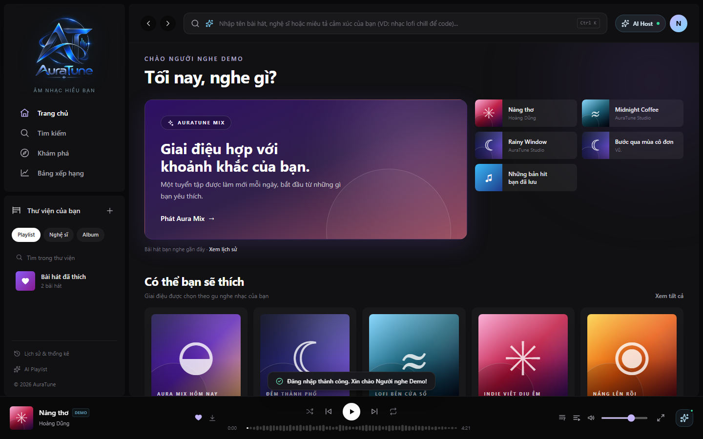
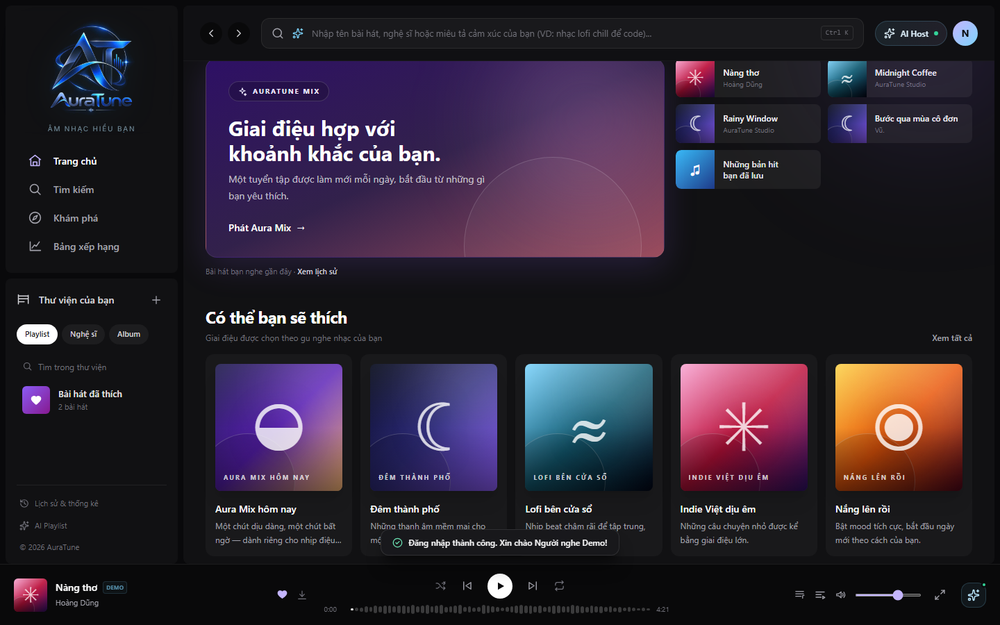
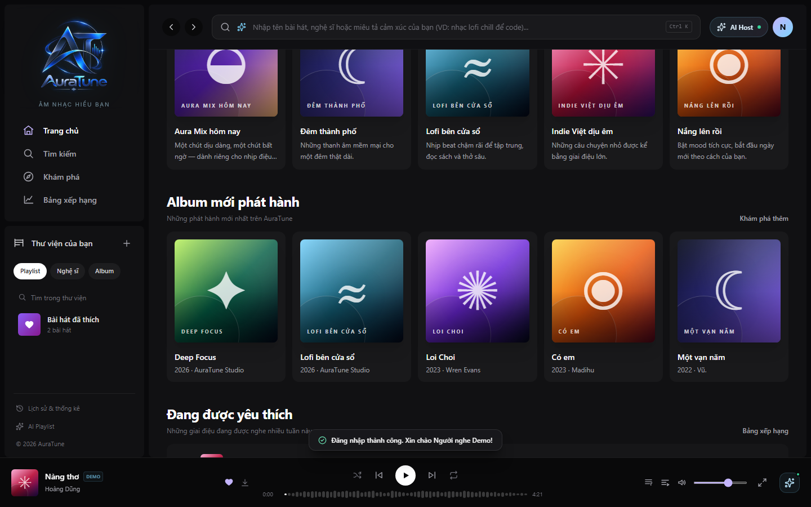
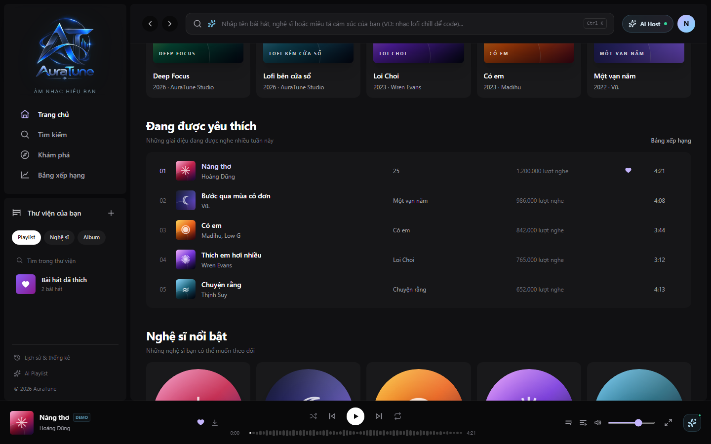
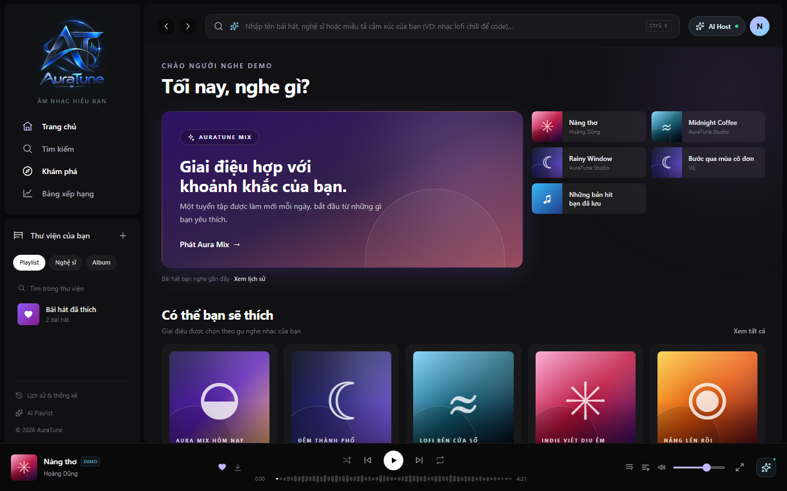
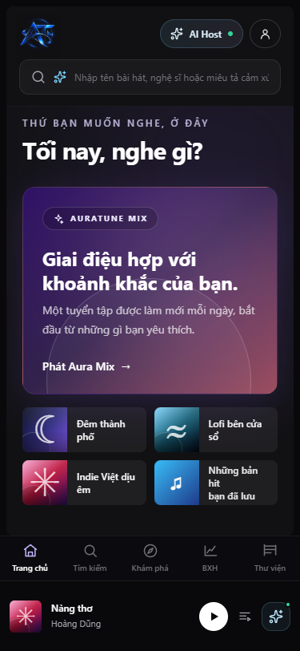

# UC-020-001 – Browse Home Dashboard

---

## 1. Metadata

| Field | Value |
|---|---|
| **Use Case ID** | UC-020-001 |
| **Use Case Name** | Browse Home Dashboard |
| **Functional Group** | 020 – Home Dashboard |
| **Primary Actor** | Guest / Visitor (`ACT-01`), Listener (`ACT-02`) |
| **Supporting Actors** | None |
| **Related FR IDs** | `021-FR-001`, `021-FR-002`, `021-FR-003`, `021-FR-004`, `021-FR-005`, `021-FR-006`, `021-FR-007`, `021-FR-008`, `021-FR-009`, `021-FR-010`, `021-FR-011`, `021-FR-012`, `021-FR-013` |
| **Related Feature/Spec** | Feature 021: Home Content Layout (`specs/020-home-dashboard/021-home-content-layout/spec.md`) |
| **Status** | Draft |
| **Writer** | Nguyễn Thanh Huy |
| **Reviewer** | TBD |

---

## 2. Description

A guest or signed-in listener opens the AuraTune Home Dashboard and browses an organized set of music sections without searching. The system presents the sections in a fixed order, adapts the greeting and shortcuts to the actor's sign-in state, loads each section independently so that one failure does not block the page, and provides paths to the full destination of each section while current playback continues.

---

## 3. Preconditions

- The AuraTune web application is reachable from a supported desktop or mobile browser.
- The music catalog contains at least one public, playable item for the public sections (`021-FR-001`).
- For the personalized variant, the actor is signed in as a `Listener` (`ACT-02`) with a valid session (`UC-010-002`).

---

## 4. Trigger

The actor opens the AuraTune root route (`/`), signs in and lands on Home, or selects "Trang chủ" in the sidebar or mobile navigation.

---

## 5. Basic Flow

1. **Actor:** Opens the Home Dashboard.
2. **System:** Determines whether the actor is a guest or a signed-in listener (`021-FR-001`).
3. **System:** Shows a loading state in each section area while its content is requested (`021-FR-007`).
4. **System:** Presents the sections in the defined order: hero and quick access, recommended content, new albums, popular tracks, featured artists, curated playlists, and genres (`021-FR-002`).
5. **System:** Shows a general greeting to a guest, or a personalized greeting with the listener's display name to a signed-in listener (`021-FR-003`).
6. **System:** Limits each preview section to at most 5 items, shows all available genres, and fills the featured artists section with the artists that have the highest platform-wide play counts (`021-FR-004`, `021-FR-013`).
7. **Actor:** Scrolls through the sections and reviews the available music.
8. **Actor:** Selects a playable item, such as a hero mix, a playlist, an album, or a track.
9. **System:** Starts playback for public content without requiring an account and keeps the Home Dashboard visible while the player updates (`021-FR-001`, `021-FR-011`).
10. **Actor:** Continues browsing Home while the music plays.

---

## 6. Alternative Flows

### AF-01 – Open the Full Destination of a Section
- **Starting step:** Step 7 of the Basic Flow.
- **Condition:** The actor wants more content than the preview shows (`021-FR-005`).
1. **Actor:** Selects the section action, for example "Xem tất cả", "Khám phá thêm", or "Bảng xếp hạng".
2. **System:** Opens the full destination for that section, such as the Explore page or the Charts page.
3. **System:** Keeps current playback running during and after navigation (`021-FR-011`).
- **Continuation:** Use case ends successfully; the actor continues in the destination use case, for example `UC-020-004`.

### AF-02 – Guest Selects a Personal Shortcut
- **Starting step:** Step 7 of the Basic Flow.
- **Condition:** A guest selects a shortcut that needs an account, such as saved hits (`021-FR-009`).
1. **Actor:** Selects the personal shortcut.
2. **System:** Sends the guest to the sign-in flow and remembers the intended destination.
3. **Actor:** Signs in through `UC-010-002`.
4. **System:** Returns the listener to the intended destination.
- **Continuation:** Use case ends successfully at the personal destination.

### AF-03 – Browse on a Phone or Tablet
- **Starting step:** Step 4 of the Basic Flow.
- **Condition:** The actor uses a narrow screen (`021-FR-010`).
1. **System:** Reflows the sections for the screen width, without horizontal page scrolling, and shows the mobile navigation and compact mini player.
- **Continuation:** Resumes at Step 5 of the Basic Flow.

---

## 7. Exception Flows

### EF-01 – One Section Fails to Load
- **Starting step:** Step 3 of the Basic Flow.
- **Condition:** The content for a single section cannot be loaded (`021-FR-006`).
1. **System:** Shows a fallback or error state inside that section only.
2. **System:** Keeps all other sections loaded and usable.
3. **Actor:** Continues browsing the remaining sections.
- **Continuation:** Resumes at Step 7 of the Basic Flow.

### EF-02 – No Section Can Be Loaded
- **Starting step:** Step 3 of the Basic Flow.
- **Condition:** The page cannot load any section, for example because of a connection failure (`021-FR-008`).
1. **System:** Shows a page-level error message with a retry action.
2. **Actor:** Selects retry.
3. **System:** Requests the section content again.
- **Continuation:** Resumes at Step 3 of the Basic Flow if loading succeeds; otherwise the use case ends in failure with the error state shown.

### EF-03 – Section Has No Content
- **Starting step:** Step 6 of the Basic Flow.
- **Condition:** A section has no items to show.
1. **System:** Hides the section or shows an empty state, and never shows a blank block.
- **Continuation:** Resumes at Step 7 of the Basic Flow.

---

## 8. Postconditions

### Success
- The actor sees the Home Dashboard with every available section in the defined order.
- Guests see only public content, and signed-in listeners see their personalized greeting and shortcuts.
- Any playback started from Home continues while the actor browses or leaves Home.

### Failure
- Sections that failed show a fallback or error state, and the rest of the page remains usable.
- If no section loads, the page shows an error with a retry action, and no playback state is changed.

---

## 9. Special Requirements

- **Performance**: The Home Dashboard should be usable within 2 seconds under standard network conditions (Vision Document, Section 6.1).
- **Responsiveness**: No horizontal page scrolling from 375 px to 1920 px wide (`021-FR-010`).
- **Accessibility**: All section actions and cards are reachable and operable with keyboard, mouse, and touch.
- **Scope Boundary**: This use case presents content only. Recommendation generation, chart calculation, and history recording belong to other groups (`021-FR-012`).

---

## 10. Prototype and Screenshots

> **Asset type**: Implementation screenshots captured from the current frontend prototype, which runs on demo data.

### Basic Flow

*Figure 1: Home Dashboard for a guest, showing the sidebar, top bar, hero, quick access, and mini player (Steps 1–5).*

*Figure 2: Personalized greeting and personal shortcuts for a signed-in listener (Step 5).*

*Figure 3: Hero, recommended content, and new albums in the defined order (Step 4).*

*Figure 4: Popular tracks and featured artists (Steps 4 and 6).*

*Figure 5: Curated playlists and the genre grid (Steps 4 and 6).*

### Alternative Flow – AF-01 (Open the Full Destination)

*Figure 6: Section actions and sidebar entries leading to full destinations.*

### Alternative Flow – AF-03 (Phone Layout)

*Figure 7: Home at 375 px wide with reflowed sections and mobile navigation.*

### Exception Flows – EF-01 and EF-02 (Section and Page Failures)
*[Prototype Pending - To be generated during UI implementation]*  
*Planned Interface: Per-section fallback state and a page-level error with a retry action. The prototype reads local demo data, so these states cannot occur yet.*

---

## 11. Related Use Cases

- **Preceding Use Case**: `UC-010-002` (Log In with Email and Password) – Required only for the personalized variant and AF-02.
- **Embedded Sections**:
  - `UC-020-002` (Stream Recommended Music from Home)
  - `UC-020-003` (Replay Recently Played Music)
  - `UC-020-004` (Browse Trending Charts)
  - `UC-020-005` (Explore New Album Releases)
- **Delegated Playback**: `UC-040-001` (Control Audio Playback) – Triggered when the actor plays content from Home.

---

## 12. Source References

- `specs/020-home-dashboard/021-home-content-layout/spec.md` – Requirements FR-001 through FR-013, User Stories 1–3, Edge Cases.
- `docs/proposal/Auratune_Vision_Document.md` – Group G02 and Section 6.1 Performance.
- `docs/proposal/proposal.md` – Section 6.2: Home Dashboard.
- `docs/analysis-and-design/api-contract.md` – Section 2.2: `GET /home`, `GET /genres`, `GET /artists/featured`.

---

## 13. Notes and Open Questions

- **Guest Streaming**: Clarification session 2026-11-01 confirmed that guests can stream public tracks, albums, and playlists from Home; sign-in is required only for personal actions.
- **Data Loading (`Q-020-1`)**: Whether Home uses the composite `GET /home` request or parallel requests per section is still open. Both options must satisfy the per-section failure rule in EF-01.
- **Prototype Gap**: The current prototype has no per-section loading, failure, or retry states (see Known Gaps in the 021 specification).
