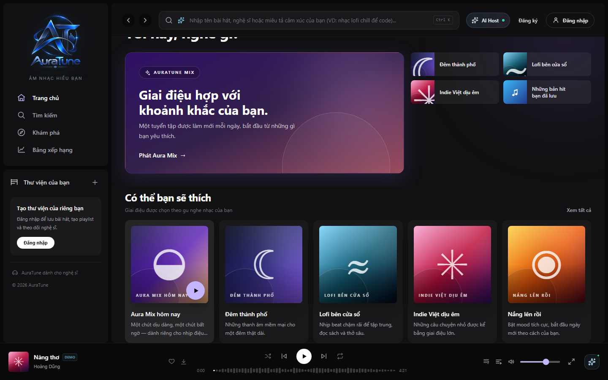
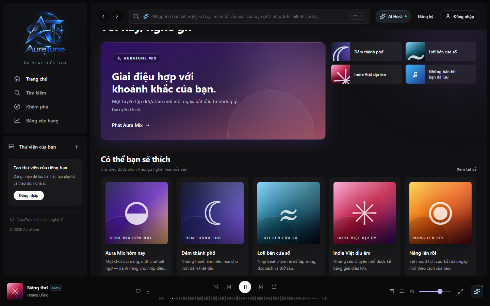
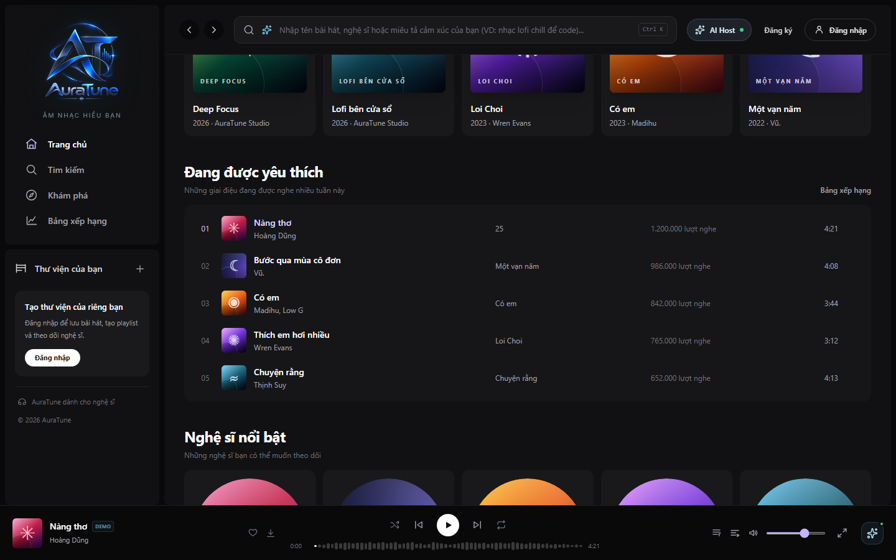
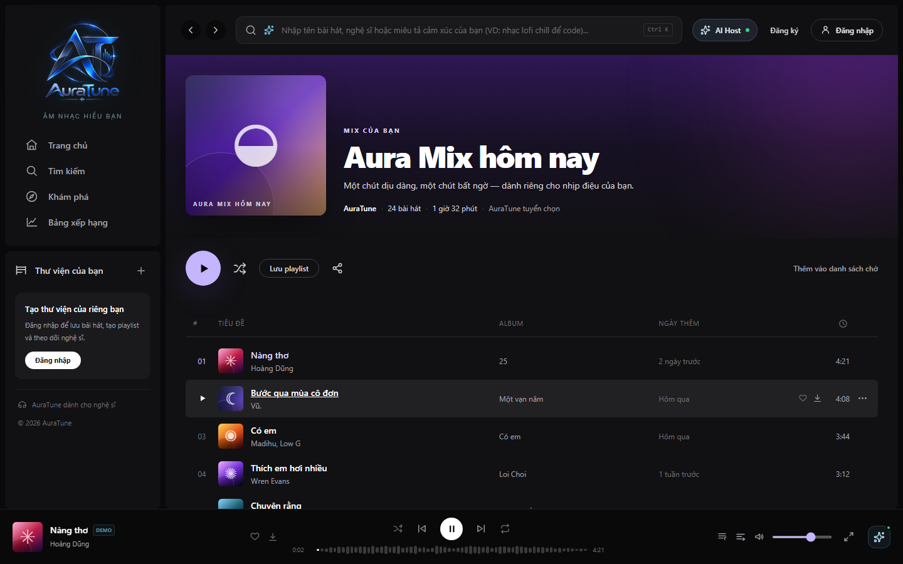
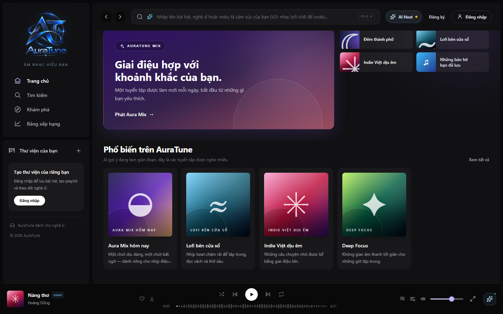

# UC-020-002 – Stream Recommended Music from Home

---

## 1. Metadata

| Field | Value |
|---|---|
| **Use Case ID** | UC-020-002 |
| **Use Case Name** | Stream Recommended Music from Home |
| **Functional Group** | 020 – Home Dashboard |
| **Primary Actor** | Listener (`ACT-02`), Guest / Visitor (`ACT-01`) |
| **Supporting Actors** | None |
| **Related FR IDs** | `022-FR-001`, `022-FR-002`, `022-FR-003`, `022-FR-004`, `022-FR-005`, `022-FR-006`, `022-FR-007`, `022-FR-008`, `022-FR-009`, `022-FR-010`, `022-FR-011`, `051-FR-013` |
| **Related Feature/Spec** | Feature 022: Recommended Content (`specs/020-home-dashboard/022-recommended-content/spec.md`) |
| **Status** | Draft |
| **Writer** | Nguyễn Thanh Huy |
| **Reviewer** | TBD |

---

## 2. Description

A listener or guest discovers recommended music in a dedicated section of the Home Dashboard and starts listening in one interaction. Signed-in listeners see recommended songs when recommendations are available, and all visitors see suggested playlists. Group 020 owns the presentation, playback entry points, and fallback display; generating and ranking recommendations belongs to Group 100.

---

## 3. Preconditions

- The actor has opened the Home Dashboard (`UC-020-001`).
- The catalog contains at least one available playlist or track that can be shown in the section (`022-FR-008`).
- For recommended songs, the actor is signed in as a `Listener` (`ACT-02`) (`022-FR-002`).

---

## 4. Trigger

The Home Dashboard renders the recommended content section, shown as "Có thể bạn sẽ thích" when recommendations are available.

---

## 5. Basic Flow

1. **System:** Requests recommended content for the actor and shows a loading state in the section (`022-FR-009`).
2. **System:** Shows up to 5 recommended items in the dedicated section: recommended songs for a signed-in listener when available, and suggested playlists for every visitor (`022-FR-001`, `022-FR-002`, `022-FR-003`, `022-FR-004`).
3. **System:** Leaves out any item that is no longer available, so no broken item is shown (`022-FR-008`).
4. **Actor:** Reviews the recommended items and focuses on a playlist card.
5. **System:** Highlights the card and shows its play action.
6. **Actor:** Selects the play action on the card.
7. **System:** Starts playback of the playlist's available tracks in one interaction and sets them as the queue (`022-FR-005`).
8. **System:** Updates the mini player with the current track while the Home Dashboard stays usable (`022-FR-009`).
9. **Actor:** Listens to the recommended music.

---

## 6. Alternative Flows

### AF-01 – Open a Recommended Item
- **Starting step:** Step 6 of the Basic Flow.
- **Condition:** The actor selects the card itself instead of its play action (`022-FR-006`).
1. **Actor:** Selects the recommended card.
2. **System:** Opens the destination page of the item, for example the playlist details page.
- **Continuation:** Use case ends successfully; the actor continues in `UC-060-002` (View Playlist Details).

### AF-02 – Guest Suggestions
- **Starting step:** Step 2 of the Basic Flow.
- **Condition:** The actor is not signed in (`022-FR-003`).
1. **System:** Shows public suggested playlists with no personalized wording or personal data.
- **Continuation:** Resumes at Step 4 of the Basic Flow.

### AF-03 – Explore More Recommendations
- **Starting step:** Step 4 of the Basic Flow.
- **Condition:** The actor wants more content than the section shows (`022-FR-010`).
1. **Actor:** Selects "Xem tất cả".
2. **System:** Opens the Explore page.
- **Continuation:** Use case ends successfully.

### AF-04 – Playlist Longer Than the Queue Limit
- **Starting step:** Step 7 of the Basic Flow.
- **Condition:** The playlist has more than 50 available tracks (`051-FR-013`).
1. **System:** Sets only the first 50 available tracks, in playlist order, as the queue.
2. **System:** Tells the actor that the queue holds at most 50 tracks and how many tracks were added.
- **Continuation:** Resumes at Step 8 of the Basic Flow.

---

## 7. Exception Flows

### EF-01 – Recommendations Unavailable
- **Starting step:** Step 1 of the Basic Flow.
- **Condition:** AI recommendations are unavailable, the result is empty, or the listener is new and has no history (`022-FR-007`).
1. **System:** Changes the section title to popular content ("Phổ biến trên AuraTune").
2. **System:** Shows a short notice that AI suggestions are temporarily interrupted.
3. **System:** Shows official popular playlists in place of the recommendations.
4. **Actor:** Selects a popular playlist to play.
- **Continuation:** Resumes at Step 7 of the Basic Flow; use case completes in fallback mode.

### EF-02 – Playlist Has Nothing Playable
- **Starting step:** Step 7 of the Basic Flow.
- **Condition:** All tracks in the selected playlist are unavailable.
1. **System:** Shows a message that there is nothing to play and does not change current playback.
- **Continuation:** Resumes at Step 4 of the Basic Flow.

### EF-03 – Slow Response
- **Starting step:** Step 1 of the Basic Flow.
- **Condition:** Recommendations take longer than expected to load.
1. **System:** Keeps the loading state in the section and keeps the rest of Home usable (`022-FR-009`).
- **Continuation:** Resumes at Step 2 when content arrives, or continues via EF-01 if the request fails.

---

## 8. Postconditions

### Success
- The actor sees up to 5 available recommended items, and selecting one plays it or opens its page in 1 interaction.
- When playback starts, the queue contains the playlist's available tracks, up to 50.
- Guests never see personalized wording or personal data.

### Failure
- The section shows popular fallback content with a short notice, and the rest of Home is unaffected.
- No playback change occurs when a selected playlist has nothing playable.

---

## 9. Special Requirements

- **Performance**: The section must not delay the rest of the Home Dashboard; it loads independently (`022-FR-009`).
- **Privacy**: Personalized content is shown only to the signed-in listener it belongs to.
- **Data Integrity**: Unavailable items are filtered out before display (`022-FR-008`).
- **Capacity**: Starting a playlist never puts more than 50 tracks in the queue (`051-FR-013`).
- **Scope Boundary**: The system does not generate, rank, or explain recommendations in this use case (`022-FR-011`).

---

## 10. Prototype and Screenshots

> **Asset type**: Implementation screenshots captured from the current frontend prototype, which runs on demo data.

### Basic Flow

*Figure 1: Hero mix and the recommended content section on Home (Step 2).*

*Figure 2: Focused recommended playlist card showing its play action (Step 5).*

*Figure 3: Playback started from recommended content, with the mini player updated (Steps 7–8).*

*Figure 4: Curated playlist section shown further down Home, also using the playback entry point.*

### Alternative Flow – AF-01 (Open a Recommended Item)

*Figure 5: Playlist details page opened from a recommended card.*

### Alternative Flow – AF-04 (Playlist Longer Than the Queue Limit)
*[Prototype Pending - To be generated during UI implementation]*  
*Planned Interface: Notice that only the first 50 tracks were added to the queue. The current prototype does not limit the queue.*

### Exception Flow – EF-01 (Recommendations Unavailable)

*Figure 6: Section switched to popular content with a short notice when AI recommendations are unavailable.*

---

## 11. Related Use Cases

- **Context Container**: `UC-020-001` (Browse Home Dashboard) – Hosts this section.
- **Recommendation Source**: `UC-100-002` (Receive Personalized Song Recommendations) – Supplies the recommended songs.
- **Delegated Playback**: `UC-040-001` (Control Audio Playback).
- **Target Detail Navigation**: `UC-060-002` (View Playlist Details).
- **Queue Rules**: `UC-050-001` (View Playback Queue) – Shows the queue set here; the 50-track limit belongs to Group 050.

---

## 12. Source References

- `specs/020-home-dashboard/022-recommended-content/spec.md` – Requirements FR-001 through FR-011, User Stories 1–3, Edge Cases.
- `specs/100-ai-recommendations/102-personalized-recommendations/spec.md` – Recommendation logic and fallback policy.
- `specs/050-queue-management/051-view-queue/spec.md` – FR-004: a started collection becomes the queue; FR-013: maximum 50 tracks.
- `specs/050-queue-management/052-add-and-remove-queue-items/spec.md` – Edge Case "Batch exceeding the limit".
- `docs/proposal/proposal.md` – Section 6.2: Home Dashboard.
- `docs/analysis-and-design/api-contract.md` – Section 2.2: `GET /recommendations/songs`, `GET /playlists`; error code `AI_SERVICE_UNAVAILABLE`.

---

## 13. Notes and Open Questions

- **Prototype Gap**: The current prototype shows recommended playlists only; recommended songs are not displayed yet, and recommendations are demo data.
- **Fallback Trigger**: The same fallback applies to an AI outage, an empty result, and a new listener with no history (022 Edge Cases).
- **Collections Over 50 Tracks**: No specification states what happens when a started collection has more than 50 tracks. AF-04 applies the 052 edge case for batch additions: only the tracks that fit are added, and the listener sees how many. This needs to be confirmed as a clarification of spec 051.
