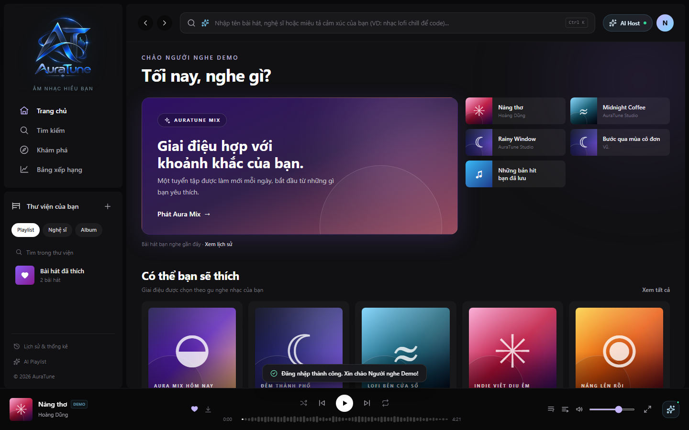
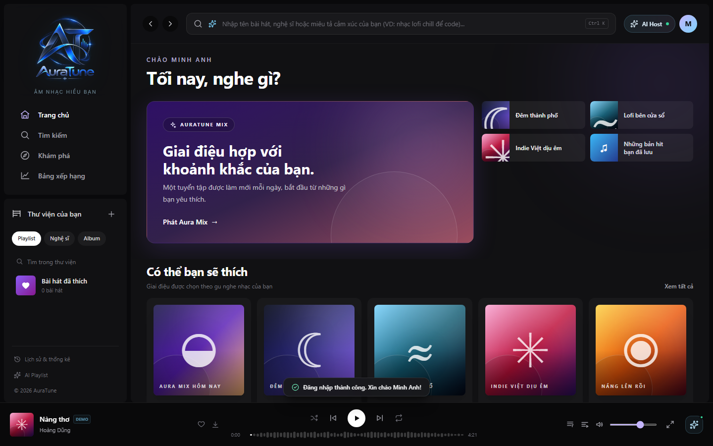
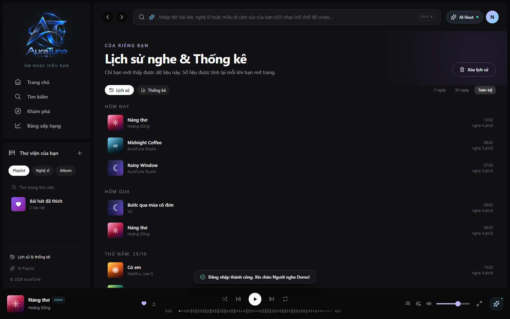

# UC-020-003 – Replay Recently Played Music

---

## 1. Metadata

| Field | Value |
|---|---|
| **Use Case ID** | UC-020-003 |
| **Use Case Name** | Replay Recently Played Music |
| **Functional Group** | 020 – Home Dashboard |
| **Primary Actor** | Listener (`ACT-02`) |
| **Supporting Actors** | None |
| **Related FR IDs** | `023-FR-001`, `023-FR-002`, `023-FR-003`, `023-FR-004`, `023-FR-005`, `023-FR-006`, `023-FR-007`, `023-FR-008`, `023-FR-009`, `023-FR-010`, `023-FR-011` |
| **Related Feature/Spec** | Feature 023: Recently Played (`specs/020-home-dashboard/023-recently-played/spec.md`) |
| **Status** | Draft |
| **Writer** | Nguyễn Thanh Huy |
| **Reviewer** | TBD |

---

## 2. Description

A signed-in listener returns to familiar music by selecting one of their recently played tracks from the quick access area at the top of the Home Dashboard. The system shows distinct, available tracks from the listener's own history, most recent first, and starts playback in one interaction using the recent list as the queue. Recording and managing history belongs to Group 070.

---

## 3. Preconditions

- The actor is signed in as a `Listener` (`ACT-02`) with a valid session (`023-FR-001`).
- The listener has at least one qualifying entry in their listening history, recorded by `UC-070-001` after 30 seconds of continuous playback, or 50% of the duration for a shorter track (`041-FR-014`).
- The actor has opened the Home Dashboard (`UC-020-001`).

---

## 4. Trigger

The Home Dashboard renders the quick access area for a signed-in listener.

---

## 5. Basic Flow

1. **System:** Retrieves the signed-in listener's own listening history (`023-FR-009`).
2. **System:** Removes repeated plays so each track appears once, at its most recent position (`023-FR-003`).
3. **System:** Leaves out tracks that are no longer available (`023-FR-004`).
4. **System:** Shows up to 4 recent tracks in the quick access area, ordered from most recent to oldest, with a link to the full listening history (`023-FR-002`, `023-FR-007`).
5. **Actor:** Selects a recent track.
6. **System:** Starts playback of the selected track in one interaction (`023-FR-005`).
7. **System:** Sets the recent tracks list, starting from the selected track, as the playback queue (`023-FR-006`).
8. **Actor:** Listens to the track and continues browsing Home.

---

## 6. Alternative Flows

### AF-01 – Guest Visitor
- **Starting step:** Step 1 of the Basic Flow.
- **Condition:** The actor is not signed in (`023-FR-008`).
1. **System:** Shows suggested playlist shortcuts in place of recent tracks.
2. **Actor:** Selects a shortcut to open the playlist.
- **Continuation:** Use case ends; the actor continues in `UC-060-002` (View Playlist Details).

### AF-02 – Listener With No History
- **Starting step:** Step 1 of the Basic Flow.
- **Condition:** The signed-in listener has no history, or has cleared it (`023-FR-008`).
1. **System:** Shows suggested playlist shortcuts in place of recent tracks.
- **Continuation:** Use case ends; the actor can continue via AF-01 Step 2.

### AF-03 – View Full Listening History
- **Starting step:** Step 4 of the Basic Flow.
- **Condition:** The listener wants to see more than the recent preview (`023-FR-007`).
1. **Actor:** Selects the history link.
2. **System:** Opens the listening history page.
- **Continuation:** Use case ends successfully; the listener continues in `UC-070-002` (View Recently Played History).

---

## 7. Exception Flows

### EF-01 – History Cannot Be Loaded
- **Starting step:** Step 1 of the Basic Flow.
- **Condition:** The listener's history cannot be retrieved (`023-FR-010`).
1. **System:** Shows suggested playlist shortcuts in the quick access area.
2. **System:** Keeps the rest of the Home Dashboard usable.
- **Continuation:** Use case ends in fallback mode.

### EF-02 – Session Expires
- **Starting step:** Any step of the Basic Flow.
- **Condition:** The listener's session is no longer valid.
1. **System:** Removes the personal data from the page and shows the guest state.
- **Continuation:** Continues via AF-01.

---

## 8. Postconditions

### Success
- The selected recent track is playing, and the queue contains the recent tracks list starting from that track.
- The recent list contains no duplicate and no unavailable tracks.

### Failure
- The quick access area shows suggested shortcuts, and no personal data is shown.
- The listening history itself is not modified by this use case (`023-FR-011`).

---

## 9. Special Requirements

- **Security & Privacy**: A listener's history is never shown to any other user (`023-FR-009`).
- **Freshness**: A track recorded in history appears on the next Home load.
- **Play Threshold**: Only plays that reached 30 seconds, or 50% of a shorter track, appear in the recent list. A shorter listen is never recorded, so it never appears here (`041-FR-014`, `UC-040-001` AF-05).
- **Scope Boundary**: This use case does not record, edit, or delete history (`023-FR-011`).

---

## 10. Prototype and Screenshots

> **Asset type**: Implementation screenshots captured from the current frontend prototype, which runs on demo data.

### Basic Flow

*Figure 1: Recent tracks in the quick access area with a link to the full history (Step 4).*

*Figure 2: Playback started from a recent track (Steps 6–7).*

### Alternative Flow – AF-01 (Guest Visitor)

*Figure 3: Suggested playlist shortcuts shown to a guest.*

### Alternative Flow – AF-02 (Listener With No History)

*Figure 4: Suggested shortcuts shown to a signed-in listener with no history.*

### Alternative Flow – AF-03 (View Full Listening History)

*Figure 5: Listening history page opened from the Home link.*

### Exception Flow – EF-01 (History Cannot Be Loaded)
*[Prototype Pending - To be generated during UI implementation]*  
*Planned Interface: Quick access area falling back to suggested shortcuts when history cannot be retrieved. The prototype stores history locally, so this failure cannot occur yet.*

---

## 11. Related Use Cases

- **Preceding Use Cases**:
  - `UC-010-002` (Log In with Email and Password) – Authenticates the listener.
  - `UC-070-001` (Record Track Play Event) – Creates the history entries shown here.
- **Context Container**: `UC-020-001` (Browse Home Dashboard).
- **Delegated Playback**: `UC-040-001` (Control Audio Playback).
- **Target Navigation**: `UC-070-002` (View Recently Played History).
- **Data Reset Trigger**: `UC-070-004` (Purge Entire Listening History) – Leads to AF-02 on the next Home load.

---

## 12. Source References

- `specs/020-home-dashboard/023-recently-played/spec.md` – Requirements FR-001 through FR-011, User Stories 1–3, Edge Cases.
- `specs/040-music-player/041-playback-controls/spec.md` – FR-014: a play is recorded after 30 seconds or 50% of the track.
- `docs/proposal/proposal.md` – Section 6.2: Home Dashboard.
- `docs/analysis-and-design/api-contract.md` – Section 2.5: `GET /users/me/history`.

---

## 13. Notes and Open Questions

- **Prototype Gap**: History is stored only in the browser in the current prototype, and plays are recorded as soon as a track starts instead of after 30 seconds (see Known Gaps in specs 023 and 041).
