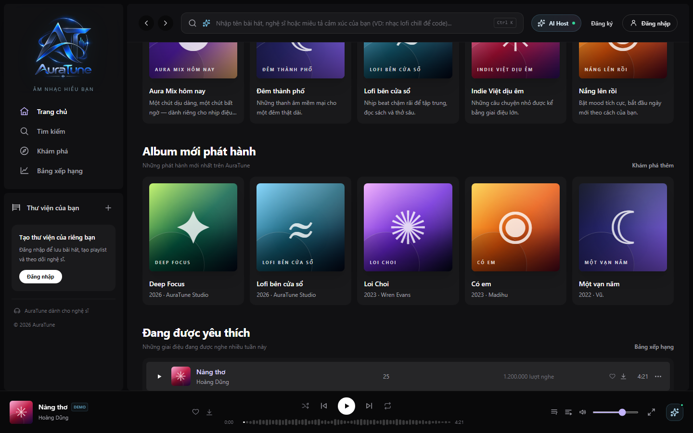
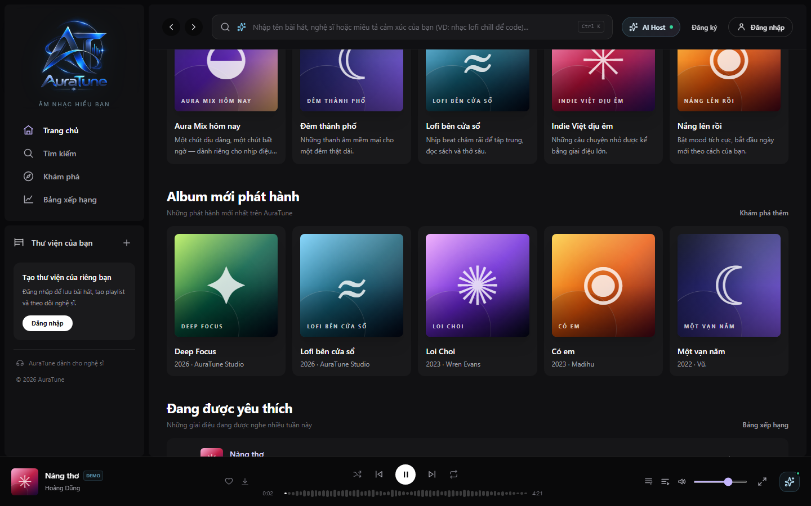
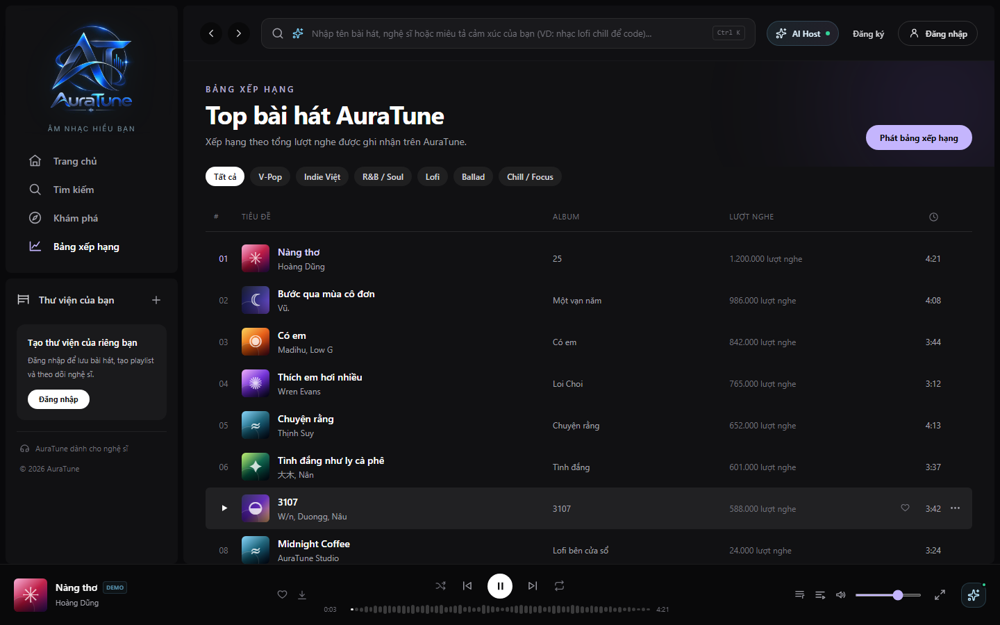
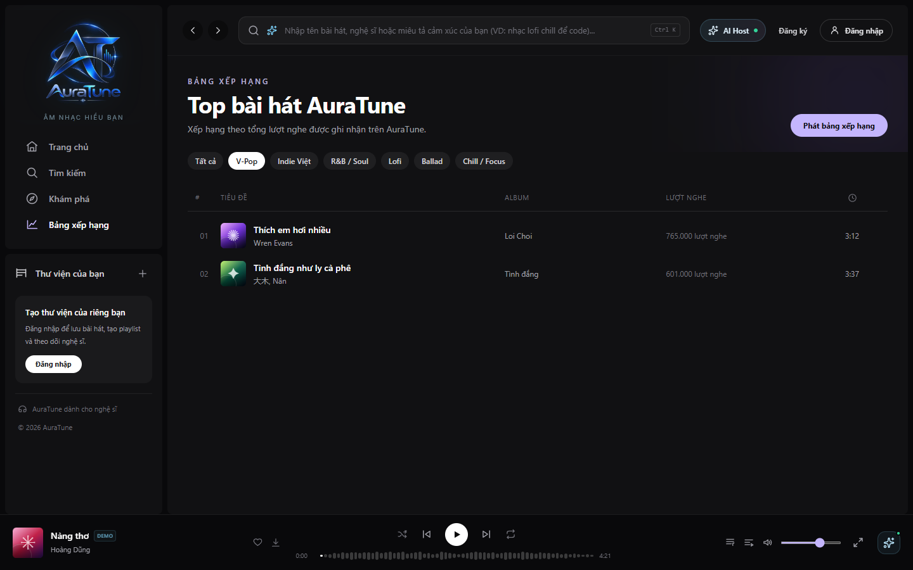

# UC-020-004 – Browse Trending Charts

---

## 1. Metadata

| Field | Value |
|---|---|
| **Use Case ID** | UC-020-004 |
| **Use Case Name** | Browse Trending Charts |
| **Functional Group** | 020 – Home Dashboard |
| **Primary Actor** | Guest / Visitor (`ACT-01`), Listener (`ACT-02`) |
| **Supporting Actors** | None |
| **Related FR IDs** | `024-FR-001`, `024-FR-002`, `024-FR-003`, `024-FR-004`, `024-FR-005`, `024-FR-006`, `024-FR-007`, `024-FR-008`, `024-FR-009`, `024-FR-010`, `024-FR-011`, `024-FR-012`, `024-FR-013`, `024-FR-014` |
| **Related Feature/Spec** | Feature 024: Trending Charts (`specs/020-home-dashboard/024-trending-charts/spec.md`) |
| **Status** | Draft |
| **Writer** | Nguyễn Thanh Huy |
| **Reviewer** | TBD |

---

## 2. Description

A guest or listener sees what is popular on AuraTune, first in the top 5 preview on the Home Dashboard and then on the full Charts page. Rankings use AuraTune's own play counts only, can be filtered by genre and by a day, week, or month period, and any ranked track or the whole chart can be played in one interaction. Group 020 owns both the Home preview and the Charts page.

---

## 3. Preconditions

- The actor has opened the Home Dashboard (`UC-020-001`) or the Charts page (`/charts`).
- AuraTune has recorded play counts for at least one available track (`024-FR-003`).

---

## 4. Trigger

The Home Dashboard renders the popular tracks section ("Đang được yêu thích"), or the actor opens the Charts page.

---

## 5. Basic Flow

1. **System:** Ranks available tracks by AuraTune's own play counts in descending order, using a stable order for ties and no external popularity data (`024-FR-003`, `024-FR-004`, `024-FR-005`).
2. **System:** Leaves unavailable tracks out of the ranking (`024-FR-009`).
3. **System:** Shows the top 5 tracks on Home with rank, title, artist, play count, and duration (`024-FR-001`, `024-FR-006`).
4. **Actor:** Focuses on a ranked track row.
5. **System:** Highlights the row and shows its play, like, and options actions.
6. **Actor:** Selects the play action on the row.
7. **System:** Starts the selected track and sets the displayed ranked list as the queue (`024-FR-010`).
8. **Actor:** Selects the chart action ("Bảng xếp hạng") to see the full chart (`024-FR-012`).
9. **System:** Opens the Charts page and shows the top 20 tracks for the default week period (`024-FR-002`, `024-FR-008`).
10. **Actor:** Selects "Phát bảng xếp hạng".
11. **System:** Plays the full displayed chart in order in one interaction (`024-FR-011`).

---

## 6. Alternative Flows

### AF-01 – Open the Charts Page Directly
- **Starting step:** Step 1 of the Basic Flow.
- **Condition:** The actor opens the Charts page from the sidebar or a link instead of from Home.
1. **System:** Shows the Charts page with the top 20 tracks for the default week period.
- **Continuation:** Resumes at Step 10 of the Basic Flow.

### AF-02 – Filter by Genre
- **Starting step:** Step 9 of the Basic Flow.
- **Condition:** The actor wants rankings for a single genre (`024-FR-007`).
1. **Actor:** Selects a genre chip.
2. **System:** Updates the list to rank only tracks in that genre, without a full page reload.
- **Continuation:** Resumes at Step 10 of the Basic Flow.

### AF-03 – Change the Period
- **Starting step:** Step 9 of the Basic Flow.
- **Condition:** The actor wants rankings for the day or the month (`024-FR-008`).
1. **Actor:** Selects the day, week, or month period.
2. **System:** Updates the ranking to reflect the selected period.
- **Continuation:** Resumes at Step 10 of the Basic Flow.

### AF-04 – Like a Ranked Track
- **Starting step:** Step 5 of the Basic Flow.
- **Condition:** The actor selects the heart action on a row (`024-FR-014`).
1. **Actor:** Selects the heart action.
2. **System:** For a signed-in listener, toggles the track in Liked Songs and updates the icon.
3. **System:** For a guest, asks the actor to sign in.
- **Continuation:** Resumes at Step 6 of the Basic Flow.

---

## 7. Exception Flows

### EF-01 – Filter Has No Tracks
- **Starting step:** Step 2 of AF-02 or AF-03.
- **Condition:** No available track matches the selected genre or period (`024-FR-013`).
1. **System:** Shows an empty state for the chart.
2. **Actor:** Selects another filter.
- **Continuation:** Resumes at Step 1 of AF-02 or AF-03.

### EF-02 – Chart Cannot Be Loaded
- **Starting step:** Step 1 of the Basic Flow.
- **Condition:** The chart data cannot be retrieved (`024-FR-013`).
1. **System:** Shows an error state with a retry action.
2. **Actor:** Selects retry.
- **Continuation:** Resumes at Step 1 of the Basic Flow; the use case ends in failure if loading fails again.

---

## 8. Postconditions

### Success
- The actor sees a ranked list in descending play-count order with no unavailable tracks.
- The same data produces the same order across repeated loads.
- Playback started from the chart uses the displayed ranked list as the queue.

### Failure
- An empty state or an error with retry is shown, and current playback is not changed.

---

## 9. Special Requirements

- **Data Policy**: Rankings use only AuraTune play counts; external metadata is never used to calculate popularity (Vision Document, AD-05; `024-FR-005`).
- **Consistency**: Tied tracks keep a stable order (`024-FR-004`).
- **Responsiveness**: Changing a genre or period updates the list without a full page reload.

---

## 10. Prototype and Screenshots

> **Asset type**: Implementation screenshots captured from the current frontend prototype, which runs on demo data.

### Basic Flow

*Figure 1: Top 5 popular tracks on Home with rank, plays, and duration (Step 3).*

*Figure 2: A focused chart row showing its actions (Step 5).*

*Figure 3: A ranked track playing, with the mini player updated (Step 7).*

### Alternative Flow – AF-01 (Charts Page)

*Figure 4: Charts page with the top 20 tracks and the play chart action.*

### Alternative Flow – AF-02 (Filter by Genre)

*Figure 5: Charts page filtered by a single genre.*

### Alternative Flow – AF-03 (Change the Period)
*[Prototype Pending - To be generated during UI implementation]*  
*Planned Interface: Day, week, and month period selector on the Charts page. The current prototype has no period control.*

### Exception Flows – EF-01 and EF-02
*[Prototype Pending - To be generated during UI implementation]*  
*Planned Interface: Empty chart state and an error state with a retry action.*

---

## 11. Related Use Cases

- **Context Container**: `UC-020-001` (Browse Home Dashboard) – Hosts the top 5 preview.
- **Delegated Playback**: `UC-040-001` (Control Audio Playback).
- **Data Source**: `UC-070-001` (Record Track Play Event) – Produces the play counts used for ranking.
- **Preceding Use Case for AF-04**: `UC-010-002` (Log In with Email and Password).

---

## 12. Source References

- `specs/020-home-dashboard/024-trending-charts/spec.md` – Requirements FR-001 through FR-014, User Stories 1–2, Edge Cases.
- `docs/proposal/Auratune_Vision_Document.md` – Group G02 and Assumption AD-05.
- `docs/proposal/proposal.md` – Section 6.2: Home Dashboard.
- `docs/analysis-and-design/api-contract.md` – Section 2.2: `GET /songs/popular`, `GET /charts/songs` with `period=day|week|month`.

---

## 13. Notes and Open Questions

- **Ownership**: Clarification session 2026-11-01 confirmed that Group 020 owns both the Home preview and the Charts page.
- **Prototype Gap**: The Charts page has no period control yet and ranks by total play count; the Home wording refers to this week (see Known Gaps in the 024 specification).
