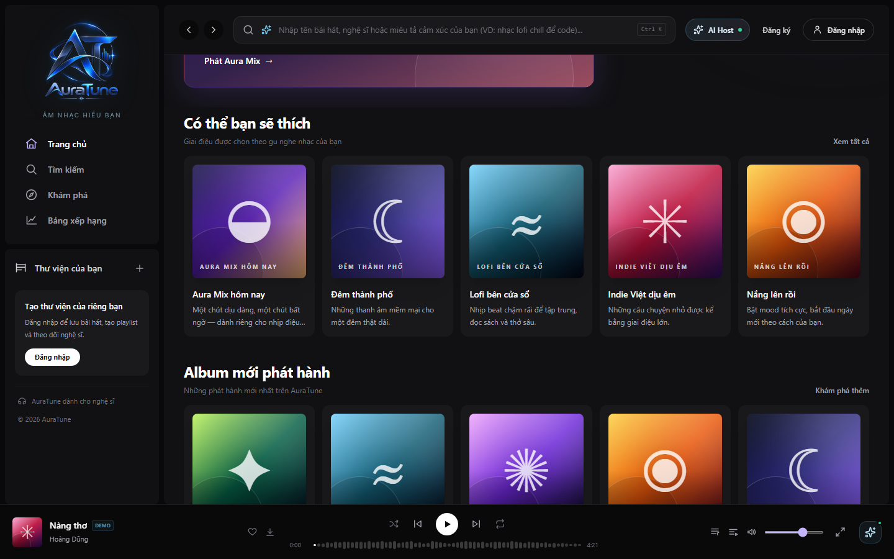
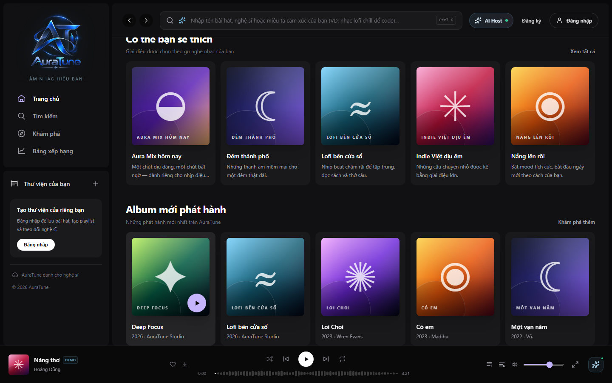
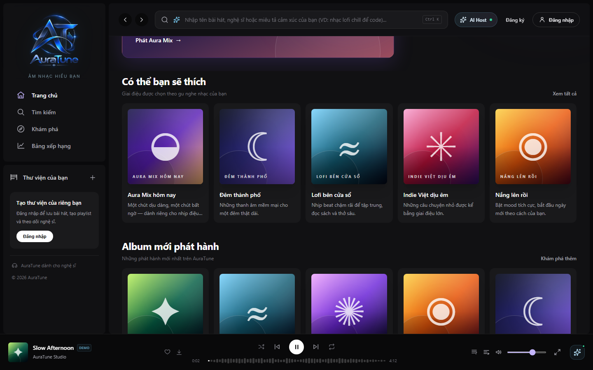
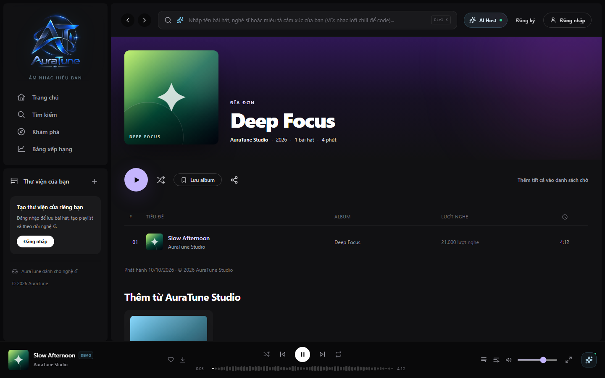
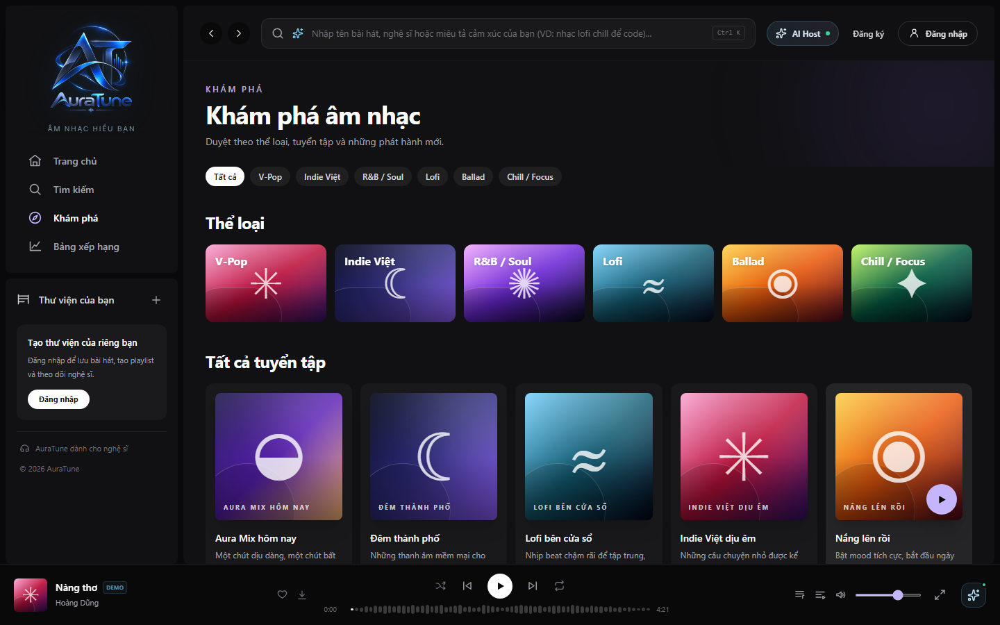

# UC-020-005 – Explore New Album Releases

---

## 1. Metadata

| Field | Value |
|---|---|
| **Use Case ID** | UC-020-005 |
| **Use Case Name** | Explore New Album Releases |
| **Functional Group** | 020 – Home Dashboard |
| **Primary Actor** | Guest / Visitor (`ACT-01`), Listener (`ACT-02`) |
| **Supporting Actors** | None |
| **Related FR IDs** | `025-FR-001`, `025-FR-002`, `025-FR-003`, `025-FR-004`, `025-FR-005`, `025-FR-006`, `025-FR-007`, `025-FR-008`, `025-FR-009`, `025-FR-010`, `025-FR-011` |
| **Related Feature/Spec** | Feature 025: New Releases (`specs/020-home-dashboard/025-new-releases/spec.md`) |
| **Status** | Draft |
| **Writer** | Nguyễn Thanh Huy |
| **Reviewer** | TBD |

---

## 2. Description

A guest or listener discovers newly released albums on the Home Dashboard and either plays an album directly from its card or opens the album page. The system orders albums by release date, newest first, and plays only available tracks in album order. Album details, tracklists, saving, and sharing belong to Group 080.

---

## 3. Preconditions

- The actor has opened the Home Dashboard (`UC-020-001`).
- The catalog contains at least one album with a release date (`025-FR-001`).

---

## 4. Trigger

The Home Dashboard renders the new albums section ("Album mới phát hành").

---

## 5. Basic Flow

1. **System:** Orders albums by release date, newest first, using a stable order for albums released on the same date (`025-FR-002`).
2. **System:** Shows up to 5 albums in a dedicated section, each with cover art, title, and artist (`025-FR-001`, `025-FR-003`, `025-FR-004`).
3. **Actor:** Focuses on an album card.
4. **System:** Highlights the card and shows its play action.
5. **Actor:** Selects the play action on the card.
6. **System:** Starts playback of the album's available tracks in album order in one interaction (`025-FR-006`, `025-FR-007`).
7. **System:** Sets the album's available tracks as the queue (`025-FR-008`).
8. **Actor:** Listens to the album and continues browsing Home.

---

## 6. Alternative Flows

### AF-01 – Open the Album Page
- **Starting step:** Step 5 of the Basic Flow.
- **Condition:** The actor selects the album card itself instead of its play action (`025-FR-005`).
1. **Actor:** Selects the album card.
2. **System:** Opens the album page.
- **Continuation:** Use case ends successfully; the actor continues in `UC-080-001` (View Album Details and Tracklist).

### AF-02 – Explore More Releases
- **Starting step:** Step 3 of the Basic Flow.
- **Condition:** The actor wants more releases than the section shows (`025-FR-010`).
1. **Actor:** Selects "Khám phá thêm".
2. **System:** Opens the Explore page.
- **Continuation:** Use case ends successfully.

### AF-03 – Album Partly Unavailable
- **Starting step:** Step 6 of the Basic Flow.
- **Condition:** Some tracks of the album are unavailable (`025-FR-007`).
1. **System:** Skips the unavailable tracks and plays only the available ones in album order.
- **Continuation:** Resumes at Step 7 of the Basic Flow.

---

## 7. Exception Flows

### EF-01 – Album Has Nothing Playable
- **Starting step:** Step 6 of the Basic Flow.
- **Condition:** No track of the album is available (`025-FR-009`).
1. **System:** Shows a message that there is nothing to play and does not change current playback.
2. **System:** Keeps the album page reachable from the card.
- **Continuation:** Resumes at Step 3 of the Basic Flow, or continues via AF-01.

### EF-02 – Section Cannot Be Loaded
- **Starting step:** Step 1 of the Basic Flow.
- **Condition:** The new albums cannot be retrieved, or no album exists.
1. **System:** Shows a fallback or empty state in the section, or hides it.
2. **System:** Keeps the rest of the Home Dashboard usable.
- **Continuation:** Use case ends in fallback mode.

---

## 8. Postconditions

### Success
- The actor sees up to 5 albums ordered by release date, newest first.
- When played from the card, the album's available tracks are playing in album order and form the queue.

### Failure
- A message, fallback, or empty state is shown, and current playback is not changed.
- Unavailable tracks never start playing.

---

## 9. Special Requirements

- **Consistency**: Albums with the same release date keep a stable order.
- **Data Integrity**: Unavailable tracks are filtered out before playback starts (`025-FR-007`).
- **Scope Boundary**: Album details, saving, and sharing are not implemented in this use case (`025-FR-011`).

---

## 10. Prototype and Screenshots

> **Asset type**: Implementation screenshots captured from the current frontend prototype, which runs on demo data.

### Basic Flow

*Figure 1: New albums section on Home, newest first (Step 2).*

*Figure 2: A focused album card showing its play action (Step 4).*

*Figure 3: Album playback started directly from its card (Steps 6–7).*

### Alternative Flow – AF-01 (Open the Album Page)

*Figure 4: Album page opened from a new album card.*

### Alternative Flow – AF-02 (Explore More Releases)

*Figure 5: Explore page opened from the section action.*

### Exception Flow – EF-01 (Album Has Nothing Playable)
*[Prototype Pending - To be generated during UI implementation]*  
*Planned Interface: Message shown when an album card is played but no track is available.*

---

## 11. Related Use Cases

- **Context Container**: `UC-020-001` (Browse Home Dashboard).
- **Delegated Playback**: `UC-040-001` (Control Audio Playback).
- **Target Detail Navigation**: `UC-080-001` (View Album Details and Tracklist).
- **Related Album Playback**: `UC-080-002` (Play Entire Album) – The same playback rule applied from the album page.

---

## 12. Source References

- `specs/020-home-dashboard/025-new-releases/spec.md` – Requirements FR-001 through FR-011, User Stories 1–3, Edge Cases.
- `docs/proposal/proposal.md` – Section 6.2: Home Dashboard.
- `docs/analysis-and-design/api-contract.md` – Section 2.2: `GET /albums/new`; Section 2.7: `GET /albums/:id`.

---

## 13. Notes and Open Questions

- **Prototype Gap**: Album data is demo data in the current prototype.
