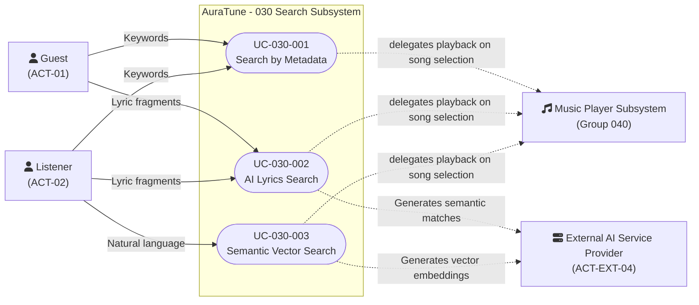

# Functional Group 030: Search – Use-Case Documentation

---

## 1. Group Information

| Attribute | Details |
|---|---|
| **Group ID** | 030 |
| **Group Name** | Search |
| **Group Owner** | Nguyễn Khánh Đăng |
| **Module Purpose** | Enables users to discover music content (Songs, Albums, Artists, Playlists) through exact text metadata matching, AI-powered semantic understanding of lyrics, and natural language mood descriptions. |
| **Documentation Status** | Draft — Baseline for Sprint 3 (PA3) Review |
| **Applicable Standards** | AuraTune Use-Case Documentation Guide, Spec Kit Architecture, PA3 Use-Case Specification Standard |

---

## 2. Scope

### 2.1 Purpose and Objectives
Functional Group 030 provides the core search and discovery capabilities of the AuraTune platform. It allows users to actively find specific music catalog entities using text keywords, while extending traditional search paradigms with AI-powered semantic vector search to understand lyrical fragments and abstract emotional contexts.

### 2.2 In-Scope Capabilities
The documented capabilities within Group 030 comprise:

1. **Metadata Search (Feature 031)**:
   - Text-based search across song titles, artist names, album names, and playlist names.
   - Ignoring letter case, diacritics, and punctuation during matching.
   - Paginating results using a "Load More" offset-limit mechanism.
   - Maintaining a strict localized browser history (LocalStorage) of up to 10 recent queries.
   - Refining results via category filters and sorting options.

2. **AI Lyrics Search (Feature 032)** *(Spec status: Draft)*:
   - Searching tracks by specific, remembered lyric fragments using semantic AI analysis.
   - Automatic graceful degradation to keyword search fallback upon AI service timeout.

3. **Semantic Vector Search (Feature 033)** *(Spec status: Draft)*:
   - Processing free-form natural language prompts (e.g., "sad music for a rainy night").
   - Ranking results using a weighted ensemble of metadata (30%), lyrics (40%), and audio characteristics (30%).
   - Automatic removal/masking of Personally Identifiable Information (PII) before external AI processing.
   - Graceful fallback to keyword search if semantic processing fails or times out.

### 2.3 Out-of-Scope Exclusions
To maintain strict architectural boundaries, the following capabilities are explicitly excluded from Group 030:
- **Audio Streaming & Player Controls**: Executing audio playback when a search result is clicked belongs to **Group 040 – Music Player**.
- **Interactive Conversational AI Dialogue**: Real-time conversational search or text-chat intent parsing is owned by **Group 120 – AI Conversational Agent**.
- **Curated Mood Tag Selection**: Selecting predefined mood/context chips (e.g., "Chill") without typing free-form queries is owned by **Group 100 – AI Recommendations**.

### 2.4 Dependencies
- **Group 040 (Music Player)**: Executes playback when a searched song is selected.
- **Group 060, 080 & 090 (Catalog Interaction)**: Provides entity detail views when searched albums, artists, or playlists are opened.
- **External AI Service Provider (`ACT-EXT-04`)**: Required for Feature 032 and Feature 033 to power semantic vector embeddings (Not required for Feature 031 Metadata Search).

---

## 3. Related Requirements and Features

| Feature ID | Feature Name | Related FR IDs | Spec Path |
|---|---|---|---|
| **031** | Metadata Search (Draft) | `031-FR-001` to `031-FR-019` | `specs/030-search/031-metadata-search/spec.md` |
| **032** | AI Lyrics Search (Draft) | `032-FR-001` to `032-FR-019` | `specs/030-search/032-ai-lyrics-search/spec.md` |
| **033** | Semantic Vector Search (Draft) | `033-FR-001` to `033-FR-017` (including `033-FR-003a`, `033-FR-004a`, `033-FR-011a`) | `specs/030-search/033-semantic-vector-search/spec.md` |

---

## 4. Actors

| Actor | Actor Type | Description | Related Use Cases |
|---|---|---|---|
| **Listener** (`ACT-02`) | Primary Human Actor | Authenticated platform user who searches for music. | `UC-030-001`, `UC-030-002`, `UC-030-003` |
| **Public User / Guest** (`ACT-01`) | Primary Human Actor | Unauthenticated visitor who can search the public catalog. | `UC-030-001`, `UC-030-002` |
| **External AI Service Provider** (`ACT-EXT-04`) | External System (Supporting Actor) | External AI service used for lyrics matching and semantic search processing. | `UC-030-002`, `UC-030-003` |

---

## 5. Use-Case Diagram



---

## 6. Use-Case List

| UC ID | Use-Case Name | Primary Actor | Related FRs | Specification File |
|---|---|---|---|---|
| **UC-030-001** | Search by Metadata | Public User, Listener | `031-FR-001` to `031-FR-019` | [`UC-030-001-metadata-search.md`](./UC-030-001-metadata-search.md) |
| **UC-030-002** | AI Lyrics Search | Public User, Listener | `032-FR-001` to `032-FR-019` | [`UC-030-002-ai-lyrics-search.md`](./UC-030-002-ai-lyrics-search.md) |
| **UC-030-003** | Semantic Vector Search | Listener | `033-FR-001` to `033-FR-017` (including lettered FRs) | [`UC-030-003-semantic-vector-search.md`](./UC-030-003-semantic-vector-search.md) |

## 5.7. Dependencies and Integration

```
                 +---------------------------+
                 |    Group 010: Auth        |
                 |  (User Profile for PII)   |
                 +-------------+-------------+
                               |
                               v
+------------------+     +-------------------+     +-------------------------+
| Group 060, 080,  |     |   Group 030:      |     | External AI Service /   |
| 090: Catalog Int.| <-- | Search Subsystem  | <-> | Vector Database         |
| (Detail Views)   |     +---------+---------+     | (Embeddings & Matching) |
+------------------+               |               +-------------------------+
                                   |
         +-------------------------+
         |
         v
+--------------------+
| Group 040:         |
| Music Player       |
| (Audio Streaming)  |
+--------------------+
```

1. **Authentication & PII Screening**: Group 030 integrates with Group 010's user profile data solely to execute local PII masking (detecting user names and emails) before transmitting queries to external services.
2. **Search Input Parsing**: The search bar serves as the unified entry point, dynamically routing queries to Metadata Search (031), AI Lyrics Search (032), or Semantic Vector Search (033) based on active tab selection.
3. **External AI matching**: Features 032 and 033 depend on the External AI Service for semantic understanding and vector matching.
4. **Playback Delegation**: Clicking a playable search result delegates execution directly to Group 040 (`UC-040-001`).

---

## 5.8. Open Issues and Architecture Clarifications

1. **Vector Storage Setup (`Q-030-01`)**:
   - *Status*: Pending architecture confirmation in Sprint 3.
   - *Detail*: Decision required between a dedicated vector database (e.g., ChromaDB) or extending PostgreSQL (e.g., `pgvector`) to handle the weighted ensemble scoring of Metadata, Lyrics, and Audio Characteristics.
2. **AI Service Fallback Timeout (`Q-030-02`)**:
   - *Status*: Confirmed baseline.
   - *Detail*: Clarification session 2026-11-01 strictly unified the timeout threshold to 3,000ms (3 seconds) across all AI search operations, triggering automatic keyword fallback.
3. **PII Masking Safety (`Q-030-03`)**:
   - *Status*: Confirmed baseline.
   - *Detail*: If the local PII screener encounters an ambiguous name match (e.g., the user's name matches a recognized catalog artist name), the system strictly defaults to privacy preservation and aborts the external AI request, utilizing keyword fallback instead.

---

## 5.9. References

- `docs/proposal/proposal.md`
- `docs/proposal/Auratune_Vision_Document.md`
- `docs/management/team-contract.md`
- `docs/requirements/use-case-model.md`
- `docs/requirements/use-cases/README.md`
- `specs/030-search/031-metadata-search/spec.md`
- `specs/030-search/032-ai-lyrics-search/spec.md`
- `specs/030-search/033-semantic-vector-search/spec.md`
- `docs/requirements/use-cases/030-search/prototypes/README.md`
