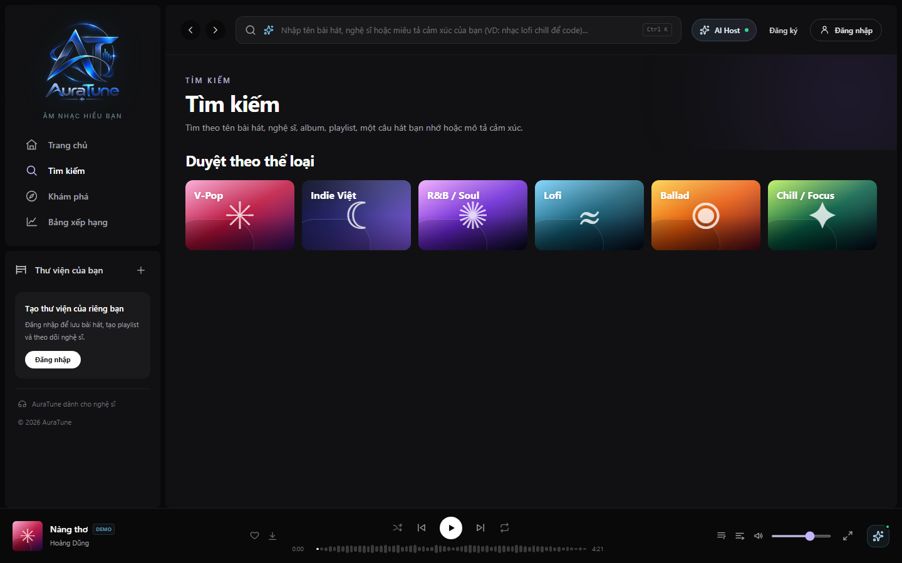
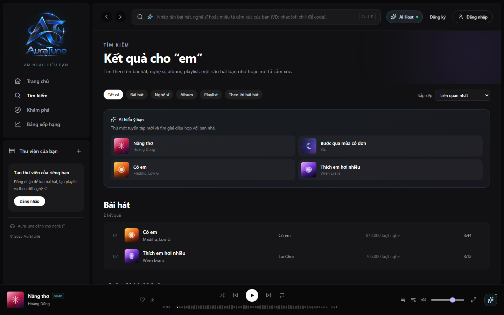
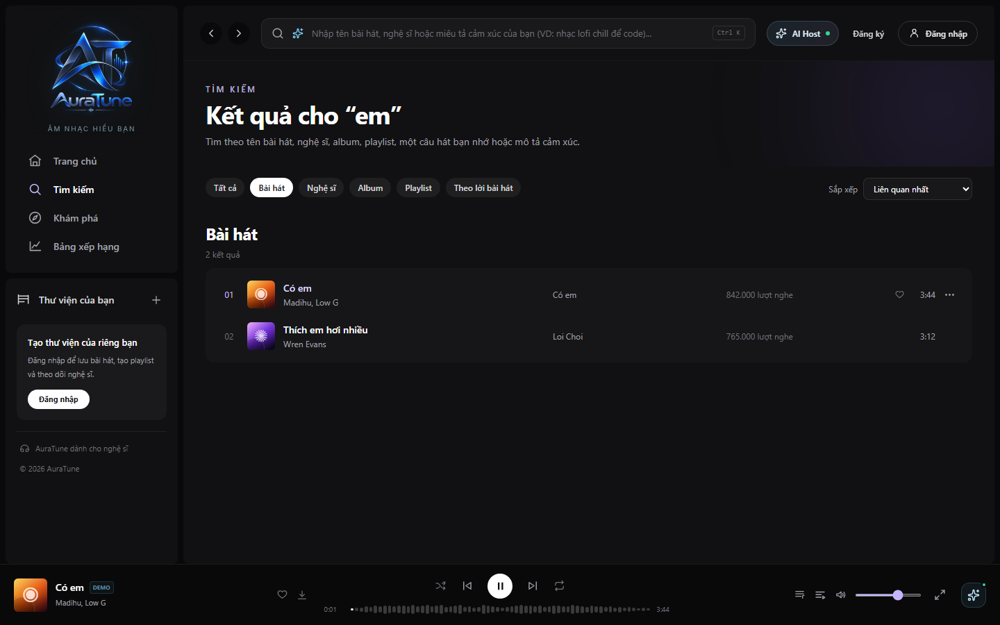
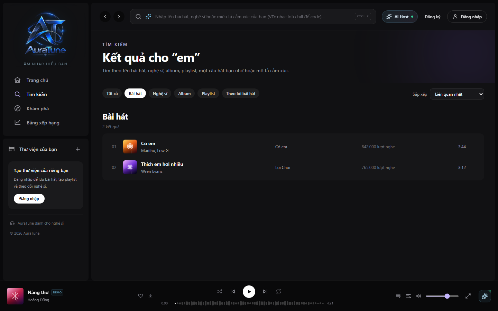
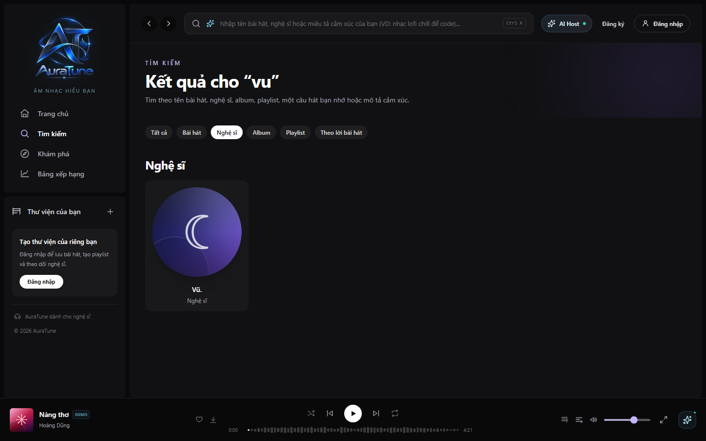
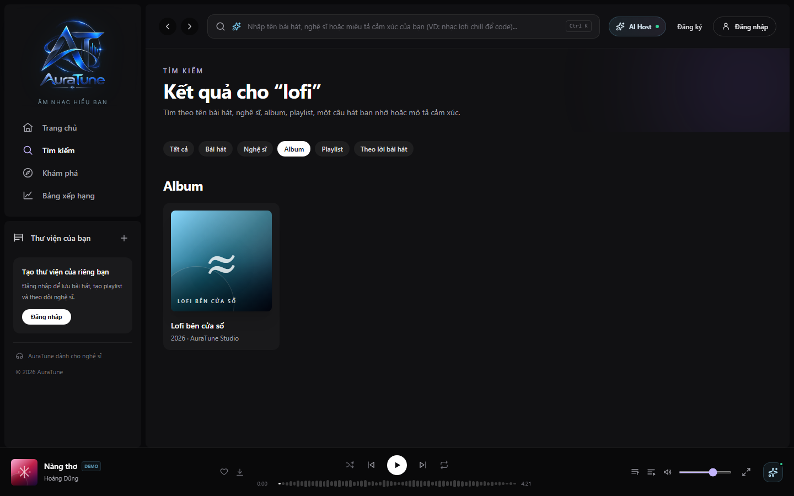
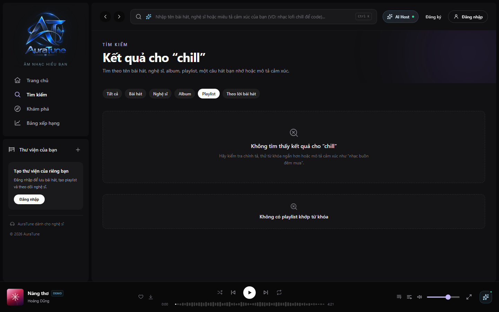
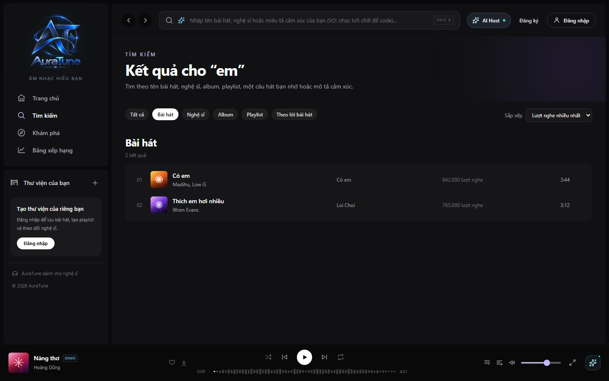
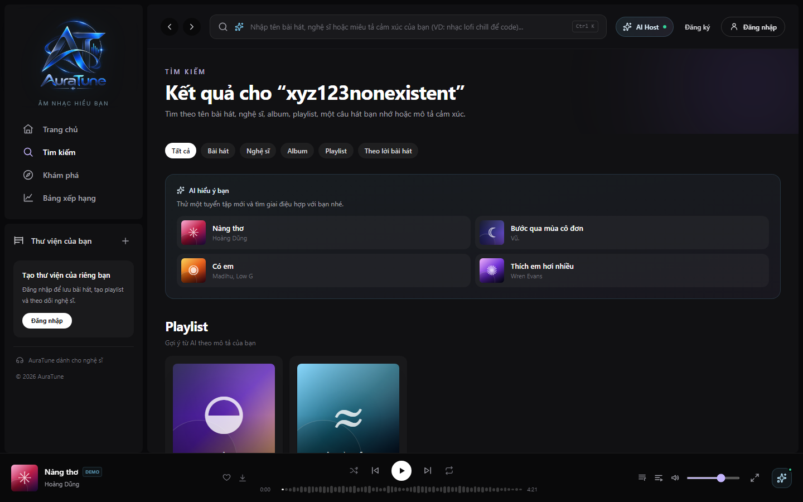

# UC-030-001 – Search by Metadata

---

## 1. Metadata

| Field | Value |
|---|---|
| **Use Case ID** | UC-030-001 |
| **Use Case Name** | Search by Metadata |
| **Functional Group** | 030 – Search |
| **Primary Actor** | Public User / Guest (`ACT-01`), Listener (`ACT-02`) |
| **Supporting Actors** | None |
| **Related FR IDs** | `031-FR-001` through `031-FR-019` |
| **Related Feature/Spec** | Feature 031: Metadata Search (`specs/030-search/031-metadata-search/spec.md`) |
| **Status** | Draft |
| **Writer** | Nguyễn Khánh Đăng |
| **Reviewer** | TBD |

---

## 2. Description

A user (Public or Authenticated) interacts with the search interface to discover specific songs, artists, albums, or playlists using text keywords. The system queries the database catalog, ignoring letter case, diacritics, and punctuation, and presents the matched entities. The user can refine these results using dynamic category filters and sorting options, paginate via a "Load More" action, and quickly access up to 10 locally stored recent queries.

---

## 3. Preconditions

- The user has accessed the AuraTune web application and navigated to the Search page (`/search`).
- The music catalog database is reachable and populated with searchable entities (Songs, Artists, Albums, Playlists).

---

## 4. Trigger

The user focuses on the search input field or types a text query containing at least 2 characters and submits the request.

---

## 5. Basic Flow

1. **Actor:** Navigates to `/search` and clicks on the search input field.
2. **System:** Extracts up to 10 recently entered queries stored in the browser's `LocalStorage` and displays them in a history dropdown (`031-FR-019`).
3. **Actor:** Types a text keyword (between 2 and 100 characters) into the search bar and presses Enter or clicks the search icon (`031-FR-002`, `031-FR-003`).
4. **System:** Invokes the `GET /search` API using the query parameter `q`, ignoring letter case, diacritics, and punctuation during matching (`031-FR-005`, `031-FR-007`, `031-FR-008`).
5. **System:** Scans the catalog across all approved metadata fields: song title, artist name, album name, and playlist name (`031-FR-004`, `031-FR-006`).
6. **System:** Renders the matched results organized by entity types on the "Tất cả" (All) tab, displaying sufficient artwork and labels to clearly identify each entity (`031-FR-013`).
7. **System:** Saves the successfully submitted keyword to the user's `LocalStorage` search history (`031-FR-019`).
8. **Actor:** Reviews the search results.
9. **System:** Dispatches interaction based on user selection:
   - If a **Song**: delegates playback initiation to the Music Player (`UC-040-001`).
   - If an **Album**, **Artist**, or **Playlist**: routes the user to the corresponding entity detail view.

---

## 6. Alternative Flows

### AF-01 – Keyword Length Boundary Violation
- **Starting step:** Step 3 of the Basic Flow.
- **Condition:** The user inputs a keyword with fewer than 2 characters or exceeding 100 characters (`031-FR-002`, `031-FR-003`).
1. **System:** Detects the length violation client-side and intercepts the query submission.
2. **System:** If $<2$ characters, the system waits for further input without dispatching an API request.
3. **System:** If $>100$ characters, the system displays a non-intrusive validation error message indicating the maximum length is exceeded.
- **Continuation:** Resumes at Step 3 of the Basic Flow.

### AF-02 – Interacting with Local Search History
- **Starting step:** Step 2 of the Basic Flow.
- **Condition:** The user selects a past query from the dropdown or decides to clear their history (`031-FR-019`).
1. **Actor:** Clicks on a previous query chip OR clicks the "Clear History" action.
2. **System:** 
   - If a past query is clicked, populates the search bar and immediately dispatches the search request (Resumes at Step 4).
   - If "Clear History" is clicked, purges the `LocalStorage` keys and hides the dropdown UI immediately.
- **Continuation:** Resumes at Step 4 or Step 3 of the Basic Flow.

### AF-03 – Insufficient / Zero Matches for Keyword
- **Starting step:** Step 5 of the Basic Flow.
- **Condition:** The database query yields exactly zero matched entities for the provided keyword (`031-FR-014`).
1. **System:** Identifies an empty result array.
2. **System:** Replaces the result container with a friendly, explicit empty-state card (e.g., "Không tìm thấy kết quả cho [keyword]") accompanied by a search-fail icon (`031-FR-014`).
3. **Actor:** Modifies the search query to try again.
- **Continuation:** Resumes at Step 3 of the Basic Flow.

### AF-04 – Refining Results via Category Filter
- **Starting step:** Step 8 of the Basic Flow.
- **Condition:** The user wants to narrow the search scope to a specific entity type (e.g., Songs or Albums).
1. **Actor:** Clicks a specific category tab (e.g., "Bài hát").
2. **System:** Re-invokes `GET /search` with the selected result category using the approved `type` parameter (`031-FR-007`, `031-FR-008`).
3. **System:** Hides filters that do not apply to the selected result type (`031-FR-011`).
4. **System:** Refreshes the display to show only the selected entity type in a dedicated layout (e.g., a tabular list for songs).
- **Continuation:** Resumes at Step 8 of the Basic Flow.

### AF-05 – Sorting Refined Results
- **Starting step:** Step 8 of the Basic Flow.
- **Condition:** The user wants to reorder the displayed results using an approved sorting option (`031-FR-012`).
1. **Actor:** Selects an option from the sorting dropdown menu.
2. **System:** Applies the selected approved sorting constraint; specific sort fields and semantics follow the approved project contract (`031-FR-012`).
3. **System:** Re-renders the result list in the newly selected order.
- **Continuation:** Resumes at Step 8 of the Basic Flow.

### AF-06 – Dynamic Result Pagination ("Load More")
- **Starting step:** Step 8 of the Basic Flow.
- **Condition:** The total matched results exceed the initial API `limit`, and the user scrolls down to request more (`031-FR-009`).
1. **Actor:** Clicks the "Load More" button (or triggers infinite scroll).
2. **System:** Invokes `GET /search` using the current query, type constraints, and the next `offset` index (`031-FR-008`, `031-FR-009`).
3. **System:** Appends the newly fetched batch of entities seamlessly to the bottom of the current list.
- **Continuation:** Resumes at Step 8 of the Basic Flow.

---

## 7. Exception Flows

### EF-01 – Backend Search Service Timeout / Connection Failure
- **Starting step:** Step 4 of the Basic Flow.
- **Condition:** The backend database or API Gateway fails to respond, times out, or returns a 5xx error (`031-FR-015`).
1. **System:** Intercepts the network/server error to prevent UI freezing.
2. **System:** Renders a distinct, actionable error state ("Lỗi kết nối. Không thể thực hiện tìm kiếm lúc này.") preventing the display of stale previous results as current (`031-FR-015`, `031-FR-017`).
3. **System:** Displays a "Thử lại" (Retry) action button (`031-FR-016`).
4. **Actor:** Clicks the Retry button.
- **Continuation:** System re-executes Step 4 of the Basic Flow. If the error persists, the use case terminates in failure mode.

---

## 8. Postconditions

### Success
- The user views an accurate, deduplicated list of catalog entities matching their exact text query.
- Selecting a result reliably delegates playback or navigates to the entity's detail view.
- The valid query string is successfully persisted into the browser's local search history (capped at 10 items).

### Failure
- The system presents a clear error or empty state.
- No stale or fabricated data is presented.
- The platform remains fully functional without application crashes.

---

## 9. Special Requirements

- **Performance**: Standard metadata search queries should execute and render within 1.5 seconds.
- **Data Privacy (Client-Side)**: Search history is stored strictly in client-side `LocalStorage`. It is not synchronized to the backend database, ensuring no server-side retention of raw query logs (`031-FR-019`).
- **Resilience**: The search interface must gracefully handle rapid, consecutive query submissions (e.g., via debounce mechanisms) to prevent API rate-limiting or race conditions.

---

## 10. Prototype and Screenshots

### Basic Flow - Search Entry

**Covered steps:** Basic Flow steps 1-2.
**Prototype type:** Implemented UI

### Basic Flow - Search Results (All)

**Covered steps:** Basic Flow steps 4-6.
**Prototype type:** Implemented UI

### Basic Flow - Track Playback

**Covered steps:** Basic Flow step 9.
**Prototype type:** Implemented UI

### AF-04 - Category Filters (Songs, Albums, Artists, Playlists)

**Covered steps:** AF-04 steps 1-4.
**Prototype type:** Implemented UI

### AF-05 - Sorting

**Covered steps:** AF-05 steps 1-3.
**Prototype type:** Implemented UI

### AF-03 - Empty State

**Covered steps:** AF-03 steps 1-2.
**Prototype type:** Implemented UI

---

## 11. Related Use Cases

- **Delegated Playback**: `UC-040-001` (Control Audio Playback) – Triggered when a searched song is clicked.
- **Target Navigation**:
  - `UC-080-001` (View Album Details)
  - `UC-090-001` (View Artist Profile)
  - `UC-060-002` (View Playlist Details)
- **Parallel Search Modes**: `UC-030-002` (AI Lyrics Search) & `UC-030-003` (Semantic Vector Search) – Accessible via dedicated tabs on the `/search` view.

---

## 12. Source References

- `specs/030-search/031-metadata-search/spec.md` – Requirements 031-FR-001 through 031-FR-019, User Stories 1–3.
- `docs/proposal/Auratune_Vision_Document.md` – Section 3.4 (N-02) & Group G03.
- `docs/proposal/proposal.md` – Section 7: Keyword and Semantic Search.

---

## 13. Notes and Open Questions

- **Search History Scope**: Clarification session 2026-11-01 confirmed that search history applies only to recent queries stored locally (LocalStorage, limit 10), not a backend database table.
