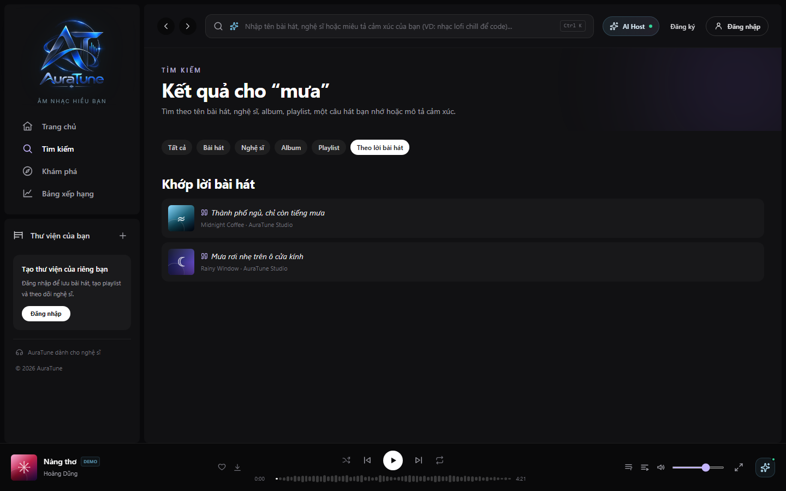
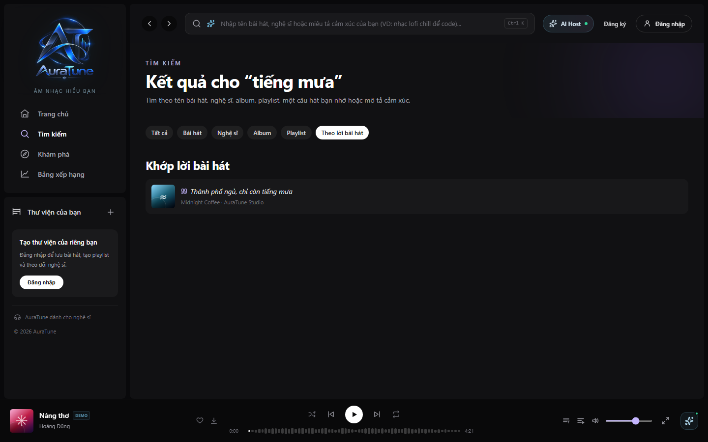
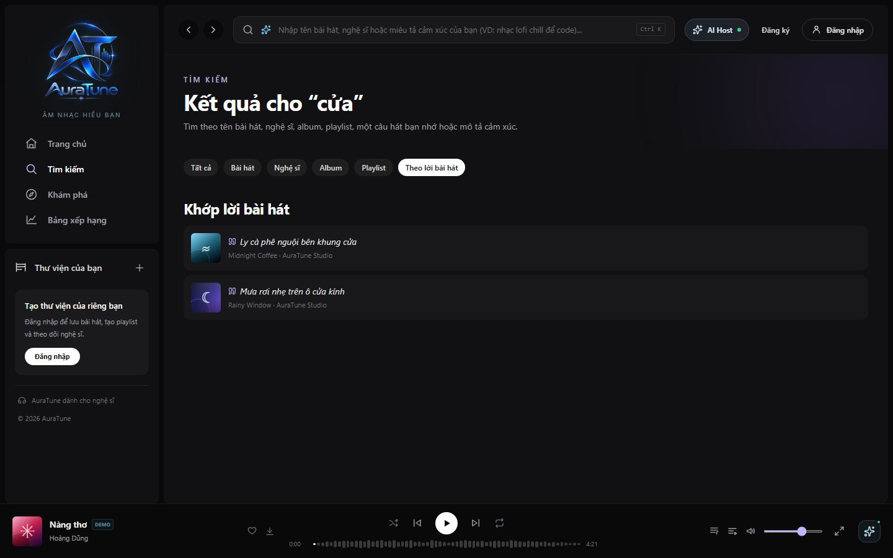
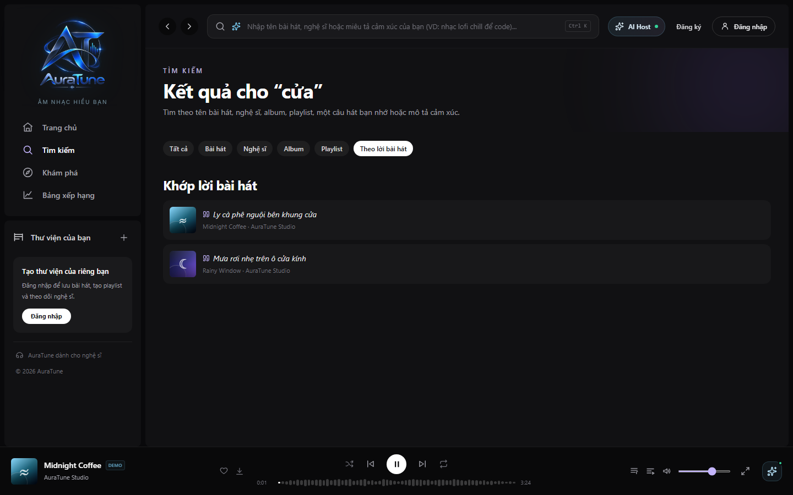
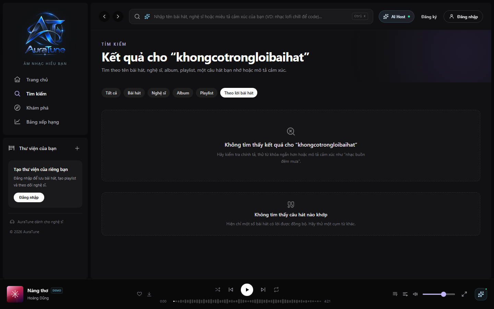
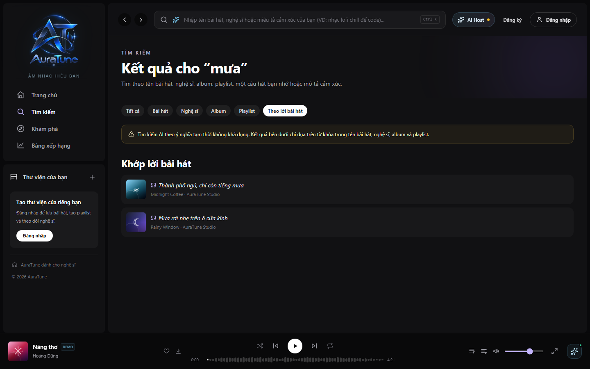

# UC-030-002 – AI Lyrics Search

---

## 1. Metadata

| Field | Value |
|---|---|
| **Use Case ID** | UC-030-002 |
| **Use Case Name** | AI Lyrics Search |
| **Functional Group** | 030 – Search |
| **Primary Actor** | Public User / Guest (`ACT-01`), Listener (`ACT-02`) |
| **Supporting Actors** | External AI Service Provider (`ACT-EXT-04`) |
| **Related FR IDs** | `032-FR-001` through `032-FR-019` |
| **Related Feature/Spec** | Feature 032: AI Lyrics Search (`specs/032-ai-lyrics-search/spec.md`) |
| **Status** | Draft |
| **Writer** | Nguyễn Khánh Đăng |
| **Reviewer** | TBD |

---

## 2. Description

A user searches for a specific song by entering an incomplete or vaguely remembered lyric fragment. The system submits this fragment to an External AI Service (`POST /ai/search/lyrics`) for semantic analysis to find matching songs within the lyric catalog. To ensure resilience, if the AI service times out (after 3 seconds) or returns an HTTP 503 error, the system automatically falls back to a normalized keyword-based lyric search, presenting the results alongside a dismissible banner informing the user of the degraded experience.

---

## 3. Preconditions

- The user has accessed the AuraTune application and navigated to the Search page (`/search`).
- The user has selected the dedicated "Theo lời bài hát" (By Lyrics) tab.
- The platform catalog contains indexed, synchronized lyric data (`032-FR-002`).

---

## 4. Trigger

The user enters a lyric fragment containing at least 3 words and no more than 200 characters (after whitespace normalization) and submits the search request (`032-FR-001`).

---

## 5. Basic Flow

1. **Actor:** Navigates to the Search view, selects the "Theo lời bài hát" tab, enters a remembered lyric fragment, and submits the search.
2. **System:** Trims whitespace and validates that the fragment contains $\ge 3$ words and $\le 200$ characters (`032-FR-014`).
3. **System:** Dispatches the query via `POST /ai/search/lyrics` to the External AI Service Provider (`ACT-EXT-04`) for semantic matching (`032-FR-002`).
4. **System:** The AI service processes the semantic intent, overcoming minor differences in spacing, capitalization, or punctuation (`032-FR-003`).
5. **System:** Retrieves an initial batch of up to 20 candidate songs that best match the meaning of the lyric fragment (`032-FR-013`).
6. **System:** Renders the matched results on the interface, displaying the highlighted matching lyric line alongside song metadata (title, artist, cover art) to ensure the user can identify it (`032-FR-004`).
7. **Actor:** Reviews the matches and selects a result.
8. **System:** Delegates playback initiation to the Music Player (`UC-040-001`), loading audio bytes directly.

---

## 6. Alternative Flows

### AF-01 – Lyric Fragment Boundary Violation
- **Starting step:** Step 2 of the Basic Flow.
- **Condition:** The user inputs an empty string, or a fragment with $< 3$ words or $> 200$ characters (`032-FR-014`).
1. **System:** Identifies the input boundary violation client-side.
2. **System:** Intercepts the query submission to prevent unnecessary API calls.
3. **System:** Displays clear, inline input feedback indicating the required word count or character limit.
- **Continuation:** Resumes at Step 1 of the Basic Flow.

### AF-02 – No Indexed Lyric Matches
- **Starting step:** Step 5 of the Basic Flow.
- **Condition:** Neither the AI search nor the keyword fallback yields any relevant songs (`032-FR-005`).
1. **System:** Identifies a successful query execution but an empty result array.
2. **System:** Replaces the result container with an explicit no-results state (e.g., "Không tìm thấy câu hát nào khớp"), preventing the user from guessing whether the search succeeded or failed (`032-FR-005`).
3. **Actor:** Refines the lyric fragment and submits a new search.
- **Continuation:** Resumes at Step 2 of the Basic Flow.

### AF-03 – Dynamic Result Pagination ("Load More")
- **Starting step:** Step 6 of the Basic Flow.
- **Condition:** More than 20 matching songs are available, and the user wishes to view more (`032-FR-013`).
1. **Actor:** Clicks the "Load More" pagination action.
2. **System:** Fetches the next batch of 20 results using the active query context.
3. **System:** Appends the newly fetched matches seamlessly to the current result list.
- **Continuation:** Resumes at Step 6 of the Basic Flow.

### AF-04 – Concurrent or Duplicate Query Submission
- **Starting step:** Step 2 of the Basic Flow.
- **Condition:** The user submits a new search while a previous AI or fallback search is still loading, or repeatedly submits the exact same query (`032-FR-018`, `032-FR-019`).
1. **System:** If the query is an exact duplicate currently in flight, blocks the duplicate submission (`032-FR-018`).
2. **System:** If the query is new, treats the newest search as authoritative, cancelling or explicitly ignoring any late-arriving responses from previous requests so that stale results are never shown (`032-FR-012`, `032-FR-019`).
- **Continuation:** Resumes at Step 3 of the Basic Flow.

---

## 7. Exception Flows

### EF-01 – AI Service Unavailable (Automatic Keyword Fallback)
- **Starting step:** Step 4 of the Basic Flow.
- **Condition:** The AI Service returns an `HTTP 503` overload error OR fails to complete the response within a strict 3-second timeout window (`032-FR-006`, `032-FR-008`).
1. **System:** Intercepts the `503` or timeout exception and identifies it as the defined unavailable-service condition.
2. **System:** Automatically falls back to executing a basic keyword search against normalized catalog lyric text without requiring manual user retry (`032-FR-007`).
3. **System:** Ranks the fallback results, prioritizing exact phrase matches over partial word matches, strictly excluding title-only or artist-only matches (`032-FR-017`).
4. **System:** Renders the fallback results and simultaneously displays a dismissible amber inline banner above them, notifying the user that AI search was unavailable and keyword search was used (`032-FR-009`, `032-FR-010`, `032-FR-011`).
5. **Actor:** Acknowledges or dismisses the banner and browses the fallback results.
- **Continuation:** Resumes at Step 6 of the Basic Flow.

### EF-02 – AI Service Rate Limited (HTTP 429)
- **Starting step:** Step 4 of the Basic Flow.
- **Condition:** The external service rejects the request due to excessive rate limits (`HTTP 429`) (`032-FR-018`).
1. **System:** Identifies the `HTTP 429` error.
2. **System:** Enforces the business rule that `429` does NOT trigger the automatic keyword fallback (`032-FR-018`).
3. **System:** Displays an appropriate, retryable rate-limit error message to the user.
- **Continuation:** The user can retry later. Use case ends in a handled failure state.

---

## 8. Postconditions

### Success
- The user views an accurate list of songs containing lyrics relevant to their remembered fragment.
- Selecting a result reliably delegates audio playback.
- If the AI was offline, the user is successfully served keyword-fallback results accompanied by full transparency via a warning banner.

### Failure
- The system presents a clear error or explicit empty state.
- No stale or fabricated data is ever presented as current.

---

## 9. Special Requirements

- **Performance & Resilience**: The strict 3-second timeout boundary is critical. If the AI service fails to respond in 3.00 seconds, the client MUST abort the wait and immediately trigger keyword fallback to preserve the UX (`032-FR-008`).
- **Data Integrity**: Fallback keyword search MUST only match against normalized lyric text arrays. A song title matching the query but lacking the word in its lyrics MUST NOT be returned in this specific tab (`032-FR-017`).

---

## 10. Prototype and Screenshots

### Basic Flow - Lyrics Search Tab Selection

**Covered steps:** Basic Flow step 1.
**Prototype type:** Implemented UI

### Basic Flow - Matching Lyric Results Presentation

**Covered steps:** Basic Flow step 6.
**Prototype type:** Implemented UI

### Basic Flow - Multiple Matching Lyrics Across Catalog

**Covered steps:** Basic Flow step 6.
**Prototype type:** Implemented UI

### Basic Flow - Hover state for Lyric Result

**Covered steps:** Basic Flow step 8.
**Prototype type:** Implemented UI

### AF-02 - Lyrics Search No Results State

**Covered steps:** AF-02 steps 1-2.
**Prototype type:** Implemented UI

### EF-01 - AI Search Unavailable Fallback Banner

**Covered steps:** EF-01 steps 1-4.
**Prototype type:** Implemented UI

---

## 11. Related Use Cases

- **Parallel Search Mode**: `UC-030-001` (Search by Metadata) – Primary keyword-based catalog search.
- **Delegated Playback**: `UC-040-001` (Control Audio Playback) – Triggered when a matching lyric song is clicked.

---

## 12. Source References

- `specs/032-ai-lyrics-search/spec.md` – Requirements FR-001 through FR-019, User Stories 1–3.
- `docs/proposal/Auratune_Vision_Document.md` – Section 3.4 (N-02) & Group G03.

---

## 13. Notes and Open Questions

- **Unified Timeout Rule**: Clarification session 2026-11-01 unified the AI Service timeout threshold to exactly 3 seconds across all AI features (overriding the initial 5s draft).