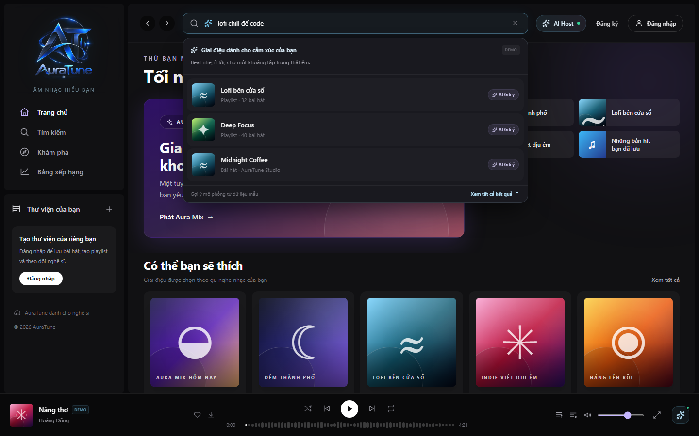
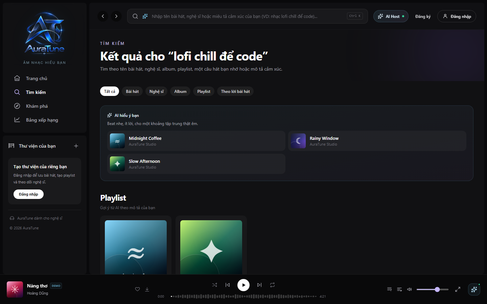
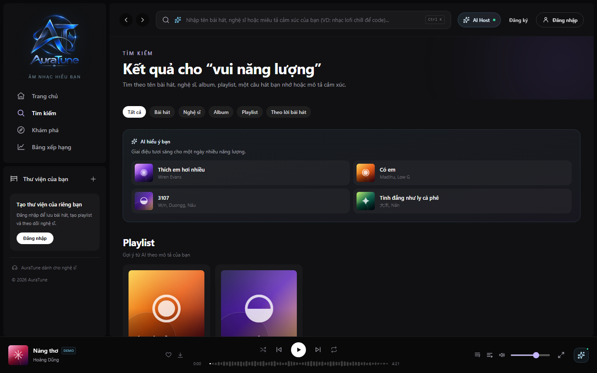
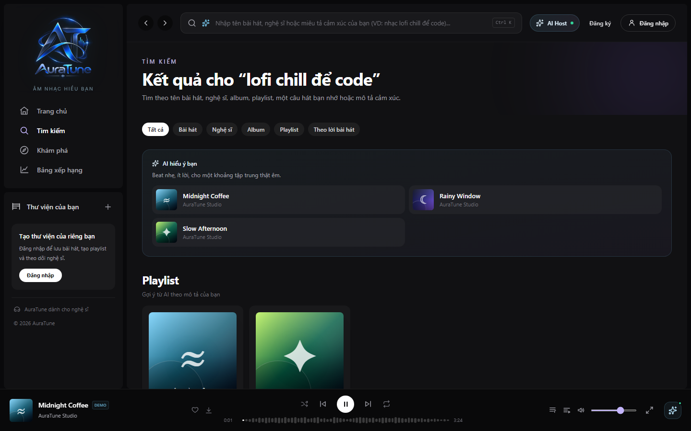
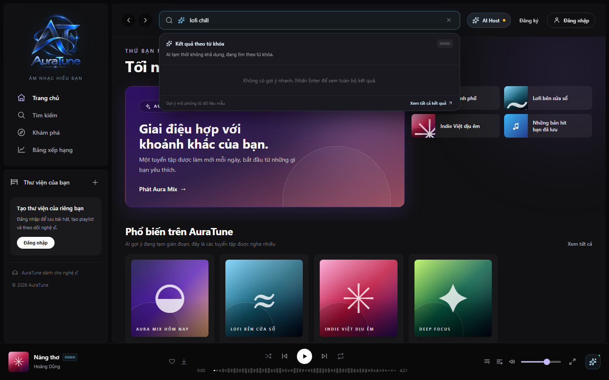

# UC-030-003 – Semantic Vector Music Search

## 1. Metadata

| Field | Value | 
| ----- | ----- | 
| **Use Case ID** | UC-030-003 | 
| **Use Case Name** | Semantic Vector Music Search | 
| **Functional Group** | 030 – Search | 
| **Primary Actor** | Listener (`ACT-02`) | 
| **Supporting Actors** | External AI Service Provider (`ACT-EXT-04`) | 
| **Related FR IDs** | `033-FR-001` through `033-FR-017` | 
| **Related Feature/Spec** | Feature 033: Semantic Vector Music Search (`specs/033-semantic-vector-search/spec.md`) | 
| **Status** | Draft | 
| **Writer** | Nguyễn Khánh Đăng | 
| **Reviewer** | TBD | 

## 2. Description

A listener describes a mood, emotion, or contextual situation in natural language. The system securely masks Personally Identifiable Information (PII), then leverages an External AI Service to process the query against a vector database containing song metadata, lyrics, and audio characteristics. The system returns a ranked list of relevant music based on a weighted ensemble score, or gracefully degrades to keyword search if the AI service becomes unavailable or times out.

## 3. Preconditions

* The user is an authenticated Listener (`ACT-02`).
* The music catalog has been processed, and vector embeddings for song metadata, lyrics, and audio characteristics (tempo, energy, valence, etc.) are available (`033-FR-003`, `033-FR-003a`).

## 4. Trigger

The listener submits a natural-language description containing at least one alphanumeric token up to 150 characters into the search bar (`033-FR-015`).

## 5. Basic Flow

1. **Actor:** Types a natural-language query (e.g., "sad music for a rainy night") into the global search input and submits.
2. **System:** Validates the input length and checks for non-whitespace alphanumeric tokens (`033-FR-015`).
3. **System:** Performs local privacy screening on the query. It strips identified emails, checks against the listener's profile name, and preserves known catalog artist names (`033-FR-011`, `033-FR-011a`).
4. **System:** Sends the sanitized query to the External AI Service Provider (`ACT-EXT-04`) to compute the query's vector embedding (`033-FR-010`, `033-FR-012`).
5. **System:** The AI service matches the query vector against music documents.
6. **System:** Calculates a unified semantic relevance score for matching tracks using a weighted ensemble: Metadata (30%), Lyrics (40%), and Audio Characteristics (30%) (`033-FR-004a`).
7. **System:** Returns a ranked result set descending by relevance score, excluding duplicates (`033-FR-006`).
8. **System:** Renders the matched results in a live dropdown or full results page, displaying an "AI hiểu ý bạn" card that briefly explains the contextual match (`033-FR-002`, `033-FR-005`).
9. **Actor:** Selects a suggested track or playlist.
10. **System:** Delegates playback to the Music Player (`UC-040-001`).

## 6. Alternative Flows

### AF-01 – Missing Content Dimensions for a Song

* **Starting step:** Step 6 of the Basic Flow.
* **Condition:** A candidate song is missing lyrics, metadata, or specific audio characteristics (`033-FR-013`).
1. **System:** Detects missing dimensions for the specific song.
2. **System:** Automatically re-normalizes the weighting across the *available* dimensions for that song (e.g., 50% Metadata, 50% Audio Characteristics if Lyrics are absent) without failing the search or throwing an error (`033-FR-004a`).
* **Continuation:** Resumes at Step 7 of the Basic Flow.

### AF-02 – PII Detection Overlap

* **Starting step:** Step 3 of the Basic Flow.
* **Condition:** The query contains a word that matches both the listener's real name AND a recognized catalog artist name, causing an ambiguity that cannot be safely resolved (`033-FR-011a`).
1. **System:** Flags the query as a potential privacy risk.
2. **System:** Aborts the semantic AI processing route.
3. **System:** Automatically executes a standard keyword search locally instead of sending the query to the third-party AI (`033-FR-011a`).
* **Continuation:** Skips to Exception Flow EF-01, Step 3.

### AF-03 – Invalid Input Length

* **Starting step:** Step 2 of the Basic Flow.
* **Condition:** The user inputs an empty string, whitespace only, or $> 150$ characters (`033-FR-015`).
1. **System:** Rejects the input client-side.
2. **System:** Displays a clear validation message ("Vui lòng nhập mô tả ý nghĩa" or limit exceeded warning) without initiating a network request.
* **Continuation:** Resumes at Step 1 of the Basic Flow.

## 7. Exception Flows

### EF-01 – AI Service Unavailable or Timeout (Graceful Degradation)

* **Starting step:** Step 4 of the Basic Flow.
* **Condition:** The AI semantic processing fails to yield a usable response within 1,500 milliseconds, reaches the absolute 3,000 milliseconds timeout, or returns a 5xx error (`033-FR-007`, `033-FR-016`).
1. **System:** Intercepts the timeout or error condition to prevent infinite loading.
2. **System:** Aborts the semantic search vector request.
3. **System:** Automatically falls back to a standard keyword search using the original user query text (`033-FR-007`).
4. **System:** Renders the keyword search results and displays a non-intrusive banner indicating that AI semantic search is temporarily unavailable and keyword results are being shown (`033-FR-008`).
5. **System:** Ensures no internal service credentials or diagnostic details are exposed to the user (`033-FR-008`).
* **Continuation:** The user interacts with the fallback results; use case completes in degraded mode.

## 8. Postconditions

### Success
* The listener discovers music relevant to their abstract natural-language intent.
* Personal identifying data (names, emails) is successfully kept out of third-party systems.

### Failure
* The system serves standard keyword results or an explicit empty state.
* Third-party AI dependencies do not cause the application to crash or freeze.

## 9. Special Requirements

* **Privacy & Security**: Enforce strict PII masking (Decree 13/2023/ND-CP). Emails and authenticated user names MUST NEVER be transmitted in the query payload to `ACT-EXT-04` (`033-FR-010`, `033-FR-012`).
* **Performance Threshold**: The system applies a rapid 1,500ms soft timeout for semantic processing to begin keyword fallback smoothly, with an absolute hard timeout at 3,000ms (`033-FR-016`).

## 10. Prototype and Screenshots

### Basic Flow - Semantic Search Entry

**Covered steps:** Basic Flow step 1.
**Prototype type:** Implemented UI

### Basic Flow - Live Natural-Language Dropdown Suggestions

**Covered steps:** Basic Flow step 8.
**Prototype type:** Implemented UI

### Basic Flow - Full Semantic Search Results

**Covered steps:** Basic Flow step 8.
**Prototype type:** Implemented UI

### Basic Flow - Semantic Context Matching (Mood/Energy)

**Covered steps:** Basic Flow steps 5-8.
**Prototype type:** Implemented UI

### Basic Flow - Semantic Result Playback Interaction

**Covered steps:** Basic Flow step 10.
**Prototype type:** Implemented UI

### Exception Flow - Graceful Degradation (EF-01)

**Covered steps:** EF-01 steps 1-5.
**Prototype type:** Implemented UI

## 11. Related Use Cases

* **Delegated Playback**: `UC-040-001` (Control Audio Playback) – Triggered when a semantic result is clicked.
* **Fallback Search Route**: `UC-030-001` (Search by Metadata) – Underlying mechanism for graceful degradation.

## 12. Source References

* `specs/033-semantic-vector-search/spec.md` – Requirements FR-001 through FR-017, User Stories 1–4.