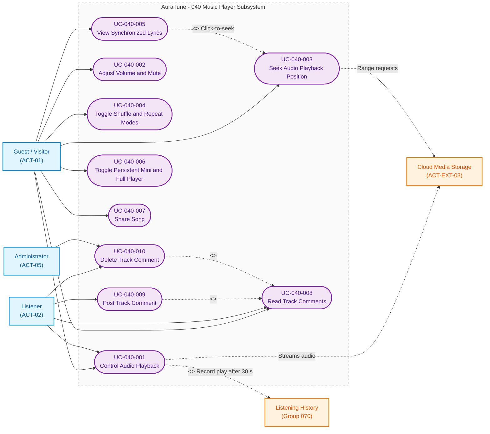

# Functional Group 040: Music Player – Use-Case Documentation

---

## 5.1. Group Information

| Attribute | Details |
|---|---|
| **Group ID** | 040 |
| **Group Name** | Music Player |
| **Group Owner** | Nguyễn Thanh Huy |
| **Module Purpose** | Provides uninterrupted audio playback across all pages, with playback, seeking, volume, shuffle and repeat controls, synchronized lyrics, song sharing, and track comments. |
| **Documentation Status** | Draft — Baseline for Sprint 3 (PA3) Review |
| **Applicable Standards** | AuraTune Use-Case Documentation Guide, Spec Kit Architecture, PA3 Use-Case Specification Standard |

---

## 5.2. Scope

### 5.2.1 Purpose and Objectives
Functional Group 040 lets guests and listeners listen continuously while they browse AuraTune. A persistent mini player stays on every page, the full player shows lyrics and comments, and each completed play of at least 30 seconds is reported to the listener's history.

### 5.2.2 In-Scope Capabilities
The verified capabilities within Group 040 comprise six subfeatures:

1. **Playback Controls (Feature 041)**:
   - Play, pause, next, previous with the 3-second restart rule, and automatic advance.
   - Stream failure, unavailable track, and autoplay handling.
   - Play event sent to Group 070 after 30 seconds of continuous playback, or 50% of a shorter track.
   - Like and add-to-playlist quick actions in the full player.

2. **Playback Progress and Volume (Feature 042)**:
   - Elapsed time and duration, seeking with buffering state, volume from 0 to 100, and mute that remembers the level.

3. **Shuffle and Repeat (Feature 043)**:
   - Shuffle without changing the displayed order, and repeat off, all, and one, with repeat one taking priority.

4. **Synchronized Lyrics (Feature 044)**:
   - Current line emphasis, plain lyrics, no-lyrics notice, and click-to-seek on timed lines.

5. **Persistent Bottom Player (Feature 045)**:
   - Mini player on every route, full player on demand, and player state restored in a paused state after a reload.

6. **Song Sharing and Comments (Feature 046)**:
   - Share through the device share sheet or a copied link.
   - Public comments, posting for signed-in users (300 characters), and deletion by the author or an administrator.

### 5.2.3 Out-of-Scope Exclusions
- **Queue Editing**: Owned by **Group 050 – Queue Management**.
- **Recording and Analyzing Listening History**: Owned by **Group 070 – Listening History** and **Group 100 – AI Recommendations**.
- **Lyric-Based Search**: Owned by **Group 030 – Search**.
- **Platform-Wide Comment Moderation Tools**: Owned by **Group 110 – Admin Functions**.

### 5.2.4 Dependencies
- **Cloud Media Storage (`ACT-EXT-03`)**: Delivers audio with range requests for streaming and seeking.
- **Group 010 (Authentication)**: Identifies listeners and administrators for comments, likes, and history.
- **Group 050 (Queue Management)**: Supplies the next and previous tracks.
- **Group 060 (Playlist Management)**: Receives add-to-playlist and like actions.
- **Group 070 (Listening History)**: Receives play events.

---

## 5.3. Related Requirements and Features

| Feature ID | Feature Name | Related FR IDs | Spec Path |
|---|---|---|---|
| **041** | Playback Controls | `041-FR-001` to `041-FR-015` | [`specs/040-music-player/041-playback-controls/spec.md`](../../../../specs/040-music-player/041-playback-controls/spec.md) |
| **042** | Playback Progress and Volume | `042-FR-001` to `042-FR-012` | [`specs/040-music-player/042-playback-progress-and-volume/spec.md`](../../../../specs/040-music-player/042-playback-progress-and-volume/spec.md) |
| **043** | Shuffle and Repeat | `043-FR-001` to `043-FR-012` | [`specs/040-music-player/043-shuffle-and-repeat/spec.md`](../../../../specs/040-music-player/043-shuffle-and-repeat/spec.md) |
| **044** | Synchronized Lyrics | `044-FR-001` to `044-FR-012` | [`specs/040-music-player/044-synchronized-lyrics/spec.md`](../../../../specs/040-music-player/044-synchronized-lyrics/spec.md) |
| **045** | Persistent Bottom Player | `045-FR-001` to `045-FR-012` | [`specs/040-music-player/045-persistent-bottom-player/spec.md`](../../../../specs/040-music-player/045-persistent-bottom-player/spec.md) |
| **046** | Song Sharing and Comments | `046-FR-001` to `046-FR-015` | [`specs/040-music-player/046-song-sharing-and-comments/spec.md`](../../../../specs/040-music-player/046-song-sharing-and-comments/spec.md) |

---

## 5.4. Actors

| Actor | Actor Type | Description | Related Use Cases |
|---|---|---|---|
| **Guest / Visitor** (`ACT-01`) | Primary Human Actor | Unauthenticated visitor who streams public music, uses all player controls, shares tracks, and reads comments. | `UC-040-001` to `UC-040-008` |
| **Listener** (`ACT-02`) | Primary Human Actor | Authenticated user who can also post and delete their own comments and whose plays are recorded. | `UC-040-001` to `UC-040-010` |
| **Administrator** (`ACT-05`) | Administrative Human Actor | Platform operator who can delete any comment. | `UC-040-010` |
| **Cloud Media Storage** (`ACT-EXT-03`) | External System (Supporting Actor) | CDN that streams audio bytes and serves range requests for seeking. | `UC-040-001`, `UC-040-003` |

---

## 5.5. Use-Case Diagram

The following Mermaid diagram visualizes the boundary, actors, confirmed use cases, and relationships for **Group 040 – Music Player**.

> **Note**: This diagram uses Mermaid `flowchart LR` syntax to represent conceptual UML Use-Case structures within standard Markdown viewers. Rounded nodes denote Use Cases, square nodes represent Actors and related subsystems, and dashed lines represent relationships across boundaries.



### Diagram Legend
- **Rounded nodes (`([ ... ])`)**: Confirmed Use Cases.
- **Solid Arrow (`-->`)**: Direct primary actor invocation. The Listener inherits every Guest association; only the extra associations are drawn.
- **Dashed Arrow (`-.->`)**: External system dependency, `<<include>>`, or `<<extend>>` relationship.
- **Subsystem Boundary (`subgraph`)**: Scope boundary of Group 040.

---

## 5.6. Use-Case List

| UC ID | Use-Case Name | Primary Actor | Related FRs | Specification File |
|---|---|---|---|---|
| **UC-040-001** | Control Audio Playback | Guest / Listener | `041-FR-001` to `041-FR-015` | [`UC-040-001-control-audio-playback.md`](./UC-040-001-control-audio-playback.md) |
| **UC-040-002** | Adjust Volume and Mute | Guest / Listener | `042-FR-006` to `042-FR-011` | [`UC-040-002-adjust-volume-and-mute.md`](./UC-040-002-adjust-volume-and-mute.md) |
| **UC-040-003** | Seek Audio Playback Position | Guest / Listener | `042-FR-001` to `042-FR-005`, `042-FR-011`, `042-FR-012` | [`UC-040-003-seek-audio-playback-position.md`](./UC-040-003-seek-audio-playback-position.md) |
| **UC-040-004** | Toggle Shuffle and Repeat Modes | Guest / Listener | `043-FR-001` to `043-FR-012` | [`UC-040-004-toggle-shuffle-and-repeat-modes.md`](./UC-040-004-toggle-shuffle-and-repeat-modes.md) |
| **UC-040-005** | View Synchronized Lyrics | Guest / Listener | `044-FR-001` to `044-FR-012` | [`UC-040-005-view-synchronized-lyrics.md`](./UC-040-005-view-synchronized-lyrics.md) |
| **UC-040-006** | Toggle Persistent Mini and Full Player | Guest / Listener | `045-FR-001` to `045-FR-012` | [`UC-040-006-toggle-persistent-mini-and-full-player.md`](./UC-040-006-toggle-persistent-mini-and-full-player.md) |
| **UC-040-007** | Share Song | Guest / Listener | `046-FR-001` to `046-FR-005` | [`UC-040-007-share-song.md`](./UC-040-007-share-song.md) |
| **UC-040-008** | Read Track Comments | Guest / Listener | `046-FR-006`, `046-FR-007`, `046-FR-014`, `046-FR-015` | [`UC-040-008-read-track-comments.md`](./UC-040-008-read-track-comments.md) |
| **UC-040-009** | Post Track Comment | Listener | `046-FR-008`, `046-FR-009`, `046-FR-012`, `046-FR-013`, `046-FR-015` | [`UC-040-009-post-track-comment.md`](./UC-040-009-post-track-comment.md) |
| **UC-040-010** | Delete Track Comment | Listener / Administrator | `046-FR-010` to `046-FR-012` | [`UC-040-010-delete-track-comment.md`](./UC-040-010-delete-track-comment.md) |

---

## 5.7. Dependencies and Integration

```
+---------------------+        +-------------------------+        +----------------------+
| Group 050:          | queue  |   Group 040:            | stream | Cloud Media Storage  |
| Queue Management    | -----> |   Music Player          | <----> | (audio, range        |
+---------------------+        |   (mini + full player)  |        |  requests)           |
                               +-----------+-------------+        +----------------------+
                                           |
              +----------------------------+----------------------------+
              |                            |                            |
              v                            v                            v
+---------------------+      +------------------------+      +----------------------+
| Group 070:          |      | Group 060:             |      | Group 110:           |
| Listening History   |      | Playlists / Liked Songs|      | Admin moderation     |
| (play after 30 s)   |      | (quick actions)        |      | (comment removal)    |
+---------------------+      +------------------------+      +----------------------+
```

1. **Playback Source**: The player plays tracks in the order supplied by Group 050 and streams audio from Cloud Media Storage.
2. **History Reporting**: After 30 seconds of continuous playback, or 50% of a shorter track, the player reports a play to Group 070 for signed-in listeners.
3. **Library Actions**: Like and add-to-playlist in the full player are handled by Group 060.
4. **Moderation**: Administrators delete comments in `UC-040-010`; wider moderation belongs to Group 110.

---

## 5.8. Open Issues and Architecture Clarifications

1. **Range Request Support (`Q-040-1`)**:
   - *Status*: Open.
   - *Detail*: Precise seeking requires that the chosen cloud storage free tier supports HTTP range requests.
2. **Seek and the Play Threshold**:
   - *Status*: Working interpretation.
   - *Detail*: `UC-040-003` counts only continuous listening time towards the 30-second threshold, so jumping forward does not count. Confirm with Group 070.
3. **Simulated Playback**:
   - *Status*: Prototype limitation.
   - *Detail*: The current frontend simulates audio with a timer, so stream errors, buffering, autoplay blocking, and player restore after reload cannot be shown yet.

---

## 5.9. References

- `docs/proposal/proposal.md` – Section 6.4: Core Music Player
- `docs/proposal/Auratune_Vision_Document.md` – Feature Group G04, Need N-04 and N-05, Sections 6.1 and 6.4
- `docs/management/team-contract.md` – Feature Ownership & Responsibilities
- `docs/requirements/use-case-model.md` – System-Level Use-Case Model
- `docs/requirements/use-cases/README.md` – Use-Case Documentation Standards
- `specs/040-music-player/041-playback-controls/spec.md`
- `specs/040-music-player/042-playback-progress-and-volume/spec.md`
- `specs/040-music-player/043-shuffle-and-repeat/spec.md`
- `specs/040-music-player/044-synchronized-lyrics/spec.md`
- `specs/040-music-player/045-persistent-bottom-player/spec.md`
- `specs/040-music-player/046-song-sharing-and-comments/spec.md`
- `docs/requirements/use-cases/040-music-player/use-case-inventory.md`
- `docs/requirements/use-cases/040-music-player/prototypes/README.md`
