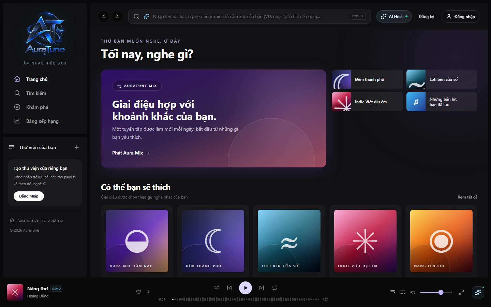
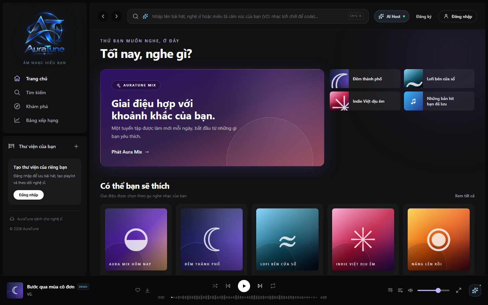
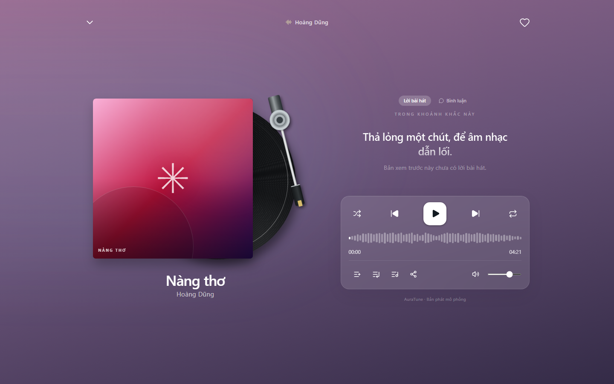

# UC-040-001 – Control Audio Playback

---

## 1. Metadata

| Field | Value |
|---|---|
| **Use Case ID** | UC-040-001 |
| **Use Case Name** | Control Audio Playback |
| **Functional Group** | 040 – Music Player |
| **Primary Actor** | Guest / Visitor (`ACT-01`), Listener (`ACT-02`) |
| **Supporting Actors** | Cloud Media Storage (CDN) (`ACT-EXT-03`) |
| **Related FR IDs** | `041-FR-001`, `041-FR-002`, `041-FR-003`, `041-FR-004`, `041-FR-005`, `041-FR-006`, `041-FR-007`, `041-FR-008`, `041-FR-009`, `041-FR-010`, `041-FR-011`, `041-FR-012`, `041-FR-013`, `041-FR-014`, `041-FR-015` |
| **Related Feature/Spec** | Feature 041: Playback Controls (`specs/040-music-player/041-playback-controls/spec.md`) |
| **Status** | Draft |
| **Writer** | Nguyễn Thanh Huy |
| **Reviewer** | TBD |

---

## 2. Description

A guest or listener plays, pauses, and moves between tracks in the queue using the same controls in the mini player and the full player. Audio is streamed from Cloud Media Storage, the next track starts automatically when one ends, and a play is recorded in the listener's history after 30 seconds of continuous playback (or 50% of a shorter track).

---

## 3. Preconditions

- A playable track is loaded in the player, for example after the actor started a track or collection (`041-FR-012`).
- The audio file is reachable through Cloud Media Storage (`ACT-EXT-03`).

---

## 4. Trigger

The actor selects the play control, or starts a track or collection from any list.

---

## 5. Basic Flow

1. **Actor:** Selects the play control.
2. **System:** Verifies that the track is available (`041-FR-008`).
3. **System:** Streams the audio from Cloud Media Storage and starts playback; the control changes to pause (`041-FR-001`).
4. **System:** Shows the current track's cover art, title, artist, and duration in both the mini player and the full player, with identical control state (`041-FR-010`, `041-FR-011`).
5. **System:** After 30 seconds of continuous playback, or 50% of the duration for a shorter track, sends a play event to Group 070 for a signed-in listener (`041-FR-014`).
6. **Actor:** Selects the pause control.
7. **System:** Pauses playback at the current position (`041-FR-001`).
8. **Actor:** Selects the play control again.
9. **System:** Resumes playback from the paused position (`041-FR-002`).
10. **System:** When the track ends, starts the next track in the queue automatically (`041-FR-006`).

---

## 6. Alternative Flows

### AF-01 – Skip to the Next Track
- **Starting step:** Step 4 of the Basic Flow.
- **Condition:** The actor selects the next control (`041-FR-003`).
1. **System:** Starts the next track in the queue from the beginning.
- **Continuation:** Resumes at Step 4 of the Basic Flow.

### AF-02 – Previous Track or Restart
- **Starting step:** Step 4 of the Basic Flow.
- **Condition:** The actor selects the previous control.
1. **System:** If more than 3 seconds have played, restarts the current track (`041-FR-004`).
2. **System:** If 3 seconds or less have played, starts the previous track in the queue (`041-FR-005`).
- **Continuation:** Resumes at Step 4 of the Basic Flow.

### AF-03 – End of the Queue With Repeat Off
- **Starting step:** Step 10 of the Basic Flow.
- **Condition:** The last track ends and repeat is off (`041-FR-007`).
1. **System:** Stops playback at the end of the track.
2. **Actor:** Can press play to start the track again.
- **Continuation:** Use case ends successfully.

### AF-04 – Quick Library Actions From the Full Player
- **Starting step:** Step 4 of the Basic Flow.
- **Condition:** The actor uses the like or add-to-playlist control in the full player (`041-FR-015`).
1. **System:** For a signed-in listener, toggles the track in Liked Songs or opens the add-to-playlist dialog.
2. **System:** For a guest, asks the actor to sign in.
- **Continuation:** Resumes at Step 4 of the Basic Flow.

### AF-05 – Short Listening Without a Recorded Play
- **Starting step:** Step 5 of the Basic Flow.
- **Condition:** The actor skips or changes the track before it has been listened to for 30 seconds, or 50% of the duration for a shorter track (`041-FR-014`).
1. **System:** Does not send a play event for this track.
- **Continuation:** Continues via AF-01 or AF-02, or at the start of the newly selected track.

### AF-06 – Pause Before the Play Threshold
- **Starting step:** Step 5 of the Basic Flow.
- **Condition:** The actor pauses before the threshold of 30 seconds, or 50% of a shorter track, is reached (`041-FR-014`).
1. **System:** Pauses playback and keeps the listening time already counted for the track.
2. **Actor:** Selects play again.
3. **System:** Resumes playback and continues counting from the kept listening time; seeking forward adds no listening time (`UC-040-003`).
- **Continuation:** Resumes at Step 5 of the Basic Flow, where the play event is sent once the threshold is reached.

---

## 7. Exception Flows

### EF-01 – Track Unavailable
- **Starting step:** Step 2 of the Basic Flow.
- **Condition:** The track is hidden or removed (`041-FR-008`).
1. **System:** Refuses to start the track and shows a message.
- **Continuation:** Use case ends in failure; current playback is unchanged.

### EF-02 – Stream Failure
- **Starting step:** Step 3 of the Basic Flow.
- **Condition:** The audio cannot be loaded from Cloud Media Storage (`041-FR-009`).
1. **System:** Stops playback and shows a message with retry and skip options.
2. **Actor:** Selects retry or skips to another track.
- **Continuation:** Resumes at Step 3 on retry, or continues via AF-01 on skip.

### EF-03 – Browser Blocks Autoplay
- **Starting step:** Step 10 of the Basic Flow.
- **Condition:** The browser does not allow audio to start without a user action (Vision Document, AD-02).
1. **System:** Keeps the player paused on the next track and waits for the actor.
2. **Actor:** Selects play.
- **Continuation:** Resumes at Step 3 of the Basic Flow.

### EF-04 – Temporary Network Drop
- **Starting step:** Step 4 of the Basic Flow.
- **Condition:** The connection drops during playback.
1. **System:** Continues from buffered audio when possible and shows a buffering state when the buffer runs out.
- **Continuation:** Resumes at Step 4 when the connection returns, or continues via EF-02.

---

## 8. Postconditions

### Success
- The selected track is playing or paused at the expected position, and both player views show the same state.
- For a signed-in listener, a play event is recorded once the 30-second or 50% threshold is reached.

### Failure
- Playback is stopped with a clear message, and no play event is recorded for a track that did not reach the threshold.

---

## 9. Special Requirements

- **Performance**: Audio starts within 500 ms of pressing play for a buffered track (Vision Document, Section 6.1).
- **Reliability**: The player should pre-buffer at least 30 seconds of audio to survive temporary network drops (Vision Document, Section 6.4).
- **Concurrency**: Rapid repeated presses never play two tracks at once; the last selected track wins.
- **Scope Boundary**: Shuffle, repeat, and queue editing rules are defined in other use cases (`041-FR-013`).

---

## 10. Prototype and Screenshots

> **Asset type**: Implementation screenshots captured from the current frontend prototype, which simulates playback with demo data.

### Basic Flow

*Figure 1: Mini player with a track loaded and paused (Step 1).*

*Figure 2: Playback started; the control shows pause (Steps 3–4).*

*Figure 3: Playback paused at the current position (Step 7).*

### Alternative Flow – AF-01 (Next Track)

*Figure 4: The next track loaded after selecting next.*

### Alternative Flow – AF-02 (Previous Track)

*Figure 5: The previous track loaded after selecting previous.*

### Alternative Flow – AF-04 (Full Player Controls)

*Figure 6: Full player with playback controls and quick library actions.*

### Exception Flows – EF-01 to EF-04
*[Prototype Pending - To be generated during UI implementation]*  
*Planned Interface: Unavailable track message, stream error with retry and skip, paused state after a blocked autoplay, and a buffering indicator. The prototype simulates audio, so these states cannot occur yet.*

---

## 11. Related Use Cases

- **Includes**: `UC-070-001` (Record Track Play Event) – Triggered at Step 5.
- **Interacts with**: `UC-050-001` (View Playback Queue) – Supplies the next and previous tracks.
- **Related Player Use Cases**: `UC-040-003` (Seek Audio Playback Position), `UC-040-004` (Toggle Shuffle and Repeat Modes), `UC-040-006` (Toggle Persistent Mini and Full Player).
- **Extended by**: `UC-120-003` (Execute Music Actions via Conversational Agent).

---

## 12. Source References

- `specs/040-music-player/041-playback-controls/spec.md` – Requirements FR-001 to FR-015, User Stories 1–3, Clarifications 2026-10-31 and 2026-11-01.
- `docs/proposal/Auratune_Vision_Document.md` – Group G04, Assumption AD-02, Sections 6.1 and 6.4.
- `docs/proposal/proposal.md` – Section 6.4: Core Music Player.
- `docs/analysis-and-design/api-contract.md` – Section 1.5 and Section 2.4: `GET /songs/:id/stream`; Section 2.5: `POST /users/me/history`.

---

## 13. Notes and Open Questions

- **History Threshold**: Clarification session 2026-11-01 set the valid-play rule to 30 seconds of continuous playback, or 50% of the duration for shorter tracks.
- **Pause Interpretation**: The specification does not say whether a pause resets the count. AF-06 keeps the listening time across a pause, and AF-05 drops it only when the track is skipped or changed. This is a working interpretation to confirm with Group 070.
- **Prototype Gap**: The current prototype simulates playback with a timer and records a play as soon as a track starts (see Known Gaps in the 041 specification).
