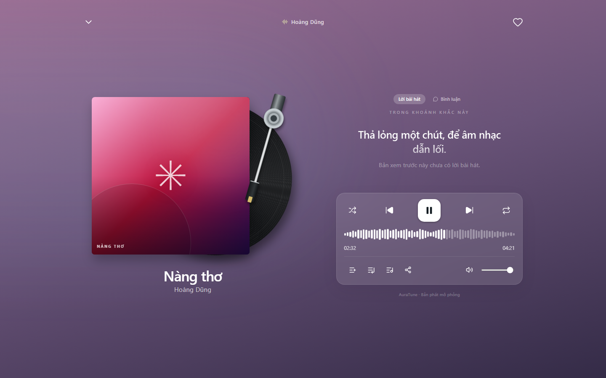
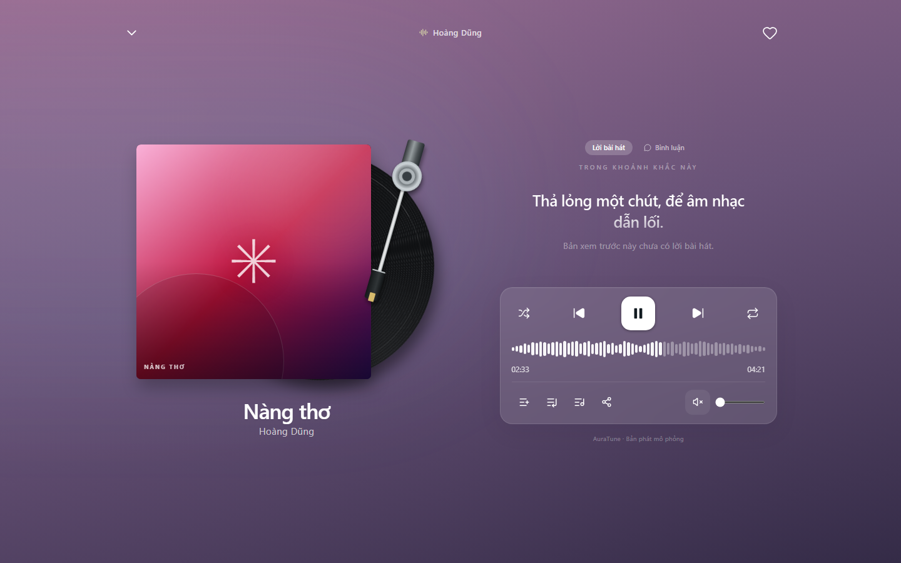

# UC-040-002 – Adjust Volume and Mute
Performed by: Nguyễn Thanh Huy | Reviewed by: Group 10 team | Edited by: Lê Công Minh Nhựt

---

## 1. Metadata
Performed by: Nguyễn Thanh Huy | Reviewed by: Group 10 team | Edited by: Lê Công Minh Nhựt

| Field | Value |
|---|---|
| **Use Case ID** | UC-040-002 |
| **Use Case Name** | Adjust Volume and Mute |
| **Functional Group** | 040 – Music Player |
| **Primary Actor** | Guest / Visitor (`ACT-01`), Listener (`ACT-02`) |
| **Supporting Actors** | None |
| **Related FR IDs** | `042-FR-006`, `042-FR-007`, `042-FR-008`, `042-FR-009`, `042-FR-010`, `042-FR-011` |
| **Related Feature/Spec** | Feature 042: Playback Progress and Volume (`specs/040-music-player/042-playback-progress-and-volume/spec.md`) |
| **Status** | Draft |
| Writer | Lê Công Minh Nhựt |
| Original Writer (PA3 draft) | Nguyễn Thanh Huy |
| Reviewer | Group 10 team |

---

## 2. Description
Performed by: Nguyễn Thanh Huy | Reviewed by: Group 10 team | Edited by: Lê Công Minh Nhựt

A guest or listener changes the playback volume or mutes the audio from the mini player or the full player so that it suits their environment. Mute remembers the previous level, and the volume stays the same when the track changes.

---

## 3. Preconditions
Performed by: Nguyễn Thanh Huy | Reviewed by: Group 10 team | Edited by: Lê Công Minh Nhựt

- A track is loaded in the player (`UC-040-001`).

---

## 4. Trigger
Performed by: Nguyễn Thanh Huy | Reviewed by: Group 10 team | Edited by: Lê Công Minh Nhựt

The actor moves the volume control or selects the mute control.

---

## 5. Basic Flow
Performed by: Nguyễn Thanh Huy | Reviewed by: Group 10 team | Edited by: Lê Công Minh Nhựt

1. **Actor:** Moves the volume control to a new level.
2. **System:** Sets the volume to the selected level between 0 and 100 and updates the control (`042-FR-006`).
3. **System:** Keeps the same level when the track changes (`042-FR-010`).
4. **Actor:** Continues listening at the new level.

---

## 6. Alternative Flows
Performed by: Nguyễn Thanh Huy | Reviewed by: Group 10 team | Edited by: Lê Công Minh Nhựt

### AF-01 – Mute and Unmute
Performed by: Nguyễn Thanh Huy | Reviewed by: Group 10 team | Edited by: Lê Công Minh Nhựt
- **Starting step:** Step 1 of the Basic Flow.
- **Condition:** The actor selects the mute control (`042-FR-007`).
1. **System:** Silences the audio, remembers the current level, and shows the muted state.
2. **Actor:** Selects the mute control again.
3. **System:** Restores the previous volume level (`042-FR-008`).
- **Continuation:** Resumes at Step 4 of the Basic Flow.

### AF-02 – Move Volume While Muted
Performed by: Nguyễn Thanh Huy | Reviewed by: Group 10 team | Edited by: Lê Công Minh Nhựt
- **Starting step:** Step 1 of AF-01.
- **Condition:** The actor moves the volume control while muted (`042-FR-009`).
1. **System:** Turns mute off and applies the selected level.
- **Continuation:** Resumes at Step 3 of the Basic Flow.

### AF-03 – Volume Set to 0
Performed by: Nguyễn Thanh Huy | Reviewed by: Group 10 team | Edited by: Lê Công Minh Nhựt
- **Starting step:** Step 2 of the Basic Flow.
- **Condition:** The actor moves the volume to 0.
1. **System:** Shows the muted appearance on the control.
- **Continuation:** Resumes at Step 4 of the Basic Flow.

### AF-04 – Keyboard or Touch Control
Performed by: Nguyễn Thanh Huy | Reviewed by: Group 10 team | Edited by: Lê Công Minh Nhựt
- **Starting step:** Step 1 of the Basic Flow.
- **Condition:** The actor uses the keyboard or a touch screen (`042-FR-011`).
1. **Actor:** Changes the level with arrow keys or by dragging on the touch screen.
- **Continuation:** Resumes at Step 2 of the Basic Flow.

---

## 7. Exception Flows
Performed by: Nguyễn Thanh Huy | Reviewed by: Group 10 team | Edited by: Lê Công Minh Nhựt

### EF-01 – Volume Control Hidden on Small Screens
Performed by: Nguyễn Thanh Huy | Reviewed by: Group 10 team | Edited by: Lê Công Minh Nhựt
- **Starting step:** Step 1 of the Basic Flow.
- **Condition:** The compact mini player on a phone does not show the volume control.
1. **Actor:** Opens the full player through `UC-040-006`, or uses the device volume.
- **Continuation:** Resumes at Step 1 of the Basic Flow in the full player.

---

## 8. Postconditions
Performed by: Nguyễn Thanh Huy | Reviewed by: Group 10 team | Edited by: Lê Công Minh Nhựt

### Success
Performed by: Nguyễn Thanh Huy | Reviewed by: Group 10 team | Edited by: Lê Công Minh Nhựt
- Audio plays at the selected level, or is muted with the previous level remembered.
- The level is kept for later tracks in the same session.

### Failure
Performed by: Nguyễn Thanh Huy | Reviewed by: Group 10 team | Edited by: Lê Công Minh Nhựt
- The level is unchanged.

---

## 9. Special Requirements
Performed by: Nguyễn Thanh Huy | Reviewed by: Group 10 team | Edited by: Lê Công Minh Nhựt

- **Accessibility**: The volume and mute controls are operable by mouse, keyboard, and touch, and have accessible names (`042-FR-011`).
- **Session Scope**: The volume applies to the current session and is not required to survive a page reload (042 Clarifications).

---

## 10. Prototype and Screenshots
Performed by: Nguyễn Thanh Huy | Reviewed by: Group 10 team | Edited by: Lê Công Minh Nhựt

> **Asset type**: Implementation screenshots captured from the current frontend prototype, which simulates playback with demo data.

### Basic Flow
Performed by: Nguyễn Thanh Huy | Reviewed by: Group 10 team | Edited by: Lê Công Minh Nhựt

*Figure 1: Volume control in the full player set to a high level (Steps 1–2).*

### Alternative Flow – AF-01 (Mute)
Performed by: Nguyễn Thanh Huy | Reviewed by: Group 10 team | Edited by: Lê Công Minh Nhựt

*Figure 2: Muted state with the crossed speaker icon and the slider at zero.*

---

## 11. Related Use Cases
Performed by: Nguyễn Thanh Huy | Reviewed by: Group 10 team | Edited by: Lê Công Minh Nhựt

- **Preceding Use Case**: `UC-040-001` (Control Audio Playback).
- **Related Use Case**: `UC-040-006` (Toggle Persistent Mini and Full Player) – Gives access to the volume control on small screens.

---

## 12. Source References
Performed by: Nguyễn Thanh Huy | Reviewed by: Group 10 team | Edited by: Lê Công Minh Nhựt

- `specs/040-music-player/042-playback-progress-and-volume/spec.md` – Requirements FR-006 to FR-011, User Story 2, Edge Cases.
- `docs/proposal/proposal.md` – Section 6.4: Core Music Player.
- `docs/proposal/Auratune_Vision_Document.md` – Group G04 and Section 6.3.

---

## 13. Notes and Open Questions
Performed by: Nguyễn Thanh Huy | Reviewed by: Group 10 team | Edited by: Lê Công Minh Nhựt

- **Prototype Gap**: Volume changes have no audible effect in the current prototype because playback is simulated.

## PA4 implementation evidence and acceptance record
Performed by: Nguyễn Thanh Huy | Reviewed by: Group 10 team | Edited by: Lê Công Minh Nhựt

Player components and `useAudioPlayer.js` exist, with backend metadata/stream handling in `songController.js`. Comments remain browser-state operations in `AppStore.jsx`; backend lyrics and history-write integration remain open in Group 040 tasks. Stream/range tests are not proof of server-side comment persistence or every lyrics state.

The flows above state required behavior. This revision records source inspection only; no browser acceptance or new feature-test run is claimed. Before acceptance, execute the basic flow and its applicable alternative/exception flows, checking the documented success and failure postconditions. Record results against this UC ID in [the PA4 review register](../../use-case-model.md#11-pa4-decisions-and-source-review).
