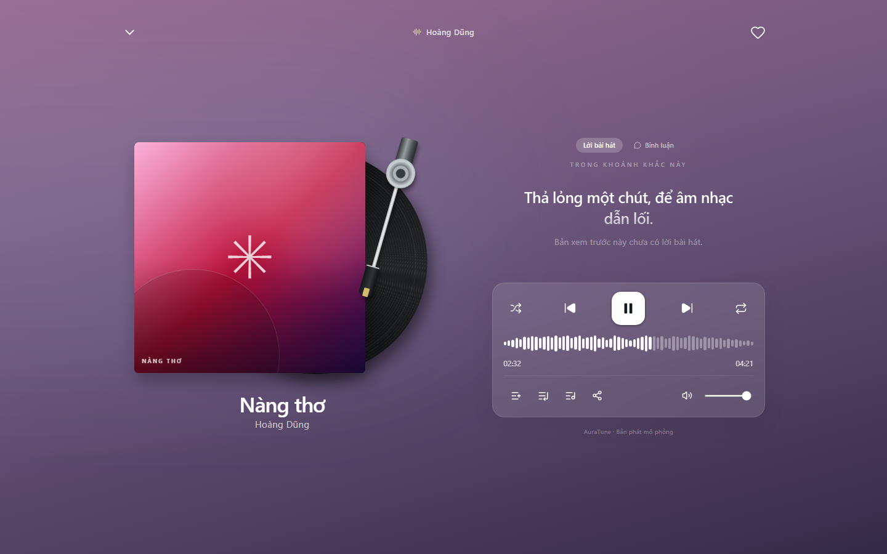
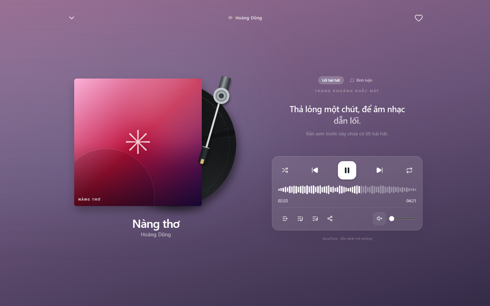

# UC-040-002 – Adjust Volume and Mute

---

## 1. Metadata

| Field | Value |
|---|---|
| **Use Case ID** | UC-040-002 |
| **Use Case Name** | Adjust Volume and Mute |
| **Functional Group** | 040 – Music Player |
| **Primary Actor** | Guest / Visitor (`ACT-01`), Listener (`ACT-02`) |
| **Supporting Actors** | None |
| **Related FR IDs** | `042-FR-006`, `042-FR-007`, `042-FR-008`, `042-FR-009`, `042-FR-010`, `042-FR-011` |
| **Related Feature/Spec** | Feature 042: Playback Progress and Volume (`specs/040-music-player/042-playback-progress-and-volume/spec.md`) |
| **Status** | Draft |
| **Writer** | Nguyễn Thanh Huy |
| **Reviewer** | TBD |

---

## 2. Description

A guest or listener changes the playback volume or mutes the audio from the mini player or the full player so that it suits their environment. Mute remembers the previous level, and the volume stays the same when the track changes.

---

## 3. Preconditions

- A track is loaded in the player (`UC-040-001`).

---

## 4. Trigger

The actor moves the volume control or selects the mute control.

---

## 5. Basic Flow

1. **Actor:** Moves the volume control to a new level.
2. **System:** Sets the volume to the selected level between 0 and 100 and updates the control (`042-FR-006`).
3. **System:** Keeps the same level when the track changes (`042-FR-010`).
4. **Actor:** Continues listening at the new level.

---

## 6. Alternative Flows

### AF-01 – Mute and Unmute
- **Starting step:** Step 1 of the Basic Flow.
- **Condition:** The actor selects the mute control (`042-FR-007`).
1. **System:** Silences the audio, remembers the current level, and shows the muted state.
2. **Actor:** Selects the mute control again.
3. **System:** Restores the previous volume level (`042-FR-008`).
- **Continuation:** Resumes at Step 4 of the Basic Flow.

### AF-02 – Move Volume While Muted
- **Starting step:** Step 1 of AF-01.
- **Condition:** The actor moves the volume control while muted (`042-FR-009`).
1. **System:** Turns mute off and applies the selected level.
- **Continuation:** Resumes at Step 3 of the Basic Flow.

### AF-03 – Volume Set to 0
- **Starting step:** Step 2 of the Basic Flow.
- **Condition:** The actor moves the volume to 0.
1. **System:** Shows the muted appearance on the control.
- **Continuation:** Resumes at Step 4 of the Basic Flow.

### AF-04 – Keyboard or Touch Control
- **Starting step:** Step 1 of the Basic Flow.
- **Condition:** The actor uses the keyboard or a touch screen (`042-FR-011`).
1. **Actor:** Changes the level with arrow keys or by dragging on the touch screen.
- **Continuation:** Resumes at Step 2 of the Basic Flow.

---

## 7. Exception Flows

### EF-01 – Volume Control Hidden on Small Screens
- **Starting step:** Step 1 of the Basic Flow.
- **Condition:** The compact mini player on a phone does not show the volume control.
1. **Actor:** Opens the full player through `UC-040-006`, or uses the device volume.
- **Continuation:** Resumes at Step 1 of the Basic Flow in the full player.

---

## 8. Postconditions

### Success
- Audio plays at the selected level, or is muted with the previous level remembered.
- The level is kept for later tracks in the same session.

### Failure
- The level is unchanged.

---

## 9. Special Requirements

- **Accessibility**: The volume and mute controls are operable by mouse, keyboard, and touch, and have accessible names (`042-FR-011`).
- **Session Scope**: The volume applies to the current session and is not required to survive a page reload (042 Clarifications).

---

## 10. Prototype and Screenshots

> **Asset type**: Implementation screenshots captured from the current frontend prototype, which simulates playback with demo data.

### Basic Flow

*Figure 1: Volume control in the full player set to a high level (Steps 1–2).*

### Alternative Flow – AF-01 (Mute)

*Figure 2: Muted state with the crossed speaker icon and the slider at zero.*

---

## 11. Related Use Cases

- **Preceding Use Case**: `UC-040-001` (Control Audio Playback).
- **Related Use Case**: `UC-040-006` (Toggle Persistent Mini and Full Player) – Gives access to the volume control on small screens.

---

## 12. Source References

- `specs/040-music-player/042-playback-progress-and-volume/spec.md` – Requirements FR-006 to FR-011, User Story 2, Edge Cases.
- `docs/proposal/proposal.md` – Section 6.4: Core Music Player.
- `docs/proposal/Auratune_Vision_Document.md` – Group G04 and Section 6.3.

---

## 13. Notes and Open Questions

- **Prototype Gap**: Volume changes have no audible effect in the current prototype because playback is simulated.
