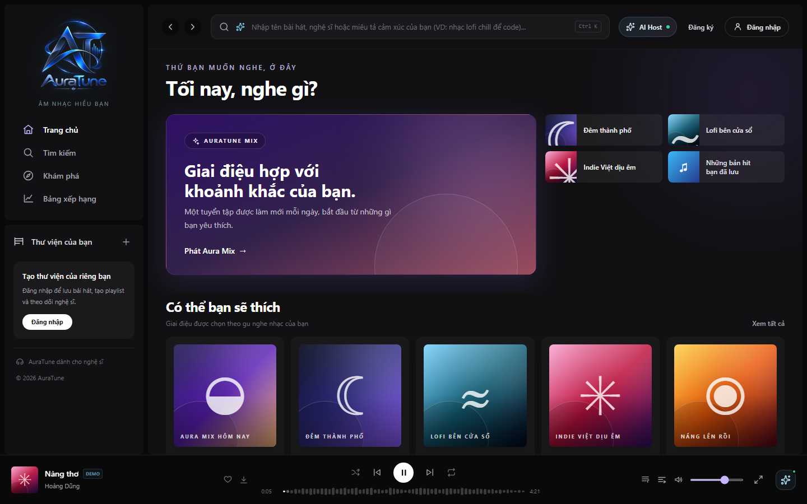
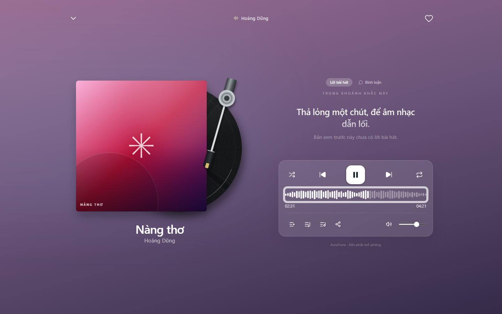

# UC-040-003 – Seek Audio Playback Position

---

## 1. Metadata

| Field | Value |
|---|---|
| **Use Case ID** | UC-040-003 |
| **Use Case Name** | Seek Audio Playback Position |
| **Functional Group** | 040 – Music Player |
| **Primary Actor** | Guest / Visitor (`ACT-01`), Listener (`ACT-02`) |
| **Supporting Actors** | Cloud Media Storage (CDN) (`ACT-EXT-03`) |
| **Related FR IDs** | `042-FR-001`, `042-FR-002`, `042-FR-003`, `042-FR-004`, `042-FR-005`, `042-FR-011`, `042-FR-012` |
| **Related Feature/Spec** | Feature 042: Playback Progress and Volume (`specs/040-music-player/042-playback-progress-and-volume/spec.md`) |
| **Status** | Draft |
| **Writer** | Nguyễn Thanh Huy |
| **Reviewer** | TBD |

---

## 2. Description

A guest or listener follows the progress of the current track and jumps to any position in it. The system shows elapsed time and total duration, requests the needed part of the audio from Cloud Media Storage, and continues playback from the selected position.

---

## 3. Preconditions

- A track is loaded in the player (`UC-040-001`).
- Cloud Media Storage supports partial (range) requests for the audio file.

---

## 4. Trigger

The actor drags or clicks the waveform progress bar in the mini player or the full player.

---

## 5. Basic Flow

1. **System:** Shows the elapsed time and total duration of the current track in minutes and seconds (`042-FR-001`).
2. **System:** Updates the progress bar and elapsed time while the track plays (`042-FR-002`).
3. **Actor:** Drags or clicks the progress bar at a new position (`042-FR-003`).
4. **System:** Limits the position to between the start and the track duration (`042-FR-004`).
5. **System:** Requests the audio for that position from Cloud Media Storage.
6. **System:** Continues playback from the selected position and updates the progress and elapsed time.
7. **System:** Exposes the new position to assistive technology as readable text (`042-FR-012`).

---

## 6. Alternative Flows

### AF-01 – Seek While Paused
- **Starting step:** Step 3 of the Basic Flow.
- **Condition:** The track is paused.
1. **System:** Moves the position without starting playback.
2. **Actor:** Selects play.
3. **System:** Starts playback from the selected position.
- **Continuation:** Resumes at Step 7 of the Basic Flow.

### AF-02 – Seek With the Keyboard
- **Starting step:** Step 3 of the Basic Flow.
- **Condition:** The actor focuses the progress bar and uses the arrow keys (`042-FR-011`).
1. **Actor:** Presses the arrow keys to move the position.
- **Continuation:** Resumes at Step 4 of the Basic Flow.

### AF-03 – Seek and the Listening History Threshold
- **Starting step:** Step 6 of the Basic Flow.
- **Condition:** The actor is a signed-in listener and the play event has not yet been sent (`041-FR-014`).
1. **System:** Counts only continuous listening time towards the 30-second or 50% threshold, so jumping forward does not count as listening.
- **Continuation:** Resumes at Step 7 of the Basic Flow.

### AF-04 – Seek by Selecting a Lyric Line
- **Starting step:** Step 3 of the Basic Flow.
- **Condition:** The actor selects a timed lyric line in the full player (`044-FR-012`).
1. **System:** Uses the line's start time as the new position.
- **Continuation:** Resumes at Step 5 of the Basic Flow (see `UC-040-005`).

---

## 7. Exception Flows

### EF-01 – Position Not Yet Buffered
- **Starting step:** Step 5 of the Basic Flow.
- **Condition:** The audio at the selected position is not available yet (`042-FR-005`).
1. **System:** Shows a buffering state until playback can continue.
- **Continuation:** Resumes at Step 6 of the Basic Flow.

### EF-02 – Range Request Fails
- **Starting step:** Step 5 of the Basic Flow.
- **Condition:** Cloud Media Storage cannot return the requested part of the audio.
1. **System:** Shows an error with a retry option and keeps the previous position.
- **Continuation:** Resumes at Step 3 on retry; otherwise continues in `UC-040-001` EF-02.

---

## 8. Postconditions

### Success
- Playback continues, or is ready to continue, from the selected position.
- The displayed elapsed time stays within 1 second of the actual position.

### Failure
- Playback stays at the previous position with a clear message.

---

## 9. Special Requirements

- **Accessibility**: The progress bar is operable by mouse, keyboard, and touch and reports the position as readable text (`042-FR-011`, `042-FR-012`).
- **Streaming**: Seeking relies on HTTP range requests (`206 Partial Content`) from Cloud Media Storage.
- **History Integrity**: Seeking never adds listening time towards the play threshold (AF-03).

---

## 10. Prototype and Screenshots

> **Asset type**: Implementation screenshots captured from the current frontend prototype, which simulates playback with demo data.

### Basic Flow

*Figure 1: Progress bar at the start of a track, showing elapsed time and duration (Step 1).*

*Figure 2: Progress bar filling while the track plays (Step 2).*

*Figure 3: Seeking to a new position in the full player (Steps 3–6).*

### Exception Flows – EF-01 and EF-02
*[Prototype Pending - To be generated during UI implementation]*  
*Planned Interface: Buffering indicator and a seek error with retry. The prototype simulates audio, so these states cannot occur yet.*

---

## 11. Related Use Cases

- **Preceding Use Case**: `UC-040-001` (Control Audio Playback).
- **Related Use Case**: `UC-040-005` (View Synchronized Lyrics) – Click-to-seek on lyric lines and line emphasis after a seek.
- **Affects**: `UC-070-001` (Record Track Play Event) – Through the threshold rule in AF-03.

---

## 12. Source References

- `specs/040-music-player/042-playback-progress-and-volume/spec.md` – Requirements FR-001 to FR-005, FR-011, FR-012, User Story 1, Edge Cases.
- `specs/040-music-player/041-playback-controls/spec.md` – FR-014: 30-second play rule.
- `docs/analysis-and-design/api-contract.md` – Section 1.5: `GET /songs/:id/stream` with `Range` support.
- `docs/requirements/use-case-model.md` – Open question `Q-040-1` on range request support in free-tier storage.

---

## 13. Notes and Open Questions

- **Range Support (`Q-040-1`)**: Precise seeking depends on confirming that the chosen cloud storage free tier supports range requests.
- **Threshold Interpretation**: AF-03 applies the 2026-11-01 clarification ("played continuously") to seeking. Confirm this reading with Group 070 when implementing `UC-070-001`.
