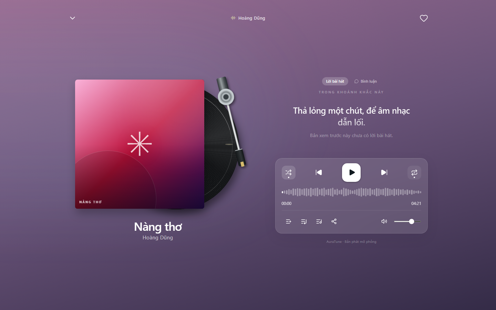

# UC-040-004 – Toggle Shuffle and Repeat Modes

---

## 1. Metadata

| Field | Value |
|---|---|
| **Use Case ID** | UC-040-004 |
| **Use Case Name** | Toggle Shuffle and Repeat Modes |
| **Functional Group** | 040 – Music Player |
| **Primary Actor** | Guest / Visitor (`ACT-01`), Listener (`ACT-02`) |
| **Supporting Actors** | None |
| **Related FR IDs** | `043-FR-001`, `043-FR-002`, `043-FR-003`, `043-FR-004`, `043-FR-005`, `043-FR-006`, `043-FR-007`, `043-FR-008`, `043-FR-009`, `043-FR-010`, `043-FR-011`, `043-FR-012` |
| **Related Feature/Spec** | Feature 043: Shuffle and Repeat (`specs/040-music-player/043-shuffle-and-repeat/spec.md`) |
| **Status** | Draft |
| **Writer** | Nguyễn Thanh Huy |
| **Reviewer** | TBD |

---

## 2. Description

A guest or listener turns shuffle on or off and cycles the repeat mode between off, repeat all, and repeat one, so that playback continues in the order they prefer. Mode changes never interrupt the current track, and both player views show the active modes.

---

## 3. Preconditions

- A track is loaded in the player (`UC-040-001`).
- The queue contains the tracks that shuffle and repeat apply to (`UC-050-001`).

---

## 4. Trigger

The actor selects the shuffle control or the repeat control.

---

## 5. Basic Flow

1. **Actor:** Selects the shuffle control (`043-FR-001`).
2. **System:** Turns shuffle on, shows the active state in both player views, and keeps the displayed queue order unchanged (`043-FR-003`, `043-FR-010`).
3. **System:** Keeps the current track playing without interruption (`043-FR-011`).
4. **System:** When advancing, selects a random queued track other than the current one (`043-FR-002`).
5. **Actor:** Selects the shuffle control again.
6. **System:** Turns shuffle off and follows the queue order from the current track.

---

## 6. Alternative Flows

### AF-01 – Cycle the Repeat Mode
- **Starting step:** Step 1 of the Basic Flow.
- **Condition:** The actor selects the repeat control (`043-FR-004`, `043-FR-005`).
1. **System:** Moves the mode from off to repeat all, then to repeat one, then back to off, and shows it in both player views.
2. **System:** With repeat all, restarts the queue from its first track after the last track ends (`043-FR-006`).
3. **System:** With repeat one, replays the current track when it ends (`043-FR-007`).
- **Continuation:** Use case ends successfully with the selected mode active.

### AF-02 – Next While Repeat One Is On
- **Starting step:** Step 3 of AF-01.
- **Condition:** The actor selects next while repeat one is on (`043-FR-008`).
1. **System:** Moves to the next track; repeat one applies only when a track ends naturally.
- **Continuation:** Use case ends successfully.

### AF-03 – Start a Collection in Shuffle Mode
- **Starting step:** Step 1 of the Basic Flow.
- **Condition:** The actor selects a shuffle-play action on a collection (`043-FR-012`).
1. **System:** Turns shuffle on and starts the collection in a random order.
- **Continuation:** Resumes at Step 3 of the Basic Flow.

### AF-04 – Shuffle and Repeat One Together
- **Starting step:** Step 4 of the Basic Flow.
- **Condition:** Both shuffle and repeat one are on and a track ends (`043-FR-009`).
1. **System:** Replays the current track, because repeat one takes priority.
- **Continuation:** Use case ends successfully.

### AF-05 – Play Next Choice With Shuffle On
- **Starting step:** Step 4 of the Basic Flow.
- **Condition:** A track was chosen with Play Next (`054-FR-009`).
1. **System:** Plays the Play Next choice before returning to random selection.
- **Continuation:** Resumes at Step 4 of the Basic Flow.

---

## 7. Exception Flows

### EF-01 – Only One Track in the Queue
- **Starting step:** Step 4 of the Basic Flow.
- **Condition:** Shuffle is on but no other track is queued.
1. **System:** Follows the repeat mode: replays the track for repeat one or repeat all, or stops for repeat off.
- **Continuation:** Use case ends successfully.

---

## 8. Postconditions

### Success
- The selected shuffle and repeat modes are active and shown in both player views.
- The displayed queue order is unchanged, and the current track was not interrupted.

### Failure
- Not applicable; mode changes always succeed.

---

## 9. Special Requirements

- **Consistency**: With shuffle on and at least two queued tracks, the next track is never the current one.
- **Session Scope**: Both modes return to off after a page reload (043 Edge Cases).
- **Accessibility**: Both controls have accessible names and expose their pressed state.

---

## 10. Prototype and Screenshots

> **Asset type**: Implementation screenshots captured from the current frontend prototype, which simulates playback with demo data.

### Basic Flow

*Figure 1: Shuffle control in the off state (Step 1).*

*Figure 2: Shuffle control in the active state (Step 2).*

### Alternative Flow – AF-01 (Repeat Modes)

*Figure 3: Repeat off.*

*Figure 4: Repeat all.*

*Figure 5: Repeat one with its dedicated icon.*

---

## 11. Related Use Cases

- **Preceding Use Case**: `UC-040-001` (Control Audio Playback).
- **Interacts with**: `UC-050-003` (Play Track Next) – Overrides shuffle for the next track; `UC-050-004` (Reorder Upcoming Queue).

---

## 12. Source References

- `specs/040-music-player/043-shuffle-and-repeat/spec.md` – Requirements FR-001 to FR-012, User Stories 1–2, Edge Cases.
- `specs/050-queue-management/054-play-next/spec.md` – FR-009: Play Next with shuffle on.
- `docs/proposal/proposal.md` – Section 6.4: Core Music Player.

---

## 13. Notes and Open Questions

- **Prototype Gap**: With shuffle on and repeat off, the current prototype keeps selecting tracks and does not stop, and it can skip a Play Next choice (see Known Gaps in specs 043 and 054).
