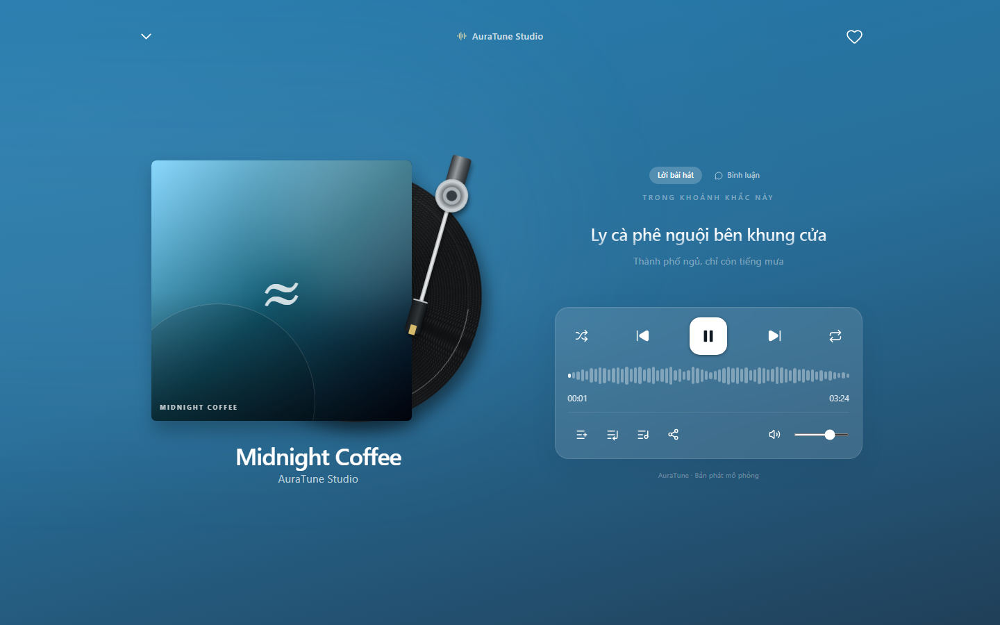
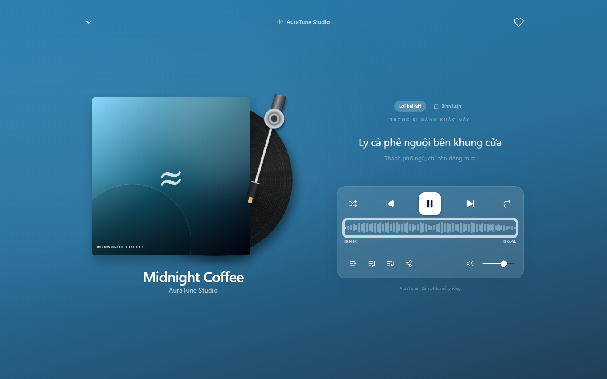
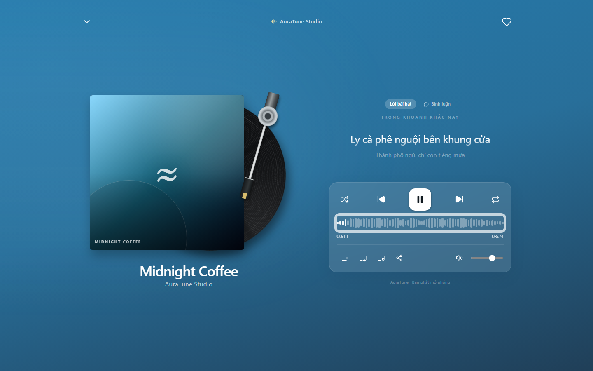
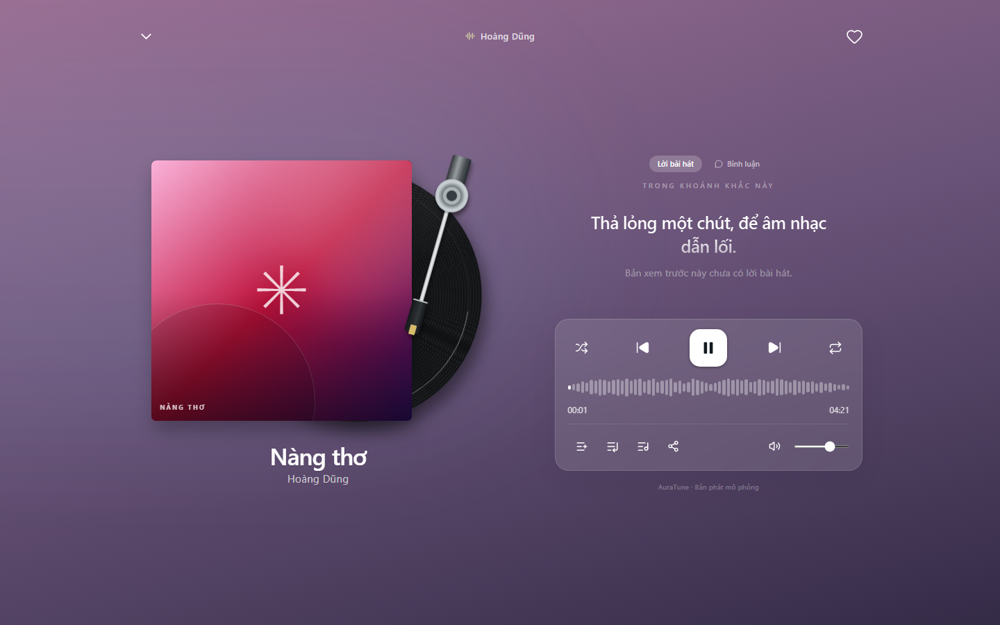

# UC-040-005 – View Synchronized Lyrics

---

## 1. Metadata

| Field | Value |
|---|---|
| **Use Case ID** | UC-040-005 |
| **Use Case Name** | View Synchronized Lyrics |
| **Functional Group** | 040 – Music Player |
| **Primary Actor** | Guest / Visitor (`ACT-01`), Listener (`ACT-02`) |
| **Supporting Actors** | None |
| **Related FR IDs** | `044-FR-001`, `044-FR-002`, `044-FR-003`, `044-FR-004`, `044-FR-005`, `044-FR-006`, `044-FR-007`, `044-FR-008`, `044-FR-009`, `044-FR-010`, `044-FR-011`, `044-FR-012` |
| **Related Feature/Spec** | Feature 044: Synchronized Lyrics (`specs/040-music-player/044-synchronized-lyrics/spec.md`) |
| **Status** | Draft |
| **Writer** | Nguyễn Thanh Huy |
| **Reviewer** | TBD |

---

## 2. Description

A guest or listener reads the lyrics of the current track in the full player while the line being sung is emphasized and follows playback. The listener can also select a timed line to jump to it. Tracks with plain lyrics or no lyrics show a clear state, and a lyrics failure never affects playback.

---

## 3. Preconditions

- A track is loaded in the player (`UC-040-001`).
- The full player is open (`UC-040-006`).

---

## 4. Trigger

The actor selects the lyrics tab ("Lời bài hát") in the full player, or the lyrics control in the mini player.

---

## 5. Basic Flow

1. **Actor:** Opens the lyrics panel of the full player (`044-FR-010`).
2. **System:** Loads the lyrics for the current track and shows them (`044-FR-001`).
3. **System:** Emphasizes the line that matches the current playback position and shows the previous and next lines with lower emphasis (`044-FR-002`, `044-FR-003`).
4. **System:** Moves the emphasis to the next line when its start time is reached (`044-FR-004`).
5. **Actor:** Reads along while the music plays.

---

## 6. Alternative Flows

### AF-01 – Select a Lyric Line to Jump
- **Starting step:** Step 5 of the Basic Flow.
- **Condition:** The actor selects a timed lyric line (`044-FR-012`).
1. **System:** Seeks playback to that line's start time and continues playing.
2. **System:** Emphasizes the selected line.
- **Continuation:** Resumes at Step 4 of the Basic Flow.

### AF-02 – Seek From the Progress Bar
- **Starting step:** Step 5 of the Basic Flow.
- **Condition:** The actor seeks through `UC-040-003` (`044-FR-005`).
1. **System:** Emphasizes the line that matches the new position.
- **Continuation:** Resumes at Step 4 of the Basic Flow.

### AF-03 – Plain Lyrics Without Timing
- **Starting step:** Step 2 of the Basic Flow.
- **Condition:** The track has lyrics without timestamps (`044-FR-006`).
1. **System:** Shows the plain lyrics without line emphasis.
- **Continuation:** Use case ends successfully.

### AF-04 – Track Changes
- **Starting step:** Step 4 of the Basic Flow.
- **Condition:** The current track changes (`044-FR-009`).
1. **System:** Replaces the panel content with the new track's lyrics.
- **Continuation:** Resumes at Step 2 of the Basic Flow.

### AF-05 – Switch to Comments
- **Starting step:** Step 5 of the Basic Flow.
- **Condition:** The actor selects the comments tab (`044-FR-010`).
1. **System:** Shows the comments panel.
- **Continuation:** Use case ends; the actor continues in `UC-040-008`.

---

## 7. Exception Flows

### EF-01 – Track Has No Lyrics
- **Starting step:** Step 2 of the Basic Flow.
- **Condition:** No lyrics exist for the track (`044-FR-007`).
1. **System:** Shows a notice that lyrics are not available.
- **Continuation:** Use case ends; playback is unaffected.

### EF-02 – Lyrics Cannot Be Loaded
- **Starting step:** Step 2 of the Basic Flow.
- **Condition:** The lyrics request fails (`044-FR-008`).
1. **System:** Shows a notice and keeps playback running.
- **Continuation:** Use case ends in failure; playback is unaffected.

---

## 8. Postconditions

### Success
- The lyrics of the current track are shown, and for timed lyrics the emphasized line matches playback.

### Failure
- A clear notice is shown instead of a blank panel, and playback continues.

---

## 9. Special Requirements

- **Timing**: The emphasized line changes within 1 second of its start time, including after a seek.
- **Readability**: Long lines wrap and stay readable.
- **Scope Boundary**: Lyric-based search is not part of this use case (`044-FR-011`); it belongs to Group 030.

---

## 10. Prototype and Screenshots

> **Asset type**: Implementation screenshots captured from the current frontend prototype, which simulates playback with demo data.

### Basic Flow

*Figure 1: Lyrics tab in the full player (Steps 1–2).*

*Figure 2: The current line emphasized (Step 3).*

*Figure 3: Emphasis moved to the next line as playback continues (Step 4).*

### Exception Flow – EF-01 (No Lyrics)

*Figure 4: Notice for a track without lyrics.*

### Alternative Flows – AF-01 (Select a Line) and AF-03 (Plain Lyrics)
*[Prototype Pending - To be generated during UI implementation]*  
*Planned Interface: Selectable timed lines and a scrollable plain-lyrics view. The current prototype shows three timed lines and does not support selecting a line.*

---

## 11. Related Use Cases

- **Preceding Use Case**: `UC-040-006` (Toggle Persistent Mini and Full Player).
- **Includes (AF-01)**: `UC-040-003` (Seek Audio Playback Position).
- **Related Use Case**: `UC-040-008` (Read Track Comments) – The other tab of the full player.

---

## 12. Source References

- `specs/040-music-player/044-synchronized-lyrics/spec.md` – Requirements FR-001 to FR-012, User Stories 1–2, Clarifications 2026-10-31 and 2026-11-01.
- `docs/proposal/Auratune_Vision_Document.md` – Need N-05 and Group G04.
- `docs/analysis-and-design/api-contract.md` – Section 2.4: `GET /songs/:id/lyrics`.

---

## 13. Notes and Open Questions

- **Click-to-Seek**: Clarification session 2026-11-01 confirmed that selecting a timed line seeks playback.
- **Prototype Gap**: Only timed lyrics are implemented, and smooth scrolling through the full text is not (see Known Gaps in the 044 specification).
