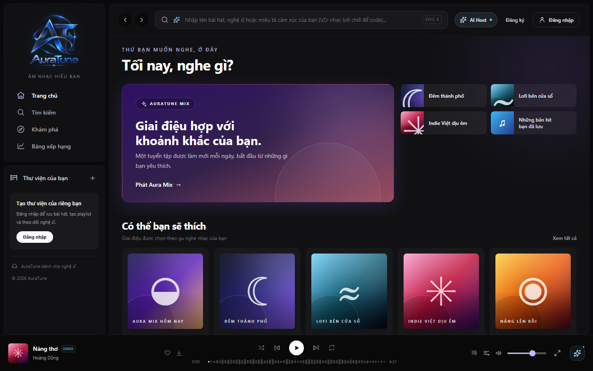
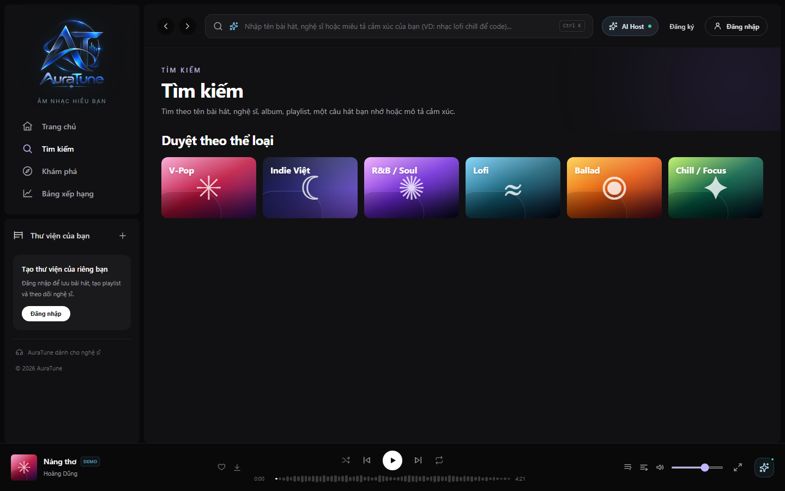
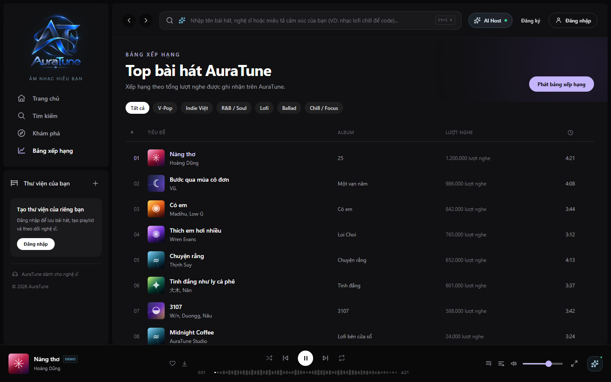
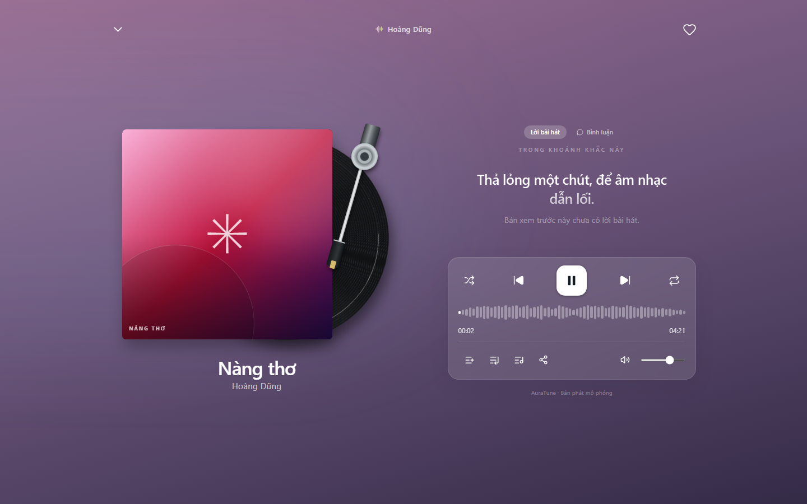

# UC-040-006 – Toggle Persistent Mini and Full Player

---

## 1. Metadata

| Field | Value |
|---|---|
| **Use Case ID** | UC-040-006 |
| **Use Case Name** | Toggle Persistent Mini and Full Player |
| **Functional Group** | 040 – Music Player |
| **Primary Actor** | Guest / Visitor (`ACT-01`), Listener (`ACT-02`) |
| **Supporting Actors** | None |
| **Related FR IDs** | `045-FR-001`, `045-FR-002`, `045-FR-003`, `045-FR-004`, `045-FR-005`, `045-FR-006`, `045-FR-007`, `045-FR-008`, `045-FR-009`, `045-FR-010`, `045-FR-011`, `045-FR-012` |
| **Related Feature/Spec** | Feature 045: Persistent Bottom Player (`specs/040-music-player/045-persistent-bottom-player/spec.md`) |
| **Status** | Draft |
| **Writer** | Nguyễn Thanh Huy |
| **Reviewer** | TBD |

---

## 2. Description

A guest or listener keeps listening while moving between pages, because the mini player stays at the bottom of every page, and switches to the full player to see artwork, lyrics, comments, and all controls. Playback never restarts when the route or the player view changes, and the last track and queue are restored in a paused state after a page reload.

---

## 3. Preconditions

- A track is loaded in the player (`UC-040-001`).

---

## 4. Trigger

The actor navigates to another page while music plays, or selects the mini player's track area or expand control.

---

## 5. Basic Flow

1. **System:** Shows the mini player at the bottom of the current page with track information and play or pause (`045-FR-001`, `045-FR-008`).
2. **Actor:** Navigates to another page, for example from Home to Search.
3. **System:** Keeps playback running and keeps the track, queue, and position unchanged (`045-FR-002`, `045-FR-003`).
4. **Actor:** Selects the mini player's track area or expand control (`045-FR-004`).
5. **System:** Opens the full player over the page without interrupting playback and moves keyboard focus into it (`045-FR-007`, `045-FR-010`).
6. **Actor:** Closes the full player with the minimize control or the Escape key (`045-FR-005`).
7. **System:** Returns the actor to the same page and position, restores keyboard focus, and keeps playback running (`045-FR-006`, `045-FR-010`).

---

## 6. Alternative Flows

### AF-01 – Restore After a Page Reload
- **Starting step:** Step 1 of the Basic Flow.
- **Condition:** The actor reloaded the page while a track was loaded (`045-FR-012`).
1. **System:** Restores the last track and queue from local browser storage in a paused state.
2. **Actor:** Selects play to continue.
- **Continuation:** Resumes at Step 1 of the Basic Flow.

### AF-02 – Use the Player on a Phone
- **Starting step:** Step 1 of the Basic Flow.
- **Condition:** The actor uses a narrow screen (`045-FR-008`, `045-FR-009`).
1. **System:** Shows a compact mini player with track information, play or pause, and queue access above the mobile navigation, without covering page content.
- **Continuation:** Resumes at Step 2 of the Basic Flow.

### AF-03 – Open the Queue From the Player
- **Starting step:** Step 1 or Step 5 of the Basic Flow.
- **Condition:** The actor selects the queue control (`045-FR-011`).
1. **System:** Opens the queue panel and closes competing overlays.
- **Continuation:** Use case ends; the actor continues in `UC-050-001`.

---

## 7. Exception Flows

### EF-01 – Saved Player State Cannot Be Restored
- **Starting step:** Step 1 of AF-01.
- **Condition:** Browser storage is unavailable or the saved state cannot be read.
1. **System:** Starts with the idle player and keeps the application usable.
- **Continuation:** Resumes at Step 1 of the Basic Flow.

### EF-02 – Sign-Out During Playback
- **Starting step:** Any step of the Basic Flow.
- **Condition:** The listener signs out.
1. **System:** Clears listener data and applies public playback rules.
- **Continuation:** Resumes at Step 1 of the Basic Flow as a guest.

---

## 8. Postconditions

### Success
- Playback continued across every route change and view change without restarting.
- The actor is on the same page and position after closing the full player.
- The current track and queue are stored in local browser storage.

### Failure
- The player starts idle if the saved state could not be restored, and the application stays usable.

---

## 9. Special Requirements

- **Continuity**: Zero playback restarts across navigation between all routes.
- **Layout**: No page content is covered by the mini player from 375 px to 1920 px wide.
- **Accessibility**: Focus stays inside the open full player and returns to where it was when closed; the full player can be closed with the keyboard.

---

## 10. Prototype and Screenshots

> **Asset type**: Implementation screenshots captured from the current frontend prototype, which simulates playback with demo data.

### Basic Flow

*Figure 1: Mini player docked on Home (Step 1).*

*Figure 2: The same track still playing after navigating to Search (Steps 2–3).*

*Figure 3: Uninterrupted playback on the Charts page (Step 3).*

*Figure 4: The full player opened from the mini player (Steps 4–5).*

*Figure 5: The full player closed, returning to the same page (Steps 6–7).*

### Alternative Flow – AF-02 (Phone)

*Figure 6: Compact mini player above the mobile navigation at 375 px wide.*

### Alternative Flow – AF-01 (Restore After Reload)
*[Prototype Pending - To be generated during UI implementation]*  
*Planned Interface: The last track and queue restored in a paused state after a reload. The current prototype returns to its idle state.*

---

## 11. Related Use Cases

- **Preceding Use Case**: `UC-040-001` (Control Audio Playback).
- **Gives access to**: `UC-040-005` (View Synchronized Lyrics), `UC-040-008` (Read Track Comments), `UC-050-001` (View Playback Queue).

---

## 12. Source References

- `specs/040-music-player/045-persistent-bottom-player/spec.md` – Requirements FR-001 to FR-012, User Stories 1–3, Clarifications 2026-10-31 and 2026-11-01.
- `specs/130-frontend/131-frontend-foundation/spec.md` – Shared application shell rules.
- `docs/proposal/proposal.md` – Section 6.4: persistent mini-player.

---

## 13. Notes and Open Questions

- **Reload Behavior**: Clarification session 2026-11-01 replaced the earlier "return to idle" answer; the player now restores the last track and queue in a paused state.
- **Prototype Gap**: The current prototype does not save the player state and returns to idle after a reload (see Known Gaps in the 045 specification).
