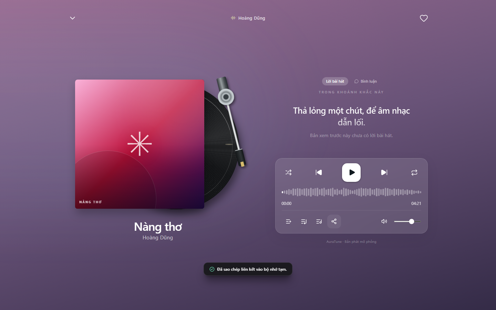

# UC-040-007 – Share Song
Performed by: Nguyễn Thanh Huy | Reviewed by: Group 10 team | Edited by: Lê Công Minh Nhựt

---

## 1. Metadata
Performed by: Nguyễn Thanh Huy | Reviewed by: Group 10 team | Edited by: Lê Công Minh Nhựt

| Field | Value |
|---|---|
| **Use Case ID** | UC-040-007 |
| **Use Case Name** | Share Song |
| **Functional Group** | 040 – Music Player |
| **Primary Actor** | Guest / Visitor (`ACT-01`), Listener (`ACT-02`) |
| **Supporting Actors** | None |
| **Related FR IDs** | `046-FR-001`, `046-FR-002`, `046-FR-003`, `046-FR-004`, `046-FR-005` |
| **Related Feature/Spec** | Feature 046: Song Sharing and Comments (`specs/040-music-player/046-song-sharing-and-comments/spec.md`) |
| **Status** | Draft |
| Writer | Lê Công Minh Nhựt |
| Original Writer (PA3 draft) | Nguyễn Thanh Huy |
| Reviewer | Group 10 team |

---

## 2. Description
Performed by: Nguyễn Thanh Huy | Reviewed by: Group 10 team | Edited by: Lê Công Minh Nhựt

A guest or listener shares a track with other people by using the device share sheet or by copying a link. The link opens content that contains the shared track, and the actor is told the result.

---

## 3. Preconditions
Performed by: Nguyễn Thanh Huy | Reviewed by: Group 10 team | Edited by: Lê Công Minh Nhựt

- The track is visible in the full player or in a track list with the "…" menu.

---

## 4. Trigger
Performed by: Nguyễn Thanh Huy | Reviewed by: Group 10 team | Edited by: Lê Công Minh Nhựt

The actor selects the share control in the full player, or "Chia sẻ" in a track's "…" menu (`046-FR-001`).

---

## 5. Basic Flow
Performed by: Nguyễn Thanh Huy | Reviewed by: Group 10 team | Edited by: Lê Công Minh Nhựt

1. **Actor:** Selects the share control (`046-FR-001`).
2. **System:** Builds a link that opens content containing the track: the album page focused on the track, or a search for the track when it has no album (`046-FR-005`).
3. **System:** Detects that no device share sheet is available and copies the link to the clipboard (`046-FR-002`).
4. **System:** Confirms that the link was copied (`046-FR-003`).
5. **Actor:** Pastes the link wherever they want to share it.

---

## 6. Alternative Flows
Performed by: Nguyễn Thanh Huy | Reviewed by: Group 10 team | Edited by: Lê Công Minh Nhựt

### AF-01 – Share Through the Device Share Sheet
Performed by: Nguyễn Thanh Huy | Reviewed by: Group 10 team | Edited by: Lê Công Minh Nhựt
- **Starting step:** Step 3 of the Basic Flow.
- **Condition:** The device supports a share sheet, for example on a phone (`046-FR-002`).
1. **System:** Opens the device share sheet with the track title and link.
2. **Actor:** Chooses an app or contact and completes sharing.
- **Continuation:** Use case ends successfully.

### AF-02 – Share Cancelled
Performed by: Nguyễn Thanh Huy | Reviewed by: Group 10 team | Edited by: Lê Công Minh Nhựt
- **Starting step:** Step 2 of AF-01.
- **Condition:** The actor closes the share sheet without sharing (`046-FR-004`).
1. **System:** Shows no message.
- **Continuation:** Use case ends with no change.

---

## 7. Exception Flows
Performed by: Nguyễn Thanh Huy | Reviewed by: Group 10 team | Edited by: Lê Công Minh Nhựt

### EF-01 – Sharing Fails
Performed by: Nguyễn Thanh Huy | Reviewed by: Group 10 team | Edited by: Lê Công Minh Nhựt
- **Starting step:** Step 3 of the Basic Flow.
- **Condition:** The link cannot be copied or the share sheet fails (`046-FR-003`).
1. **System:** Shows a message that the link could not be shared and keeps the share control available.
2. **Actor:** Tries again or closes the message.
- **Continuation:** Resumes at Step 1 of the Basic Flow on a new attempt; otherwise the use case ends in failure.

---

## 8. Postconditions
Performed by: Nguyễn Thanh Huy | Reviewed by: Group 10 team | Edited by: Lê Công Minh Nhựt

### Success
Performed by: Nguyễn Thanh Huy | Reviewed by: Group 10 team | Edited by: Lê Công Minh Nhựt
- The link is copied or shared, and it opens content containing the shared track.

### Failure
Performed by: Nguyễn Thanh Huy | Reviewed by: Group 10 team | Edited by: Lê Công Minh Nhựt
- Nothing is shared, and the actor has been told why, except after a cancel.

---

## 9. Special Requirements
Performed by: Nguyễn Thanh Huy | Reviewed by: Group 10 team | Edited by: Lê Công Minh Nhựt

- **Correctness**: 100% of share links open content containing the track.
- **Privacy**: The link contains no personal data.

---

## 10. Prototype and Screenshots
Performed by: Nguyễn Thanh Huy | Reviewed by: Group 10 team | Edited by: Lê Công Minh Nhựt

> **Asset type**: Implementation screenshots captured from the current frontend prototype, which runs on demo data.

### Basic Flow
Performed by: Nguyễn Thanh Huy | Reviewed by: Group 10 team | Edited by: Lê Công Minh Nhựt

*Figure 1: Share control in the full player and the "link copied" confirmation (Steps 1–4).*

### Alternative Flow – AF-01 and Exception Flow – EF-01
Performed by: Nguyễn Thanh Huy | Reviewed by: Group 10 team | Edited by: Lê Công Minh Nhựt
*[Prototype Pending - To be generated during UI implementation]*  
*Planned Interface: Device share sheet on a phone and the failure message. The share sheet is drawn by the operating system.*

---

## 11. Related Use Cases
Performed by: Nguyễn Thanh Huy | Reviewed by: Group 10 team | Edited by: Lê Công Minh Nhựt

- **Related Use Case**: `UC-080-005` (Share Album) – The same sharing pattern for albums.
- **Target Navigation**: `UC-080-001` (View Album Details and Tracklist), `UC-030-001` (Search Catalog by Text Metadata).

---

## 12. Source References
Performed by: Nguyễn Thanh Huy | Reviewed by: Group 10 team | Edited by: Lê Công Minh Nhựt

- `specs/040-music-player/046-song-sharing-and-comments/spec.md` – Requirements FR-001 to FR-005, User Story 1, Edge Cases.
- `docs/proposal/proposal.md` – Section 6.4: share.

---

## 13. Notes and Open Questions
Performed by: Nguyễn Thanh Huy | Reviewed by: Group 10 team | Edited by: Lê Công Minh Nhựt

- **Social Features**: The proposal notes that sharing and comments make AuraTune closer to a social network, which may need a licence in Vietnam (proposal, Section 4.2). This does not change the behavior specified here.

## PA4 implementation evidence and acceptance record
Performed by: Nguyễn Thanh Huy | Reviewed by: Group 10 team | Edited by: Lê Công Minh Nhựt

Player components and `useAudioPlayer.js` exist, with backend metadata/stream handling in `songController.js`. Comments remain browser-state operations in `AppStore.jsx`; backend lyrics and history-write integration remain open in Group 040 tasks. Stream/range tests are not proof of server-side comment persistence or every lyrics state.

The flows above state required behavior. This revision records source inspection only; no browser acceptance or new feature-test run is claimed. Before acceptance, execute the basic flow and its applicable alternative/exception flows, checking the documented success and failure postconditions. Record results against this UC ID in [the PA4 review register](../../use-case-model.md#11-pa4-decisions-and-source-review).
