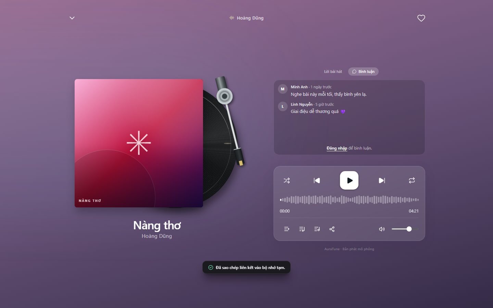
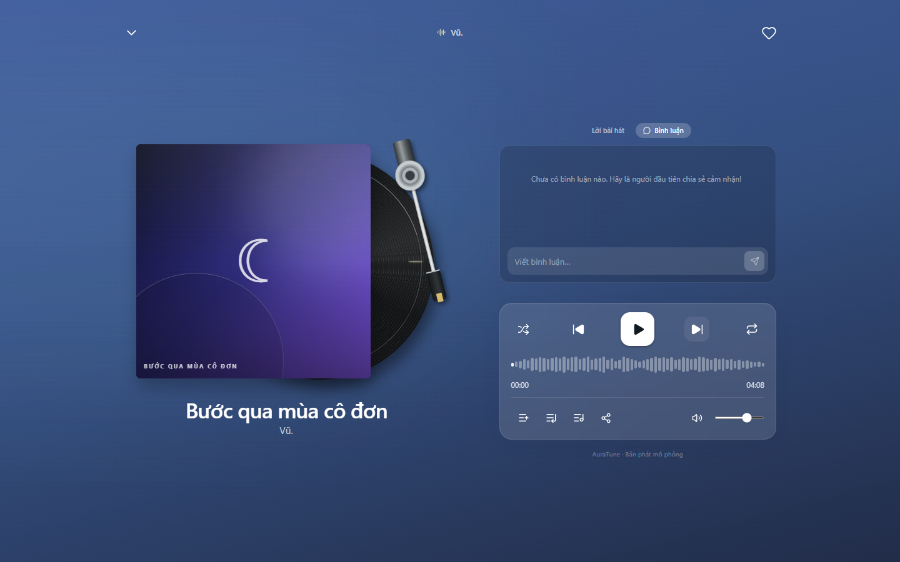

# UC-040-008 – Read Track Comments

---

## 1. Metadata

| Field | Value |
|---|---|
| **Use Case ID** | UC-040-008 |
| **Use Case Name** | Read Track Comments |
| **Functional Group** | 040 – Music Player |
| **Primary Actor** | Guest / Visitor (`ACT-01`), Listener (`ACT-02`) |
| **Supporting Actors** | None |
| **Related FR IDs** | `046-FR-006`, `046-FR-007`, `046-FR-014`, `046-FR-015` |
| **Related Feature/Spec** | Feature 046: Song Sharing and Comments (`specs/040-music-player/046-song-sharing-and-comments/spec.md`) |
| **Status** | Draft |
| **Writer** | Nguyễn Thanh Huy |
| **Reviewer** | TBD |

---

## 2. Description

Any visitor reads what others have said about the current track in the comments panel of the full player. Each comment shows its author, relative time, and text. Guests see a sign-in prompt instead of the comment input.

---

## 3. Preconditions

- A track is loaded in the player (`UC-040-001`).
- The full player is open (`UC-040-006`).

---

## 4. Trigger

The actor selects the comments tab ("Bình luận") in the full player.

---

## 5. Basic Flow

1. **Actor:** Selects the comments tab.
2. **System:** Loads the comments for the current track (`046-FR-006`).
3. **System:** Shows each comment with its author, relative time, and text (`046-FR-007`).
4. **Actor:** Scrolls through the comments.

---

## 6. Alternative Flows

### AF-01 – Track Has No Comments
- **Starting step:** Step 3 of the Basic Flow.
- **Condition:** No one has commented on the track (`046-FR-014`).
1. **System:** Shows an empty state inviting the first comment.
- **Continuation:** Use case ends successfully.

### AF-02 – Guest Reads Comments
- **Starting step:** Step 3 of the Basic Flow.
- **Condition:** The actor is not signed in (`046-FR-015`).
1. **System:** Shows the comments and replaces the comment input with a sign-in prompt.
- **Continuation:** Resumes at Step 4 of the Basic Flow.

### AF-03 – Write a Comment
- **Starting step:** Step 4 of the Basic Flow.
- **Condition:** A signed-in listener wants to add a comment.
- **Continuation:** Use case ends; the listener continues in `UC-040-009`.

### AF-04 – Track Changes
- **Starting step:** Step 4 of the Basic Flow.
- **Condition:** The current track changes.
1. **System:** Loads and shows the comments of the new track.
- **Continuation:** Resumes at Step 3 of the Basic Flow.

---

## 7. Exception Flows

### EF-01 – Comments Cannot Be Loaded
- **Starting step:** Step 2 of the Basic Flow.
- **Condition:** The comments request fails.
1. **System:** Shows an error with a retry option and keeps playback running.
- **Continuation:** Resumes at Step 2 on retry; otherwise the use case ends in failure.

---

## 8. Postconditions

### Success
- The actor sees all comments for the current track, or an empty state.

### Failure
- An error is shown, and playback is unaffected.

---

## 9. Special Requirements

- **Access**: Comments are public; reading requires no account (`046-FR-006`).
- **Readability**: Long text without spaces wraps inside the panel.

---

## 10. Prototype and Screenshots

> **Asset type**: Implementation screenshots captured from the current frontend prototype, which runs on demo data.

### Basic Flow

*Figure 1: Comments panel with author, relative time, and text (Steps 1–3).*

### Alternative Flow – AF-01 (No Comments)

*Figure 2: Empty state for a track with no comments.*

### Alternative Flow – AF-02 (Guest)

*Figure 3: Comments shown to a guest with a sign-in prompt instead of the input.*

### Exception Flow – EF-01
*[Prototype Pending - To be generated during UI implementation]*  
*Planned Interface: Comment loading error with retry.*

---

## 11. Related Use Cases

- **Preceding Use Case**: `UC-040-006` (Toggle Persistent Mini and Full Player).
- **Extended by**: `UC-040-009` (Post Track Comment), `UC-040-010` (Delete Track Comment).
- **Related Use Case**: `UC-040-005` (View Synchronized Lyrics) – The other tab of the full player.

---

## 12. Source References

- `specs/040-music-player/046-song-sharing-and-comments/spec.md` – Requirements FR-006, FR-007, FR-014, FR-015, User Story 2.
- `docs/analysis-and-design/api-contract.md` – Section 2.4: `GET /songs/:id/comments`.

---

## 13. Notes and Open Questions

- **Timestamped Comments**: The API Contract allows an optional `timestamp_seconds`, but the specification does not use it.
