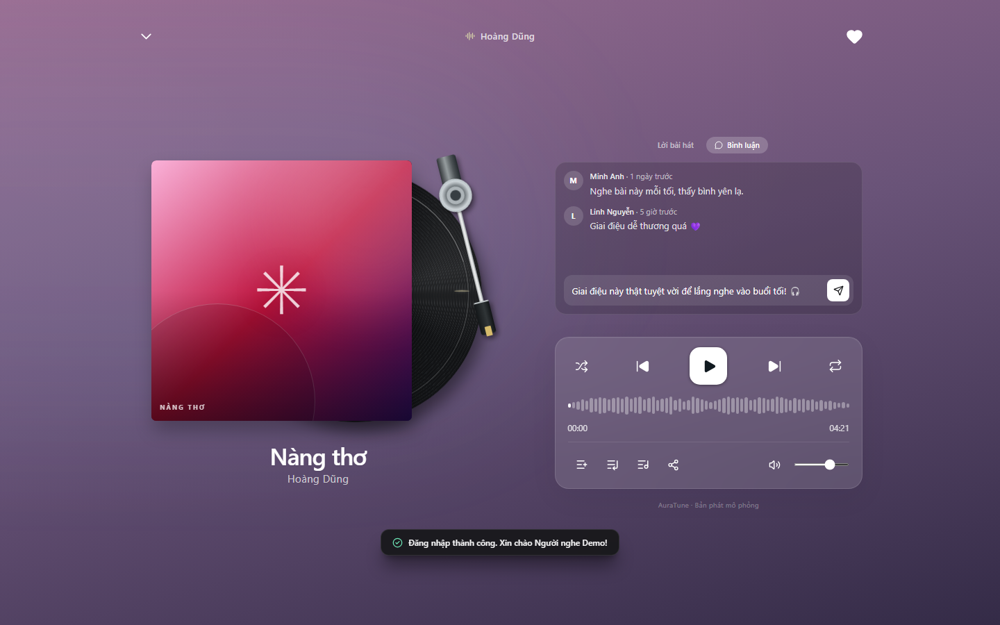
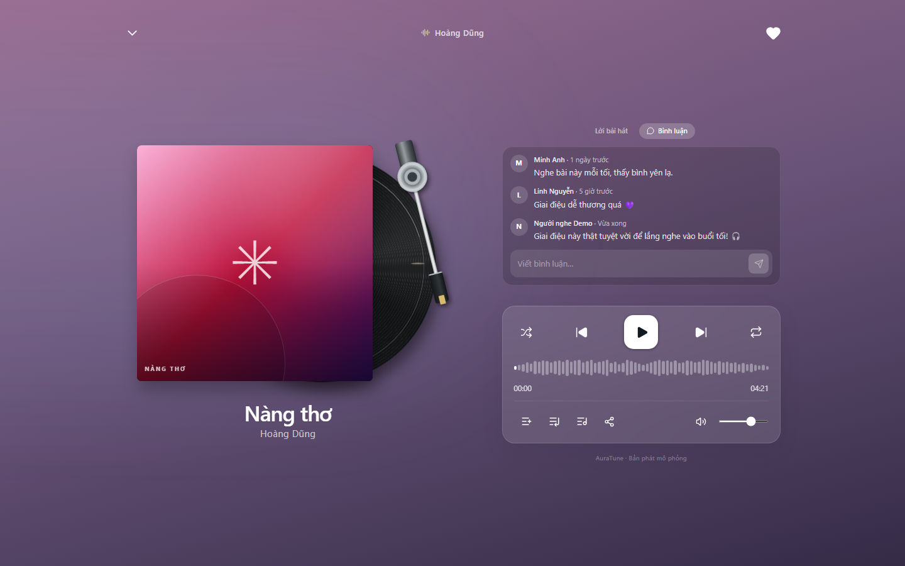
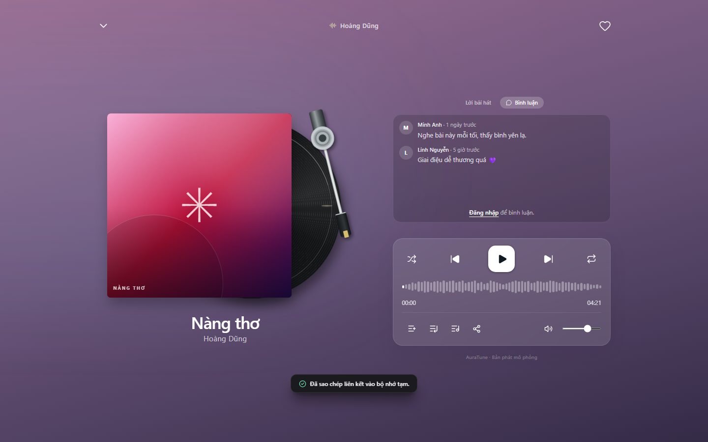

# UC-040-009 – Post Track Comment

---

## 1. Metadata

| Field | Value |
|---|---|
| **Use Case ID** | UC-040-009 |
| **Use Case Name** | Post Track Comment |
| **Functional Group** | 040 – Music Player |
| **Primary Actor** | Listener (`ACT-02`) |
| **Supporting Actors** | None |
| **Related FR IDs** | `046-FR-008`, `046-FR-009`, `046-FR-012`, `046-FR-013`, `046-FR-015` |
| **Related Feature/Spec** | Feature 046: Song Sharing and Comments (`specs/040-music-player/046-song-sharing-and-comments/spec.md`) |
| **Status** | Draft |
| **Writer** | Nguyễn Thanh Huy |
| **Reviewer** | TBD |

---

## 2. Description

A signed-in listener writes a comment about the current track in the full player and posts it so that other visitors can read it. The system rejects empty text, limits comments to 300 characters, and keeps unsent text when posting fails.

---

## 3. Preconditions

- For the Basic Flow, the actor is signed in as a `Listener` (`ACT-02`) (`046-FR-008`); a guest is handled in EF-01.
- The comments panel of the current track is open (`UC-040-008`).

---

## 4. Trigger

The listener selects the comment input ("Viết bình luận…").

---

## 5. Basic Flow

1. **Actor:** Types a comment in the input.
2. **System:** Stops input at 300 characters and enables the send control only when the text is not empty (`046-FR-009`).
3. **Actor:** Selects send.
4. **System:** Verifies on the server that the actor is signed in and the text is valid (`046-FR-012`).
5. **System:** Saves the comment and shows it in the thread with the listener's name and "Vừa xong".
6. **System:** Clears the input.

---

## 6. Alternative Flows

### AF-01 – Post With the Keyboard
- **Starting step:** Step 3 of the Basic Flow.
- **Condition:** The listener presses Enter instead of selecting send.
1. **Actor:** Presses Enter in the comment input.
2. **System:** Treats Enter as the send action when the text is not empty (`046-FR-009`).
- **Continuation:** Resumes at Step 4 of the Basic Flow.

---

## 7. Exception Flows

### EF-01 – Guest Tries to Comment
- **Starting step:** Step 1 of the Basic Flow.
- **Condition:** The actor is not signed in (`046-FR-015`).
1. **System:** Shows a sign-in prompt in place of the input.
2. **Actor:** Signs in through `UC-010-002`.
- **Continuation:** Resumes at Step 1 of the Basic Flow after sign-in.

### EF-02 – Empty or Whitespace-Only Text
- **Starting step:** Step 2 of the Basic Flow.
- **Condition:** The text contains no visible characters (`046-FR-009`).
1. **System:** Keeps the send control disabled, so nothing is posted.
- **Continuation:** Resumes at Step 1 of the Basic Flow.

### EF-03 – Posting Fails
- **Starting step:** Step 4 of the Basic Flow.
- **Condition:** The comment cannot be saved, for example because of a connection failure (`046-FR-013`).
1. **System:** Shows an error message and keeps the text in the input.
2. **Actor:** Selects send again.
- **Continuation:** Resumes at Step 4 of the Basic Flow.

### EF-04 – Session Expired
- **Starting step:** Step 4 of the Basic Flow.
- **Condition:** The server rejects the request because the session is no longer valid (`046-FR-012`).
1. **System:** Keeps the text and asks the actor to sign in again.
- **Continuation:** Continues via EF-01.

---

## 8. Postconditions

### Success
- The comment is stored with its author and creation time and is visible to all visitors.

### Failure
- No comment is stored, and the typed text is kept.

---

## 9. Special Requirements

- **Security**: Permissions are enforced on the server, not only in the interface (`046-FR-012`).
- **Efficiency**: Posting takes 2 interactions or fewer after typing.
- **Moderation**: Posted comments can be removed by administrators through `UC-040-010` and Group 110.

---

## 10. Prototype and Screenshots

> **Asset type**: Implementation screenshots captured from the current frontend prototype, which runs on demo data.

### Basic Flow

*Figure 1: A signed-in listener typing a comment (Steps 1–2).*

*Figure 2: The new comment shown in the thread (Step 5).*

### Exception Flow – EF-01 (Guest)

*Figure 3: Sign-in prompt shown to a guest instead of the comment input.*

### Exception Flow – EF-03 (Posting Fails)
*[Prototype Pending - To be generated during UI implementation]*  
*Planned Interface: Error message with the unsent text kept in the input.*

---

## 11. Related Use Cases

- **Extends**: `UC-040-008` (Read Track Comments).
- **Preceding Use Case for EF-01**: `UC-010-002` (Log In with Email and Password).
- **Related Use Case**: `UC-040-010` (Delete Track Comment).

---

## 12. Source References

- `specs/040-music-player/046-song-sharing-and-comments/spec.md` – Requirements FR-008, FR-009, FR-012, FR-013, FR-015, User Story 3, Edge Cases.
- `docs/analysis-and-design/api-contract.md` – Section 2.4: `POST /songs/:id/comments`.

---

## 13. Notes and Open Questions

- **Prototype Gap**: Comments are stored locally in the current prototype, so permissions are enforced only in the client.
