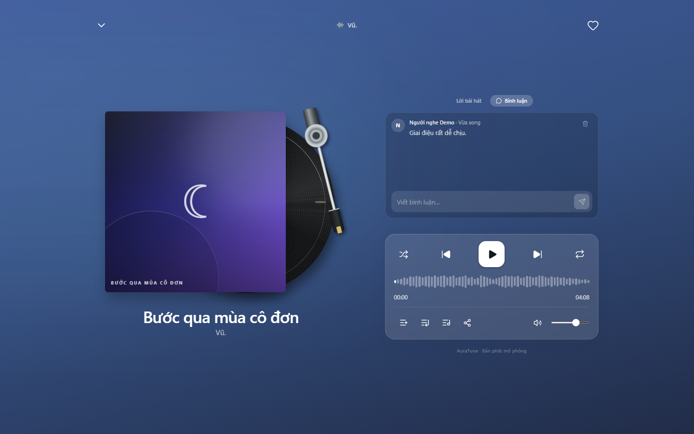

# UC-040-010 – Delete Track Comment
Performed by: Nguyễn Thanh Huy | Reviewed by: Group 10 team | Edited by: Lê Công Minh Nhựt

---

## 1. Metadata
Performed by: Nguyễn Thanh Huy | Reviewed by: Group 10 team | Edited by: Lê Công Minh Nhựt

| Field | Value |
|---|---|
| **Use Case ID** | UC-040-010 |
| **Use Case Name** | Delete Track Comment |
| **Functional Group** | 040 – Music Player |
| **Primary Actor** | Listener (`ACT-02`), Administrator (`ACT-05`) |
| **Supporting Actors** | None |
| **Related FR IDs** | `046-FR-010`, `046-FR-011`, `046-FR-012` |
| **Related Feature/Spec** | Feature 046: Song Sharing and Comments (`specs/040-music-player/046-song-sharing-and-comments/spec.md`) |
| **Status** | Draft |
| Writer | Lê Công Minh Nhựt |
| Original Writer (PA3 draft) | Nguyễn Thanh Huy |
| Reviewer | Group 10 team |

---

## 2. Description
Performed by: Nguyễn Thanh Huy | Reviewed by: Group 10 team | Edited by: Lê Công Minh Nhựt

The author of a comment removes their own comment, or an administrator removes any comment, from the comments panel of the full player. Users without permission never see the delete action, and the server enforces the rule.

---

## 3. Preconditions
Performed by: Nguyễn Thanh Huy | Reviewed by: Group 10 team | Edited by: Lê Công Minh Nhựt

- The comments panel of the current track is open (`UC-040-008`).
- The actor is signed in as the comment's author (`ACT-02`) or as an administrator (`ACT-05`).

---

## 4. Trigger
Performed by: Nguyễn Thanh Huy | Reviewed by: Group 10 team | Edited by: Lê Công Minh Nhựt

The actor selects the delete control on a comment.

---

## 5. Basic Flow
Performed by: Nguyễn Thanh Huy | Reviewed by: Group 10 team | Edited by: Lê Công Minh Nhựt

1. **System:** Shows the delete control only on comments the actor is allowed to delete (`046-FR-010`, `046-FR-011`).
2. **Actor:** Selects the delete control on a comment.
3. **System:** Verifies on the server that the actor is the author or an administrator (`046-FR-012`).
4. **System:** Deletes the comment and removes it from the thread.

---

## 6. Alternative Flows
Performed by: Nguyễn Thanh Huy | Reviewed by: Group 10 team | Edited by: Lê Công Minh Nhựt

### AF-01 – Administrator Deletes Another User's Comment
Performed by: Nguyễn Thanh Huy | Reviewed by: Group 10 team | Edited by: Lê Công Minh Nhựt
- **Starting step:** Step 1 of the Basic Flow.
- **Condition:** The actor is an administrator (`046-FR-010`).
1. **System:** Shows the delete control on every comment.
- **Continuation:** Resumes at Step 2 of the Basic Flow.

### AF-02 – Last Comment Deleted
Performed by: Nguyễn Thanh Huy | Reviewed by: Group 10 team | Edited by: Lê Công Minh Nhựt
- **Starting step:** Step 4 of the Basic Flow.
- **Condition:** The deleted comment was the only one.
1. **System:** Shows the empty comments state (`046-FR-014`).
- **Continuation:** Use case ends successfully.

---

## 7. Exception Flows
Performed by: Nguyễn Thanh Huy | Reviewed by: Group 10 team | Edited by: Lê Công Minh Nhựt

### EF-01 – Permission Denied by the Server
Performed by: Nguyễn Thanh Huy | Reviewed by: Group 10 team | Edited by: Lê Công Minh Nhựt
- **Starting step:** Step 3 of the Basic Flow.
- **Condition:** The actor is no longer allowed to delete the comment, for example after a role change (`046-FR-012`).
1. **System:** Keeps the comment and shows a not-authorized message.
- **Continuation:** Use case ends in failure.

### EF-02 – Deletion Fails
Performed by: Nguyễn Thanh Huy | Reviewed by: Group 10 team | Edited by: Lê Công Minh Nhựt
- **Starting step:** Step 4 of the Basic Flow.
- **Condition:** The request fails because of a connection or server error.
1. **System:** Keeps the comment and shows an error with a retry option.
- **Continuation:** Resumes at Step 2 on retry.

---

## 8. Postconditions
Performed by: Nguyễn Thanh Huy | Reviewed by: Group 10 team | Edited by: Lê Công Minh Nhựt

### Success
Performed by: Nguyễn Thanh Huy | Reviewed by: Group 10 team | Edited by: Lê Công Minh Nhựt
- The comment no longer exists and is hidden from all visitors.

### Failure
Performed by: Nguyễn Thanh Huy | Reviewed by: Group 10 team | Edited by: Lê Công Minh Nhựt
- The comment is unchanged.

---

## 9. Special Requirements
Performed by: Nguyễn Thanh Huy | Reviewed by: Group 10 team | Edited by: Lê Công Minh Nhựt

- **Security**: Users without permission cannot delete comments in any scenario; the server checks ownership or the administrator role (`046-FR-012`).
- **Accessibility**: The delete control has an accessible name.

---

## 10. Prototype and Screenshots
Performed by: Nguyễn Thanh Huy | Reviewed by: Group 10 team | Edited by: Lê Công Minh Nhựt

> **Asset type**: Implementation screenshots captured from the current frontend prototype, which runs on demo data.

### Basic Flow
Performed by: Nguyễn Thanh Huy | Reviewed by: Group 10 team | Edited by: Lê Công Minh Nhựt

*Figure 1: The author of a comment sees the delete control on it (Steps 1–2).*

### Alternative Flow – AF-01 and Exception Flows
Performed by: Nguyễn Thanh Huy | Reviewed by: Group 10 team | Edited by: Lê Công Minh Nhựt
*[Prototype Pending - To be generated during UI implementation]*  
*Planned Interface: Administrator view with delete controls on all comments, and the not-authorized and error messages.*

---

## 11. Related Use Cases
Performed by: Nguyễn Thanh Huy | Reviewed by: Group 10 team | Edited by: Lê Công Minh Nhựt

- **Optional entry from comment reading**: `UC-040-008` (Read Track Comments); deletion retains its independent authorization checks.
- **Related Use Case**: `UC-040-009` (Post Track Comment).
- **Related Moderation**: Group 110 – Content Moderation (`specs/110-admin-functions/112-content-moderation/spec.md`).

---

## 12. Source References
Performed by: Nguyễn Thanh Huy | Reviewed by: Group 10 team | Edited by: Lê Công Minh Nhựt

- `specs/040-music-player/046-song-sharing-and-comments/spec.md` – Requirements FR-010 to FR-012, User Story 3.
- `docs/analysis-and-design/api-contract.md` – Section 2.4: `DELETE /comments/:id` (User / Admin).

---

## 13. Notes and Open Questions
Performed by: Nguyễn Thanh Huy | Reviewed by: Group 10 team | Edited by: Lê Công Minh Nhựt

- **Mapping Correction**: The use-case model previously linked this use case to `112-FR-004`, which is about not exposing unrelated user data during moderation review, not deleting comments. The mapping now uses `046-FR-010` to `046-FR-012`.
- **Prototype Gap**: Permissions are enforced only in the client in the current prototype.

## PA4 implementation evidence and acceptance record
Performed by: Nguyễn Thanh Huy | Reviewed by: Group 10 team | Edited by: Lê Công Minh Nhựt

Player components and `useAudioPlayer.js` exist, with backend metadata/stream handling in `songController.js`. Comments remain browser-state operations in `AppStore.jsx`; backend lyrics and history-write integration remain open in Group 040 tasks. Stream/range tests are not proof of server-side comment persistence or every lyrics state.

The flows above state required behavior. This revision records source inspection only; no browser acceptance or new feature-test run is claimed. Before acceptance, execute the basic flow and its applicable alternative/exception flows, checking the documented success and failure postconditions. Record results against this UC ID in [the PA4 review register](../../use-case-model.md#11-pa4-decisions-and-source-review).
