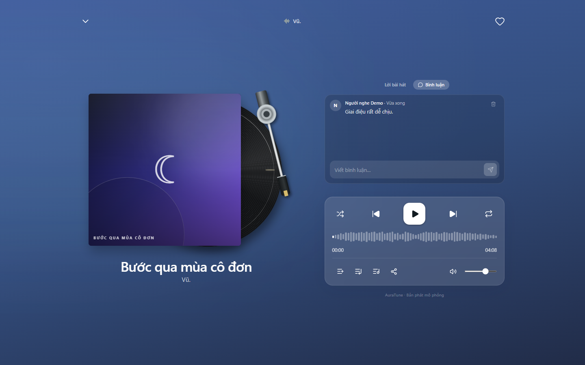

# UC-040-010 – Delete Track Comment

---

## 1. Metadata

| Field | Value |
|---|---|
| **Use Case ID** | UC-040-010 |
| **Use Case Name** | Delete Track Comment |
| **Functional Group** | 040 – Music Player |
| **Primary Actor** | Listener (`ACT-02`), Administrator (`ACT-05`) |
| **Supporting Actors** | None |
| **Related FR IDs** | `046-FR-010`, `046-FR-011`, `046-FR-012` |
| **Related Feature/Spec** | Feature 046: Song Sharing and Comments (`specs/040-music-player/046-song-sharing-and-comments/spec.md`) |
| **Status** | Draft |
| **Writer** | Nguyễn Thanh Huy |
| **Reviewer** | TBD |

---

## 2. Description

The author of a comment removes their own comment, or an administrator removes any comment, from the comments panel of the full player. Users without permission never see the delete action, and the server enforces the rule.

---

## 3. Preconditions

- The comments panel of the current track is open (`UC-040-008`).
- The actor is signed in as the comment's author (`ACT-02`) or as an administrator (`ACT-05`).

---

## 4. Trigger

The actor selects the delete control on a comment.

---

## 5. Basic Flow

1. **System:** Shows the delete control only on comments the actor is allowed to delete (`046-FR-010`, `046-FR-011`).
2. **Actor:** Selects the delete control on a comment.
3. **System:** Verifies on the server that the actor is the author or an administrator (`046-FR-012`).
4. **System:** Deletes the comment and removes it from the thread.

---

## 6. Alternative Flows

### AF-01 – Administrator Deletes Another User's Comment
- **Starting step:** Step 1 of the Basic Flow.
- **Condition:** The actor is an administrator (`046-FR-010`).
1. **System:** Shows the delete control on every comment.
- **Continuation:** Resumes at Step 2 of the Basic Flow.

### AF-02 – Last Comment Deleted
- **Starting step:** Step 4 of the Basic Flow.
- **Condition:** The deleted comment was the only one.
1. **System:** Shows the empty comments state (`046-FR-014`).
- **Continuation:** Use case ends successfully.

---

## 7. Exception Flows

### EF-01 – Permission Denied by the Server
- **Starting step:** Step 3 of the Basic Flow.
- **Condition:** The actor is no longer allowed to delete the comment, for example after a role change (`046-FR-012`).
1. **System:** Keeps the comment and shows a not-authorized message.
- **Continuation:** Use case ends in failure.

### EF-02 – Deletion Fails
- **Starting step:** Step 4 of the Basic Flow.
- **Condition:** The request fails because of a connection or server error.
1. **System:** Keeps the comment and shows an error with a retry option.
- **Continuation:** Resumes at Step 2 on retry.

---

## 8. Postconditions

### Success
- The comment no longer exists and is hidden from all visitors.

### Failure
- The comment is unchanged.

---

## 9. Special Requirements

- **Security**: Users without permission cannot delete comments in any scenario; the server checks ownership or the administrator role (`046-FR-012`).
- **Accessibility**: The delete control has an accessible name.

---

## 10. Prototype and Screenshots

> **Asset type**: Implementation screenshots captured from the current frontend prototype, which runs on demo data.

### Basic Flow

*Figure 1: The author of a comment sees the delete control on it (Steps 1–2).*

### Alternative Flow – AF-01 and Exception Flows
*[Prototype Pending - To be generated during UI implementation]*  
*Planned Interface: Administrator view with delete controls on all comments, and the not-authorized and error messages.*

---

## 11. Related Use Cases

- **Extends**: `UC-040-008` (Read Track Comments).
- **Related Use Case**: `UC-040-009` (Post Track Comment).
- **Related Moderation**: Group 110 – Content Moderation (`specs/110-admin-functions/112-content-moderation/spec.md`).

---

## 12. Source References

- `specs/040-music-player/046-song-sharing-and-comments/spec.md` – Requirements FR-010 to FR-012, User Story 3.
- `docs/analysis-and-design/api-contract.md` – Section 2.4: `DELETE /comments/:id` (User / Admin).

---

## 13. Notes and Open Questions

- **Mapping Correction**: The use-case model previously linked this use case to `112-FR-004`, which is about not exposing unrelated user data during moderation review, not deleting comments. The mapping now uses `046-FR-010` to `046-FR-012`.
- **Prototype Gap**: Permissions are enforced only in the client in the current prototype.
