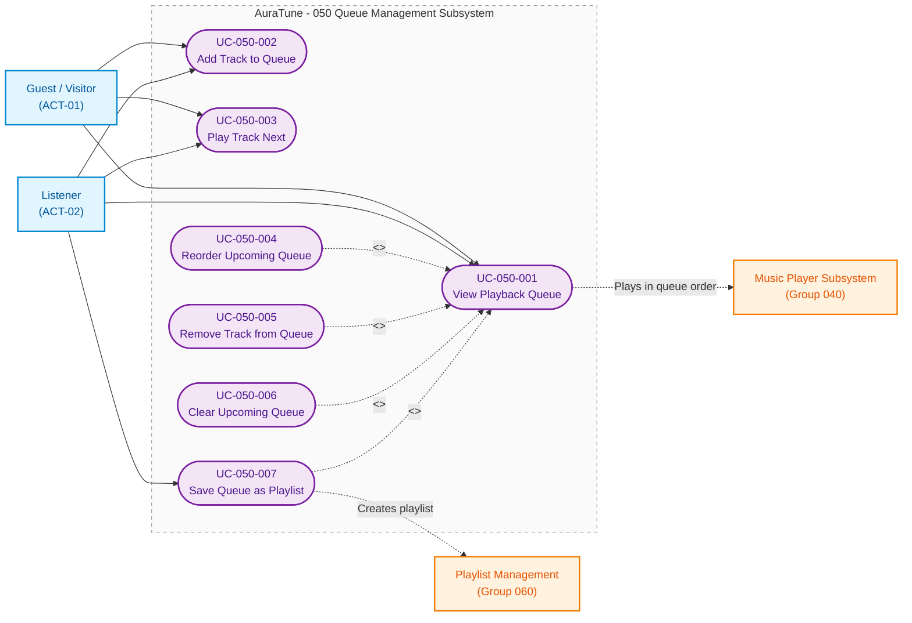

# Functional Group 050: Queue Management – Use-Case Documentation

---

## 5.1. Group Information

| Attribute | Details |
|---|---|
| **Group ID** | 050 |
| **Group Name** | Queue Management |
| **Group Owner** | Nguyễn Thanh Huy |
| **Module Purpose** | Gives listeners real-time control over what plays next: viewing, adding, prioritizing, reordering, removing, and clearing upcoming tracks, and saving the queue as a playlist. |
| **Documentation Status** | Draft — Baseline for Sprint 3 (PA3) Review |
| **Applicable Standards** | AuraTune Use-Case Documentation Guide, Spec Kit Architecture, PA3 Use-Case Specification Standard |

---

## 5.2. Scope

### 5.2.1 Purpose and Objectives
Functional Group 050 lets guests and listeners shape a listening session without interrupting the track that is playing. The queue is kept on the client in local browser storage, survives a page reload, and holds at most 50 tracks.

### 5.2.2 In-Scope Capabilities
The verified capabilities within Group 050 comprise four subfeatures:

1. **View Queue (Feature 051)**:
   - Right-aligned queue drawer with the current track and the ordered upcoming tracks and their count.
   - Play any upcoming track immediately and clear all upcoming tracks.
   - Queue persisted in local browser storage and restored in a paused state after a page reload.
   - Maximum queue capacity of 50 tracks.
   - "Save as Playlist" for signed-in listeners, connected to Group 060.

2. **Add and Remove Queue Items (Feature 052)**:
   - Add to the end of the queue from track menus and the full player, with confirmation.
   - No duplicate upcoming tracks, unavailable tracks refused, batch additions with a count.
   - Remove any upcoming track; the current track cannot be removed.

3. **Reorder Queue (Feature 053)**:
   - Drag-and-drop reordering plus up and down controls for keyboard and touch.

4. **Play Next (Feature 054)**:
   - Place a track directly after the current track, with the latest choice first.
   - Play Next takes priority over shuffle for the next track.

### 5.2.3 Out-of-Scope Exclusions
- **Audio Playback, Shuffle, and Repeat**: Owned by **Group 040 – Music Player**.
- **Playlist Creation and Editing Rules**: Owned by **Group 060 – Playlist Management**; Group 050 only starts the save action.
- **Server-Side Queue Sync Across Devices**: Not supported; the API Contract defines no queue endpoints.

### 5.2.4 Dependencies
- **Group 010 (Authentication)**: Required only for Save as Playlist.
- **Group 040 (Music Player)**: Plays the tracks in queue order and applies shuffle and repeat rules.
- **Group 060 (Playlist Management)**: Creates the playlist in `UC-050-007`.
- **Group 120 (AI Conversational Agent)**: Can add tracks to the queue on the listener's behalf (`UC-120-003`).

---

## 5.3. Related Requirements and Features

| Feature ID | Feature Name | Related FR IDs | Spec Path |
|---|---|---|---|
| **051** | View Queue | `051-FR-001` to `051-FR-013` | [`specs/050-queue-management/051-view-queue/spec.md`](../../../../specs/050-queue-management/051-view-queue/spec.md) |
| **052** | Add and Remove Queue Items | `052-FR-001` to `052-FR-012` | [`specs/050-queue-management/052-add-and-remove-queue-items/spec.md`](../../../../specs/050-queue-management/052-add-and-remove-queue-items/spec.md) |
| **053** | Reorder Queue | `053-FR-001` to `053-FR-009` | [`specs/050-queue-management/053-reorder-queue/spec.md`](../../../../specs/050-queue-management/053-reorder-queue/spec.md) |
| **054** | Play Next | `054-FR-001` to `054-FR-010` | [`specs/050-queue-management/054-play-next/spec.md`](../../../../specs/050-queue-management/054-play-next/spec.md) |

---

## 5.4. Actors

| Actor | Actor Type | Description | Related Use Cases |
|---|---|---|---|
| **Guest / Visitor** (`ACT-01`) | Primary Human Actor | Unauthenticated visitor who can view and edit the queue while streaming public music. | `UC-050-001` to `UC-050-006` |
| **Listener** (`ACT-02`) | Primary Human Actor | Authenticated user with all guest queue capabilities, plus saving the queue as a playlist. | `UC-050-001` to `UC-050-007` |

---

## 5.5. Use-Case Diagram

The following Mermaid diagram visualizes the boundary, actors, confirmed use cases, and relationships for **Group 050 – Queue Management**.

> **Note**: This diagram uses Mermaid `flowchart LR` syntax to represent conceptual UML Use-Case structures within standard Markdown viewers. Rounded nodes denote Use Cases, square nodes represent Actors and related subsystems, and dashed lines represent relationships across boundaries.



### Diagram Legend
- **Rounded nodes (`([ ... ])`)**: Confirmed Use Cases.
- **Solid Arrow (`-->`)**: Direct primary actor invocation. Reorder, remove, clear, and save are started from inside the queue panel, so they extend `UC-050-001`.
- **Dashed Arrow (`-.->`)**: `<<extend>>` relationship or cross-group dependency.
- **Subsystem Boundary (`subgraph`)**: Scope boundary of Group 050.

---

## 5.6. Use-Case List

| UC ID | Use-Case Name | Primary Actor | Related FRs | Specification File |
|---|---|---|---|---|
| **UC-050-001** | View Playback Queue | Guest / Listener | `051-FR-001` to `051-FR-005`, `051-FR-007` to `051-FR-011`, `051-FR-013` | [`UC-050-001-view-playback-queue.md`](./UC-050-001-view-playback-queue.md) |
| **UC-050-002** | Add Track to Queue | Guest / Listener | `052-FR-001` to `052-FR-007`, `052-FR-010` to `052-FR-012`, `051-FR-013` | [`UC-050-002-add-track-to-queue.md`](./UC-050-002-add-track-to-queue.md) |
| **UC-050-003** | Play Track Next | Guest / Listener | `054-FR-001` to `054-FR-010`, `052-FR-012`, `051-FR-013` | [`UC-050-003-play-track-next.md`](./UC-050-003-play-track-next.md) |
| **UC-050-004** | Reorder Upcoming Queue | Guest / Listener | `053-FR-001` to `053-FR-009` | [`UC-050-004-reorder-upcoming-queue.md`](./UC-050-004-reorder-upcoming-queue.md) |
| **UC-050-005** | Remove Track from Queue | Guest / Listener | `052-FR-008` to `052-FR-011` | [`UC-050-005-remove-track-from-queue.md`](./UC-050-005-remove-track-from-queue.md) |
| **UC-050-006** | Clear Upcoming Queue | Guest / Listener | `051-FR-006`, `051-FR-007` | [`UC-050-006-clear-upcoming-queue.md`](./UC-050-006-clear-upcoming-queue.md) |
| **UC-050-007** | Save Queue as Playlist | Listener | `051-FR-012` | [`UC-050-007-save-queue-as-playlist.md`](./UC-050-007-save-queue-as-playlist.md) |

---

## 5.7. Dependencies and Integration

```
+--------------------+        +-------------------------+        +--------------------+
| Track lists, menus |  add   |   Group 050:            |  save  | Group 060:         |
| and Group 120 agent| -----> |   Queue Management      | -----> | Playlist Management|
+--------------------+        |   (client, max 50,      |        | (new playlist)     |
                              |    browser storage)     |        +--------------------+
                              +-----------+-------------+
                                          |
                                          | queue order
                                          v
                              +-------------------------+
                              | Group 040: Music Player |
                              | (playback, shuffle,     |
                              |  repeat)                |
                              +-------------------------+
```

1. **Queue Sources**: Tracks enter the queue from track menus, the full player, collection playback, and the AI agent.
2. **Storage**: The queue lives in local browser storage on the client and is restored in a paused state after a reload. It does not sync across devices.
3. **Playback**: Group 040 plays tracks in queue order; an explicit Play Next choice overrides shuffle for the next track.
4. **Persistence as a Playlist**: `UC-050-007` hands the queued tracks to Group 060 to create a permanent playlist.

---

## 5.8. Open Issues and Architecture Clarifications

1. **Single-Song Start (`Q-050-2`)**:
   - *Status*: Open.
   - *Detail*: When a listener plays a single song from search, the queue could be replaced or the song could be inserted first. The use-case model records this as unresolved.
2. **Save as Playlist UI**:
   - *Status*: Confirmed requirement, not yet implemented.
   - *Detail*: `051-FR-012` is specified, but the action does not exist in the frontend. `UC-050-007` uses wireframes until screenshots are available.
3. **Persistence and Capacity**:
   - *Status*: Confirmed requirement, not yet implemented.
   - *Detail*: The queue must survive a reload (`051-FR-011`) and hold at most 50 tracks (`051-FR-013`). The current prototype does neither.
4. **Collections Over 50 Tracks**:
   - *Status*: Working interpretation, to be confirmed in spec 051.
   - *Detail*: Spec 051 does not say what happens when a started collection (`051-FR-004`) has more than 50 tracks. `UC-050-001` (AF-05), `UC-020-002` and `UC-020-005` (AF-04) keep only the first 50 available tracks and tell the listener, following the 052 edge case for batch additions.

---

## 5.9. References

- `docs/proposal/proposal.md` – Section 6.5: Queue Management
- `docs/proposal/Auratune_Vision_Document.md` – Feature Group G05
- `docs/management/team-contract.md` – Feature Ownership & Responsibilities
- `docs/requirements/use-case-model.md` – System-Level Use-Case Model
- `docs/requirements/use-cases/README.md` – Use-Case Documentation Standards
- `specs/050-queue-management/051-view-queue/spec.md`
- `specs/050-queue-management/052-add-and-remove-queue-items/spec.md`
- `specs/050-queue-management/053-reorder-queue/spec.md`
- `specs/050-queue-management/054-play-next/spec.md`
- `docs/requirements/use-cases/050-queue-management/use-case-inventory.md`
- `docs/requirements/use-cases/050-queue-management/prototypes/README.md`
