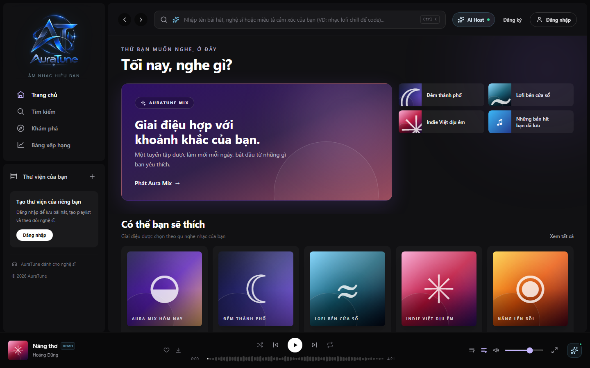
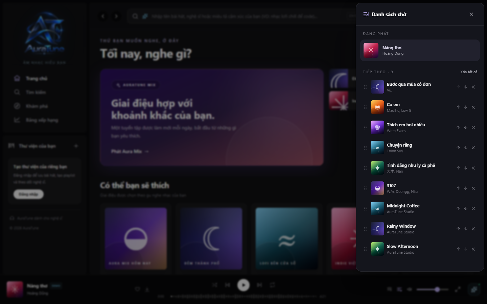
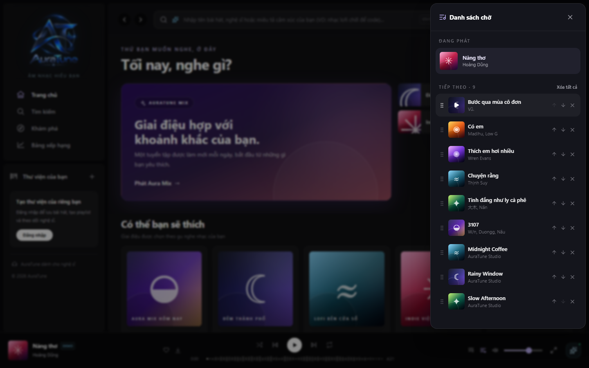
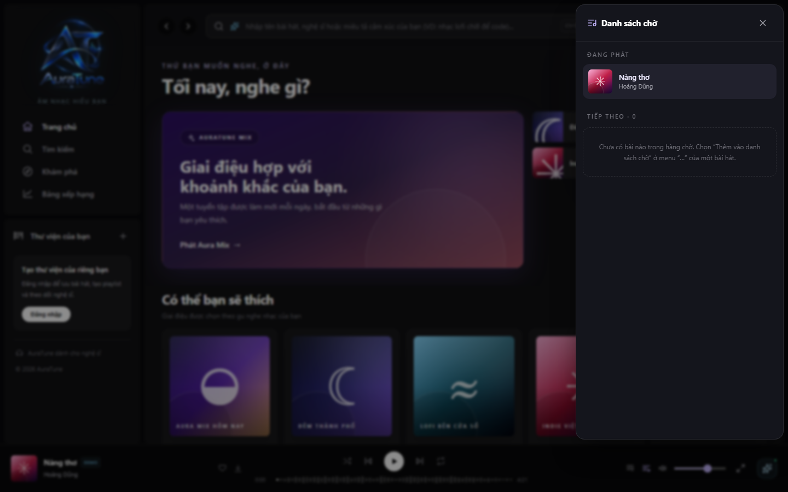

# UC-050-001 – View Playback Queue

---

## 1. Metadata

| Field | Value |
|---|---|
| **Use Case ID** | UC-050-001 |
| **Use Case Name** | View Playback Queue |
| **Functional Group** | 050 – Queue Management |
| **Primary Actor** | Guest / Visitor (`ACT-01`), Listener (`ACT-02`) |
| **Supporting Actors** | None |
| **Related FR IDs** | `051-FR-001`, `051-FR-002`, `051-FR-003`, `051-FR-004`, `051-FR-005`, `051-FR-007`, `051-FR-008`, `051-FR-009`, `051-FR-010`, `051-FR-011`, `051-FR-013` |
| **Related Feature/Spec** | Feature 051: View Queue (`specs/050-queue-management/051-view-queue/spec.md`) |
| **Status** | Draft |
| **Writer** | Nguyễn Thanh Huy |
| **Reviewer** | TBD |

---

## 2. Description

A guest or listener opens the queue panel from the player to see the track that is playing now and the ordered list of tracks that will play next, without interrupting playback. The actor can play any upcoming track immediately. The queue is kept in local browser storage, so it is restored in a paused state after a page reload.

---

## 3. Preconditions

- A track is loaded in the player, either playing or paused (`UC-040-001`).
- The queue was set by starting a collection, such as a playlist, album, chart, or result list (`051-FR-004`), or by queue actions in `UC-050-002` and `UC-050-003`.

---

## 4. Trigger

The actor selects the queue control ("Danh sách chờ") in the mini player or the full player.

---

## 5. Basic Flow

1. **Actor:** Selects the queue control in the player (`051-FR-001`).
2. **System:** Opens the queue panel as a right-aligned drawer with a backdrop, without interrupting playback (`051-FR-009`).
3. **System:** Shows the current track in the "Đang phát" area with cover art, title, and artist (`051-FR-002`).
4. **System:** Shows the upcoming tracks in playback order under "Tiếp theo" together with their count (`051-FR-003`).
5. **Actor:** Reviews the upcoming tracks.
6. **Actor:** Selects the play action on an upcoming track.
7. **System:** Plays that track immediately and updates the panel to show it as the current track (`051-FR-005`, `051-FR-010`).
8. **Actor:** Closes the panel with the close control, the backdrop, or the Escape key (`051-FR-008`).
9. **System:** Closes the panel and keeps playback running (`051-FR-009`).

---

## 6. Alternative Flows

### AF-01 – Track Changes While the Panel Is Open
- **Starting step:** Step 5 of the Basic Flow.
- **Condition:** The current track ends or the actor presses next (`051-FR-010`).
1. **System:** Moves the next track to "Đang phát" and updates the upcoming list and count immediately.
- **Continuation:** Resumes at Step 5 of the Basic Flow.

### AF-02 – No Upcoming Tracks
- **Starting step:** Step 4 of the Basic Flow.
- **Condition:** The current track is the last one in the queue (`051-FR-007`).
1. **System:** Shows guidance on adding tracks from a track's "…" menu and hides the clear action.
- **Continuation:** Resumes at Step 8 of the Basic Flow.

### AF-03 – Restore the Queue After a Page Reload
- **Starting step:** Step 1 of the Basic Flow.
- **Condition:** The actor reloaded the page while a queue existed (`051-FR-011`).
1. **System:** Restores the current track and upcoming tracks from local browser storage in a paused state.
2. **Actor:** Opens the queue panel.
- **Continuation:** Resumes at Step 2 of the Basic Flow.

### AF-04 – Many Upcoming Tracks
- **Starting step:** Step 4 of the Basic Flow.
- **Condition:** The upcoming list is longer than the panel height.
1. **System:** Scrolls the list inside the panel and truncates long titles without breaking the layout.
- **Continuation:** Resumes at Step 5 of the Basic Flow.

### AF-05 – Queue Set From a Collection Longer Than 50 Tracks
- **Starting step:** Step 4 of the Basic Flow.
- **Condition:** The queue was set by starting a collection with more than 50 available tracks (`051-FR-004`, `051-FR-013`).
1. **System:** Shows only the first 50 available tracks of the collection, in collection order, counting the current track; the remaining tracks of the collection are not in the queue.
- **Continuation:** Resumes at Step 5 of the Basic Flow.

---

## 7. Exception Flows

### EF-01 – Saved Queue Cannot Be Restored
- **Starting step:** Step 1 of AF-03.
- **Condition:** Browser storage is unavailable or the saved queue cannot be read.
1. **System:** Starts with the default queue and keeps the application usable.
- **Continuation:** Resumes at Step 1 of the Basic Flow.

### EF-02 – Selected Upcoming Track Is No Longer Available
- **Starting step:** Step 7 of the Basic Flow.
- **Condition:** The selected track became unavailable after it was queued.
1. **System:** Refuses to play the track and shows a message, as defined in `UC-040-001`.
- **Continuation:** Resumes at Step 5 of the Basic Flow.

---

## 8. Postconditions

### Success
- The actor has seen the current track and the upcoming tracks in their real playback order and count.
- Playback was never interrupted by opening or closing the panel.
- The queue remains stored in local browser storage.

### Failure
- The panel shows the default queue if the saved queue could not be restored, and the application stays usable.

---

## 9. Special Requirements

- **Consistency**: The displayed order always matches the playback order, and the count always matches the list.
- **Accessibility**: The panel opens in 1 interaction and can be closed with the keyboard (Escape).
- **Storage**: The queue is stored only on the client; there are no queue endpoints in the API Contract, so it does not sync across devices.
- **Capacity**: The queue never holds more than 50 tracks, including the current track (`051-FR-013`).

---

## 10. Prototype and Screenshots

> **Asset type**: Implementation screenshots captured from the current frontend prototype, which runs on demo data.

### Basic Flow

*Figure 1: Queue control in the mini player (Step 1).*

*Figure 2: Queue panel with the current track and upcoming tracks (Steps 2–4).*

*Figure 3: Upcoming track with play-now, reorder, and remove actions (Step 6).*

### Alternative Flow – AF-02 (No Upcoming Tracks)

*Figure 4: Guidance shown when nothing is upcoming.*

### Alternative Flow – AF-03 (Restore After Reload)
*[Prototype Pending - To be generated during UI implementation]*  
*Planned Interface: Player and queue restored in a paused state after a page reload. The current prototype resets the queue on reload.*

### Alternative Flow – AF-05 (Collection Longer Than 50 Tracks)
*[Prototype Pending - To be generated during UI implementation]*  
*Planned Interface: Queue panel holding the first 50 tracks of a long collection. The current prototype does not limit the queue.*

---

## 11. Related Use Cases

- **Preceding Use Case**: `UC-040-001` (Control Audio Playback) – Loads the track and queue.
- **Extended by**:
  - `UC-050-004` (Reorder Upcoming Queue)
  - `UC-050-005` (Remove Track from Queue)
  - `UC-050-006` (Clear Upcoming Queue)
  - `UC-050-007` (Save Queue as Playlist)
- **Queue Sources**: `UC-050-002` (Add Track to Queue), `UC-050-003` (Play Track Next).

---

## 12. Source References

- `specs/050-queue-management/051-view-queue/spec.md` – Requirements FR-001 to FR-005, FR-007 to FR-011, and FR-013, User Stories 1–3, Clarifications 2026-10-31 and 2026-11-01.
- `specs/050-queue-management/052-add-and-remove-queue-items/spec.md` – Edge Case "Batch exceeding the limit".
- `docs/proposal/Auratune_Vision_Document.md` – Group G05.
- `docs/proposal/proposal.md` – Section 6.5: Queue Management.
- `docs/design/architecture/feature-modules.md` – No queue endpoints in the API Contract.

---

## 13. Notes and Open Questions

- **Storage Decision**: Clarification session 2026-11-01 confirmed that the queue survives a page reload through local browser storage.
- **Single-Song Start (`Q-050-2`)**: Whether playing a single song from search replaces the queue or inserts the song at the top is still open in the use-case model.
- **Collections Over 50 Tracks**: Specification 051 does not state what happens when a started collection has more than 50 tracks. AF-05 applies the 052 edge case for batch additions: only the tracks that fit are added. The same rule is used in `UC-020-002` (AF-04) and `UC-020-005` (AF-04). This needs to be confirmed as a clarification of spec 051.
- **Prototype Gap**: The current prototype does not save the queue, so it resets after a reload; the panel is modal, so the page behind it cannot be used while it is open.
