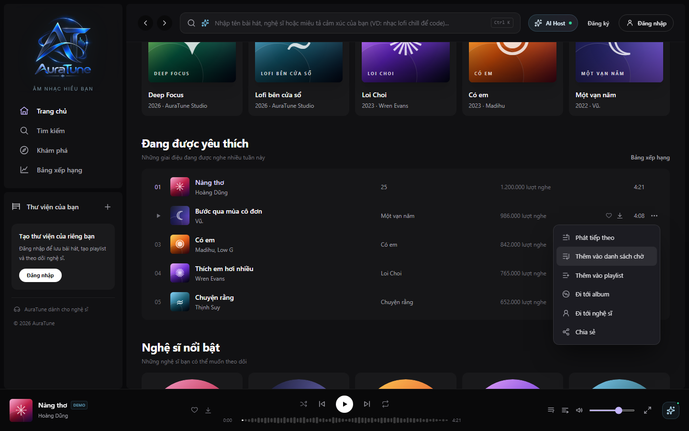
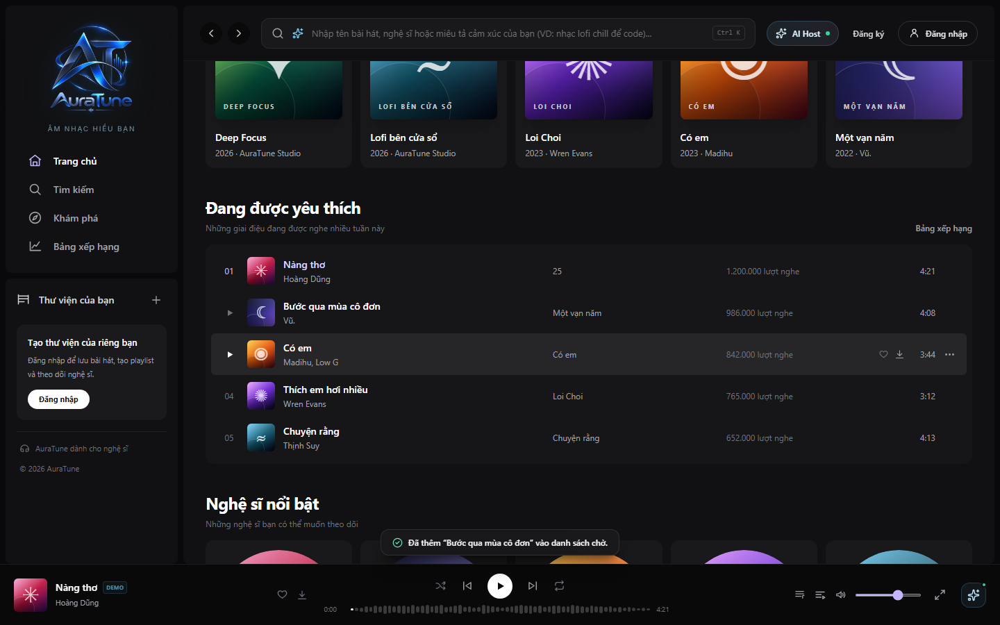
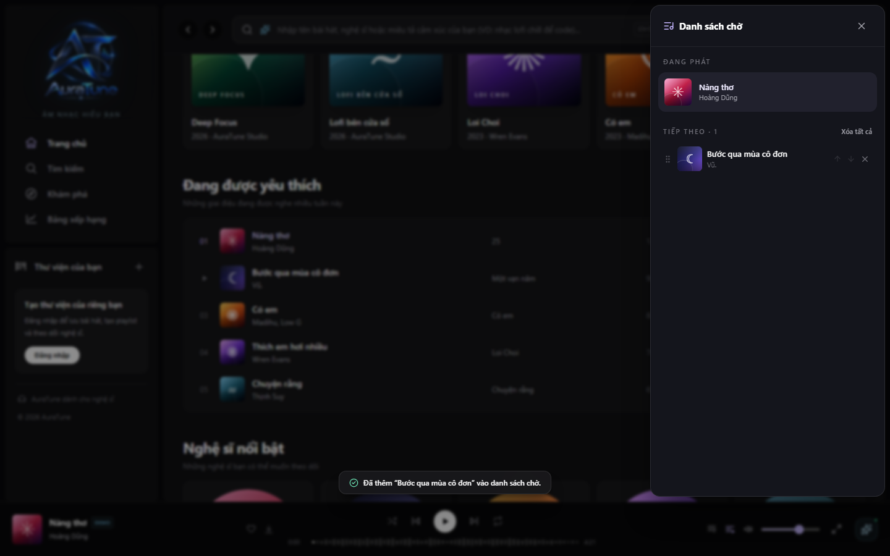
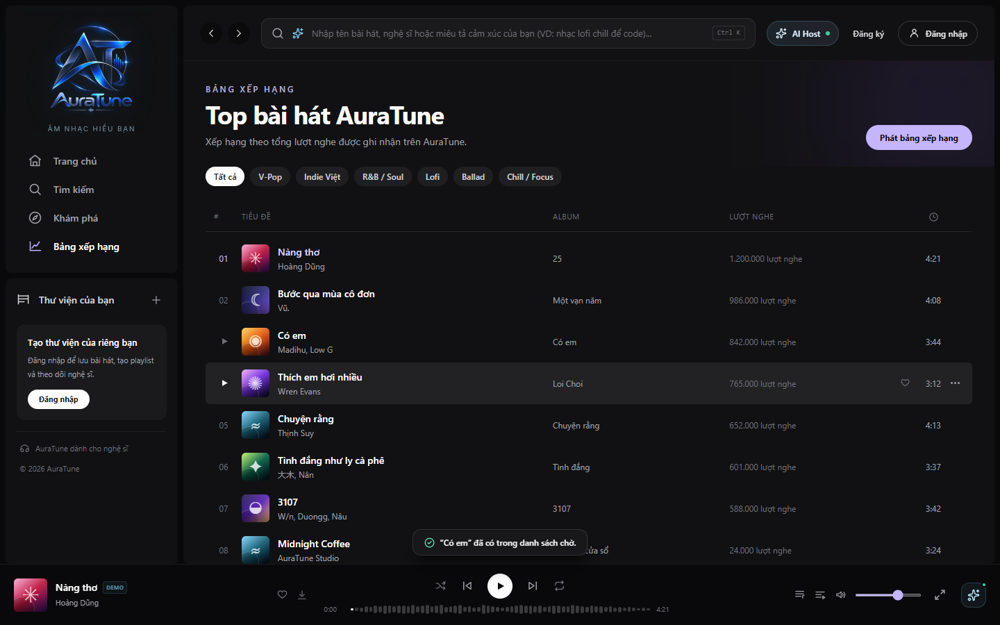

# UC-050-002 – Add Track to Queue

---

## 1. Metadata

| Field | Value |
|---|---|
| **Use Case ID** | UC-050-002 |
| **Use Case Name** | Add Track to Queue |
| **Functional Group** | 050 – Queue Management |
| **Primary Actor** | Guest / Visitor (`ACT-01`), Listener (`ACT-02`) |
| **Supporting Actors** | None |
| **Related FR IDs** | `052-FR-001`, `052-FR-002`, `052-FR-003`, `052-FR-004`, `052-FR-005`, `052-FR-006`, `052-FR-007`, `052-FR-010`, `052-FR-011`, `052-FR-012`, `051-FR-013` |
| **Related Feature/Spec** | Feature 052: Add and Remove Queue Items (`specs/050-queue-management/052-add-and-remove-queue-items/spec.md`) |
| **Status** | Draft |
| **Writer** | Nguyễn Thanh Huy |
| **Reviewer** | TBD |

---

## 2. Description

A guest or listener adds a track to the end of the queue from any track list or from the full player, so that it plays later without interrupting the current track. The system prevents duplicate upcoming tracks, refuses unavailable tracks, enforces the 50-track queue limit, and confirms every action.

---

## 3. Preconditions

- A track list or the full player is visible to the actor.
- The queue contains fewer than 50 tracks (`052-FR-012`, `051-FR-013`).

---

## 4. Trigger

The actor opens a track's "…" menu and selects "Thêm vào danh sách chờ", or selects the add-to-queue control in the full player.

---

## 5. Basic Flow

1. **Actor:** Opens the "…" menu of a track in a list.
2. **System:** Shows the track menu, including "Thêm vào danh sách chờ".
3. **Actor:** Selects "Thêm vào danh sách chờ" (`052-FR-001`).
4. **System:** Verifies that the track is available, is not the current track, is not already upcoming, and that the queue has room (`052-FR-003`, `052-FR-006`, `052-FR-012`).
5. **System:** Appends the track to the end of the queue without interrupting playback (`052-FR-001`, `052-FR-011`).
6. **System:** Shows a confirmation, for example "Đã thêm "…" vào danh sách chờ." (`052-FR-002`).
7. **System:** Updates the upcoming list and count immediately (`052-FR-010`).
8. **Actor:** Continues listening; the added track plays after the tracks before it.

---

## 6. Alternative Flows

### AF-01 – Track Already Upcoming or Playing
- **Starting step:** Step 4 of the Basic Flow.
- **Condition:** The track is already in the upcoming list or is the current track (`052-FR-003`, `052-FR-004`).
1. **System:** Leaves the queue unchanged.
2. **System:** Tells the actor that the track is already in the queue or is playing.
- **Continuation:** Use case ends successfully with no change.

### AF-02 – Track Was Played Earlier
- **Starting step:** Step 4 of the Basic Flow.
- **Condition:** The track is in the queue but has already been played (`052-FR-005`).
1. **System:** Moves the track to the end of the queue.
- **Continuation:** Resumes at Step 6 of the Basic Flow.

### AF-03 – Add From the Full Player
- **Starting step:** Step 1 of the Basic Flow.
- **Condition:** The actor uses the add-to-queue control in the full player (`052-FR-001`).
1. **Actor:** Selects the add-to-queue control.
- **Continuation:** Resumes at Step 4 of the Basic Flow.

### AF-04 – Add Several Tracks at Once
- **Starting step:** Step 3 of the Basic Flow.
- **Condition:** The actor adds a set of tracks, for example all tracks of a list (`052-FR-007`).
1. **System:** Skips tracks that are already upcoming or unavailable.
2. **System:** Appends the remaining tracks in order, up to the 50-track limit.
3. **System:** Tells the actor how many tracks were added, or that nothing new was added.
- **Continuation:** Resumes at Step 7 of the Basic Flow.

---

## 7. Exception Flows

### EF-01 – Track Unavailable
- **Starting step:** Step 4 of the Basic Flow.
- **Condition:** The track is hidden, removed, or otherwise unavailable (`052-FR-006`).
1. **System:** Refuses the add and tells the actor that the track is unavailable.
- **Continuation:** Use case ends in failure; the queue is unchanged.

### EF-02 – Queue Limit Reached
- **Starting step:** Step 4 of the Basic Flow.
- **Condition:** The queue already contains 50 tracks (`052-FR-012`, `051-FR-013`).
1. **System:** Refuses the add.
2. **System:** Tells the actor that the 50-track limit has been reached and suggests removing or clearing tracks.
- **Continuation:** Use case ends in failure; the actor can continue in `UC-050-005` or `UC-050-006`.

---

## 8. Postconditions

### Success
- The track is the last item in the queue, appears only once among upcoming tracks, and the count is updated.
- The queue, including the new track, is stored in local browser storage.
- Current playback continued without interruption.

### Failure
- The queue is unchanged, and the actor has been told why.

---

## 9. Special Requirements

- **Efficiency**: Adding a track takes 2 interactions from a track list.
- **Integrity**: No duplicate upcoming tracks and never more than 50 tracks in the queue.
- **Feedback**: Every add attempt produces a confirmation or a notice.

---

## 10. Prototype and Screenshots

> **Asset type**: Implementation screenshots captured from the current frontend prototype, which runs on demo data.

### Basic Flow

*Figure 1: Track menu with "Thêm vào danh sách chờ" (Steps 1–3).*

*Figure 2: Confirmation after adding a track (Step 6).*

*Figure 3: The added track at the end of the upcoming list (Step 7).*

### Alternative Flow – AF-01 (Already Upcoming)

*Figure 4: Notice shown when the track is already in the queue.*

### Exception Flows – EF-01 and EF-02 (Unavailable Track, Queue Limit)
*[Prototype Pending - To be generated during UI implementation]*  
*Planned Interface: Notices for an unavailable track and for a full queue of 50 tracks. The current prototype does not enforce either rule for single adds.*

---

## 11. Related Use Cases

- **Context**: `UC-050-001` (View Playback Queue) – Shows the result.
- **Related Action**: `UC-050-003` (Play Track Next) – Places a track first instead of last.
- **Recovery for EF-02**: `UC-050-005` (Remove Track from Queue), `UC-050-006` (Clear Upcoming Queue).
- **Included by**: `UC-120-003` (Execute Music Actions via Conversational Agent).

---

## 12. Source References

- `specs/050-queue-management/052-add-and-remove-queue-items/spec.md` – Requirements FR-001 to FR-007 and FR-010 to FR-012, User Story 1, Clarifications 2026-10-31 and 2026-11-01.
- `specs/050-queue-management/051-view-queue/spec.md` – FR-013: maximum queue capacity of 50 tracks.
- `docs/proposal/Auratune_Vision_Document.md` – Group G05.
- `docs/proposal/proposal.md` – Section 6.5: Queue Management.

---

## 13. Notes and Open Questions

- **De-duplication Scope**: Clarification session 2026-11-01 states that de-duplication applies to manual additions; starting a collection keeps the collection's original order.
- **Prototype Gap**: Single adds of unavailable tracks are not blocked, and the 50-track limit is not enforced in the current prototype.
