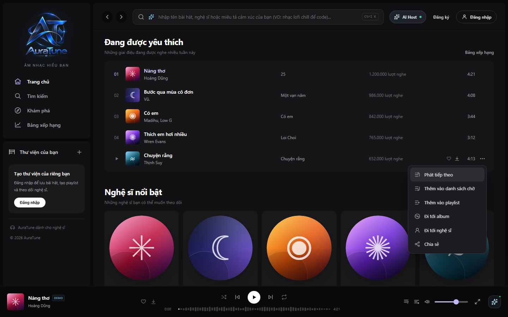
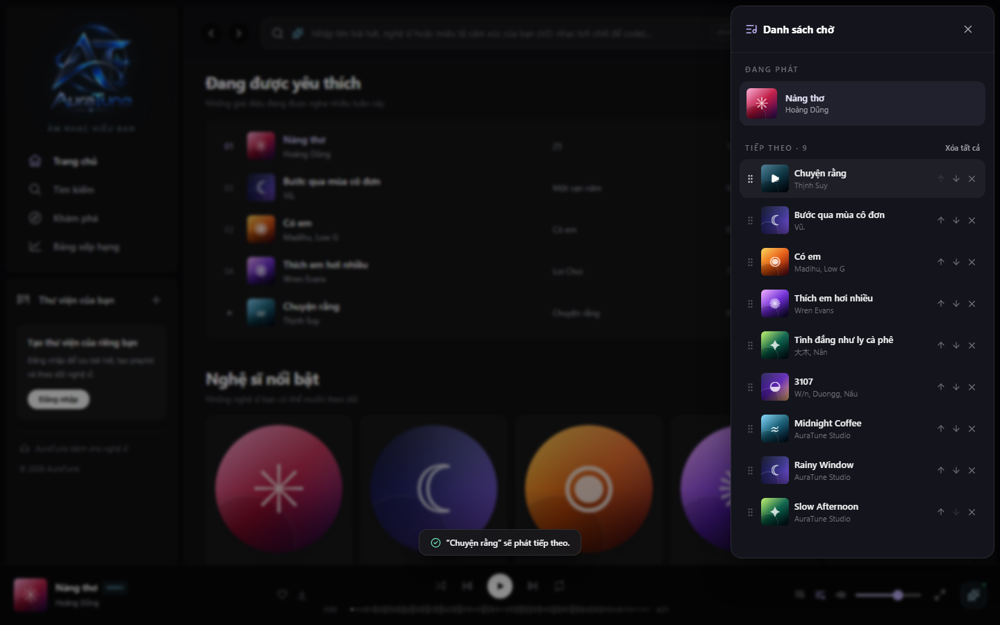
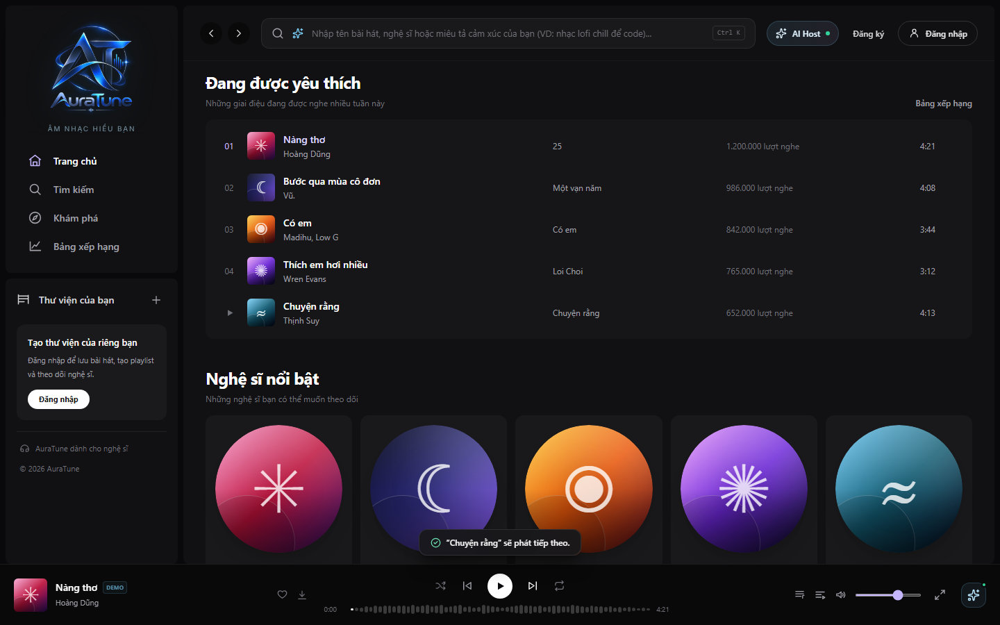
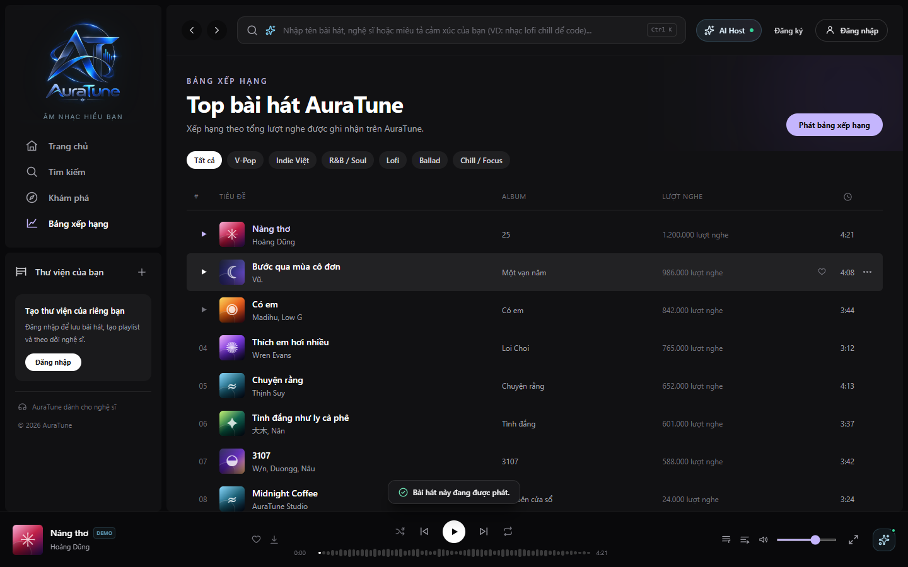

# UC-050-003 – Play Track Next

---

## 1. Metadata

| Field | Value |
|---|---|
| **Use Case ID** | UC-050-003 |
| **Use Case Name** | Play Track Next |
| **Functional Group** | 050 – Queue Management |
| **Primary Actor** | Guest / Visitor (`ACT-01`), Listener (`ACT-02`) |
| **Supporting Actors** | None |
| **Related FR IDs** | `054-FR-001`, `054-FR-002`, `054-FR-003`, `054-FR-004`, `054-FR-005`, `054-FR-006`, `054-FR-007`, `054-FR-008`, `054-FR-009`, `054-FR-010`, `052-FR-012`, `051-FR-013` |
| **Related Feature/Spec** | Feature 054: Play Next (`specs/050-queue-management/054-play-next/spec.md`) |
| **Status** | Draft |
| **Writer** | Nguyễn Thanh Huy |
| **Reviewer** | TBD |

---

## 2. Description

A guest or listener chooses a track to play immediately after the current one, without clearing the rest of the queue. The system places the track directly after the current track, moves it instead of duplicating it when it is already queued, and plays it next even when shuffle is on.

---

## 3. Preconditions

- A track is loaded in the player (`UC-040-001`).
- A track list with the "…" menu is visible to the actor.

---

## 4. Trigger

The actor opens a track's "…" menu and selects "Phát tiếp theo".

---

## 5. Basic Flow

1. **Actor:** Opens the "…" menu of a track.
2. **System:** Shows the track menu with "Phát tiếp theo" as its first action (`054-FR-001`).
3. **Actor:** Selects "Phát tiếp theo".
4. **System:** Verifies that the track is available and is not the current track (`054-FR-007`, `054-FR-008`).
5. **System:** Places the track directly after the current track, keeping the order of the other upcoming tracks (`054-FR-002`, `054-FR-004`).
6. **System:** Shows a confirmation, for example ""…" sẽ phát tiếp theo." (`054-FR-006`).
7. **System:** Keeps the current track playing without interruption (`054-FR-010`).
8. **Actor:** Lets the current track finish or presses next.
9. **System:** Plays the chosen track next, including when shuffle is on (`054-FR-009`).

---

## 6. Alternative Flows

### AF-01 – Track Already in the Queue
- **Starting step:** Step 5 of the Basic Flow.
- **Condition:** The chosen track is already upcoming (`054-FR-003`).
1. **System:** Moves the track to the position directly after the current track and does not duplicate it.
- **Continuation:** Resumes at Step 6 of the Basic Flow.

### AF-02 – Track Is Already Playing
- **Starting step:** Step 4 of the Basic Flow.
- **Condition:** The chosen track is the current track (`054-FR-007`).
1. **System:** Leaves the queue unchanged.
2. **System:** Tells the actor that the track is already playing.
- **Continuation:** Use case ends successfully with no change.

### AF-03 – Play Next Used Several Times
- **Starting step:** Step 5 of the Basic Flow.
- **Condition:** The actor has already chosen other tracks with Play Next (`054-FR-005`).
1. **System:** Places the most recent choice first, followed by the earlier choices.
- **Continuation:** Resumes at Step 6 of the Basic Flow.

### AF-04 – Empty Upcoming List
- **Starting step:** Step 5 of the Basic Flow.
- **Condition:** No tracks are upcoming.
1. **System:** Makes the chosen track the only upcoming track.
- **Continuation:** Resumes at Step 6 of the Basic Flow.

---

## 7. Exception Flows

### EF-01 – Track Unavailable
- **Starting step:** Step 4 of the Basic Flow.
- **Condition:** The chosen track is unavailable (`054-FR-008`).
1. **System:** Refuses the action and tells the actor that the track is unavailable.
- **Continuation:** Use case ends in failure; the queue is unchanged.

### EF-02 – Queue Limit Reached
- **Starting step:** Step 5 of the Basic Flow.
- **Condition:** The queue already contains 50 tracks and the chosen track is not in it (`052-FR-012`, `051-FR-013`).
1. **System:** Refuses to add the track and tells the actor that the 50-track limit has been reached.
- **Continuation:** Use case ends in failure. A track already in the queue can still be moved via AF-01.

---

## 8. Postconditions

### Success
- The chosen track is the first upcoming track and appears only once in the queue.
- The other upcoming tracks keep their order.
- The chosen track plays next, regardless of shuffle, and the queue is stored in local browser storage.

### Failure
- The queue is unchanged, and the actor has been told why.

---

## 9. Special Requirements

- **Efficiency**: The action takes 2 interactions from a track list.
- **Priority Rule**: An explicit Play Next choice takes priority over the next random selection when shuffle is on.
- **Repeat One**: With repeat one on, the current track keeps repeating until the actor presses next (054 Edge Cases).

---

## 10. Prototype and Screenshots

> **Asset type**: Implementation screenshots captured from the current frontend prototype, which runs on demo data.

### Basic Flow

*Figure 1: "Phát tiếp theo" at the top of the track menu (Steps 1–3).*

*Figure 2: Confirmation after choosing Play Next (Step 6).*

*Figure 3: The chosen track at the top of the upcoming list (Step 5).*

*Figure 4: The chosen track playing after the current one ended (Step 9).*

### Alternative Flow – AF-02 (Already Playing)

*Figure 5: Notice shown when Play Next is chosen for the current track.*

### Exception Flows – EF-01 and EF-02
*[Prototype Pending - To be generated during UI implementation]*  
*Planned Interface: Notices for an unavailable track and for a full queue.*

---

## 11. Related Use Cases

- **Context**: `UC-050-001` (View Playback Queue).
- **Related Action**: `UC-050-002` (Add Track to Queue) – Places a track last instead of first.
- **Interaction**: `UC-040-004` (Toggle Shuffle and Repeat Modes) – Play Next overrides shuffle for the next track.

---

## 12. Source References

- `specs/050-queue-management/054-play-next/spec.md` – Requirements FR-001 to FR-010, User Stories 1–2, Edge Cases.
- `specs/050-queue-management/052-add-and-remove-queue-items/spec.md` – FR-012: queue capacity.
- `specs/050-queue-management/051-view-queue/spec.md` – FR-013: queue capacity.
- `docs/proposal/Auratune_Vision_Document.md` – Group G05.

---

## 13. Notes and Open Questions

- **Prototype Gap**: With shuffle on, the current prototype picks a random track and can skip the Play Next choice; Play Next also does not refuse unavailable tracks (see Known Gaps in the 054 specification).
