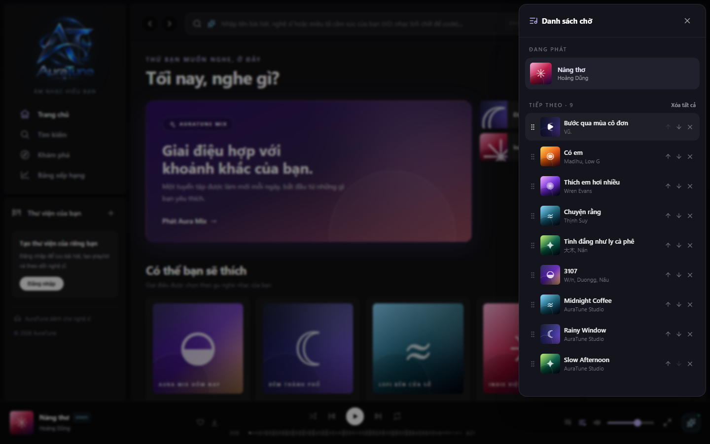
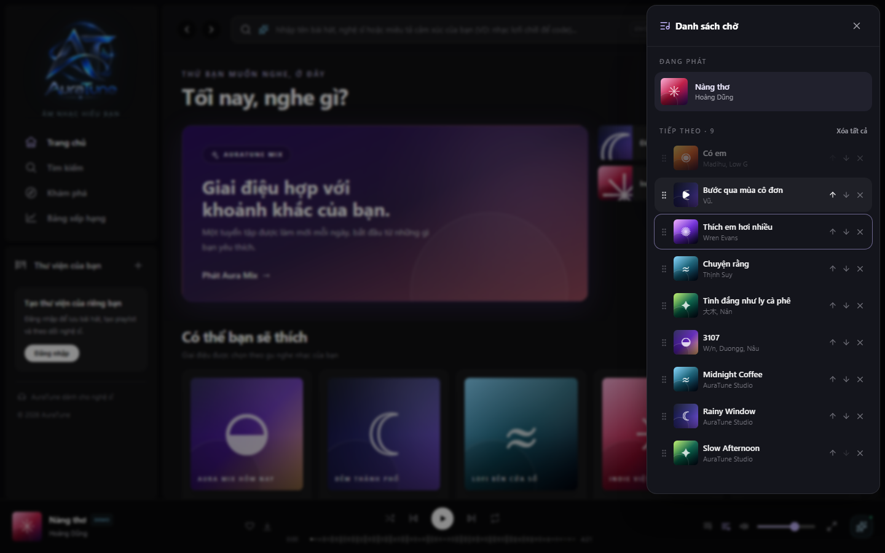

# UC-050-004 – Reorder Upcoming Queue

---

## 1. Metadata

| Field | Value |
|---|---|
| **Use Case ID** | UC-050-004 |
| **Use Case Name** | Reorder Upcoming Queue |
| **Functional Group** | 050 – Queue Management |
| **Primary Actor** | Guest / Visitor (`ACT-01`), Listener (`ACT-02`) |
| **Supporting Actors** | None |
| **Related FR IDs** | `053-FR-001`, `053-FR-002`, `053-FR-003`, `053-FR-004`, `053-FR-005`, `053-FR-006`, `053-FR-007`, `053-FR-008`, `053-FR-009` |
| **Related Feature/Spec** | Feature 053: Reorder Queue (`specs/050-queue-management/053-reorder-queue/spec.md`) |
| **Status** | Draft |
| **Writer** | Nguyễn Thanh Huy |
| **Reviewer** | TBD |

---

## 2. Description

A guest or listener changes the order of upcoming tracks in the queue panel by dragging a track to a new position or by using up and down controls, without interrupting playback. The new order is used for all later playback. The current track cannot be moved.

---

## 3. Preconditions

- The queue panel is open (`UC-050-001`).
- At least two tracks are upcoming.

---

## 4. Trigger

The actor starts dragging an upcoming track by its grip handle, or selects its up or down control.

---

## 5. Basic Flow

1. **Actor:** Presses the grip handle of an upcoming track and starts dragging it (`053-FR-001`).
2. **System:** Marks the dragged track and highlights the drop target under the pointer (`053-FR-003`).
3. **Actor:** Drops the track at the new position.
4. **System:** Moves the track to that position and shifts the other upcoming tracks (`053-FR-001`).
5. **System:** Keeps the current track playing without interruption (`053-FR-008`).
6. **System:** Uses the new order for all later playback and stores it in local browser storage (`053-FR-007`).

---

## 6. Alternative Flows

### AF-01 – Reorder With Up and Down Controls
- **Starting step:** Step 1 of the Basic Flow.
- **Condition:** The actor uses a keyboard, a touch screen, or prefers step controls (`053-FR-002`, `053-FR-009`).
1. **Actor:** Selects the down or up control of an upcoming track.
2. **System:** Swaps the track with the one below or above it.
3. **System:** Disables up on the first upcoming track and down on the last one (`053-FR-004`).
- **Continuation:** Resumes at Step 5 of the Basic Flow.

### AF-02 – Drop in the Same Position
- **Starting step:** Step 3 of the Basic Flow.
- **Condition:** The track is dropped where it started (`053-FR-006`).
1. **System:** Leaves the order unchanged.
- **Continuation:** Use case ends successfully with no change.

### AF-03 – Drag Cancelled
- **Starting step:** Step 2 of the Basic Flow.
- **Condition:** The actor releases the track outside the list or cancels the drag.
1. **System:** Removes the drag marks and keeps the original order.
- **Continuation:** Use case ends with no change.

---

## 7. Exception Flows

### EF-01 – Attempt to Move the Current Track
- **Starting step:** Step 1 of the Basic Flow.
- **Condition:** The actor tries to move the track that is playing now (`053-FR-005`).
1. **System:** Offers no drag handle or step controls for the current track, so it cannot be moved.
- **Continuation:** Use case ends with no change.

### EF-02 – Current Track Ends During a Drag
- **Starting step:** Step 2 of the Basic Flow.
- **Condition:** The current track finishes while the actor is dragging.
1. **System:** Updates the list for the new current track without corrupting the order of the remaining upcoming tracks.
- **Continuation:** Resumes at Step 3 of the Basic Flow.

---

## 8. Postconditions

### Success
- The upcoming tracks are in the new order, and playback follows that order.
- Playback was never interrupted.

### Failure
- The order is unchanged.

---

## 9. Special Requirements

- **Accessibility**: All reordering can be done with the keyboard alone; each step control has an accessible name that includes the track (`053-FR-009`).
- **Touch Support**: Step controls remain available when dragging is not supported.
- **Efficiency**: A track can be moved one step in 1 interaction.

---

## 10. Prototype and Screenshots

> **Asset type**: Implementation screenshots captured from the current frontend prototype, which runs on demo data.

### Basic Flow

*Figure 1: Upcoming tracks before reordering.*

*Figure 2: Dragged track and highlighted drop target (Steps 1–2).*

### Alternative Flow – AF-01 (Up and Down Controls)

*Figure 3: Order after moving the first track down.*

*Figure 4: Up control on the second track.*

---

## 11. Related Use Cases

- **Extends**: `UC-050-001` (View Playback Queue).
- **Interaction**: `UC-040-004` (Toggle Shuffle and Repeat Modes) – With shuffle on, the next track is chosen randomly from the queue.

---

## 12. Source References

- `specs/050-queue-management/053-reorder-queue/spec.md` – Requirements FR-001 to FR-009, User Stories 1–2, Edge Cases.
- `docs/proposal/proposal.md` – Section 6.5: Queue Management (drag-and-drop reordering).
- `docs/proposal/Auratune_Vision_Document.md` – Group G05 and Section 6.3 (mouse, keyboard, and touch).

---

## 13. Notes and Open Questions

- **Prototype Gap**: With shuffle on, the current prototype ignores the reordered sequence when choosing the next track (see Known Gaps in the 053 specification).
