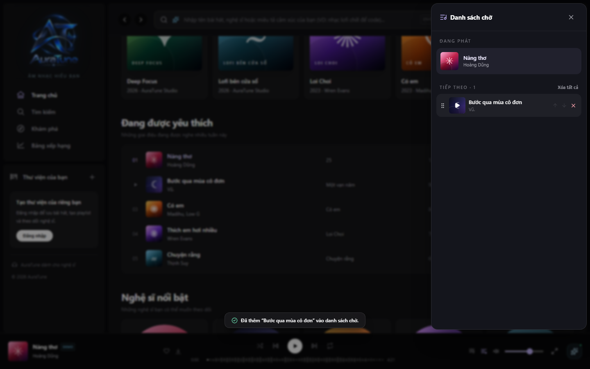
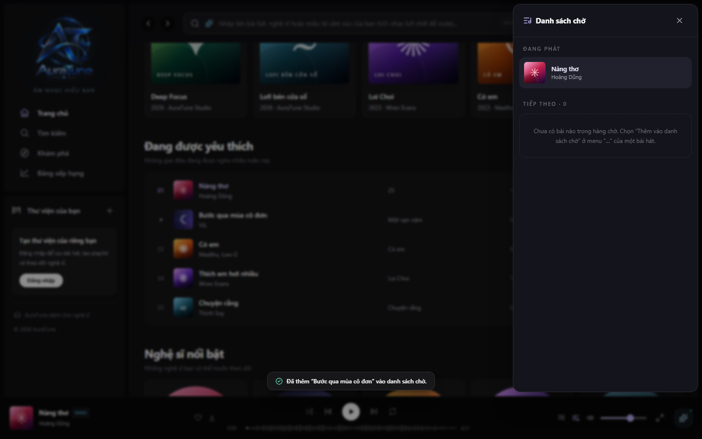

# UC-050-005 – Remove Track from Queue
Performed by: Nguyễn Thanh Huy | Reviewed by: Group 10 team | Edited by: Lê Công Minh Nhựt

---

## 1. Metadata
Performed by: Nguyễn Thanh Huy | Reviewed by: Group 10 team | Edited by: Lê Công Minh Nhựt

| Field | Value |
|---|---|
| **Use Case ID** | UC-050-005 |
| **Use Case Name** | Remove Track from Queue |
| **Functional Group** | 050 – Queue Management |
| **Primary Actor** | Guest / Visitor (`ACT-01`), Listener (`ACT-02`) |
| **Supporting Actors** | None |
| **Related FR IDs** | `052-FR-008`, `052-FR-009`, `052-FR-010`, `052-FR-011` |
| **Related Feature/Spec** | Feature 052: Add and Remove Queue Items (`specs/050-queue-management/052-add-and-remove-queue-items/spec.md`) |
| **Status** | Draft |
| Writer | Lê Công Minh Nhựt |
| Original Writer (PA3 draft) | Nguyễn Thanh Huy |
| Reviewer | Group 10 team |

---

## 2. Description
Performed by: Nguyễn Thanh Huy | Reviewed by: Group 10 team | Edited by: Lê Công Minh Nhựt

A guest or listener removes an upcoming track from the queue so that it does not play in the current listening session. Only upcoming tracks can be removed; the current track keeps playing.

---

## 3. Preconditions
Performed by: Nguyễn Thanh Huy | Reviewed by: Group 10 team | Edited by: Lê Công Minh Nhựt

- The queue panel is open (`UC-050-001`).
- At least one track is upcoming.

---

## 4. Trigger
Performed by: Nguyễn Thanh Huy | Reviewed by: Group 10 team | Edited by: Lê Công Minh Nhựt

The actor selects the remove control ("✕") on an upcoming track.

---

## 5. Basic Flow
Performed by: Nguyễn Thanh Huy | Reviewed by: Group 10 team | Edited by: Lê Công Minh Nhựt

1. **Actor:** Selects the remove control on an upcoming track (`052-FR-008`).
2. **System:** Removes the track from the queue.
3. **System:** Updates the upcoming list and count immediately (`052-FR-010`).
4. **System:** Keeps the current track playing without interruption and stores the updated queue in local browser storage (`052-FR-011`).

---

## 6. Alternative Flows
Performed by: Nguyễn Thanh Huy | Reviewed by: Group 10 team | Edited by: Lê Công Minh Nhựt

### AF-01 – Remove the Last Upcoming Track
Performed by: Nguyễn Thanh Huy | Reviewed by: Group 10 team | Edited by: Lê Công Minh Nhựt
- **Starting step:** Step 3 of the Basic Flow.
- **Condition:** The removed track was the only upcoming track.
1. **System:** Shows the empty queue guidance and hides the clear action (`051-FR-007`).
- **Continuation:** Use case ends successfully.

### AF-02 – Remove During a Track Transition
Performed by: Nguyễn Thanh Huy | Reviewed by: Group 10 team | Edited by: Lê Công Minh Nhựt
- **Starting step:** Step 2 of the Basic Flow.
- **Condition:** The current track ends at the same moment.
1. **System:** Selects the next track from the updated list.
- **Continuation:** Resumes at Step 3 of the Basic Flow.

---

## 7. Exception Flows
Performed by: Nguyễn Thanh Huy | Reviewed by: Group 10 team | Edited by: Lê Công Minh Nhựt

### EF-01 – Attempt to Remove the Current Track
Performed by: Nguyễn Thanh Huy | Reviewed by: Group 10 team | Edited by: Lê Công Minh Nhựt
- **Starting step:** Step 1 of the Basic Flow.
- **Condition:** The actor tries to remove the track that is playing now (`052-FR-009`).
1. **System:** Offers no remove control for the current track, so it cannot be removed.
- **Continuation:** Use case ends with no change.

---

## 8. Postconditions
Performed by: Nguyễn Thanh Huy | Reviewed by: Group 10 team | Edited by: Lê Công Minh Nhựt

### Success
Performed by: Nguyễn Thanh Huy | Reviewed by: Group 10 team | Edited by: Lê Công Minh Nhựt
- The removed track is no longer in the queue, and the count is decreased by one.
- Current playback continued without interruption.

### Failure
Performed by: Nguyễn Thanh Huy | Reviewed by: Group 10 team | Edited by: Lê Công Minh Nhựt
- The queue is unchanged.

---

## 9. Special Requirements
Performed by: Nguyễn Thanh Huy | Reviewed by: Group 10 team | Edited by: Lê Công Minh Nhựt

- **Efficiency**: Removing a track takes 1 interaction in the queue panel.
- **Accessibility**: Each remove control has an accessible name that includes the track title.

---

## 10. Prototype and Screenshots
Performed by: Nguyễn Thanh Huy | Reviewed by: Group 10 team | Edited by: Lê Công Minh Nhựt

> **Asset type**: Implementation screenshots captured from the current frontend prototype, which runs on demo data.

### Basic Flow
Performed by: Nguyễn Thanh Huy | Reviewed by: Group 10 team | Edited by: Lê Công Minh Nhựt

*Figure 1: Remove control on an upcoming track (Step 1).*

### Alternative Flow – AF-01 (Last Upcoming Track Removed)
Performed by: Nguyễn Thanh Huy | Reviewed by: Group 10 team | Edited by: Lê Công Minh Nhựt

*Figure 2: Empty queue guidance after the last upcoming track was removed.*

---

## 11. Related Use Cases
Performed by: Nguyễn Thanh Huy | Reviewed by: Group 10 team | Edited by: Lê Công Minh Nhựt

- **Extends**: `UC-050-001` (View Playback Queue).
- **Related Action**: `UC-050-006` (Clear Upcoming Queue) – Removes all upcoming tracks at once.

---

## 12. Source References
Performed by: Nguyễn Thanh Huy | Reviewed by: Group 10 team | Edited by: Lê Công Minh Nhựt

- `specs/050-queue-management/052-add-and-remove-queue-items/spec.md` – Requirements FR-008 to FR-011, User Story 2, Edge Cases.
- `docs/proposal/proposal.md` – Section 6.5: Queue Management.

---

## 13. Notes and Open Questions
Performed by: Nguyễn Thanh Huy | Reviewed by: Group 10 team | Edited by: Lê Công Minh Nhựt

- None.

## PA4 implementation evidence and acceptance record
Performed by: Nguyễn Thanh Huy | Reviewed by: Group 10 team | Edited by: Lê Công Minh Nhựt

Queue operations are implemented through the player hook and `QueuePanel.jsx`. Verify queue ordering and current-track continuity in the browser. Exporting the queue also depends on the real playlist persistence path; local queue behavior alone does not verify the saved playlist.

The flows above state required behavior. This revision records source inspection only; no browser acceptance or new feature-test run is claimed. Before acceptance, execute the basic flow and its applicable alternative/exception flows, checking the documented success and failure postconditions. Record results against this UC ID in [the PA4 review register](../../use-case-model.md#11-pa4-decisions-and-source-review).
