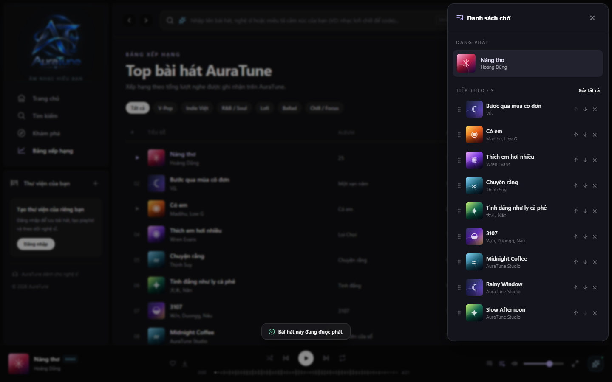
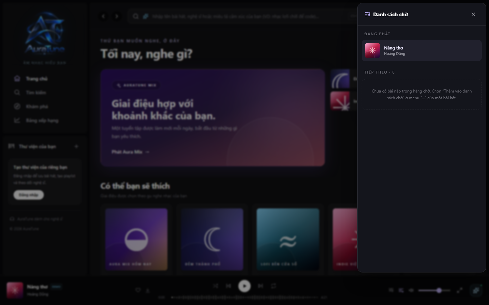

# UC-050-006 – Clear Upcoming Queue

---

## 1. Metadata

| Field | Value |
|---|---|
| **Use Case ID** | UC-050-006 |
| **Use Case Name** | Clear Upcoming Queue |
| **Functional Group** | 050 – Queue Management |
| **Primary Actor** | Guest / Visitor (`ACT-01`), Listener (`ACT-02`) |
| **Supporting Actors** | None |
| **Related FR IDs** | `051-FR-006`, `051-FR-007` |
| **Related Feature/Spec** | Feature 051: View Queue (`specs/050-queue-management/051-view-queue/spec.md`) |
| **Status** | Draft |
| **Writer** | Nguyễn Thanh Huy |
| **Reviewer** | TBD |

---

## 2. Description

A guest or listener removes all upcoming tracks at once to start building the queue again. The current track keeps playing, and the panel shows guidance on adding new tracks.

---

## 3. Preconditions

- The queue panel is open (`UC-050-001`).
- At least one track is upcoming.

---

## 4. Trigger

The actor selects "Xóa tất cả" in the queue panel.

---

## 5. Basic Flow

1. **Actor:** Selects "Xóa tất cả" (`051-FR-006`).
2. **System:** Removes all upcoming tracks from the queue.
3. **System:** Keeps the current track playing without interruption (`051-FR-006`).
4. **System:** Shows the empty queue guidance and hides the clear action (`051-FR-007`).
5. **System:** Stores the updated queue, containing only the current track, in local browser storage.

---

## 6. Alternative Flows

### AF-01 – Start Building a New Queue
- **Starting step:** Step 4 of the Basic Flow.
- **Condition:** The actor wants to queue new music.
1. **Actor:** Adds tracks from a track menu.
- **Continuation:** Use case ends; the actor continues in `UC-050-002` or `UC-050-003`.

---

## 7. Exception Flows

### EF-01 – Nothing to Clear
- **Starting step:** Step 1 of the Basic Flow.
- **Condition:** No tracks are upcoming (`051-FR-007`).
1. **System:** Hides the clear action, so the use case cannot start.
- **Continuation:** Use case ends with no change.

---

## 8. Postconditions

### Success
- The queue contains only the current track, and the upcoming count is 0.
- Current playback continued without interruption.

### Failure
- The queue is unchanged.

---

## 9. Special Requirements

- **Efficiency**: Clearing takes 1 interaction.
- **Safety**: The current track is never removed by this action.

---

## 10. Prototype and Screenshots

> **Asset type**: Implementation screenshots captured from the current frontend prototype, which runs on demo data.

### Basic Flow

*Figure 1: "Xóa tất cả" shown while upcoming tracks exist (Step 1).*

*Figure 2: Empty queue guidance after clearing, with the current track kept (Step 4).*

---

## 11. Related Use Cases

- **Extends**: `UC-050-001` (View Playback Queue).
- **Related Action**: `UC-050-005` (Remove Track from Queue).
- **Following Use Cases**: `UC-050-002` (Add Track to Queue), `UC-050-003` (Play Track Next).

---

## 12. Source References

- `specs/050-queue-management/051-view-queue/spec.md` – Requirements FR-006 and FR-007, User Story 3.
- `docs/proposal/proposal.md` – Section 6.5: Queue Management.

---

## 13. Notes and Open Questions

- **Confirmation**: The specification does not require a confirmation dialog before clearing. Adding one would need a specification change.
