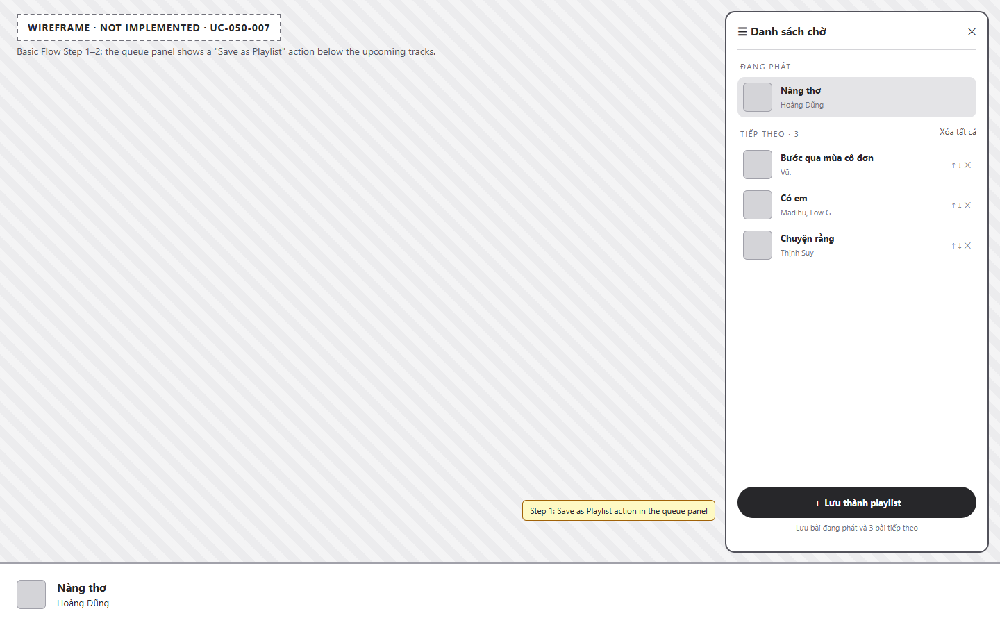
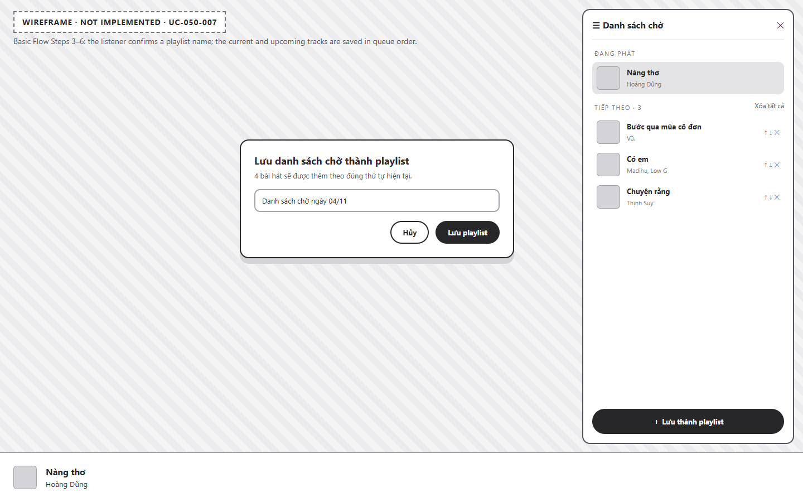
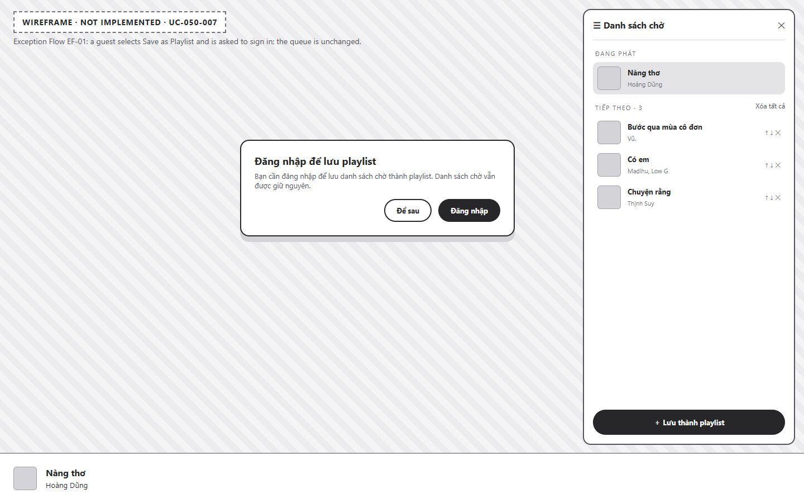

# UC-050-007 – Save Queue as Playlist

---

## 1. Metadata

| Field | Value |
|---|---|
| **Use Case ID** | UC-050-007 |
| **Use Case Name** | Save Queue as Playlist |
| **Functional Group** | 050 – Queue Management |
| **Primary Actor** | Listener (`ACT-02`) |
| **Supporting Actors** | None |
| **Related FR IDs** | `051-FR-012` |
| **Related Feature/Spec** | Feature 051: View Queue (`specs/050-queue-management/051-view-queue/spec.md`) |
| **Status** | Draft |
| **Writer** | Nguyễn Thanh Huy |
| **Reviewer** | TBD |

---

## 2. Description

A signed-in listener saves the current track and all upcoming tracks as a new permanent playlist, so that a listening session built in the queue can be kept and replayed later. The playlist is created through Group 060 – Playlist Management. Guests are asked to sign in first.

> **UI Status**: This capability is specified (`051-FR-012`, clarification session 2026-11-01) but **not implemented** in the current frontend. The images in Section 10 are wireframes made for this use case, not screenshots.

---

## 3. Preconditions

- The queue panel is open (`UC-050-001`).
- The queue contains at least one track.
- For the Basic Flow, the actor is signed in as a `Listener` (`ACT-02`) (`UC-010-002`).

---

## 4. Trigger

The actor selects "Lưu thành playlist" in the queue panel.

---

## 5. Basic Flow

1. **Actor:** Selects "Lưu thành playlist" in the queue panel (`051-FR-012`).
2. **System:** Verifies that the actor is signed in.
3. **System:** Opens a dialog that states how many tracks will be saved and proposes a default playlist name.
4. **Actor:** Keeps or edits the playlist name and confirms.
5. **System:** Creates a new playlist owned by the listener containing the current track and all upcoming tracks, in queue order, through Group 060 (`UC-060-001`).
6. **System:** Shows a confirmation with a link to the new playlist.
7. **System:** Leaves the queue and current playback unchanged.

---

## 6. Alternative Flows

### AF-01 – Cancel Saving
- **Starting step:** Step 4 of the Basic Flow.
- **Condition:** The actor closes the dialog or selects cancel.
1. **System:** Closes the dialog without creating a playlist.
- **Continuation:** Use case ends with no change.

### AF-02 – Open the New Playlist
- **Starting step:** Step 6 of the Basic Flow.
- **Condition:** The actor selects the link in the confirmation.
1. **System:** Opens the new playlist's details page.
- **Continuation:** Use case ends successfully; the actor continues in `UC-060-002` (View Playlist Details).

---

## 7. Exception Flows

### EF-01 – Guest Attempts to Save
- **Starting step:** Step 2 of the Basic Flow.
- **Condition:** The actor is not signed in (`051-FR-012`).
1. **System:** Asks the actor to sign in and keeps the queue unchanged.
2. **Actor:** Signs in through `UC-010-002`, or dismisses the prompt.
- **Continuation:** Resumes at Step 3 of the Basic Flow after sign-in; otherwise the use case ends with no change.

### EF-02 – Invalid Playlist Name
- **Starting step:** Step 4 of the Basic Flow.
- **Condition:** The name is empty or breaks the playlist naming rules of Group 060.
1. **System:** Shows a validation message and keeps the dialog open with the entered text.
- **Continuation:** Resumes at Step 4 of the Basic Flow.

### EF-03 – Playlist Cannot Be Created
- **Starting step:** Step 5 of the Basic Flow.
- **Condition:** The playlist service fails or the connection is lost.
1. **System:** Shows an error message with a retry option and keeps the dialog and name.
2. **Actor:** Retries or cancels.
- **Continuation:** Resumes at Step 5 on retry; otherwise continues via AF-01.

### EF-04 – Unavailable Tracks in the Queue
- **Starting step:** Step 5 of the Basic Flow.
- **Condition:** Some queued tracks have become unavailable.
1. **System:** Saves only the available tracks and tells the listener how many were saved.
- **Continuation:** Resumes at Step 6 of the Basic Flow.

---

## 8. Postconditions

### Success
- A new playlist owned by the listener exists and contains the queued tracks in queue order.
- The queue and current playback are unchanged.

### Failure
- No playlist is created, and the queue and current playback are unchanged.

---

## 9. Special Requirements

- **Security**: Only signed-in listeners can create the playlist; ownership is verified by the server.
- **Integrity**: Track order in the playlist matches the queue order at the moment of saving.
- **Capacity**: At most 50 tracks can be saved, because the queue is limited to 50 tracks (`051-FR-013`).

---

## 10. Prototype and Screenshots

> **Asset type**: Conceptual wireframes created for this use case. The feature is not implemented in `src/frontend/`, so these images must be replaced with implementation screenshots after the UI is built.

### Basic Flow

*Figure 1: Wireframe of the "Lưu thành playlist" action in the queue panel (Steps 1–2).*

*Figure 2: Wireframe of the dialog that confirms the playlist name (Steps 3–4).*

### Exception Flow – EF-01 (Guest Attempts to Save)

*Figure 3: Wireframe of the sign-in prompt shown to a guest.*

### Exception Flows – EF-02 and EF-03
*[Prototype Pending - To be generated during UI implementation]*  
*Planned Interface: Name validation message and creation error with retry.*

---

## 11. Related Use Cases

- **Extends**: `UC-050-001` (View Playback Queue).
- **Extends**: `UC-060-001` (Create Playlist) – As recorded in the use-case model (`<<extend>>`).
- **Preceding Use Case for EF-01**: `UC-010-002` (Log In with Email and Password).
- **Following Use Case**: `UC-060-002` (View Playlist Details).

---

## 12. Source References

- `specs/050-queue-management/051-view-queue/spec.md` – FR-012 and Clarification session 2026-11-01.
- `specs/060-playlist-management/061-playlist-crud/spec.md` – Playlist creation rules.
- `docs/requirements/use-case-model.md` – Relationship `UC-050-007` <<extend>> `UC-060-001`.
- `docs/analysis-and-design/api-contract.md` – Section 2.6: `POST /playlists`, `POST /playlists/:id/songs`.

---

## 13. Notes and Open Questions

- **UI Pending**: Replace the wireframes with implementation screenshots once the action is built.
- **Default Name**: The specification does not define the default playlist name. The wireframe uses "Danh sách chờ ngày <date>" as an example only.
- **Single Request**: Whether the client creates the playlist and adds tracks in one request or two follows the API Contract chosen by Group 060.
