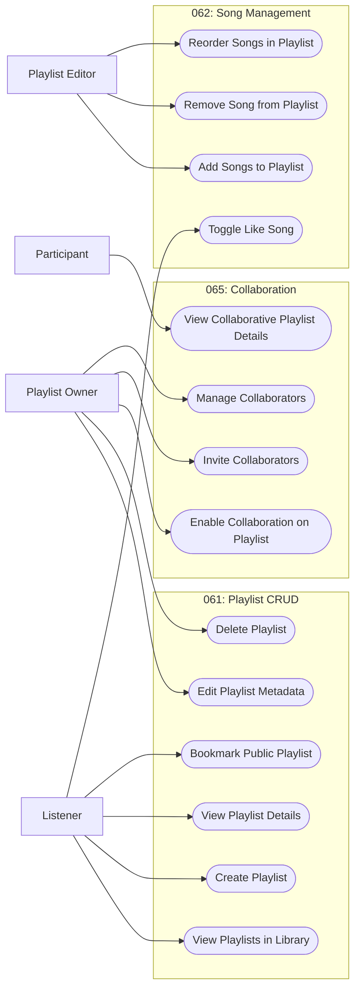

# 060 – Playlist Management

## 1. Group Overview

| Field | Description |
|---|---|
| Group ID | 060 |
| Group Name | Playlist Management |
| Group Owner | Mai Đăng Khoa |
| Purpose | Core management of user-created playlists and song curation. |
| Status | In Progress |

## 2. Scope

### 2.1 In Scope
- Creating, viewing, updating, and deleting playlists.
- Managing songs within playlists (add, remove, reorder).
- Liked Songs integration.
- Bookmarking public playlists.
- Collaborative playlist features (inviting and managing collaborators).

### 2.2 Out of Scope
- AI-based playlist generation (covered by 064).
- Advanced social sharing features (covered by 040-social-features).
- Playing songs (covered by 050-player-engine).

## 3. Requirement and Feature Traceability

| Feature ID | Feature Name | Related FR IDs | Spec Kit Specification |
|---|---|---|---|
| 061-playlist-crud | Playlist CRUD | FR-001 to FR-010 | [specs/060-playlist-management/061-playlist-crud/spec.md](../../../../specs/060-playlist-management/061-playlist-crud/spec.md) |
| 062-playlist-song-management | Playlist Song Management | FR-062-01 to FR-062-08 | [specs/060-playlist-management/062-playlist-song-management/spec.md](../../../../specs/060-playlist-management/062-playlist-song-management/spec.md) |
| 065-collaborative-playlists | Collaborative Playlists | FR-065-01 to FR-065-10 | [specs/060-playlist-management/065-collaborative-playlists/spec.md](../../../../specs/060-playlist-management/065-collaborative-playlists/spec.md) |

## 4. Actors

| Actor | Actor Type | Description | Goals |
|---|---|---|---|
| Listener | Primary | Authenticated user who listens to music. | Organize and curate music collections. |
| Playlist Owner | Primary | Listener who created a specific playlist. | Manage metadata and access control of their playlist. |
| Playlist Editor | Primary | Owner or collaborator with edit rights. | Modify the content of a playlist. |
| Participant | Primary | User who joined a collaborative playlist. | Contribute to a shared music collection. |

## 5. Use-Case Diagram

## 6. Use-Case Summary

| UC ID | Use-Case Name | Primary Actor | Related FR IDs | Specification |
|---|---|---|---|---|
| UC-060-001 | View Playlists in Library | Listener | FR-004 | [./UC-060-001-view-playlists-in-library.md](./UC-060-001-view-playlists-in-library.md) |
| UC-060-002 | Create Playlist | Listener | FR-001, FR-002, FR-003, FR-009 | [./UC-060-002-create-playlist.md](./UC-060-002-create-playlist.md) |
| UC-060-003 | View Playlist Details | Listener | FR-005, FR-006 | [./UC-060-003-view-playlist-details.md](./UC-060-003-view-playlist-details.md) |
| UC-060-004 | Edit Playlist Metadata | Playlist Owner | FR-007 | [./UC-060-004-edit-playlist-metadata.md](./UC-060-004-edit-playlist-metadata.md) |
| UC-060-005 | Delete Playlist | Playlist Owner | FR-008 | [./UC-060-005-delete-playlist.md](./UC-060-005-delete-playlist.md) |
| UC-060-006 | Bookmark Public Playlist | Listener | FR-010 | [./UC-060-006-bookmark-public-playlist.md](./UC-060-006-bookmark-public-playlist.md) |
| UC-060-007 | Add Songs to Playlist | Playlist Editor | FR-001 | [./UC-060-007-add-songs-to-playlist.md](./UC-060-007-add-songs-to-playlist.md) |
| UC-060-008 | Remove Song from Playlist | Playlist Editor | FR-005 | [./UC-060-008-remove-song-from-playlist.md](./UC-060-008-remove-song-from-playlist.md) |
| UC-060-009 | Reorder Songs in Playlist | Playlist Editor | FR-004 | [./UC-060-009-reorder-songs-in-playlist.md](./UC-060-009-reorder-songs-in-playlist.md) |
| UC-060-010 | Toggle Like Song | Listener | FR-002 | [./UC-060-010-toggle-like-song.md](./UC-060-010-toggle-like-song.md) |
| UC-060-011 | Enable Collaboration on Playlist | Playlist Owner | FR-065-01 | [./UC-060-011-enable-collaboration-on-playlist.md](./UC-060-011-enable-collaboration-on-playlist.md) |
| UC-060-012 | Invite Collaborators | Playlist Owner | FR-065-02, FR-065-03 | [./UC-060-012-invite-collaborators.md](./UC-060-012-invite-collaborators.md) |
| UC-060-013 | Manage Collaborators | Playlist Owner | FR-065-07 | [./UC-060-013-manage-collaborators.md](./UC-060-013-manage-collaborators.md) |
| UC-060-014 | View Collaborative Playlist Details | Participant | FR-065-04, FR-065-05, FR-065-10 | [./UC-060-014-view-collaborative-playlist-details.md](./UC-060-014-view-collaborative-playlist-details.md) |

## 7. Prototype Summary

| UC ID | Basic Flow Prototype | Alternative Flow Prototypes | Notes |
|---|---|---|---|
| UC-060-001 | ../../../../specs/060-playlist-management/061-playlist-crud/ui/01-playlist-list.png | N/A | Implemented UI |
| UC-060-002 | ../../../../specs/060-playlist-management/061-playlist-crud/ui/02-create-playlist.png | N/A | Implemented UI |
| UC-060-003 | ../../../../specs/060-playlist-management/061-playlist-crud/ui/03-playlist-details.png | N/A | Implemented UI |
| UC-060-004 | ../../../../specs/060-playlist-management/061-playlist-crud/ui/04-edit-playlist.png | N/A | Implemented UI |
| UC-060-005 | ../../../../specs/060-playlist-management/061-playlist-crud/ui/05-delete-playlist.png | N/A | Implemented UI |
| UC-060-007 | ../../../../specs/060-playlist-management/062-playlist-song-management/ui/02-add-songs.png | N/A | Implemented UI |
| UC-060-008 | ../../../../specs/060-playlist-management/062-playlist-song-management/ui/03-remove-song.png | N/A | Implemented UI |
| UC-060-011 | ../../../../specs/060-playlist-management/065-collaborative-playlists/ui/01-collaborative-playlist-entry.png | N/A | Implemented UI |
| UC-060-012 | ../../../../specs/060-playlist-management/065-collaborative-playlists/ui/02-invite-collaborators.png | N/A | Implemented UI |
| UC-060-013 | ../../../../specs/060-playlist-management/065-collaborative-playlists/ui/04-collaborative-members.png | N/A | Implemented UI |
| UC-060-014 | ../../../../specs/060-playlist-management/065-collaborative-playlists/ui/03-shared-playlist.png | N/A | Implemented UI |

## 8. Open Issues and Decisions

| ID | Issue / Decision Needed | Impacted UC/FR | Owner | Status |
|---|---|---|---|---|
| D-060-01 | Concurrent edits policy | UC-060-004 | Admin | Resolved | Last write wins. |
| D-060-02 | Collaborative permissions | UC-060-014 | Admin | Resolved | All collaborators can add/remove/reorder. |

## 9. Review Record

| Reviewer | Review Date | Result | Summary of Changes |
|---|---|---|---|
| [FULL NAME] | 2026-11-03 | Draft | Initial creation. |
