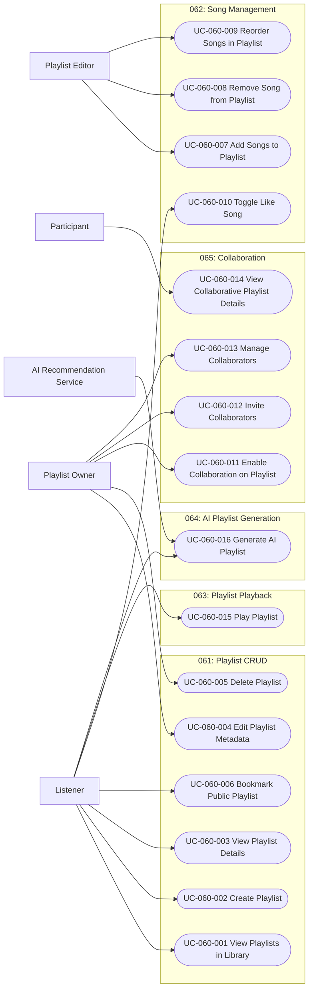

# 060 – Playlist Management

## 1. Group Overview

| Field | Description |
|---|---|
| Group ID | 060 |
| Group Name | Playlist Management |
| Group Owner | Mai Đăng Khoa |
| Purpose | Core management of user-created playlists and song curation. |
| Status | In Progress |

## 2. Scope

### 2.1 In Scope
- Creating, viewing, updating, and deleting playlists.
- Managing songs within playlists (add, remove, reorder).
- Liked Songs integration.
- Bookmarking public playlists.
- Collaborative playlist features (inviting and managing collaborators).
- Playlist playback and AI-assisted playlist generation (features 063 and 064).

### 2.2 Out of Scope
- Advanced social sharing features (covered by 040-social-features).

## 3. Requirement and Feature Traceability

| Feature ID | Feature Name | Related FR IDs | Spec Kit Specification |
|---|---|---|---|
| 061-playlist-crud | Playlist CRUD | 061-FR-001 to 061-FR-010 | [specs/060-playlist-management/061-playlist-crud/spec.md](../../../../specs/060-playlist-management/061-playlist-crud/spec.md) |
| 062-playlist-song-management | Playlist Song Management | 062-FR-001 to 062-FR-008 | [specs/060-playlist-management/062-playlist-song-management/spec.md](../../../../specs/060-playlist-management/062-playlist-song-management/spec.md) |
| 063-playlist-playback | Playlist Playback | 063-FR-001 to 063-FR-009 | [specs/060-playlist-management/063-playlist-playback/spec.md](../../../../specs/060-playlist-management/063-playlist-playback/spec.md) |
| 064-ai-playlist-generation | AI Playlist Generation | 064-FR-001 to 064-FR-010 | [specs/060-playlist-management/064-ai-playlist-generation/spec.md](../../../../specs/060-playlist-management/064-ai-playlist-generation/spec.md) |
| 065-collaborative-playlists | Collaborative Playlists | 065-FR-001 to 065-FR-010 | [specs/060-playlist-management/065-collaborative-playlists/spec.md](../../../../specs/060-playlist-management/065-collaborative-playlists/spec.md) |

## 4. Actors

| Actor | Actor Type | Description | Goals |
|---|---|---|---|
| Listener | Primary | Authenticated user who listens to music. | Organize and curate music collections. |
| Playlist Owner | Primary | Listener who created a specific playlist. | Manage metadata and access control of their playlist. |
| Playlist Editor | Primary | Owner or collaborator with edit rights. | Modify the content of a playlist. |
| Participant | Primary | User who joined a collaborative playlist. | Contribute to a shared music collection. |
| AI Recommendation Service | Supporting | Service that returns generated track proposals. | Suggest tracks matching a listener's prompt. |

## 5. Use-Case Diagram

## 6. Use-Case Summary

| UC ID | Use-Case Name | Primary Actor | Related FR IDs | Specification |
|---|---|---|---|---|
| UC-060-001 | View Playlists in Library | Listener | 061-FR-004, 061-FR-010, 062-FR-002 | [./UC-060-001-view-playlists-in-library.md](./UC-060-001-view-playlists-in-library.md) |
| UC-060-002 | Create Playlist | Listener | 061-FR-001, 061-FR-002, 061-FR-003, 061-FR-009 | [./UC-060-002-create-playlist.md](./UC-060-002-create-playlist.md) |
| UC-060-003 | View Playlist Details | Listener | 061-FR-005, 061-FR-006; 065-FR-010 | [./UC-060-003-view-playlist-details.md](./UC-060-003-view-playlist-details.md) |
| UC-060-004 | Edit Playlist Metadata | Playlist Owner | 061-FR-007; 065-FR-006 | [./UC-060-004-edit-playlist-metadata.md](./UC-060-004-edit-playlist-metadata.md) |
| UC-060-005 | Delete Playlist | Playlist Owner | 061-FR-008; 065-FR-006 | [./UC-060-005-delete-playlist.md](./UC-060-005-delete-playlist.md) |
| UC-060-006 | Bookmark Public Playlist | Listener | 061-FR-010 | [./UC-060-006-bookmark-public-playlist.md](./UC-060-006-bookmark-public-playlist.md) |
| UC-060-007 | Add Songs to Playlist | Playlist Editor | 062-FR-001, 062-FR-003, 062-FR-006, 062-FR-007, 062-FR-008, 065-FR-004, 065-FR-008 | [./UC-060-007-add-songs-to-playlist.md](./UC-060-007-add-songs-to-playlist.md) |
| UC-060-008 | Remove Song from Playlist | Playlist Editor | 062-FR-005, 062-FR-006, 062-FR-007, 065-FR-004, 065-FR-008 | [./UC-060-008-remove-song-from-playlist.md](./UC-060-008-remove-song-from-playlist.md) |
| UC-060-009 | Reorder Songs in Playlist | Playlist Editor | 062-FR-003, 062-FR-004, 062-FR-007, 065-FR-004, 065-FR-008 | [./UC-060-009-reorder-songs-in-playlist.md](./UC-060-009-reorder-songs-in-playlist.md) |
| UC-060-010 | Toggle Like Song | Listener | 062-FR-002 | [./UC-060-010-toggle-like-song.md](./UC-060-010-toggle-like-song.md) |
| UC-060-011 | Enable Collaboration on Playlist | Playlist Owner | 065-FR-001, 065-FR-009 | [./UC-060-011-enable-collaboration-on-playlist.md](./UC-060-011-enable-collaboration-on-playlist.md) |
| UC-060-012 | Invite Collaborators | Playlist Owner | 065-FR-002, 065-FR-003, 065-FR-009 | [./UC-060-012-invite-collaborators.md](./UC-060-012-invite-collaborators.md) |
| UC-060-013 | Manage Collaborators | Playlist Owner | 065-FR-007, 065-FR-009 | [./UC-060-013-manage-collaborators.md](./UC-060-013-manage-collaborators.md) |
| UC-060-014 | View Collaborative Playlist Details | Participant | 065-FR-004, 065-FR-005, 065-FR-009, 065-FR-010 | [./UC-060-014-view-collaborative-playlist-details.md](./UC-060-014-view-collaborative-playlist-details.md) |
| UC-060-015 | Play Playlist | Listener | 063-FR-001 through 063-FR-009 | [./UC-060-015-play-playlist.md](./UC-060-015-play-playlist.md) |
| UC-060-016 | Generate AI Playlist | Listener | 064-FR-001 through 064-FR-010 | [./UC-060-016-generate-ai-playlist.md](./UC-060-016-generate-ai-playlist.md) |

## 7. Prototype Summary

| UC ID | Basic Flow Prototype | Alternative Flow Prototypes | Notes |
|---|---|---|---|
| UC-060-001 | ../../../../specs/060-playlist-management/061-playlist-crud/ui/01-playlist-list.png | N/A | Implemented UI |
| UC-060-002 | ../../../../specs/060-playlist-management/061-playlist-crud/ui/02-create-playlist.png | N/A | Implemented UI |
| UC-060-003 | ../../../../specs/060-playlist-management/061-playlist-crud/ui/03-playlist-details.png | N/A | Implemented UI |
| UC-060-004 | ../../../../specs/060-playlist-management/061-playlist-crud/ui/04-edit-playlist.png | N/A | Implemented UI |
| UC-060-005 | ../../../../specs/060-playlist-management/061-playlist-crud/ui/05-delete-playlist.png | N/A | Implemented UI |
| UC-060-006 | N/A | N/A | Bookmarking UI prototype not present in the feature assets. |
| UC-060-007 | ../../../../specs/060-playlist-management/062-playlist-song-management/ui/02-add-songs.png | N/A | Implemented UI |
| UC-060-008 | ../../../../specs/060-playlist-management/062-playlist-song-management/ui/03-remove-song.png | N/A | Implemented UI |
| UC-060-009 | ../../../../specs/060-playlist-management/062-playlist-song-management/ui/01-playlist-tracklist.png | N/A | Tracklist UI; a distinct reordered state is not present. |
| UC-060-010 | N/A | N/A | Like toggle prototype not present in the feature assets. |
| UC-060-011 | ../../../../specs/060-playlist-management/065-collaborative-playlists/ui/01-collaborative-playlist-entry.png | N/A | Implemented UI |
| UC-060-012 | ../../../../specs/060-playlist-management/065-collaborative-playlists/ui/02-invite-collaborators.png | N/A | Implemented UI |
| UC-060-013 | ../../../../specs/060-playlist-management/065-collaborative-playlists/ui/04-collaborative-members.png | N/A | Implemented UI |
| UC-060-014 | ../../../../specs/060-playlist-management/065-collaborative-playlists/ui/03-shared-playlist.png | N/A | Implemented UI |
| UC-060-015 | ../../../../specs/060-playlist-management/063-playlist-playback/ui/01-playlist-play-button.png | ../../../../specs/060-playlist-management/063-playlist-playback/ui/03-playlist-track-playing.png | Implemented UI; shuffle/add-to-queue states not shown. |
| UC-060-016 | ../../../../specs/060-playlist-management/064-ai-playlist-generation/ui/01-ai-playlist-entry.png | ../../../../specs/060-playlist-management/064-ai-playlist-generation/ui/03-ai-playlist-results.png | Implemented UI; save and unavailable-service states not shown here. |

## 8. Open Issues and Decisions

| ID | Issue / Decision Needed | Impacted UC/FR | Owner | Status |
|---|---|---|---|---|
| D-060-01 | Concurrent edits policy: last write wins. | UC-060-004 | Admin | Resolved |
| D-060-02 | Collaborative permissions: all authorized collaborators can add/remove/reorder. | UC-060-014 | Admin | Resolved |
| Q-060-01 | Use 063 functional requirements and clarifications as the behavioral baseline; the reconstructed UI note is narrower and does not supersede them. | UC-060-015 | Group Owner | Resolved |
| Q-060-02 | 064-FR-006 allows removing/reordering proposed tracks and renaming the proposed playlist; track metadata cannot be renamed. | UC-060-016 | Group Owner | Resolved |
| Q-060-03 | 061-FR-010 and its clarification specify saving/following a read-only reference, but do not require removing it. Exclude unfollow behavior from this UC unless a requirement is added. | UC-060-006 | Group Owner | Resolved |

## 9. Review Record

| Reviewer | Review Date | Result | Summary of Changes |
|---|---|---|---|
| [FULL NAME] | 2026-11-03 | Draft | Initial creation. |
